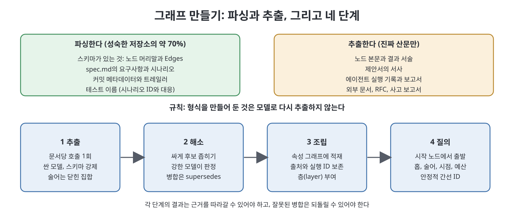

# 8장 그래프 만들기 (Building the Graph)

2부에서 그린 구조(래티스, 메타그래프, 스키마)는 누군가 읽고 쓰기 전까지는 죽어 있는 설계도다. 8장은 그 설계도에 실제 데이터를 채우는 방법, 곧 추출(extraction), 해소(resolution), 조립(assembly), 질의(query)의 네 단계를 다룬다. 책이 강조하는 차이는 입력에 있다. 교과서적인 지식 그래프 구축은 문서 더미를 처리하지만, 이 책의 대상은 이미 상당 부분 구조화된 저장소(repository)다. 그래서 이 장의 핵심 질문은 "무엇을 모델에게 맡기고, 무엇을 그냥 파싱할 것인가"이다.

> **쉽게 말하면**
> 이미 형식이 있는 파일은 모델에게 다시 읽히지 말고 기계적으로 파싱한다. 모델은 진짜 글(산문)에만 쓰고, 그 결과를 합치고 검색하는 과정은 되돌릴 수 있게 만든다.

> **참고(노트 작성자)** 책은 2026년경의 에이전트 워크플로를 전제로 하며, 언급되는 도구(`lat.md`, OpenSpec 등)와 모델 호출 방식은 집필 시점 기준이다. 책의 코드는 옮기지 않고 구조만 재구성했다.

## 이 장의 흐름

1. 무엇을 파싱하고 무엇을 추출할 것인가
2. 1단계 추출: 스키마로 묶은 모델 호출
3. 2단계 해소: 같은 것은 합치고 다른 것은 나눈다
4. 3단계 조립과 4단계 질의
5. 이 파이프라인도 하나의 래칫이다
6. 정답 모음(gold set) 만들기

## 1. 무엇을 파싱하고 무엇을 추출할 것인가

책은 먼저 입력 소스를 둘로 나눈다. 스키마가 있으면 파싱하고, 자유로운 글이면 추출한다.

| 소스 | 방법 | 이유 |
|------|------|------|
| `lat.md` 노드의 머리말과 Edges | 파싱 | 이미 유형이 있고 명시적이다 |
| 스펙 파일의 요구사항과 시나리오 | 파싱 | 구분자가 정해져 있다 |
| 변경 설계서의 Lattice Footprint 절 | 파싱 | 설계상 구조화된 절이다 |
| 커밋 메타데이터와 트레일러 | 파싱 | 기계가 쓴 값이다 |
| 속성 테스트 파일 | 파싱 | 테스트 이름이 시나리오 ID와 대응한다 |
| 노드 본문, 제안서 서사, 실행 기록, 외부 문서 | 추출 | 자유로운 글이다 |

책은 성숙한 저장소의 약 70%는 파싱으로 해결된다고 말한다. 규칙은 한 줄이다. 스키마가 있는 것은 파싱하고, 진짜 산문만 추출하며, 형식을 직접 만들어 둔 것은 절대 다시 추출하지 않는다. 이를 어기면 비용과 신뢰성이 동시에 나빠진다. 예컨대 파일에 "A가 B를 함축한다"가 명시적으로 적혀 있는데도 모델에게 그 관계를 다시 뽑게 하면, 돈을 내고 0이 아닌 오류율을 사 오는 셈이다.

## 2. 1단계 추출

남은 산문에는 문서당 한 번, 싸고 빠른 모델을 부르되 출력 형식을 스키마로 강제한다. 책의 표현으로는 이 스키마가 시스템이 가진 유일한 "학습 데이터"다. 스키마는 개체(entity)와 관계(relation)로 이루어진다.

| 요소 | 필드 | 뜻 |
|------|------|-----|
| 개체 | 이름, 유형, 설명, 별칭, 범위 | 유형은 결정, 용어, 속성, 패턴, 규칙, 발견, 능력, 출처 중 하나 |
| 관계 | 출발, 술어, 도착, 신뢰도, 근거 | 술어는 대체, 함축, 제약, 정의, 준수 다섯 가지로 고정 |

책이 꼽는 성공의 네 가지 조건은 다음과 같다.

- **술어는 닫힌 집합으로 제한한다.** 자유 문자열이 아니라 열거형으로 받으면 모델이 여섯 번째 술어를 발명할 수 없다. 책은 이것이 7장의 닫힌 어휘 원칙을 입구에서 강제하는 것이며 파일 전체에서 효과가 가장 큰 한 줄이라고 한다.
- **설명(description)을 비우지 않는다.** 설명은 다음 단계인 해소가 쓰는 문맥 증거다. 설명이 빈 개체는 중복되거나 잘못 합쳐진다.
- **근거(evidence)로 관계를 감사 가능하게 한다.** 근거 구간이 원문에 실제로 있는지 검사하면 환각을 기계적으로 잡는다.
- **싼 모델로 한 문서에 한 번만 부른다.** 추출은 대량이고 기계적인 일이므로, 추론 예산은 결과를 바꾸는 해소 단계에 아낀다.

## 3. 2단계 해소

추출 결과는 깔끔한 그래프가 아니라 표면 형태의 모음이다. 같은 개념이 약어, 별칭, 옛 이름, 철자 변형으로 흩어져 나온다. 책은 "Edwin Aldrin"과 "Buzz Aldrin"이 글자는 안 겹치지만 같은 인물이라는 예로 문자열 유사도가 실패하는 이유를 보인다. 반대 방향의 실패는 더 나쁘다. 결제 능력의 `order`와 배송 능력의 `order`가 이름만 같고 다른 개념일 수 있는데, 이를 합치면 이후 모든 순회가 오염된다.

책이 제시하는 절차는 세 단계다.

1. **싸게 거른다.** 유형별로 묶고 임베딩, 공유 별칭, 6장에서 파생한 near 관계로 후보를 수백 개에서 십여 개로 좁힌다. near가 이 단계의 차단(blocking) 신호다.
2. **강한 모델이 판정한다.** 후보 묶음의 전체 설명과 범위를 주고 정규 그룹과 이유를 요구한다. 추론 과제라서 싼 모델은 이름 겹침만 보고 합친다.
3. **결정을 데이터로 남긴다.** 정규 개체는 별칭, 출처 문서, 해소 근거, 신뢰도, 병합을 수행한 실행(run)을 보존한다.

핵심 원칙은 해소가 추가적이고 점검 가능해야 한다는 것이다. 병합은 삭제가 아니라 출처 블록이 달린 대체(supersedes) 간선이다. 잘못된 병합을 되돌리는 일은 "대체를 다시 대체하는 것"이며, 7장의 불변식이 대체된 객체를 계속 주소 지정 가능하게 보장하므로 가능하다. 책은 압축률이 높다고 무조건 좋은 것이 아니라고 경고한다. 과잉 병합은 잘 연결되어 있지만 틀린 그래프를 만들고, 증상이 "답이 없음"이 아니라 "자신 있게 틀린 답"이라 훨씬 늦게 발견된다.

## 4. 3단계 조립과 4단계 질의

조립은 최소한의 출처를 담은 속성 그래프로 적재하는 일이다. 참조 구현은 5장의 SQLite 스키마지만 개념적으로는 노드(이름, 유형, 설명, 출처 문서, 별칭, 범위, 만든 실행)와 간선(술어, 출처 문서, 신뢰도, 근거, 단언한 실행, 유효 시작일)을 쌓는 것이다. 책은 두 가지를 덧붙인다.

- **필요할 때만 구체화(reification)한다.** 간선에 범위, 1.0 미만의 신뢰도, 유효 기간 같은 속성이 생기면 그때 단언 노드로 승격한다. 미리 승격하지 않아야 그래프가 읽힌다.
- **모든 노드에 층(layer)을 부여한다.** 기본 산출물은 0층, 단언은 1층, 단언에 대한 단언은 2층, 문맥과 정책 규칙은 3층이다. 9장의 컨텍스트 빌더가 층으로 거르므로 잘못 부여하면 곧바로 쓰레기가 섞인다.

질의의 원칙은 다중 홉 질의가 그래프 전체를 모델에게 쏟아붓지 않는다는 것이다. 시작 개체를 정하고, 유계(bounded) 이웃을 순회하고, 간선을 유형과 날짜로 거르고, 직렬화한다. 그러면 답이 간선 식별자를 인용할 수 있고, 근거 없는 진술은 평가자가 빠지거나 모순된 간선으로 짚어 낼 수 있다. 질의 함수에는 다섯 개의 손잡이가 있다.

| 손잡이 | 역할 | 책의 조언 |
|--------|------|-----------|
| hops | 순회 깊이 | 1~2. 3홉은 거의 항상 실수 |
| allowed | 허용 술어 | 6장의 실용적 근접성을 질의 시점에 적용 |
| as_of | 기준 시점 | "변경 당시 시행 중이던 것"을 유효 기간으로 답한다 |
| layers | 포함할 층 | 보통 0과 1. 2층은 감사용, 3층은 빌더 전용 |
| budget_tokens | 토큰 상한 | 넘치면 신뢰도 낮은 간선부터 버리고 그 사실을 출력에 적는다 |

직렬화 결과의 각 줄에는 `[e:0412]` 같은 안정적 간선 ID가 붙고, 잘려 나간 간선 수를 밝히는 줄이 따라온다. 책은 이 ID가 없으면 인용은 산문이고 검증은 느낌이라고 말한다. 9장의 근거 기반 평가자는 이 ID에 기댄다.

## 5. 이 파이프라인도 하나의 래칫이다

책은 이 파이프라인의 평가 장치가 2장의 래칫(ratchet)과 같은 모양이라고 짚는다. 프롬프트나 스키마를 하나 바꾸고, 정답 모음에서 정밀도, 재현율, F1, 비용, 지연을 계산해, 좋아지면 유지하고 나빠지면 되돌린다. 최적화 대상이 추출 프롬프트, 온톨로지, 해소 정책, 질의 직렬화기일 뿐이다. 검증 가능한 출력, 프롬프트 버전 관리, 1분 안에 도는 작은 정답 모음, 한 번에 한 구성요소라는 조건도 그대로다.

경고도 따라온다. 래칫은 눈에 보이는 지표만 개선한다. 개체 F1만 재면 과잉 병합된 개체 표와 8,000토큰으로 부푼 직렬화기가 남는다. 12장의 지표 표가 이 문제를 위해 있다고 책은 예고한다.

## 6. 정답 모음 만들기

팀들이 가장 자주 건너뛰는 단계다. 책은 문서 30개를 한 번 손으로 주석하는 작은 모음을 권하며, 대표적인 문서가 아니라 적대적인 문서를 고르라고 한다.

| 묶음 | 문서 수 | 시험하는 것 |
|------|--------|-------------|
| 같은 개념, 다른 이름 | 5 | 누락된 병합 |
| 다른 개념, 같은 이름(능력 간) | 5 | 거짓 병합 |
| 날짜가 모순되거나 대체된 사실 | 5 | 시간 처리 |
| 추출할 관계가 전혀 없는 문서 | 5 | 항상 관계를 찾는 추출기 |
| 평범한 문서 | 10 | 기본 성능 |

추출은 개체 정밀도, 재현율, F1, 스키마 유효 응답률, 비용, 지연으로, 해소는 압축률, 쌍별 정밀도와 재현율, 거짓 병합률, 누락 병합률, 수동 검토율로 잰다. 책은 이틀 오후의 주석 작업이 1년간 프롬프트를 자신 있게 바꿀 능력을 산다고 말한다.

## 핵심 정리

- 스키마가 있는 것은 파싱하고 진짜 산문만 추출한다. 성숙한 저장소의 약 70%는 파싱으로 끝난다.
- 추출은 싼 모델로 문서당 한 번, 술어는 닫힌 집합, 설명과 근거는 필수로 한다.
- 해소는 싸게 거르고, 강한 모델이 판정하며, 병합을 대체 간선과 출처로 남겨 되돌릴 수 있게 한다. 과잉 병합이 과소 병합보다 위험하다.
- 질의는 홉, 술어, 시점, 층, 토큰 예산 다섯 손잡이로 유계 부분그래프만 꺼내고, 안정적 간선 ID를 붙인다.
- 구축 파이프라인 자체가 래칫이므로 적대적으로 고른 30문서 정답 모음이 있어야 안전하게 개선할 수 있다.

 
 
 

이전: [7장 스키마](../02.%202%EB%B6%80%20%EA%B5%AC%EC%A1%B0/07%EC%9E%A5%20%EC%8A%A4%ED%82%A4%EB%A7%88.md) | 다음: [9장 컨텍스트 조립과 근거 기반 평가자](09%EC%9E%A5%20%EC%BB%A8%ED%85%8D%EC%8A%A4%ED%8A%B8%20%EC%A1%B0%EB%A6%BD%EA%B3%BC%20%EA%B7%BC%EA%B1%B0%20%EA%B8%B0%EB%B0%98%20%ED%8F%89%EA%B0%80%EC%9E%90.md)

 

[Graph Engineering - The Loop Memory Model](../)
