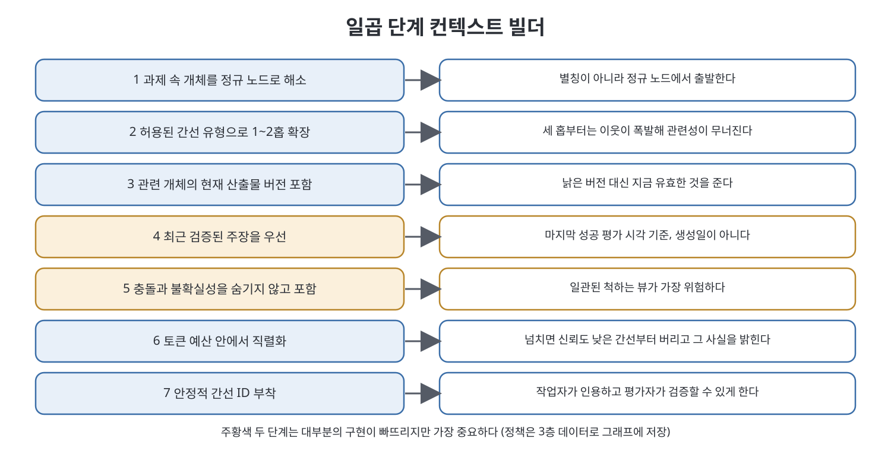
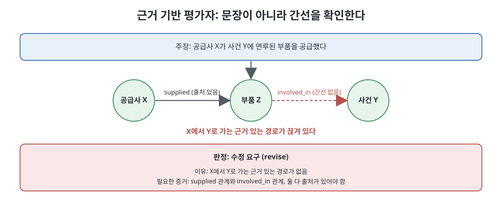

# 9장 컨텍스트 조립과 근거 기반 평가자 (Context Assembly and the Grounded Evaluator)

책이 "보상의 장"이라 부르는 장이다. 1부와 2부가 준비한 모든 것은 두 메커니즘으로 모인다. 하나는 작업자의 컨텍스트를 대화 기록이 아니라 그래프에서 조립하는 컨텍스트 조립(context assembly)이고, 다른 하나는 작업자의 결과물을 또 다른 모델의 취향이 아니라 그래프에 비춰 평가하는 근거 기반 평가자(grounded evaluator)다. 장 끝에는 이 방식이 해 줄 수 없는 것에 대한 솔직한 한계도 실려 있다.

> **쉽게 말하면**
> 지식 그래프는 "전부 들고 있다"가 장점이 아니라 "과제마다 다른 작은 조각을 싸고 근거 있게 꺼낼 수 있다"가 장점이다. 평가자는 글이 그럴듯한지가 아니라 필요한 간선이 실제로 있는지를 확인한다.

> **참고(노트 작성자)** 책은 2026년경 에이전트 워크플로(이른바 forge 파이프라인)를 전제로 하며, 단계 이름과 도구는 집필 시점 기준이다.

## 이 장의 흐름

1. 이 장이 막으려는 실패: 그래프를 새로운 컨텍스트 덤프로 쓰는 일
2. 일곱 단계 컨텍스트 빌더
3. 비평에서 점검으로: 그래프 기반 평가
4. forge 파이프라인에 적용한 네 가지 질문
5. 모델에게 남는 일
6. 다중 홉 답변은 경로까지 평가한다
7. 솔직한 한계

## 1. 이 장이 막으려는 실패

책은 먼저 프로젝트를 죽이는 실패를 말한다. 팀이 멋진 지식 그래프를 만들고는 전체를 직렬화해 모든 프롬프트에 넣는다. 그러면 작업자마다 4만 토큰의 온톨로지를 받고, 관련성은 묻히고, 비용은 오르며, 솔직히 잘 고른 2,000토큰짜리 CLAUDE.md가 더 낫다는 결론이 나온다. 책은 이것이 기본 결과일 만큼 흔하다고 말한다. 그래프의 가치는 모든 것을 담고 있다는 데 있지 않고, 작업마다 다른 작은 것을 싸고 방어 가능하게 꺼내 준다는 데 있다.

## 2. 일곱 단계 컨텍스트 빌더

작업자 한 명에게 필요한 것은 과제 전용 부분그래프다. 빌더는 다음 일곱 가지를 순서대로 한다.

| 단계 | 하는 일 | 왜 필요한가 |
|------|---------|-------------|
| 1 | 과제 문장 속 개체를 정규 노드로 해소 | 별칭이 아닌 정규 노드에서 시작 |
| 2 | 허용된 간선 유형으로 1~2홉 확장 | 이웃 폭발 방지 |
| 3 | 관련 개체의 현재 산출물 버전 포함 | 낡은 버전 배제 |
| 4 | 최근에 검증된 주장을 우선 | 오래 방치된 주장과의 경쟁 방지 |
| 5 | 충돌과 불확실성을 포함 | 작업자가 모호함을 알리고 상향할 수 있게 함 |
| 6 | 토큰 예산 안에서 직렬화 | 비용 통제 |
| 7 | 안정적 간선 ID 부착 | 인용과 검증 |

책은 4단계와 5단계가 대부분의 구현에서 빠지지만 가장 중요하다고 강조한다.

- **4단계, 최근 검증된 주장을 우선한다.** 그래프는 쌓이기만 한다. 최신순과 신뢰도 순서가 없으면, 2년 된 채 아무 평가도 받지 않은 주장이 어제 확인된 주장과 같은 자리를 놓고 다툰다. 정렬 기준은 생성일이 아니라 마지막으로 평가에 성공한 시점이다.
- **5단계, 충돌과 불확실성을 숨기지 않는다.** 일관되고 깨끗한 뷰를 주고 싶은 본능을 거스르라는 것이다. 모순(contradicts) 간선과 낮은 신뢰도의 단언을 받은 작업자는 모호함을 표시하고 상향 보고할 수 있다. 세탁된 뷰를 받은 작업자는 한쪽을 조용히 고르고, 그 사실은 운영 중에야 드러난다. 불확실성은 신호이며, 이를 억누르면 그래프가 주장을 얻지도 않고 진실로 바꿔 놓는다.

빌더는 정책을 3층 데이터에서 읽는다. 단계별 가중치와 허용 술어가 코드에 박혀 있지 않고 그래프에 저장되므로, 5단계의 검색 방식을 바꾸는 일은 게이트를 통과하는 래티스 변경이다. 검색 정책도 다른 모든 것처럼 버전이 있고 감사와 되돌리기가 가능하다.

## 3. 비평에서 점검으로

forge의 6단계는 검증에 실패하면 상향 보고한다. 검증은 속성 스위트(기계적), 인수 점검(기계적), 설계 결정(ADR) 정합성(모델이 산문을 읽음)의 세 요소다. 세 번째가 약한 고리이고, 그래프가 이것을 대체한다.

예를 들어 "공급사 X가 사건 Y에 연루된 부품을 공급했다"는 주장에는 그래프 기반 평가자가 간선을 확인한다. X에서 부품 Z로 가는 공급(supplied) 간선과, Z에서 Y로 가는 연루(involved_in) 간선이 모두 있어야 한다. 하나가 없으면 평가자는 산문 대신 구조화된 피드백을 돌려준다. 결정은 "수정", 주장 문장, 이유("X에서 Y로 가는 근거 있는 경로 없음"), 필요한 증거 목록(출처 있는 supplied 관계와 involved_in 관계) 형태다.

책은 이 형식이 자유 서술 비평보다 세 가지로 낫다고 한다. 느낌이 아니라 무엇이 빠졌는지 이름을 붙이고, 기계가 읽을 수 있어 다음 디스패치를 자동으로 만들 수 있으며, 같은 그래프에 같은 주장이면 같은 판정이 나와 재현된다.

## 4. forge 파이프라인에 적용한 네 가지 질문

변경 하나에 대해 근거 기반 평가자는 네 질문에 기계적으로 답한다.

| 질문 | 점검 방법 | 결과 처리 |
|------|----------|-----------|
| 1. 모든 Honors 항목이 시행 중인 노드로 해소되는가 | 기존 `lat lint` 유지 | 실패 시 수정 |
| 2. 준수하겠다고 한 불변식을 실제로 만족하는가 | 순회 세 번 | 실패 시 끊긴 고리를 지목해 수정 |
| 3. 새로 만든 노드가 시행 중인 노드와 중복되는가 | 노드마다 near 조회 | 임계 초과는 질문으로 표면화, 거부 아님 |
| 4. 건드리지 않은 시행 중 노드와 모순되는가 | 파생된 contradicts 간선 | 질문으로 표면화, 거부 아님 |

2번이 forge가 하지 못하던 일이다. 변경 설계서가 어떤 불변식을 준수한다고 선언했다면, 순회 세 번이 묻는다. 그 불변식을 시험하는 속성이 있는가, 그 속성이 이 변경의 스위트에 들어 있는가, 가장 최근 평가에서 통과했는가. 하나라도 아니오면 빠진 고리를 구체적으로 적어 수정을 요구한다. 모델 호출은 없다. 이로써 "생활 스펙은 CI가 검증한 것만 센다"는 forge의 규칙이 정책에서 장치가 된다.

3번과 4번이 판정이 아니라 질문인 이유가 중요하다. 모순은 진짜 충돌이라서 대체가 필요한 것일 수도 있고, 범위가 다를 뿐이라 맥락 범위 단언이 필요한 것일 수도 있다. 둘 다 할 일이지 기계가 내릴 평결이 아니다.

## 5. 모델에게 남는 일

책은 근거를 대는 일이 모델의 판단을 없애지는 못한다고 말한다. 없앴다고 주장하면 모두가 우회하는 경직된 게이트가 생긴다. 책의 분담은 이렇다.

| 담당 | 일 |
|------|-----|
| 기계(모델 없음) | 참조 해소, 속성과 불변식의 연결, 평가 최신성, 출처 존재 여부, 예산 계산, 그래프 불변식 다섯 가지 |
| 모델(그래프가 준 증거와 함께) | 가까운 두 노드가 같은 사실인지, 모순이 진짜인지 범위 차이인지, 불변식 본문이 속성이 시험하는 상황을 덮는지, 주장의 증거가 주장을 뒷받침하는지 |
| 사람 | 목표가 맞는지, 대체가 애초에 일어나야 하는지, 틀렸을 때 비용이 직접 읽는 비용보다 큰 모든 일 |

그래프의 역할은 두 번째 칸을 싸고 근거 있게 만드는 것이다. 모델은 "또 뭐가 있을지"를 짐작하는 대신 관련 부분그래프를 앞에 두고 판단한다. "이것이 그럴듯한가"가 "이 경로가 존재하는가"로 바뀐다.

## 6. 다중 홉 답변은 경로까지 평가한다

답이 다중 홉 순회에 의존한다면 답만 평가해서는 부족하다. 좋은 답은 질문 속 개체를 올바르게 해소하고, 관련 부분그래프를 가져오고, 근거 있는 간선을 쓰고, 시간과 출처 제약을 지키고, 사실과 추론을 구분하고, 쓴 간선을 인용하고, 빠진 증거를 알려야 한다. 답이 운으로 맞고 경로는 틀릴 수 있다. 모델이 사전학습으로 사실을 알고 인용만 지어낸 경우다. 가져온 부분그래프에 안정적 ID가 있으므로 경로 점검은 기계적이다. 인용된 `[e:NNNN]`이 모두 존재하고 답이 말하는 대로 연결되는지 단언하면 된다.

적대적 사례도 일부러 만들라고 책은 권한다. 오해를 부르는 별칭, 모순되는 날짜, 끊어진 경로가 그렇다. 마지막 경우의 올바른 답은 "그래프는 이를 뒷받침하지 않는다"이다. "근거 부족"을 한 번도 돌려주지 않는 평가자는 평가하는 것이 아니다.

## 7. 솔직한 한계

책은 이 장이 줄 수 없는 두 가지를 적는다. 첫째, 그래프는 말뭉치만큼만 좋다. 편향된 출처는 편향된 그래프를, 빠진 문서는 빠진 간선을 만든다. 그래프는 주장, 출처, 관계를 점검 가능한 형태로 보존할 뿐 주장을 진실로 바꾸지 않는다. 근거 기반 평가자는 주장이 그래프에 뒷받침된다는 것만 확인하며, 이는 주장이 옳다는 것보다 엄밀히 약한 진술이다. 그 간극의 크기가 말뭉치의 사각지대의 크기다.

둘째, 근거 대기는 판단을 옮길 뿐 없애지 않는다. 누군가 온톨로지, 술어, 신뢰도 임계값, 무엇이 출처인지를 정했고, 평가자는 그 선택을 대규모로 충실히 집행한다. 선택이 틀렸다면 빠르고 일관되고 문서화가 잘된 오류 기계를 갖게 된 것이며, 아무도 그것과 논쟁하지 않으므로 오히려 더 나쁘다. 책은 12장이 이 두 문제를 진지하게 다룬다고 예고한다.

## 핵심 정리

- 그래프를 통째로 프롬프트에 넣는 것은 새로운 형태의 컨텍스트 덤핑이다. 가치는 과제마다 다른 작은 조각을 꺼내는 데 있다.
- 일곱 단계 빌더에서 최근 검증 우선(4단계)과 충돌 포함(5단계)이 가장 자주 빠지고 가장 중요하다.
- 근거 기반 평가자는 간선의 유무를 점검해 무엇이 빠졌는지 이름 붙인 구조화된 피드백을 돌려주며, 같은 입력에 같은 판정이 나온다.
- 중복과 모순은 평결이 아니라 질문으로 올린다. 기계, 모델, 사람의 분담을 분명히 한다.
- 다중 홉 답은 경로를 점검하고 "근거 부족"을 말할 수 있어야 하며, 근거 대기는 말뭉치 사각지대와 선택의 오류를 없애지 못한다.

 
 
 

이전: [8장 그래프 만들기](08%EC%9E%A5%20%EA%B7%B8%EB%9E%98%ED%94%84%20%EB%A7%8C%EB%93%A4%EA%B8%B0.md) | 다음: [10장 하나의 그래프를 향한 스웜](10%EC%9E%A5%20%ED%95%98%EB%82%98%EC%9D%98%20%EA%B7%B8%EB%9E%98%ED%94%84%EB%A5%BC%20%ED%96%A5%ED%95%9C%20%EC%8A%A4%EC%9B%9C.md)

 

[Graph Engineering - The Loop Memory Model](../)
