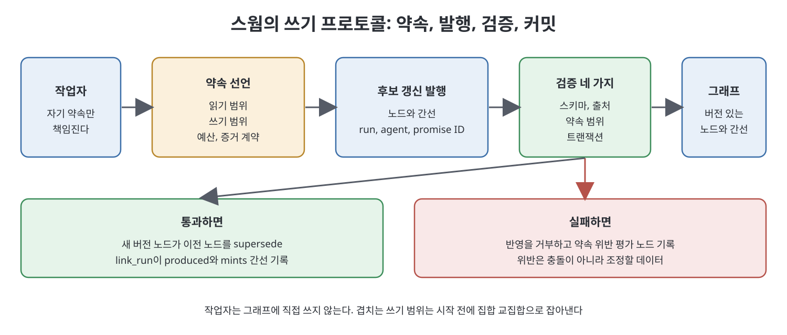
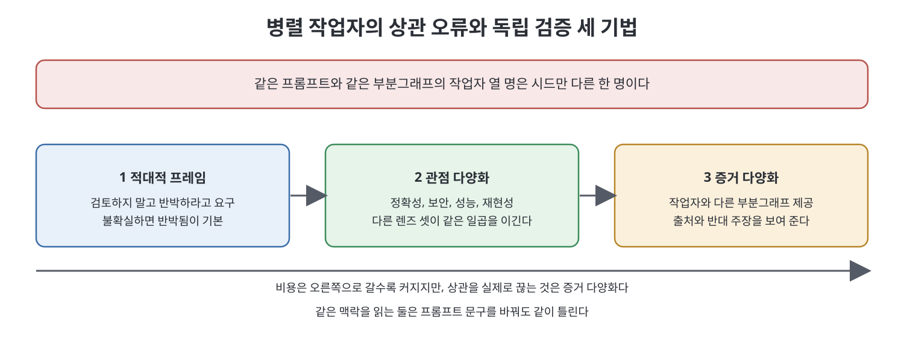

# 10장 하나의 그래프를 향한 스웜 (The Swarm Against One Graph)

작업자가 여럿이고 바탕(substrate)은 하나일 때, 설계는 버티거나 아니면 "빠르고 잘 정돈된 난장판"을 만든다. 책은 이 장에서 여러 에이전트가 하나의 그래프에 쓰기를 해야 하는 순간부터 생기는 문제와, 이를 조율하는 틀(약속 이론), 쓰기 프로토콜, 결과를 합치는 리듀서, 독립적인 검증, 예산, 그리고 병렬화가 오히려 해로운 경우를 차례로 다룬다. 스웜(swarm)은 같은 그래프를 향해 동시에 일하는 에이전트 무리를 뜻한다.

> **쉽게 말하면**
> 열 명이 같은 프롬프트로 같은 자료를 보고 일하면 독립된 열 명이 아니라 한 명이 열 번 일한 것이다. 쓰기는 "약속한 범위 안에서, 검증을 통과한 것만, 버전을 달아" 하게 하고, 검증은 서로 다른 증거를 보게 만들어야 한다.

> **참고(노트 작성자)** 책은 2026년경 에이전트 워크플로를 전제로 하며, 비용 수치와 도구는 집필 시점 기준이다. 책의 약속 YAML과 코드는 옮기지 않고 구조만 재구성했다.

## 이 장의 흐름

1. 쓰기 문제: 중복 생성, 상관된 오류, 쓰기 순서
2. 약속 이론: 작업자는 자기 약속을 소유한다
3. 작업 트리 격리와 그 한계
4. 쓰기 프로토콜
5. 리듀서와 그 계약
6. 검증을 정말 독립적으로 만들기
7. 예산은 선택이 아니다
8. 병렬화가 해로울 때

## 1. 쓰기 문제

읽기 전용 스웜은 쉽다. 열 작업자가 유계 부분그래프를 질의하고 발견을 돌려주면 리듀서가 종합한다. 그래프는 변하지 않으니 충돌이 없다. 하지만 작업자가 쓰는 순간, 그리고 써야 루프가 잊지 않으므로, 세 문제가 한꺼번에 온다.

| 문제 | 무엇이 일어나는가 | 책의 설명 |
|------|-------------------|-----------|
| 중복 생성(duplicate minting) | 두 작업자가 같은 불변식을 서로 다른 슬러그로 만든다 | near가 잡아내지만 두 쓰기가 이미 반영된 뒤다 |
| 상관된 오류(correlated errors) | 비슷한 프롬프트와 컨텍스트가 비슷한 실수를 낳는다 | 같은 시스템 프롬프트와 같은 부분그래프의 열 작업자는 시드만 다른 한 명이다 |
| 쓰기 순서 | A가 불변식을 만든 사이 B는 그것이 없는 세계를 기준으로 일한다 | B의 결과는 틀린 것이 아니라 낡은 것이며, 시간 모델 없이는 둘을 구분할 수 없다 |

책은 팬아웃(fan-out)이 독립 표본 추출처럼 느껴지지만 그렇지 않다고 한다. 검증 파동은 검토자의 프롬프트, 증거, 역할이 다를 때만 도움이 되고, 아니면 같은 오류의 확인을 열 번 산 것이다.

## 2. 약속 이론

자율적인 쓰기 주체를 조율하는 가장 깔끔한 틀로 책은 약속 이론(Promise Theory)을 든다. 감시하고 강제하는 오케스트레이터를 만들려는 직관을 뒤집는 접근이다. 핵심 원칙은 네 가지다.

- **자율성**: 에이전트는 자기 행동에 대해서만 약속할 수 있다. 다른 에이전트에게 의무를 부과할 수 없다.
- **자발적 협력**: 조율은 명령이 아니라 서로 양립하는 약속에서 나온다.
- **강제보다 평가**: 약속을 지키게 강제할 수는 없고, 지켰는지 평가할 수만 있다.
- **지역 지식, 지역 행동**: 에이전트는 자기가 볼 수 있는 것에 기반해 행동하며, 그것은 결코 전체가 아니다.

스웜에 적용하면 이렇다. 열 작업자의 충돌 없는 쓰기를 명령하는 오케스트레이터는 열 작업자의 미래를 모두 모델링해야 하는데 불가능하다. 반면 각 작업자가 쓰기 범위를 약속하게 하고 지켰는지 평가하는 오케스트레이터는 아무것도 모델링할 필요가 없다. 작업자는 시작 전에 약속 선언(promise declaration)을 한다. 선언에는 이 실행과 작업의 식별자, 읽을 범위, 새 노드를 만들 수 있는 쓰기 범위, 예산(토큰, 시간, 재시도), 그리고 "만든 모든 주장은 출처를 달거나 추론으로 표시한다" 같은 증거 계약이 담긴다.

약속은 그래프 객체이고 실행 전에 쓰이고 실행 후에 평가된다. 세 가지가 따라온다.

1. 충돌 감지가 작업 시작 전에 계산되는 집합 교집합이 된다. 두 작업자가 같은 능력(capability)에 쓰겠다고 약속하면, 나중에 병합 충돌로 발견할 일이 아니라 미리 내리는 스케줄링 결정이다.
2. 깨진 약속은 장애가 아니라 일급 발견이다. 선언한 범위 밖에 쓴 작업자는 위반을 기록한 평가 노드를 남기고, 그것이 팬아웃을 조정할 데이터가 된다.
3. 연쇄가 추적 가능해진다. C가 B의 약속에 의존했는데 B가 깼다면 의존이 간선이므로 피해 범위는 조사가 아니라 순회다.

책은 6층짜리 약속 그래프를 다룬 다른 글을 소개하며, 하나의 래티스에 쓰는 스웜에는 약속, 실행, 평가의 세 객체면 충분하다고 말한다.

## 3. 작업 트리 격리와 그 한계

병렬 쓰기의 표준 장치는 작업 트리(worktree) 격리다. 에이전트마다 새 git 작업 트리를 주어 파일 편집이 부딪치지 않게 하며, 여러 코딩 에이전트가 같은 저장소를 고칠 때 쓴다. 책은 이것이 사 주는 것과 사 주지 못하는 것을 구분한다.

| 구분 | 격리가 해 주는가 | 예 |
|------|------------------|-----|
| 파일 수준 격리 | 해 준다 | 두 작업자가 같은 소스 파일을 고쳐도 작업 사본이 안 섞인다 |
| 의미 수준 격리 | 해 주지 않는다 | 각자 일관되고 통과하는 두 변경이, 하나가 다른 쪽 스펙이 의존한 용어를 바꾼 탓에 합치면 모순이다 |

의미 수준 격리는 2절의 약속 범위와 7장의 그래프 불변식이 맡는다. 작업 트리는 필요조건일 뿐이며 비용도 들어 공유 파일을 바꿀 때만 쓴다.

## 4. 쓰기 프로토콜

작업자는 그래프에 직접 쓰지 않는다. 후보 갱신을 발행(publish)하면 검증을 거쳐 트랜잭션으로 커밋된다. 갱신 묶음은 노드, 간선, 실행 ID, 에이전트 ID, 약속 ID를 담는다. 검증은 네 가지다.

1. 스키마 유효성: 닫힌 어휘와 노드 형식.
2. 출처 존재: 7장의 다섯 번째 불변식.
3. 약속 범위: 약속을 지켰는가.
4. 트랜잭션 자체.

`link_run`은 브리지 역할을 하며 `produced`와 `mints` 간선을 써서 갱신이 누구 것인지 추적 가능하게 한다. 버전 없이는 아무것도 반영하지 않는다. 노드를 "갱신"하는 작업자는 덮어쓰지 않고 후속 버전을 만들며 앞선 노드는 계속 주소 지정이 된다.

## 5. 리듀서와 그 계약

팬아웃은 쉽고 팬인(fan-in)에서 품질이 결정된다. 책은 팬아웃 전에 리듀서를 정의하라고 한다. 열 결과를 어떻게 합칠지 말할 수 없다면 열 작업자에게 무엇을 요구할지도 아직 모르는 것이고, 열 번 비용을 낸 뒤에야 알게 된다. 리듀서 계약은 다섯 항목이다.

| 항목 | 정하는 것 |
|------|-----------|
| 입력 형태 | 모든 작업자가 돌려주는 스키마(자유 산문이 아님) |
| 중복 제거 정책 | 래티스에서는 정규 개체, 술어, 도착의 조합이 같으면 같은 발견 |
| 충돌 정책 | 둘이 불일치할 때 고를지, 상향할지, 둘 다 contradicts로 기록할지 |
| 증거 문턱 | 발견이 리듀스를 통과할 최소 증거 |
| 절단 공개 | 상위 N개로 자른다면 무엇을 버렸는지 밝힘 |

충돌은 둘 다 기록하는 편이 대체로 옳다고 책은 말한다. 조용히 하나를 고르는 것은 상관된 오류가 합의로 바뀌는 길이다. 책은 마지막 항목을 특히 강조한다. 조용한 상한은 금지다. 상위 N개, 재시도 없음, 표본 추출처럼 범위를 제한했다면 버린 것을 기록해야 한다. 조용한 절단은 "다 다뤘다"로 읽히고 최종 보고서에서 철저함과 구분되지 않는다.

## 6. 검증을 정말 독립적으로 만들기

스웜의 대표적 실패가 상관된 오류이므로 검증에는 의도적인 다양성이 필요하다. 책은 비용이 오르는 순서로 세 가지 기법을 든다.

- **적대적 프레임**: 검토하지 말고 반박하라고 요구하고, 불확실하면 기본값을 "반박됨"으로 둔다. "맞나요"라고 물으면 동의하고, "깨지는 경우를 찾으라"고 하면 찾는다.
- **관점 다양화**: 발견이 여러 방식으로 실패할 수 있으면 같은 검토자 N명 대신 정확성, 보안, 성능, 재현성 같은 서로 다른 렌즈를 준다. 책은 다양한 검증자 셋이 똑같은 일곱 명을 이긴다고 한다.
- **증거 다양화**: 검증자에게 작업자와 다른 부분그래프를 준다. 작업자가 2홉 이웃을 봤다면 검증자에게는 출처와 반대 주장을 준다. 같은 그래프의 다른 투영이며, 6장의 실용적 근접성을 예산 도구가 아니라 인식 도구로 쓰는 셈이다.

그래프는 셋째를 싸게 만들고, 상관을 실제로 끊는 것도 셋째다. 같은 컨텍스트를 읽는 두 에이전트는 프롬프트를 어떻게 쓰든 상관된다고 책은 말한다.

## 7. 예산은 선택이 아니다

대규모 팬아웃은 토큰을 빠르게 쓴다. 책은 높은 노력 수준의 서브에이전트 1,000개 실행이 수십 달러가 들 수 있다고 말한다. 그래서 실행마다 시작 전에 모델 호출, 서브에이전트, 동시 작업자, 도구 호출, 경과 시간, 토큰, 금액, 재시도, 그래프 쓰기의 상한과 마무리에 필요한 최소 증거를 선언해야 한다.

예산이 바닥나면 현재 최선의 산출물, 끝난 작업, 미해결 문제, 중단 이유를 돌려주고 부분 실패를 매끄러운 최종 답 뒤에 숨기지 않는다. 자신 있는 요약을 내놓는 스웜은 죽는 스웜보다 나쁘다. 죽으면 읽히기 때문이다. 중단 이유를 평가 노드로 써서, 예산 때문에 멈춘 실행과 끝나서 멈춘 실행이 6개월 뒤에도 구분되게 한다.

## 8. 병렬화가 해로울 때

아키텍처 설계, 서사 글쓰기, 결합이 강한 리팩터링, 미묘한 제품 결정은 한 맥락이 필요하며, 쪼개면 각 조각은 괜찮아도 합쳐지지 않는다. 판별 기준은 하위 과제가 정말 독립적인가(2장의 셋째 질문)다. 한 작업자가 다른 작업자의 결정을 알아야 한다면 병렬화는 일관성을 내주고 경과 시간을 사는 거래이며 공짜가 아니다.

래티스에서는 추출은 문서별로 독립이라 잘 병렬화되지만 해소는 모든 후보를 한꺼번에 봐야 한다. 다음 단계 전에 모든 결과가 필요한 장벽(barrier) 경우이므로, 해소를 항목별 연산인 척하지 말고 장벽을 넣어 설계하라고 책은 말한다.

## 핵심 정리

- 쓰기를 시작하면 중복 생성, 상관된 오류, 쓰기 순서 문제가 동시에 온다. 같은 프롬프트의 열 작업자는 시드만 다른 한 명이다.
- 약속 이론은 강제 대신 평가를 택한다. 쓰기 범위 선언으로 충돌을 사전 집합 교집합으로 잡고, 깨진 약속을 발견으로 기록한다.
- 작업 트리는 파일 수준만 격리한다. 의미 수준 충돌은 약속 범위와 그래프 불변식이 막는다.
- 작업자는 직접 쓰지 않고 검증된 후보를 버전과 함께 트랜잭션으로 커밋하며, 리듀서는 팬아웃 전에 계약을 정하고 조용한 절단을 하지 않는다.
- 독립 검증은 적대적 프레임, 관점 다양화, 증거 다양화로 만들고, 예산은 미리 선언하며 소진 시 부분 실패를 숨기지 않는다. 한 맥락이 필요한 일과 해소 단계는 병렬화하지 않는다.

 
 
 

이전: [9장 컨텍스트 조립과 근거 기반 평가자](09%EC%9E%A5%20%EC%BB%A8%ED%85%8D%EC%8A%A4%ED%8A%B8%20%EC%A1%B0%EB%A6%BD%EA%B3%BC%20%EA%B7%BC%EA%B1%B0%20%EA%B8%B0%EB%B0%98%20%ED%8F%89%EA%B0%80%EC%9E%90.md) | 다음: [11장 재배선된 파이프라인](11%EC%9E%A5%20%EC%9E%AC%EB%B0%B0%EC%84%A0%EB%90%9C%20%ED%8C%8C%EC%9D%B4%ED%94%84%EB%9D%BC%EC%9D%B8.md)

 

[Graph Engineering - The Loop Memory Model](../)
