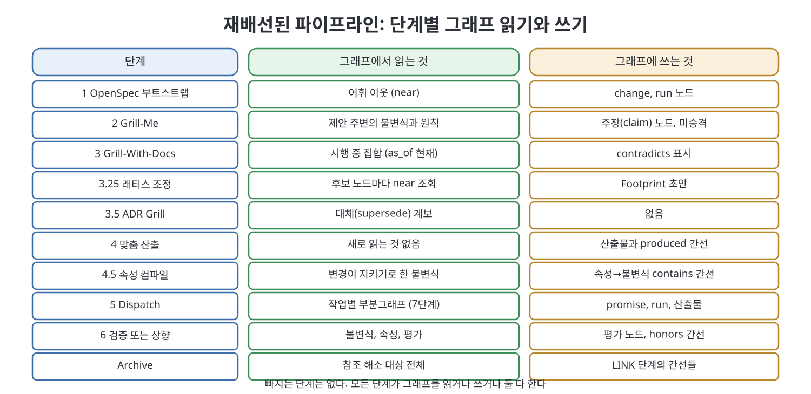
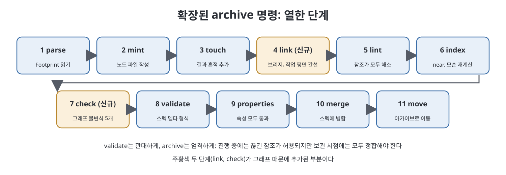

# 11장 재배선된 파이프라인 (The Pipeline, Rewired)

3부의 마지막 장은 forge 파이프라인의 단계 목록에 그래프 연산을 꽂아 넣는다. 책의 선언은 "아무것도 빼지 않는다"이다. 모든 단계가 그래프에서 읽거나, 쓰거나, 둘 다 하게 될 뿐이다. 새로 생기는 연산은 하나, LINK이며 archive 명령에 들어간다. 또 무엇을 자동화하지 말아야 하는지로 장이 끝난다. forge는 책 앞부분에서 소개한 개발 파이프라인(제안, 심문, 산출, 디스패치, 검증, 보관)을 가리키는 이름이다.

> **쉽게 말하면**
> 기존 파이프라인의 각 단계는 그대로 두고, 사람이 디렉터리를 뒤져 고르던 곳을 "그래프에서 필요한 만큼만 조회"로 바꾸고, 보관 시점에 "모든 연결이 맞는지" 점검을 한 번 더 한다.

> **참고(노트 작성자)** 책은 2026년경 에이전트 워크플로를 전제로 하며, 단계 이름(OpenSpec, Grill-Me 등)과 명령은 집필 시점 기준이다. 책의 의사 코드와 명령 목록은 옮기지 않고 구조만 표로 재구성했다.

## 이 장의 흐름

1. 전체 단계 목록: 단계별 읽기와 쓰기
2. 단계마다 무엇이 바뀌는가
3. 확장된 archive 명령
4. LINK 자세히
5. 비용, 솔직하게
6. 자동화하지 말아야 할 것

## 1. 전체 단계 목록

책이 정리한 단계별 그래프 연산은 다음과 같다. 단계 이름은 책의 것을 그대로 쓴다.

| 단계 | 읽는 것 | 쓰는 것 |
|------|---------|---------|
| 1 부트스트랩 | 어휘 이웃(near) | 변경(change), 실행(run) 노드 |
| 2 Grill-Me | 제안 주변의 불변식과 원칙 | 주장 노드(승격되지 않은 발견) |
| 3 Grill-With-Docs | 시행 중 집합(as_of 현재) | contradicts 표시 |
| 3¼ 래티스 조정 | 후보 노드마다 near 조회 | Lattice Footprint 초안(미커밋) |
| 3½ ADR Grill | 주제의 대체 계보 | 없음 |
| 4 맞춤 산출 | 새로 읽는 것 없음 | 산출물과 produced 간선 |
| 4½ 속성 컴파일 | 변경이 준수하는 불변식 | 속성에서 불변식으로 가는 contains 간선 |
| 5 디스패치 | 작업별 유계 부분그래프(일곱 단계 빌더) | 작업마다 약속, 실행, 산출물 |
| 6 검증 또는 상향 | 준수 불변식과 그 속성, 평가 | 평가 노드, honors 간선 |
| 보관(Archive) | 참조 전체 | 아래의 LINK 간선들 |

## 2. 단계마다 무엇이 바뀌는가

**1단계 부트스트랩.** "어휘 조각을 로드"가 "시드 의도의 개체를 해소하고 그 2홉 어휘 이웃을 조회"로 바뀐다. 노드가 마흔 개일 때는 같지만 사백 개가 되면 앞의 방식은 불가능하다. 또 산문이 쓰이기도 전에 변경 노드와 첫 실행 노드가 생겨 작업 평면이 열린다.

**2단계 Grill-Me.** 모든 주장을 측정 가능한 점검이나 비목표로 끌고 가는 정신은 그대로다. 새로운 점은 답이 가는 곳이다. 아직 결정이 아닌 발견은 신뢰도와 근거가 있는 주장(claim) 노드가 된다. "믿지만 비준되지 않은 것"이 "불변식으로 승격"도 "유실"도 아닌 거처를 얻는다.

**3단계 Grill-With-Docs.** 래티스 전체 로드 대신 지금 시점의 시행 중 집합과 제안 개체의 이웃을 조회한다. 파생 contradicts 감지가 더해지며, 질문으로 표면화하고 거부하지 않는다.

**3¼단계 래티스 조정.** 가장 많이 바뀌는 단계다. 네 규칙 게이트에 드디어 장치가 생긴다.

| 규칙 | 이전 | 이제 |
|------|------|------|
| 1. 이 변경을 넘어 지속되는가 | 판단 | 판단(바뀌지 않음, 정말 사람의 일) |
| 2. 안정적 슬러그를 가질 가치가 있는가 | 판단 | 판단 |
| 3. 이미 다뤄진 사실이 아닌가 | 판단 | 시행 중 집합에 대한 near 질의 |
| 4. 정확히 한 노드 유형에 맞는가 | 판단 | 유형을 제약한 추출 스키마 |

3번은 손으로 확인하려면 래티스 전체를 읽어야 해서 가장 자주 어겨졌다. 이제는 임계값 있는 질의이며 평결이 아니라 질문을 낸다.

**3½단계 ADR Grill.** 주제의 대체 계보 전체, 곧 이전 결정과 교체 이유를 순서대로 가져온다. 예전에는 사슬을 손으로 복원하느라 사람들이 건너뛰었고 그래서 "불필요한 대체(Superfluous Supersession)" 함정이 생겼다. supersedes 순회가 이를 공짜로 만든다.

**4단계 산출과 4½단계 속성 컴파일.** 산출물은 produced 간선과 버전을 얻는다. Lattice Footprint 절은 검토자가 실제로 읽는 결합 지점이라 여전히 사람이 쓴다. 컴파일된 속성에는 시험 대상 불변식에서 오는 contains 간선이 달리며, 이 간선 하나가 9장의 질문 2를 답할 수 있게 한다. 없으면 불변식과 속성의 연결은 이름 규칙 속에만 있다.

**5단계 디스패치.** 일곱 단계 빌더가 "최소 스펙 조각 건네기"를 대체한다. 원래 지침은 옳았지만 "관련"을 사람이 정했다면 이제는 정책 기반 순회가 정하고, 계약자는 간선 ID가 붙은 유계 부분그래프를 받는다. 읽기 범위, 쓰기 범위, 예산을 선언한 약속도 함께 쓴다.

**6단계 검증 또는 상향.** 속성 스위트, 9장의 그래프 점검(모델 없음), 남은 것에 대한 모델 판단의 순서다. 실패하면 코드가 아니라 스펙을 상향한다는 철칙은 그대로이고, 그래프는 빠진 간선으로 어느 스펙인지를 정확히 해 준다.

## 3. 확장된 archive 명령

forge의 보관은 "만들기, 건드리기, 해소" 후 속성 스위트가 초록일 때 이뤄진다. 그래프 판은 두 단계를 끼운다.

| 번호 | 단계 | 비고 |
|------|------|------|
| 1~3 | Footprint 해석, 노드 파일 작성(mint), 결과 흔적 추가(touch) | forge 기존 |
| 4 | link: 브리지와 작업 평면 간선 기록 | 신규 |
| 5~6 | lint(참조 해소), index(near와 contradicts 재계산) | forge 기존 |
| 7 | check: 그래프 불변식 다섯 가지 점검 | 신규 |
| 8~11 | 스펙 델타 검증, 속성 통과, 병합, 아카이브로 이동 | forge 기존 |

forge가 세운 비대칭이 그래프로 확장된다. validate는 관대하고 archive는 엄격하다. 진행 중인 변경은 며칠 동안 끊긴 참조, 미해결 contradicts 표시, 낮은 신뢰도의 단언을 가질 수 있다. 하지만 보관 시점에는 그래프가 정합해야 한다. 모든 참조가 해소되고, 모든 주장이 출처가 있거나 추론으로 표시되고, 모든 산출물에 작성 실행이 있고, 모든 평가가 기준(rubric)을 밝히고, 대체된 모든 객체가 주소 지정 가능해야 한다.

## 4. LINK 자세히

LINK는 3장의 논증 전체를 떠받치는 새 단계다. 보관 대상 변경에 대해 다음을 쓴다.

| 대상 | 기록하는 간선 |
|------|---------------|
| Mints 항목 M | 그것을 작성한 실행에서 M으로 mints 간선, 실행 맥락에서 M의 출처 블록 |
| Honors 항목 H | 변경에서 H로 honors 간선. 이 변경 아래 만든 산출물 중 diff가 H가 다스리는 코드를 건드린 것에서 H로도 honors |
| 작업 T | T에서 변경으로 derived_from, 실행에서 산출물로 produced, 산출물에서 평가로 evaluated_by |
| 인용된 출처 S | 산출물에서 S로 cites |

판단이 필요한 곳은 가운데의 조건, "산출물의 diff가 H가 다스리는 코드를 건드리는가"뿐이며, 이곳에서는 보수적으로 가야 한다고 책은 말한다. 과잉 연결은 모든 것이 모든 것을 준수하는 그래프를 만들어 honors 순회가 저장소 전체를 돌려준다. 과소 연결은 6단계 게이트에 거짓 음성을 낳는다. 책은 과소 연결을 택하라고 한다. 빠진 honors 간선은 준수해야 할 불변식을 준수하지 않는 것처럼 보이는 변경으로 드러나고 사람이 알아채 고치지만, 과잉 연결된 그래프는 소리 없이 잡음으로 퇴화하기 때문이다.

## 5. 비용, 솔직하게

변경 하나당 그래프가 더하는 비용은 다음과 같다.

| 작업 | 비용 |
|------|------|
| 부트스트랩 개체 해소 | 싼 호출 1회 |
| 3¼단계 near 질의 | 색인 조회, 모델 호출 없음 |
| 5단계 컨텍스트 조립 | 작업마다 순회, 모델 호출 없음 |
| 6단계 그래프 점검 | 순회, 모델 호출 없음 |
| 보관 시 색인 재구축 | 수 초 |
| 새 산문의 추출 | 바뀐 산문 문서당 싼 호출 1회 |

추가 작업의 대부분이 추론이 아니라 순회라는 점이 핵심이다. 비싼 연산인 해소 판정과 모순 판단은 디스패치마다가 아니라 보관 시점에 변경당 한 번 일어난다. 절감은 측정하기 어렵지만 더 크다. 사람이 고른 스펙 조각 대신 계산된 조각이 나가고 더 작다. 책의 예에서 "아마 관련 있는 모든 것" 8,000토큰이 "실제 제약 이웃과 인용" 3,000토큰이 되고, 디스패치 마흔 번이면 예산 안에 드는 변경과 아닌 변경이 갈린다.

## 6. 자동화하지 말아야 할 것

책은 두 번째 달의 전형적 실수가 자동화이며, 세 가지는 수동으로 남겨야 한다고 말한다.

- **목표**: 무엇을 만들지 정하는 단계는 없다. forge의 1단계는 모델이 제안서를 쓰기 전에 사람을 인터뷰하도록 뒤집었다. 일반적인 시드는 일반적인 제안서를 낳기 때문이다. 그래프는 나쁜 목표를 고쳐 주지 않고 더 빨리 퍼뜨리며 아름답게 문서화한다.
- **대체(supersession)**: 결정이 이제 틀렸다고 판단하는 것은 그래프가 아니라 세계에 대한 판단이다. 그래프는 두 노드가 모순된다는 것은 감지하지만 어느 쪽이 살아남아야 할지는 정하지 못한다. supersedes는 사람이 쓰고, 심문하고, 승인한다.
- **네 규칙 게이트의 1번과 2번**: 사실이 이 변경 너머로 지속되는지, 안정적 슬러그를 가질 가치가 있는지는 미래에 대한 질문이다. 3번은 현재에 대한 질문이라 장치를 얻었다. 1번과 2번을 모델에게 시키면 답처럼 읽히는 자신 있는 추측을 내놓는다.

책은 4부가 균형추라고 예고한다. 무엇을 측정할지, 어떻게 실패하는지, 한 분기를 걸지 않고 어떻게 구축할지가 다뤄진다.

## 핵심 정리

- 파이프라인에서 빠지는 단계는 없고, 모든 단계가 그래프에서 읽거나 쓰거나 둘 다 한다. 새 연산은 LINK 하나다.
- 심문에서 나온 "믿지만 비준되지 않은 것"은 주장 노드로 남고, 속성에서 불변식으로 가는 contains 간선이 9장의 질문 2를 가능하게 한다.
- 네 규칙 게이트의 3번은 near 질의로 장치를 얻었고 4번은 유형 제약 스키마가 맡으며, 1번과 2번은 사람의 판단으로 남는다.
- archive는 link와 check 두 단계가 추가되어, 진행 중에는 관대하고 보관 시점에는 그래프 정합을 엄격하게 요구한다. LINK는 과소 연결을 택한다.
- 추가 비용은 대부분 모델 호출 없는 순회이며 컨텍스트가 작아져 오히려 절감된다. 목표, 대체, 게이트 1~2번은 자동화하지 않는다.

 
 
 

이전: [10장 하나의 그래프를 향한 스웜](10%EC%9E%A5%20%ED%95%98%EB%82%98%EC%9D%98%20%EA%B7%B8%EB%9E%98%ED%94%84%EB%A5%BC%20%ED%96%A5%ED%95%9C%20%EC%8A%A4%EC%9B%9C.md) | 다음: [12장 지표 실패 양상 만들지 말아야 할 때](../04.%204%EB%B6%80%20%ED%8C%90%EB%8B%A8/12%EC%9E%A5%20%EC%A7%80%ED%91%9C%20%EC%8B%A4%ED%8C%A8%20%EC%96%91%EC%83%81%20%EB%A7%8C%EB%93%A4%EC%A7%80%20%EB%A7%90%EC%95%84%EC%95%BC%20%ED%95%A0%20%EB%95%8C.md)

 

[Graph Engineering - The Loop Memory Model](../)
