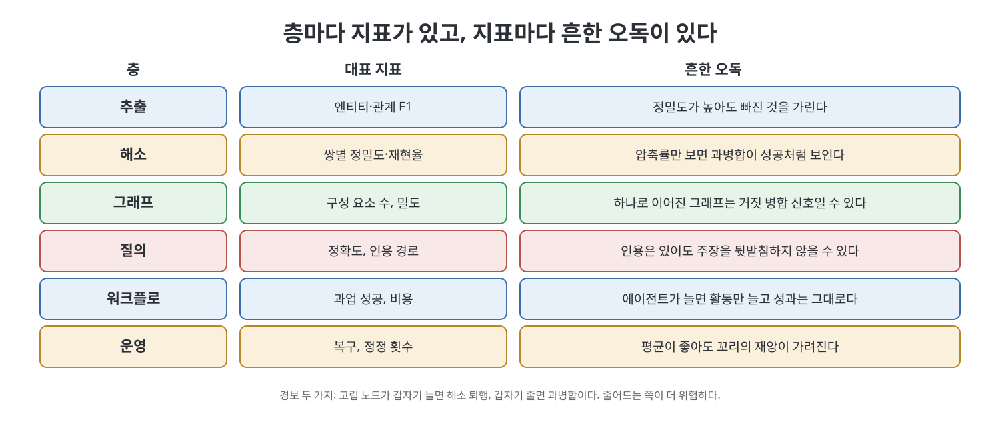
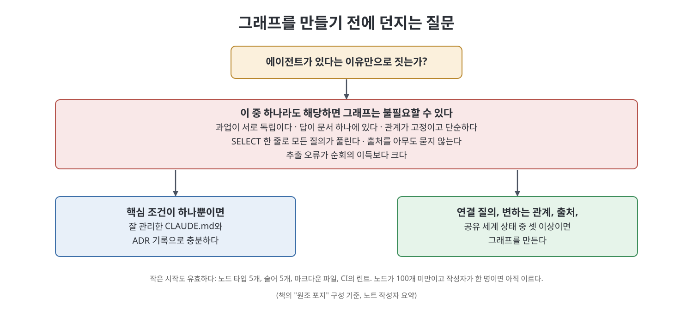

# 12장 지표, 실패 양상, 만들지 말아야 할 때 (Metrics, Failure Modes, and When Not to Build This)

이 장은 책 전체에서 가장 쓸모 있는 장으로 꼽힌다. 저자는 이 시스템을 도입할지 고민하는 사람이라면 7장(스키마)을 읽기 전에 먼저 읽으라고 권한다. 앞선 장들이 "어떻게 만드는가"를 다뤘다면, 이 장은 "어떻게 잘못 읽히고, 어떻게 망가지고, 언제 짓지 말아야 하는가"를 다룬다. 책이 스스로 자신의 처방에 반대 의견을 달아 두는 드문 장이다.

> **쉽게 말하면**
> 지표는 층마다 따로 두되 각각 잘못 읽는 방식이 있고, 개선 장치는 눈에 보이는 숫자만 올린다. 가장 위험한 사고는 서로 다른 것을 하나로 합치는 거짓 병합이다. 그리고 그래프는 에이전트가 있다고 해서 짓는 것이 아니다.

> **참고(노트 작성자)** 책은 2026년경 에이전트 워크플로를 전제로 쓰였고, 소개하는 도구와 사례는 그 시점 기준이다. 이 장의 "책은 ~라고 말한다"는 저자의 주장이고, 노트 작성자의 해설은 별도 표시했다.

## 이 장의 흐름

1. 층별 지표와 흔한 오독
2. 지표는 반드시 조작된다: 래칫이 보는 숫자만 오른다
3. 엔티티 해소의 치명적 오류: 거짓 병합
4. 그래프는 만든 사람의 판단을 증폭한다
5. 그래프는 코퍼스를 비춘다
6. 비용 측면
7. 그래프를 만들지 말아야 할 때, 그리고 스케치는 제품이 아니다
8. 다시 그 시험

## 1. 층별 지표와 흔한 오독

책은 모든 층에 자기 지표가 있어야 하고, 지표마다 특징적인 오독이 따른다고 말한다. 중요한 쪽은 오독 열이며, 가설이 아니라 실제로 일어나는 일이라고 강조한다.

| 층 | 대표 지표 | 흔한 오독 |
|----|----------|-----------|
| 추출 | 엔티티·관계 F1 | 정밀도가 높으면 빠진 엔티티가 가려진다. 보수적 추출기는 점수가 좋지만 성긴 그래프를 만든다 |
| 해소 | 쌍별 정밀도·재현율 | 압축률만 보면 과병합에 상을 준다. 정식 엔티티가 줄면 성공처럼 보인다 |
| 그래프 | 구성 요소 수, 밀도 | 하나로 이어진 그래프가 늘 좋은 것은 아니다. 완전히 이어졌다면 거짓 병합이 많다는 뜻일 때가 많다 |
| 질의 | 정확도, 인용 경로 | 유창한 답이 무관한 간선을 인용할 수 있다. 인용은 있지만 주장을 뒷받침하지 않는다 |
| 워크플로 | 과업 성공률, 비용 | 에이전트를 늘리면 활동만 늘고 가치는 안 는다. 처리량은 진전이 아니다 |
| 운영 | 복구, 정정 횟수 | 평균이 좋아도 최악의 사례가 숨는다. 평균은 멀쩡한데 꼬리에서 고객 하나를 잃는다 |

책은 한 번의 점수보다 추세를 보라고 권한다. 문서 유형별 추출률, 스키마 실패율, 해소 압축률, 연결 구성 요소 변화, 질의 지연, 부분 그래프 크기, 인용 간선의 유효성, 토큰 비용, 낡은 엔티티 수, 그래프 갱신 실패, 에이전트 재시도율이 그 목록이다. 경보로는 두 개를 꼭 걸라고 한다. 고립 노드가 갑자기 늘면 해소가 퇴행했다는 신호다. 새 표기가 기존 정식 엔티티와 더는 맞물리지 않는다는 뜻이다. 반대로 고립 노드가 갑자기 줄면 과병합이다. 그래프가 건강해 보이면서 실제로는 나빠지므로 이쪽이 위험한 방향이라고 책은 지적한다.

## 2. 지표는 반드시 조작된다

2장에서 소개한 래칫(ratchet, 개선만 남기고 후퇴는 버리는 장치)은 이 시스템의 엔진이다. 책은 이 엔진에 설계로 대비해야 할 성질이 하나 있다고 말한다. 래칫은 자기가 볼 수 있는 지표만 개선한다는 것이다.

책은 모델 학습에서 비슷한 예를 든다. 옵티마이저가 검증 손실은 줄이면서 추론 비용을 늘리고 견고성을 깎거나 평가 세트에 과적합시킬 수 있다. 래티스 쪽에서는 더 정확히 같은 일이 벌어진다. 압축률을 최적화하는 해소 래칫은 공격적으로 병합한다. 답 정확도를 최적화하는 질의 래칫은 예산이 막을 때까지 직렬화한 부분 그래프를 키운다. 골드 세트에서 F1을 최적화하는 추출 래칫은 골드 세트의 문서 서른 개에 과적합된다.

방어책은 단일 점수가 아니라 하한선이 있는 지표 벡터다. 책의 예시는 이렇다. 해소 정밀도와 질의 지연에 하한을 두고 그 조건 아래서 추출 품질을 최적화한다. 검색된 부분 그래프 크기에 상한을 두고 그 아래서 답 정확도를 최적화한다. 하한과 상한은 최적화를 시작하기 전에 적어 두라고 한다. 시작한 뒤에는 기준을 옮기는 쪽으로 합리화하게 되기 때문이다.

## 3. 엔티티 해소는 치명적 오류를 낳을 수 있다

책은 이 실패 양상에 독립된 절을 준다. 점진적으로 나빠지는 것이 아니기 때문이다. 거짓 병합은 많은 순회를 오염시킨다. 두 엔티티를 한 노드로 합치면, 이후 모든 질의가 둘의 속성, 출처, 날짜, 관계를 뒤섞어 읽는다. 어휘 용어 둘을 합쳤다면 둘 중 하나를 참조하던 모든 스펙이 틀린 정의를 가리킨다. 오염은 조용하고, 국소적이지 않고, 그 노드를 건드리는 질의가 늘수록 커진다.

| 실패 | 증상 | 발견 난이도 |
|------|------|------------|
| 놓친 병합 | 중복 노드, 부분적인 답 | 쉽다. 빈틈이 눈에 띈다 |
| 거짓 병합 | 자신 있고, 틀렸고, 출처가 잘 붙은 답 | 어렵다. 고장난 것처럼 보이지 않는다 |

그래서 책의 결론은 분명하다. 덜 합치는 것은 성가신 일이고, 지나치게 합치는 것은 위험하다. 해소를 조정할 때는 덜 합치는 쪽으로 기울이고, 애매한 후보는 사람이 판정하도록 올리라는 것이다. 구조적 방어도 네 가지 소개한다. 별칭을 남기고, 근거를 남기고, 확신도를 남기고, 병합을 되돌릴 수 있게 한다. 병합을 출처 블록이 붙은 대체(supersedes) 단언으로 기록하면 다시 대체해서 취소할 수 있지만, 삭제로 구현한 병합은 영영 되돌릴 수 없다.

## 4. 그래프는 만든 사람의 판단을 증폭한다

책이 이 장에서 꼭 기억하라고 한 문장은 이렇다. 루프는 만든 사람이 고른 목표와 평가자를 증폭하고, 그래프는 온톨로지와 출처 정책을 증폭한다. 틀린 것을 최적화하라고 시키거나 세계를 틀리게 표현하면 자동화는 오류의 규모만 키운다.

책은 이 책의 모든 구조적 선택이 판단을 없애지 않고 옮길 뿐이라고 말한다. 술어 집합은 표현 가능한 관계를 정하고, 저작되는 술어 열한 개 밖의 것은 모든 질의에서 영원히 보이지 않는다. 출처 정책은 무엇이 증거인지, 확신도 임계값은 무엇이 표면에 올라오는지 정한다. 잘못 고르면 일관되고 문서화도 잘 된, 틀리는 기계가 생기며 이는 비일관적인 기계보다 반박하기 더 어렵다. 책이 사람의 명시적 소유를 요구하는 이유가 여기에 있고, 그것을 의례가 아니라 증폭의 방향을 바로잡는 장치라고 설명한다.

## 5. 그래프는 코퍼스를 비춘다

그래프의 품질은 출처, 추출 프롬프트, 온톨로지, 해소 정책의 품질을 넘지 못한다. 편향된 코퍼스는 편향된 그래프를 낳고, 빠진 문서는 빠진 간선이 된다. 책은 그래프가 주장, 출처, 관계를 점검 가능하게 보존할 뿐 주장을 진실로 바꿔 주지는 않는다고 못 박는다.

코드 저장소에는 특유의 함정이 있다. 래티스는 팀이 적어 둔 것으로만 만들어진다. 적어 두지 않은 지식은 빠져 있고, 6개월쯤 그래프 기반 평가를 돌리면 빠진 것이 거짓처럼 읽히기 시작한다. 문서화되지 않은 불변식은 아무도 지키지 않는 불변식이 되고, 관문이 검사하지 않는 불변식이 되고, 결국 위반되는 불변식이 된다. 책이 권하는 완화책은 지루하지만 효과적이다. 운영 사고가 문서화되지 않은 가정을 드러내면 그 자리에서 노드를 만들라는 것이다. 사고는 불변식의 가장 질 좋은 출처인데, 모두가 바빠서 가장 기록되기 어려운 출처이기도 하다.

## 6. 비용 측면

동적 워크플로는 비싸다. 책은 하위 에이전트 1,000개를 높은 노력 수준으로 돌리면 수십 달러가 들 수 있고, 예산을 선언하지 않으면 자연스러운 멈춤 지점이 없다고 경고한다. 병렬 일꾼은 서로 상관된 오류를 만든다. 검증의 다양성을 일부러 설계하지 않으면 열 배를 내고 한 가지 시각을 사는 것이 기본값이다. 쪼개면 품질이 떨어지는 과업도 있다. 하나의 일관된 맥락이 필요한 과업이 그렇다.

그래프 자체의 비용도 있다. 색인 구축, 바뀐 산문에 대한 추출 호출, 아카이브 시점의 해소 중재, 그리고 사람들이 자주 잊는 병합의 인간 검토다. 책은 마지막 항목에 예산을 잡으라고 말한다. 검토하는 속도보다 빨리 자라는 그래프는 검증되지 않은 구조를 쌓고 있는 것이고, 검토 속도가 그래프가 안전하게 자랄 수 있는 실제 상한이다. DAG는 무한히 자라므로 가지치기, 보관, 요약이 필요하고, 압축은 너무 커져서 추론이 안 되는 뒤가 아니라 그 전에 계획하라고 한다.

## 7. 만들지 말아야 할 때

책은 이 절이 나머지 책보다 더 많은 사람의 시간을 아껴 줄 것이라고 말한다. 에이전트가 있다는 이유만으로 지식 그래프를 도입하지 말라는 것이 출발점이다.

| 그래프가 불필요할 수 있는 경우 | 이유 |
|------------------------------|------|
| 과업이 서로 독립이고 세션 간 상태가 필요 없다 | 기억할 것이 없다 |
| 답이 문서 하나에 있다 | 필요한 연산은 순회가 아니라 검색이다 |
| 관계가 고정이고 단순하다 | 바꿀 일 없는 스키마에 유연한 표현은 낭비다 |
| 관계형 테이블이 모든 질의에 답한다 | SELECT로 충분하면 SELECT를 쓴다 |
| 출처가 필요 없다 | 주장의 출처를 아무도 묻지 않는다 |
| 추출 오류가 순회의 가치를 넘는다 | 잡음 입력에 다단계 추론을 얹으면 구조가 갚는 것보다 오류가 빨리 쌓인다 |

그래프가 제값을 하는 것은 연결 질의, 변하는 관계, 출처, 공유되는 세계 상태가 중심일 때다. 책의 기준은 이 넷 중 셋 이상이면 만들고, 하나뿐이면 잘 관리한 CLAUDE.md와 규율 있는 ADR(Architecture Decision Record, 설계 결정 기록) 로그가 낫다는 것이다. 책은 작은 쪽의 정직한 답도 있다고 한다. 앞선 책 시리즈에서 소개한 원래의 포지는 노드 타입 5개, 술어 5개, 마크다운 파일, CI의 `lat lint`로 이미 완결된 시스템이다. 래티스가 노드 100개 미만이고 작성자가 한 명이라면 이 책의 복잡도를 감당할 자격을 아직 얻지 못한 것이고, 너무 일찍 도입하면 한 분기를 잃고 그래프는 오버헤드라는 교훈만 얻는다고 책은 말한다.

### 스케치는 제품이 아니다

책은 참고한 참조 아키텍처 중 에이전트 협업 플랫폼들이 스스로를 "스케치"라고 밝힌다고 소개한다. 분산 저장, 저장소 압축, 에이전트 간 신뢰, 악성 번들, 의미 중복 탐지, 컴퓨트 스케줄링, 재현성, 장기 그래프 색인이 빠진 문제로 꼽힌다. 제품이 되려면 인증, 권한, 격리, 남용 방지, 저장 내구성, 색인, 관측성, 충돌 정책, 거버넌스가 더 필요하다. 책은 이 한계를 결격 사유가 아니라 교훈으로 읽는다. 에이전트가 많아지면 단일 메인 브랜치, 사람 속도의 리뷰, 대화 기록 기반 기억, 병합 중심 협업이 가장 먼저 무너진다는 것을 보여 주기 때문이다. 실패 목록을 배우되 스케치를 배포하지는 말라는 것이 책의 당부다.

## 8. 다시 그 시험

이 장은 1장이 연 질문 하나로 환원된다. 중요한 모든 출력이 목표, 계획, 산출물, 출처, 그래프 경로, 평가자 결정, 한정된 실행 기록까지 추적되는가. 참이면 루프, 스웜, DAG, 지식 그래프는 불투명한 행동이 아니라 조합 가능한 공학 장치가 된다. 거짓이면 에이전트를 더 붙일수록 불투명성만 는다. 책의 권고는 이 문장을 참으로 만드는 가장 작은 것을 만들라는 것이다. NOTES.md와 ADR 로그로 참이 된다면 거기서 끝이고, 다르게 말하는 사람은 이 책의 저자 자신까지 의심하라고 한다. 루프에서 그래프로 가는 길은 단순함에서 복잡함으로 가는 길이 아니라, 암묵적 상태에서 명시적 상태로, 휘발성 기억에서 지속성 기억으로, 추정에서 증거로 가는 길이라는 말로 장이 끝난다.

> **참고(노트 작성자)** 이 장을 실무에서 쓰는 가장 쉬운 방법은 "하한선 목록"을 먼저 적는 일이다. 예를 들어 해소 정밀도 하한과 질의 지연 상한을 문서로 고정한 뒤에야 압축률 최적화를 시작한다.

## 핵심 정리

- 지표는 층마다 따로 두고, 각 지표의 흔한 오독을 함께 적어 둔다. 한 번의 점수가 아니라 추세를 본다.
- 래칫은 자기가 보는 숫자만 올린다. 방어책은 단일 점수가 아니라 하한과 상한이 있는 지표 벡터이며, 기준은 시작 전에 적는다.
- 거짓 병합은 조용하고 비국소적으로 퍼진다. 덜 합치는 쪽으로 기울이고, 별칭, 근거, 확신도를 남기고, 병합은 대체 단언으로 기록해 되돌릴 수 있게 한다.
- 루프는 목표를, 그래프는 온톨로지와 출처 정책을 증폭한다. 판단은 사라지지 않고 옮겨질 뿐이므로 사람이 명세와 기준을 소유해야 한다.
- 그래프는 코퍼스를 비춘다. 적지 않은 것은 거짓처럼 읽히므로, 사고가 드러낸 가정은 그 자리에서 노드로 만든다.
- 연결 질의, 변하는 관계, 출처, 공유 세계 상태 중 셋 이상일 때 그래프를 만든다. 하나뿐이면 CLAUDE.md와 ADR 로그가 낫다.

[이전: 11장 재배선된 파이프라인](../03.%203%EB%B6%80%20%EB%A9%94%EC%BB%A4%EB%8B%88%EC%A6%98/11%EC%9E%A5%20%EC%9E%AC%EB%B0%B0%EC%84%A0%EB%90%9C%20%ED%8C%8C%EC%9D%B4%ED%94%84%EB%9D%BC%EC%9D%B8.md) | [다음: 13장 구축 경로](13%EC%9E%A5%20%EA%B5%AC%EC%B6%95%20%EA%B2%BD%EB%A1%9C.md)

 
 
 

[Graph Engineering - The Loop Memory Model](../)
