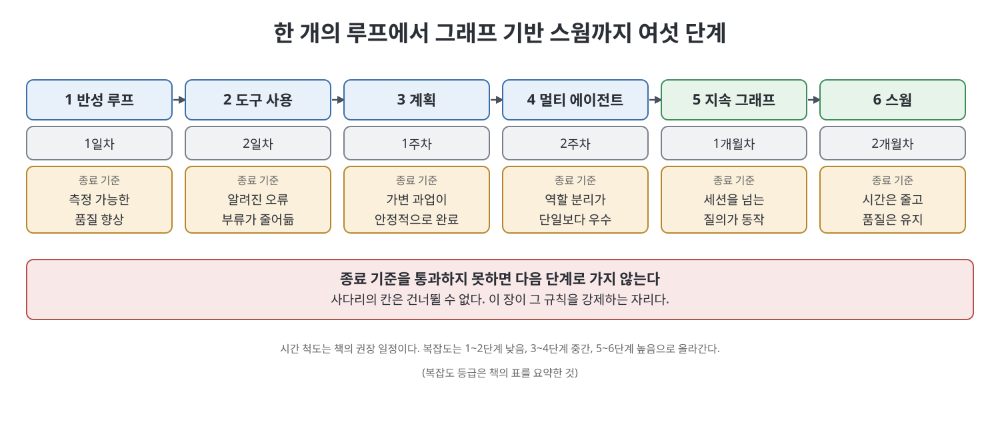
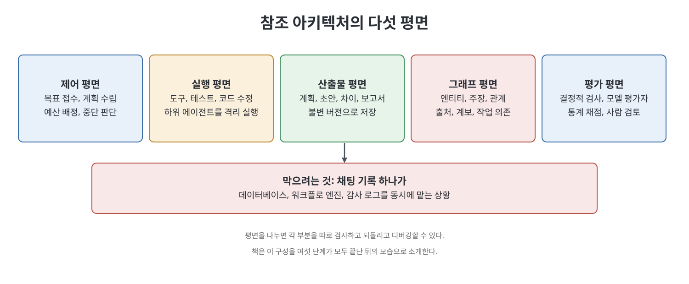

# 13장 구축 경로 (The Build Path)

이 장은 하나의 루프에서 그래프 기반 스웜까지 가는 여섯 단계의 구축 순서를 제시한다. 각 단계에는 종료 기준이 있고, 기준을 통과하지 못하면 다음 단계로 가지 않는다. 책은 2장의 사다리에서 칸을 건너뛸 수 없다고 했는데, 이 장이 그 규칙을 실제로 강제하는 자리라고 말한다. 뒤쪽에서는 모든 단계가 끝난 뒤의 참조 아키텍처, 열네 단계의 기본 작업 루프, 운영에 올리기 전의 점검표, 책 전체를 맺는 마무리가 이어진다.

> **쉽게 말하면**
> 하루짜리 반성 루프에서 시작해, 한 단계씩 "이 장치가 정말 효과가 있었다"를 숫자로 확인한 뒤에만 다음 층을 올린다. 그래프는 다섯 번째에야 들어오고, 스웜은 맨 마지막이다.

> **참고(노트 작성자)** 책은 2026년경 에이전트 워크플로를 전제로 한다. 일정(일, 주, 월)은 책의 권장이며 팀 규모와 과업에 따라 달라질 수 있다.

## 이 장의 흐름

1. 여섯 단계 한눈에 보기
2. 1일차 반성 루프, 2일차 도구
3. 1주차 계획, 2주차 멀티 에이전트
4. 1개월차 그래프 연결
5. 2개월차 스웜으로 확장
6. 참조 아키텍처의 다섯 평면
7. 기본 작업 루프 14단계
8. 운영 점검표와 마무리

## 1. 여섯 단계 한눈에 보기

| 단계 | 시기 | 복잡도 | 종료 기준 |
|------|------|--------|-----------|
| 1 반성 루프 | 1일차 | 낮음 | 품질이 측정 가능하게 향상된다 |
| 2 도구 사용 | 2일차 | 낮음 | 도구가 알려진 오류 부류를 줄인다 |
| 3 계획 | 1주차 | 중간 | 분해 방식이 달라지는 과업이 완료된다 |
| 4 멀티 에이전트 | 2주차 | 중간 | 역할 분리가 단일 에이전트를 이긴다 |
| 5 지속 그래프 | 1개월차 | 높음 | 세션을 넘나드는 질의가 동작한다 |
| 6 스웜 워크플로 | 2개월차 | 높음 | 품질 손실 없이 실제 시간이 단축된다 |



## 2. 1일차와 2일차: 루프와 도구

1일차에는 평가할 수 있는 출력을 내는 기존 모델 호출 하나를 골라 네 가지를 더한다. 저장된 첫 초안, 명시적 기준을 가진 평가자, 수정 단계, 멈춤 규칙이다. 책은 거절된 초안까지 모두 저장하라고 말한다. 책이 소개한 코드는 짧은 반성 함수이고, 개념은 다음 몇 줄로 요약된다.

```text
초안 = 생성(과업)
반복 최대 3회:
    검토 = 평가(과업, 초안)
    승인이면 결과와 모든 버전을 반환
    아니면 검토의 변경 지시로 다시 생성
상한에 닿으면 마지막 버전과 "반복 한도 도달" 상태를 반환
```

책은 두 가지 세부가 이 루프의 가치를 좌우한다고 한다. 하나는 최종 결과만이 아니라 모든 버전을 돌려주는 것이다. 거절된 초안이 무엇을 시도했는지의 기록이다. 다른 하나는 평가자가 점수가 아니라 결정과 변경 사항을 돌려주는 것이다. 숫자는 나빠졌다는 사실만 알려 주지만 구조화된 비평은 다음 회차가 할 일을 알려 준다. 종료 기준은 지목할 수 있는 무언가에 대해 품질이 측정 가능하게 오르는 것이고, 측정할 수 없다면 2장의 첫 번째 질문으로 돌아가라고 한다. 아직 자율에 맞는 과업이 아니라는 뜻이다.

2일차에는 도구를 딱 하나 붙인다. 알려진 오류 부류 하나를 겨냥해서다. 코드 실행, 웹 검색, 데이터베이스 접근, 파일 조작이 후보다. 도구마다 타입이 있는 스키마, 명시적 권한, 결과 확인이 필요하다. 다섯 개를 한꺼번에 붙이고 싶은 유혹을 참으라고 책은 말한다. 선택될 일이 없는 도구도 모든 호출마다 지연과 모델이 틀릴 수 있는 결정 하나를 더하기 때문이다. 종료 기준은 도구가 겨냥한 오류 부류를 실제로 줄인다는 것을 보이는 일이다.

## 3. 1주차와 2주차: 계획과 멀티 에이전트

계획은 과업 경로가 달라질 때만 도입한다. 순서가 고정이면 플래너가 아니라 체인이면 된다. 책은 실행 전에 JSON 계획을 요구하되 각 단계에 의존 관계와 단계별 성공 조건을 선언하게 하라고 한다. 예를 들어 문서에서 그래프를 만드는 계획은 추출, 엔티티 해소, 그래프 조립 세 단계로 나뉘고, 조립 단계는 앞의 둘에 의존하며 "모든 끝점이 노드로 풀린다"를 성공 조건으로 삼는다. 의존 관계는 실행 전에 검증한다. 재계획할 때는 성공한 작업을 보존해야 하며, 완료된 단계를 버리는 재계획은 "의상을 입은 재시작"이라고 책은 꼬집는다. 재시도와 총비용에는 상한을 둔다.

2주차에는 두 역할로 시작한다. 생성자와 비평가다. 소프트웨어 구성으로 유용한 것은 플래너, 구현자, 테스트 작성자, 보안 검토자, 종합자의 다섯이다. 책의 세 규칙은 다음과 같다.

| 규칙 | 뜻 |
|------|----|
| 인계는 대화가 아니라 산출물 계약이다 | 스키마를 정의하고 그에 맞춰 넘긴다 |
| 검토자는 기준별 결함을 돌려준다 | "좋아 보인다"는 신호가 없다. 산문이면 비용만 늘고 정보는 없다 |
| 같은 저장소를 여러 코딩 에이전트가 고치면 워크트리를 격리한다 | 서로의 변경이 섞이지 않게 한다 |

종료 기준은 같은 과업에서 역할 분리가 단일 에이전트를 이기는 것이며, 정직하게 측정하라고 한다. 역할 분리는 하나의 일관된 맥락이 필요한 과업에서 자주 진다(10장에서 다룬 내용).

## 4. 1개월차: 그래프를 연결한다

"지금, 그 전은 아니다." 책은 그래프를 이 시점에야 들이라고 말한다. 먼저 버전이 있는 JSON이나 관계형 테이블에 엔티티, 주장, 출처, 관계, 산출물, 에이전트 실행, 평가, 버전, 별칭, 미해결 질문을 저장하는 것으로 시작한다. 포지 저장소라면 7장 9절의 이행 순서를 따른다.

1. 기존 래티스를 파싱한다. `lat.md/` 아래는 손대지 않고 색인되어야 하며, 안 되면 파서를 고친다.
2. 새 변경에만 `work.md/`를 더한다. 과거 소급은 하지 않는다.
3. 진짜 산문에서만 추출을 더한다. 추출은 싼 모델, 해소는 더 강한 모델에 맡긴다.
4. 모든 간선에 출처를 붙인다. 기존 도구가 얼마나 익명으로 만들어 왔는지 이 단계에서 드러난다.
5. near와 contradicts는 관문이 아니라 표면화된 질문으로 켠다. 4주 동안 지켜본다.
6. 그래프 불변식은 하나씩 켜고, 출처 불변식은 마지막에 켠다.

골드 세트(8장)는 3단계 중에 만든다. 적대적으로 고른 문서 서른 개, 이틀 오후 분량이다. 종료 기준의 구체적 시험도 있다. 3주 전에 만든 사실과 어제 만든 산출물을 이어야만 답이 나오는 질문을 시스템에 던진다. 확인 가능한 인용과 함께 답하면 그래프는 진짜이고, 대화 기록에서 답하면 아니라고 한다.

## 5. 2개월차: 스웜으로 확장한다

스웜은 민망할 만큼 병렬적인(embarrassingly parallel) 작업에 쓴다. 결함 부류 하나에 대해 모든 파일을 감사하기, 수천 문서에서 엔티티 추출, 독립 모듈의 테스트 생성, 후보 설정 비교, 독립 가설 조사가 책의 예다. 팬아웃 전에 리듀서를 먼저 정의하고(10장), 동시성 한도, 총 일꾼 수 상한, 토큰 예산, 일꾼별 타임아웃, 재시도 정책, 증거 계약, 중복 제거 정책, 최종 평가 관문을 정한다. 종료 기준은 품질을 잃지 않고 시간이 줄어드는 것이다. 속도만 재지 말고 품질을 재라고 한다. 시간을 절반으로 줄이면서 거짓 병합률을 슬쩍 올렸다면 성공으로 출고한 퇴행이다.

## 6. 참조 아키텍처

여섯 단계가 모두 끝나면 다섯 평면이 깔끔하게 갈린다고 책은 소개한다.

| 평면 | 책임 |
|------|------|
| 제어 | 목표를 받고 계획을 세우고 예산을 배정하고 워크플로를 시작하며 멈출 때를 정한다 |
| 실행 | 도구, 테스트, 코드 수정, 하위 에이전트를 격리된 환경에서 돌린다 |
| 산출물 | 계획, 초안, 차이, 보고서, 지표, 평가를 불변 버전으로 저장한다 |
| 그래프 | 엔티티, 주장, 관계, 출처, 계보, 작업 의존을 저장한다 |
| 평가 | 결정적 검사, 모델 평가자, 통계 채점, 사람 검토를 돌린다 |



분리의 목적은 한 가지 결과를 막는 것이다. 채팅 기록 하나가 데이터베이스, 워크플로 엔진, 감사 로그를 동시에 맡는 상황이다. 책은 구조 없는 에이전트 시스템이 모두 이런 모양이고 그래서 디버깅이 안 된다고 말한다.

## 7. 기본 작업 루프 열네 단계

그래프 기반 에이전트 과업의 실용적 기본형은 열네 단계다. 목표와 제약을 받고, 과업 엔티티를 그래프에서 해소하고, 출처가 달린 한정된 부분 그래프를 가져오고, 타입이 있는 계획을 만들어 의존을 검증하고, 독립 단계를 격리된 일꾼에게 나눠 주고, 구조화된 산출물과 증거를 요구하고, 후보 그래프 갱신을 게시한다. 이어서 스키마, 권한, 출처를 검증하고, 결정적 테스트를 돌리고, 평가자 에이전트를 기준표로 돌리고, 충돌을 풀거나 불확실성을 올리고, 버전이 달린 최종 산출물을 게시하고, 출처, 그래프 경로, 실행, 평가에 연결하고, 비용, 지연, 실패, 미해결 질문을 기록한다.

책은 마지막 14단계가 가장 자주 빠지지만 다음 반복을 가능하게 하는 단계라고 말한다. 미해결 질문은 한 번의 실행이 내놓는 가장 값진 산출이다. 목록에서 시스템이 무엇을 모르는지 알려 주는 유일한 항목이기 때문이다.

## 8. 운영 점검표와 마무리

책은 운영이라고 부르기 전에 열 가지 요소를 묻는다.

| 요소 | 스스로에게 묻기 | 빠지면 |
|------|----------------|--------|
| 목표 | 과업을 시험할 수 있는가 | 엉뚱한 것을 최적화한다 |
| 지표 | 개선을 구별하는가 | 활동은 있고 진전은 없다 |
| 되돌림 | 갱신을 취소할 수 있는가 | 실패한 실험이 상태를 해친다 |
| 도구 스키마 | 인자에 타입이 있는가 | 잘못된 호출, 조용한 오류 |
| 산출물 계약 | 일꾼이 무엇을 돌려줘야 하는가 | 제각각의 산문 |
| 출처 | 모든 주장에 근거가 있는가 | 출력을 감사할 수 없다 |
| 해소 정책 | 병합을 되돌릴 수 있는가 | 거짓 병합이 그래프를 오염시킨다 |
| 예산 | 한도가 명시되어 있는가 | 자원이 끝없이 샌다 |
| 모니터링 | 추세를 추적하는가 | 퇴행이 보이지 않는다 |
| 복구 | 상태에서 재개할 수 있는가 | 중단될 때마다 처음부터 |

책의 마무리는 포지의 주장을 한 번 더 날카롭게 다듬는 데 쓰인다. 포지는 스펙이 지속되는 산출물이고 코드는 부수 효과라고 했다. 래티스 보너스 장은 래티스가 지속되는 산출물이고 스펙은 현재 능력 집합에 대한 투영, 코드는 그 투영의 부수 효과라고 다듬었다. 이 책은 많은 에이전트가 동시에 쓰는 세계를 위해 다시 말한다. 그래프가 지속되는 산출물이고, 래티스는 그 중 사람이 가꾼 지식 평면이며, 스펙은 투영이고, 코드는 부수 효과다. 모두가 만들고 있는 루프는 제품이 아니라 그래프를 만들어 내는 장치라는 것이다.

책은 사다리의 각 패턴이 앞 패턴의 한계 하나씩을 겨냥한다고 정리한다. 루프는 한 번에 끝내는 오류를, 도구는 지식의 빈틈을, 계획은 복잡성을, 멀티 에이전트는 관점의 한계를, DAG는 계보를, 지식 그래프는 지속되는 공유 기억을 겨냥한다. 순서는 의무가 아니라 방향이다. 가까운 시일의 공학 일은 자율 스웜의 극적인 장면보다 덜 화려하고 훨씬 더 값지다. 타입이 있는 계약을 정의하고, 계보를 보존하고, 모든 변경을 평가하고, 기억을 컨텍스트 창 밖에 두는 일이다. 그래프가 완성되는 때는 여섯 달 뒤 아직 존재하지 않는 모델이 아무도 쓰지 않은 프롬프트로 일하며, 본 적 없는 엔티티를 풀고, 그것을 구속하는 불변식을 찾아 간선을 인용하고, 제약을 지키며, 재시도 예산이 왜 3인지 누구에게도 물을 필요가 없을 때라고 책은 그린다.

## 핵심 정리

- 구축은 여섯 단계(루프, 도구, 계획, 멀티 에이전트, 지속 그래프, 스웜)이며, 각 단계의 종료 기준을 통과해야 다음으로 간다.
- 반성 루프는 모든 버전을 저장하고 평가자가 점수가 아닌 결정과 변경 사항을 돌려준다. 도구는 한 번에 하나, 계획은 경로가 달라질 때만 쓴다.
- 멀티 에이전트의 인계는 산출물 계약이고 검토는 기준별 결함이다. 역할 분리가 단일 에이전트를 이기는지 정직하게 측정한다.
- 그래프는 1개월차에 기존 래티스를 그대로 색인하는 것에서 시작한다. 종료 기준은 3주 전 사실과 어제 산출물을 잇는 질의에 인용과 함께 답하는 것이다.
- 스웜은 리듀서를 먼저 정의하고 예산과 한도를 선언하며, 속도뿐 아니라 품질로 성공을 판단한다.
- 열네 단계 루프의 마지막(미해결 질문 기록)을 버리지 말고, 운영 전에 열 가지 점검표로 확인한다.

[이전: 12장 지표 실패 양상 만들지 말아야 할 때](12%EC%9E%A5%20%EC%A7%80%ED%91%9C%20%EC%8B%A4%ED%8C%A8%20%EC%96%91%EC%83%81%20%EB%A7%8C%EB%93%A4%EC%A7%80%20%EB%A7%90%EC%95%84%EC%95%BC%20%ED%95%A0%20%EB%95%8C.md) | [다음: 14장 더 읽을거리](14%EC%9E%A5%20%EB%8D%94%20%EC%9D%BD%EC%9D%84%EA%B1%B0%EB%A6%AC.md)

<br>
<br>
<br>

[Graph Engineering - The Loop Memory Model](../)
