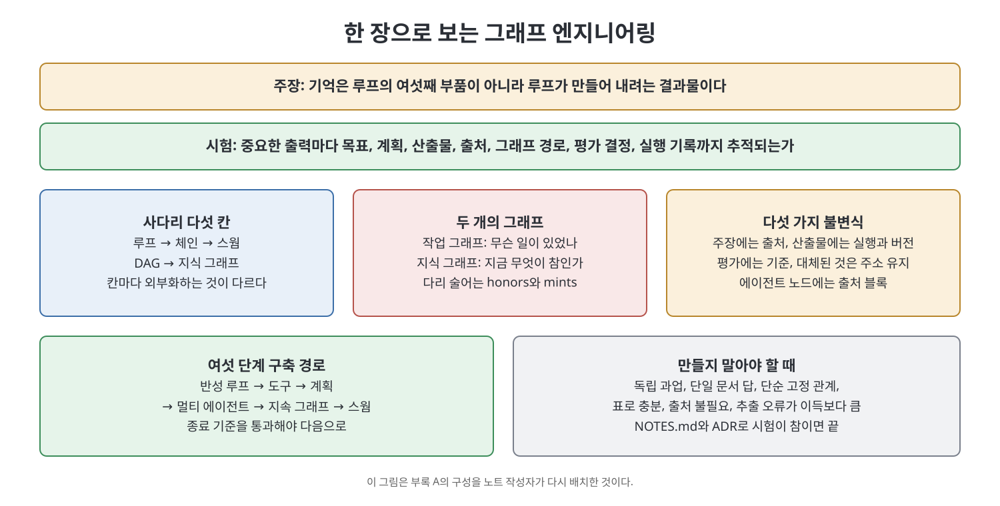

# 부록 A 한 장으로 보는 그래프 엔지니어링 (Graph Engineering on One Page)

책의 부록 A는 인쇄해서 책상 옆에 붙여 두라고 만든 한 장짜리 요약이다. 주장, 시험, 사다리, 두 그래프, 어휘, 노드 타입, 의미 모드, 불변식, 파이프라인, 컨텍스트 조립, 근거 기반 평가자, 구축 경로, 철칙, 만들지 말아야 할 때가 순서대로 압축되어 있다. 이 노트는 그 구성을 표 중심으로 다시 배치해, 본문을 읽은 뒤 기억을 빠르게 되살리는 용도로 정리한다.

> **쉽게 말하면**
> 이 책 전체를 한 장에 접으면 "기억이 루프의 목적이다"라는 주장, "출력이 끝까지 추적되는가"라는 시험, 그리고 지켜야 할 철칙 여덟 개가 된다.

> **참고(노트 작성자)** 도구와 명령 이름은 책이 쓰인 2026년경 기준이다. 표의 용어는 앞 장들에서 풀이한 것을 요약한 것이므로, 낯선 항목은 해당 장으로 돌아가 확인한다.

## 1. 주장과 시험

| 구분 | 내용 |
|------|------|
| 주장 | 기억은 루프의 여섯째 부품이 아니다. 루프가 만들어 내려는 바로 그것이다 |
| 시험 | 중요한 모든 출력이 목표, 계획, 산출물, 출처, 그래프 경로, 평가자 결정, 한정된 실행 기록으로 추적된다 |
| 판정 | 참이면 에이전트는 처리량을 더하고, 거짓이면 불투명성을 더한다 |

## 2. 사다리

| 칸 | 바깥으로 꺼내는 것 | 이럴 때 선택 |
|----|-------------------|-------------|
| 루프 | 반복과 평가 | 출력을 검사할 수 있을 때 |
| 체인 | 과업의 순서 | 순서가 안정적일 때 |
| 스웜 | 병렬 탐색과 역할 | 하위 과업이 독립일 때 |
| DAG | 실험의 계보 | 대안을 살려 두어야 할 때 |
| 지식 그래프 | 사실, 출처, 기억 | 사실이 세션을 넘어 살아남아야 할 때 |

## 3. 두 개의 그래프

| 구분 | 작업 그래프 | 지식 그래프 |
|------|------------|------------|
| 답하는 질문 | 무슨 일이 있었나 | 무엇이 참인가 |
| 진실 모델 | 불변의 이력 | 효력 있는 집합(in-force set) |
| 성장 | 빠르고 기계적이며 동시적 | 느리고 사람이 가꾸며 관문이 있다 |
| 없으면 | 재현도 감사도 못 한다 | 제약도 검증도 못 한다 |

두 그래프는 정확히 두 개의 술어, `honors`와 `mints`로만 이어진다(브리지).

## 4. 어휘와 노드 타입

| 분류 | 항목 |
|------|------|
| 지식 평면 저작 술어 (5) | supersedes, implies, constrains, defines, honors |
| 작업 평면 저작 술어 (5) | produced, derived_from, evaluated_by, cites, parent_of |
| 브리지 (2) | honors, mints |
| 파생, 저작 금지 | near, contradicts |
| 구조 | contains, expresses |
| 지식 노드 | adr, vocab, invariant, pattern, principle, claim, source |
| 작업 노드 | change, task, agent_run, artifact, evaluation |
| 공유 노드 | assertion (재화된 간선) |

저작 술어는 평면마다 다섯 개로 유지한다. 여섯째가 필요하다고 느끼면 노드를 넓히거나 산문으로 남기라는 것이 책의 조언이다.

## 5. 네 가지 의미 모드

| 관계 | 모드 | 던지는 질문 |
|------|------|------------|
| CONTAINS | 구조적 | 이것은 무엇으로 이루어졌나 |
| EXPRESSES | 속성적 | 이것에 대해 무엇이 참인가 |
| NEAR | 연상적 | 이것과 닮은 것은 무엇인가 |
| LEADS_TO | 인과·시간적 | 이것 다음에 무엇이 오는가 |

스키마에 모드 하나가 빠지면 그 방향은 보이지 않는다. 책은 원래의 포지 래티스에 NEAR가 빠져 있었다고 짚는다.

## 6. 다섯 가지 그래프 불변식

1. 모든 주장에는 출처가 있거나 추론이라고 표시된다.
2. 모든 산출물에는 만든 실행과 버전이 있다.
3. 모든 평가는 자기 기준표를 밝힌다.
4. 대체된 객체는 계속 주소로 찾을 수 있다.
5. 에이전트가 만든 노드는 출처 블록을 가진다.

## 7. 파이프라인

| 단계 | 읽는 것 | 쓰는 것 |
|------|--------|--------|
| 1 부트스트랩 | 어휘 이웃 | 변경, 실행 |
| 2 Grill-Me | 불변식과 원칙 | 주장 |
| 3 Grill-Docs | 효력 있는 집합 | contradicts 표시 |
| 3¼ 조정 | 후보마다 near | 발자국 초안 |
| 3½ ADR Grill | 대체 계보 | 없음 |
| 4 방출 | 없음 | 산출물, produced |
| 4½ 속성 | 지켜진 불변식 | 속성의 contains 간선 |
| 5 파견 | 한정된 부분 그래프 | 약속, 실행, 산출물 |
| 6 검증 | 불변식과 속성 | 평가, honors |
| 아카이브 | 새로 만들기, 건드리기, 해소, 연결, 린트, 색인, 검사, 병합 순서 | |

## 8. 컨텍스트 조립과 근거 기반 평가자

일곱 단계 컨텍스트 조립은 이렇다. 엔티티 해소, 1~2홉 확장, 현재 산출물 버전 포함, 최근 검증된 것 우선, 충돌 포함, 예산 안에서 직렬화, 안정적인 간선 ID 부착이다.

근거 기반 평가자는 "좋아 보인다"를 구조화된 응답으로 바꾼다. 결정(수정이 필요하다), 문제가 된 주장, 이유(예: X에서 Y로 가는 지지 경로 없음), 필요한 증거 목록이 그 항목이다.

## 9. 구축 경로와 철칙

| 단계 | 시기 | 종료 기준 |
|------|------|----------|
| 반성 루프 | 1일차 | 품질이 측정 가능하게 향상 |
| 도구 사용 | 2일차 | 알려진 오류 부류 감소 |
| 계획 | 1주차 | 가변 과업 완료 |
| 멀티 에이전트 | 2주차 | 역할 분리가 단일을 이김 |
| 지속 그래프 | 1개월차 | 세션 간 질의 동작 |
| 스웜 | 2개월차 | 품질 손실 없이 시간 단축 |

종료 기준을 통과하지 못한 단계는 건너뛰지 않는다. 철칙 여덟 개는 아래와 같다.

1. 그래프가 지속되는 산출물이다. 스펙은 투영, 코드는 부수 효과다.
2. NEAR는 제안하고 나머지 넷이 결정한다. 파생 관계는 관문이 되지 않는다.
3. 마크다운이 정본이고 색인은 버려도 되는 것이다.
4. 덜 합치는 쪽으로 기운다. 거짓 병합은 조용하고 놓친 병합은 보인다.
5. 팬아웃 전에 리듀서를 정의한다.
6. 조용한 상한은 없다. 버려진 것은 기록한다.
7. 예산이 바닥나면 가장 좋은 산출물과 멈춘 이유를 돌려준다.
8. 에이전트가 있다는 이유로 그래프를 짓지 않는다. 연결 질의, 변하는 관계, 출처, 공유 세계 상태 때문에 짓는다.

## 10. 만들지 말아야 할 때

과업이 독립이거나, 답이 문서 하나에서 나오거나, 관계가 고정이고 단순하거나, 표 하나로 모든 질의가 풀리거나, 출처가 필요 없거나, 추출 오류가 순회의 이득을 넘으면 짓지 않는다. NOTES.md와 ADR 로그로 시험이 참이 되면 거기서 끝이다(12장 7절).

## 핵심 정리

- 한 줄 주장은 "기억은 루프가 만들려는 것"이고, 한 줄 시험은 "모든 중요한 출력이 끝까지 추적되는가"이다.
- 사다리의 다섯 칸은 각각 외부화하는 대상이 다르고, 사실의 지속성이 필요할 때 마지막 칸인 지식 그래프에 이른다.
- 두 그래프는 `honors`와 `mints`로만 이어지고, 저작 술어는 평면마다 다섯 개로 유지한다.
- 다섯 불변식(출처, 실행과 버전, 평가 기준, 주소 유지, 출처 블록)이 그래프의 최소 품질선이다.
- 철칙의 중심은 덜 합치기, 리듀서 먼저, 조용한 상한 금지, 필요할 때만 짓기다.

[이전: 부록 Readme](Readme.md) | [다음: 부록 B 스키마 참조](%EB%B6%80%EB%A1%9D%20B%20%EC%8A%A4%ED%82%A4%EB%A7%88%20%EC%B0%B8%EC%A1%B0.md)

 
 
 

[Graph Engineering - The Loop Memory Model](../)
