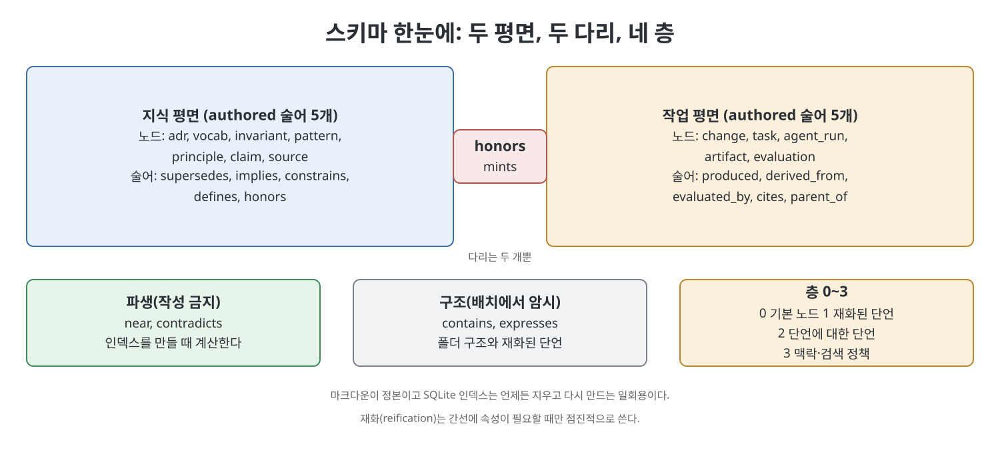

# 부록 B 스키마 참조 (Schema Reference)

책의 부록 B는 7장이 이유를 설명한 스키마 전체를 한곳에 모은 조회용 자료다. 노드 타입, 술어, 참조 문법, 노드 파일 형식, 재화된 단언, 층, 불변식, 파생 색인, 검색 정책, 디렉터리 배치, CLI가 차례로 나온다. 책의 코드·YAML·SQL 블록은 옮기지 않고, 이 노트는 구조를 표로 재구성했다. 정확한 문법과 전체 열 목록은 원서에서 확인한다.

> **쉽게 말하면**
> 이 부록은 "이 필드가 뭐였더라"를 찾는 사전이다. 노드는 어느 평면의 무엇이고, 술어는 어디서 어디로 가며, 색인은 어떤 열을 가지는지가 표로 정리되어 있다.

> **참고(노트 작성자)** 도구 이름(`lat` CLI 등)과 파일 배치는 책이 쓰인 2026년경의 설계이며 시점 기준이다. 표의 일부 칸(공급 가능 여부 등)은 PDF 텍스트 추출이 흐트러져 있어 문맥으로 읽었으니 원서와 대조하라.

## B.1 노드 타입

| 타입 | 평면 | 층 | 대체 가능 | 출처 블록 필요 |
|------|------|:--:|:--------:|---------------|
| adr | 지식 | 0 | 가능 | 에이전트가 만들 때 |
| vocab | 지식 | 0 | 가능 | 에이전트가 만들 때 |
| invariant | 지식 | 0 | 가능 | 에이전트가 만들 때 |
| pattern | 지식 | 0 | 가능 | 에이전트가 만들 때 |
| principle | 지식 | 0 | 가능 | 에이전트가 만들 때 |
| claim | 지식 | 0 | 가능 | 항상 |
| source | 지식 | 0 | 불가(불변) | 해당 없음 |
| change | 작업 | 0 | 불가 | 항상 |
| task | 작업 | 0 | 불가 | 항상 |
| agent_run | 작업 | 0 | 불가 | 항상 |
| artifact | 작업 | 0 | 불가(버전으로 관리) | 항상 |
| evaluation | 작업 | 0 | 불가 | 항상 |
| assertion | 공유 | 1~2 | 가능 | 항상 |

## B.2 술어

### 지식 평면, 저작

| 술어 | 정의역에서 치역으로 | SST 모드 | 의미 |
|------|-------------------|---------|------|
| supersedes | 임의 노드에서 같은 타입 | LEADS_TO | 이전 노드를 대체하고 옛 노드는 얼어붙는다 |
| implies | 임의에서 임의 | LEADS_TO | 이것을 받아들이면 상대도 성립해야 한다 |
| constrains | 임의에서 임의 | EXPRESSES | 상대의 허용 결정을 좁힌다 |
| defines | 임의에서 vocab | EXPRESSES | 상대가 쓰는 정식 의미를 제공한다 |
| honors | 임의에서 임의 | CONTAINS | 상대가 효력을 유지하는 것에 의존한다 |

### 작업 평면, 저작

| 술어 | 정의역에서 치역으로 | 의미 |
|------|-------------------|------|
| produced | agent_run에서 artifact | 이 실행이 그 산출물을 만들었다 |
| derived_from | artifact에서 artifact 또는 source | 파생 계보 |
| evaluated_by | artifact에서 evaluation | 평가 연결 |
| cites | artifact에서 claim 또는 source | 증거 연결 |
| parent_of | agent_run에서 agent_run | 실행 계보(DAG) |

### 브리지(평면 사이를 건너는 유일한 술어)

| 술어 | 정의역에서 치역으로 | 의미 |
|------|-------------------|------|
| honors | 작업 노드에서 지식 노드 | 그 노드가 효력 중이어야 한다는 의존 |
| mints | agent_run에서 지식 노드 | 그 노드를 존재하게 만들었다 |

### 파생과 구조

| 구분 | 관계 | 속성 | 목적 또는 의미 |
|------|------|------|---------------|
| 파생(색인 빌드 때 계산, 저작 금지, 관문 금지) | near | 가중치, 차원 모음, 맥락 | 중복 탐지, 해소 후보 묶기, 검색 |
| 파생 | contradicts | 확신도, 근거 | 충돌을 작업 항목으로 표면화 |
| 구조(배치로 암시) | contains | 없음 | 능력, 요구사항, 시나리오, 속성의 포함 사슬, 변경과 과업, 메타노드 캡슐화 |
| 구조 | expresses | 없음 | 재화된 단언에 속성을 붙임 |

## B.3 참조 문법

| 대상 | 접두 | 형식 설명 | 새 예시 |
|------|------|----------|---------|
| 지식 노드 | lat | 타입과 슬러그 | `lat:adr/use-sqlite` |
| 작업 노드 | work | 타입과 ID | `work:run/9c2e17` |
| 단언 | assert | ID | `assert:0188` |

규칙은 네 가지다. 참조는 원본에서 한 방향이다. 슬러그는 제목이 아니라 케밥 케이스다. 앵커, 제목, 줄 번호는 쓰지 않는다. 어떤 산출물의 전체 의존 표면은 저장소에서 이 세 접두 형식을 정규식으로 한 번 훑으면 얻는다.

## B.4 노드 파일 형식

노드는 마크다운 파일 하나이며, 제목 줄은 슬러그와 제목으로 이루어진다. 본문 앞쪽 필드는 다음과 같다.

| 필드 | 값 | 비고 |
|------|----|------|
| Type | adr, vocab, invariant, pattern, principle, claim, source 중 하나 | 필수 |
| Status | 제안됨, 수락됨, 또는 다른 노드를 대체하며 수락됨 | 대체 관계가 여기 드러난다 |
| Date | 날짜 | 필수 |
| Plane | 평면 | 선택, 기본은 지식 |
| Provenance | 실행, 변경, 확신도(0에서 1), 출처 목록 | 에이전트가 만든 노드에 필수 |
| Edges | 술어와 참조의 목록 | 간선의 저작 위치 |

본문 구획은 맥락, 본문, 결과 세 개다.

## B.5 재화된 단언 형식

재화(reification)는 간선을 노드처럼 다뤄 속성을 붙이는 방식이다. 책은 간선에 속성이 필요할 때만 점진적으로 쓰라고 하며, 미리 승격하지 말라고 한다.

| 필드 | 의미 |
|------|------|
| subject | 주어 참조. 다른 단언일 수도 있다(층 2) |
| predicate | 저작 술어 중 하나 |
| object | 목적어 참조 또는 없음 |
| asserted_by | 단언한 실행 |
| confidence | 확신도(0에서 1) |
| context | 어느 능력에 한정되는지, 또는 전역 |
| valid_from, valid_to | 유효 기간 시작과 끝(끝은 "항상"도 가능) |
| source | 근거 출처 |
| note | 자유 서술 |

## B.6 층

| 층 | 내용 | 읽는 쪽 |
|:--:|------|--------|
| 0 | 기본 산출물, 모든 노드 타입 | 사람, 모든 단계 |
| 1 | 재화된 단언: 출처, 확신도, 유효성 | 아카이브 관문, 평가자 |
| 2 | 단언에 대한 단언: 대체, 무효화 | 감사 질의만 |
| 3 | 맥락과 검색 정책: 단계별 가중치 | 컨텍스트 빌더 |

## B.7 다섯 가지 그래프 불변식

| 번호 | 내용 |
|:---:|------|
| 1 | 모든 주장에는 출처가 있거나 상태가 추론이다 |
| 2 | 모든 산출물에는 만든 실행과 버전이 있다 |
| 3 | 모든 평가는 기준표나 스위트를 밝힌다 |
| 4 | 대체된 모든 객체는 주소로 찾을 수 있다 |
| 5 | 에이전트가 만든 모든 노드에는 출처 블록이 있다 |

## B.8 파생 색인 스키마

색인은 SQLite 형태의 일회용 데이터베이스이며 마크다운에서 언제든 다시 만들 수 있다. 책의 SQL은 옮기지 않고 세 테이블의 열을 정리한다.

| 테이블 | 주요 열 | 설명 |
|--------|--------|------|
| nodes | id, plane(지식, 작업, 공유 중 하나), type, status, title, body, layer(0에서 3), scope, created_run, created_at | 모든 노드. 평면과 층에 값 제약 |
| edges | id, src, predicate, dst, reified_as, asserted_by, source, confidence(기본 1.0), context, valid_from, valid_to, derived(near, contradicts는 1) | 모든 간선. 끝점은 nodes를 참조하며 재화된 단언도 가리킬 수 있다 |
| near_dims | edge_id, dimension, value | near 간선의 차원별 점수. 기본 키는 간선과 차원의 쌍 |

색인에는 출발점과 서술어, 도착점과 서술어, 평면과 타입과 상태 조합에 대한 조회용 인덱스가 걸린다. 이 파일은 버전 관리에서 제외된다.

## B.9 검색 정책(층 3)

검색 정책은 코드 상수가 아니라 그래프 데이터로 저장한다. 단계마다 허용 술어, 홉 수, 노드 타입별 가중치가 다르다.

| 단계 | 허용 술어 | 홉 | 가중치 |
|------|----------|:--:|--------|
| 1 부트스트랩 | defines | 2 | vocab 0.7, invariant 0.2, pattern 0.1 |
| 2 Grill-Me | implies, constrains | 1 | invariant 0.5, principle 0.3, vocab 0.2 |
| 3 Grill-Docs | supersedes, constrains, honors | 2 | adr 0.6, pattern 0.3, invariant 0.1 |
| 3¼ 조정 | 전부와 near | 1 | 균등, 재현율 높게 |
| 4½ 속성 | constrains, implies | 1 | invariant 0.8, principle 0.2 |
| 5 파견 | honors, constrains, defines | 2 | invariant 0.5, adr 0.3, pattern 0.2 |
| 6 검증 | honors, cites, evaluated_by | 2 | claim 0.6, source 0.4 |

## B.10 디렉터리 배치

| 위치 | 평면 | 내용 |
|------|------|------|
| `lat.md/` | 지식, 정본 | 재생성되는 색인, adr, vocab, invariants, patterns, principles 폴더, 단계 대기 중인 claims, 출처 등록부 sources |
| `work.md/` | 작업 | 색인, changes, runs, artifacts, evaluations, 층 1~2의 assertions |
| `.lat/` | 파생 | 색인 DB. 버전 관리 제외 |
| `openspec/` | 스펙 | project.md, 능력별 스펙, 변경 폴더(제안, 설계, 과업, 속성 테스트, 스펙 델타) |

## B.11 CLI 표면

| 명령 | 하는 일 | 출신 |
|------|--------|------|
| lat lint | 모든 참조가 풀리는지 검사 | 포지 원본 |
| lat index | 색인을 다시 만들고 near, contradicts 재계산 | 포지 원본 |
| lat graph | 대체 관계와 간선을 Graphviz로 내보냄 | 포지 원본 |
| lat near | 단계 가중치로 가장 가까운 효력 노드 | 추가 |
| lat inforce | 특정 시점의 효력 집합 | 추가 |
| lat honors | 이 노드에 현재 의존하는 것 | 추가 |
| lat lineage | 뿌리까지의 대체 사슬 | 추가 |
| lat check | 다섯 그래프 불변식 검사 | 추가 |
| lat context | 일곱 단계 컨텍스트 빌더 실행 | 추가 |

## 핵심 정리

- 노드는 지식 7종, 작업 5종, 공유(단언) 1종이다. 지식 노드는 대체 가능하고 source만 불변이다.
- 저작 술어는 지식 5개, 작업 5개, 브리지 `honors`(작업에서 지식으로)와 `mints`뿐이다. near와 contradicts는 파생이며 관문이 아니다.
- 참조는 `lat:`, `work:`, `assert:` 세 접두에 슬러그나 ID를 쓰며 한 방향이고, 한 번의 정규식 검색으로 의존 표면이 나온다.
- 층 0은 기본 노드, 1은 재화된 단언, 2는 단언에 대한 단언, 3은 검색 정책이다. 재화는 필요할 때만 한다.
- 색인은 세 테이블의 일회용 데이터베이스이며 마크다운이 정본이다. 검색 정책은 단계별로 술어, 홉, 가중치를 달리하는 그래프 데이터다.

[이전: 부록 A 한 장으로 보는 그래프 엔지니어링](%EB%B6%80%EB%A1%9D%20A%20%ED%95%9C%20%EC%9E%A5%EC%9C%BC%EB%A1%9C%20%EB%B3%B4%EB%8A%94%20%EA%B7%B8%EB%9E%98%ED%94%84%20%EC%97%94%EC%A7%80%EB%8B%88%EC%96%B4%EB%A7%81.md) | [다음: 부록 C 프롬프트](%EB%B6%80%EB%A1%9D%20C%20%ED%94%84%EB%A1%AC%ED%94%84%ED%8A%B8.md)

 
 
 

[Graph Engineering - The Loop Memory Model](../)
