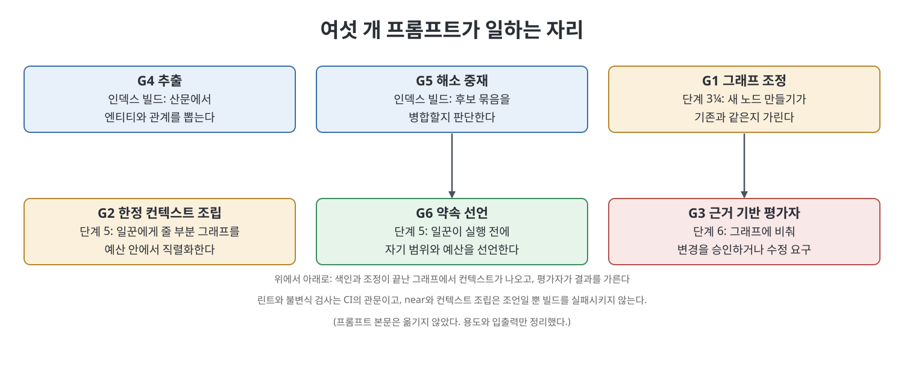

# 부록 C 프롬프트 (The Prompts)

책의 부록 C는 여섯 개의 프롬프트(G1에서 G6)와 설치 방법을 담고 있다. 각 프롬프트는 포지(앞선 책 시리즈의 파이프라인)의 접착 프롬프트를 대체하지 않고 확장하며, 원본이 있으면 그래프 버전이 무엇을 더하는지 밝힌다. 이 노트는 프롬프트 본문을 옮기지 않는다. 각 프롬프트가 언제 쓰이는지, 무엇을 입력으로 받아 무엇을 내놓는지, 어떤 제약을 거는지만 정리한다. 본문이 필요하면 원서나 책이 말하는 저장소의 `prompts/` 폴더를 본다.

> **쉽게 말하면**
> 여섯 프롬프트는 그래프를 지키는 여섯 가지 역할이다. 새 노드를 만들기 전에 같은 것이 있는지 따지고, 일꾼에게 줄 정보를 예산 안에서 고르고, 결과를 그래프에 비춰 심사하고, 문서에서 사실을 뽑고, 같은 것을 묶을지 판단하고, 일꾼이 자기 범위를 먼저 선언하게 한다.

> **참고(노트 작성자)** 프롬프트의 단계 번호와 `lat` 명령은 책의 포지 파이프라인(부록 A의 파이프라인)을 전제로 한다. 모델과 도구는 2026년경 기준이며, 실제로 쓸 때는 원서 본문을 자기 환경에 맞게 고쳐 쓴다.

## 1. 한눈에 보기

| 번호 | 이름 | 쓰이는 때 | 책이 말하는 관계 |
|------|------|----------|----------------|
| G1 | 그래프 조정 | 단계 3¼, 변경안을 검토할 때 | 포지의 래티스 조정 프롬프트를 확장 |
| G2 | 한정 컨텍스트 조립 | 단계 5, 일꾼을 파견하기 직전 | 단계 5의 스펙 조각 선택을 대체 |
| G3 | 근거 기반 평가자 | 단계 6, 검증할 때 | 단계 6의 ADR 정렬 부분을 대체 |
| G4 | 추출 | 색인 빌드 | 새로 추가 |
| G5 | 해소 중재 | 색인 빌드 | 새로 추가 |
| G6 | 약속 선언 | 단계 5, 파견된 일꾼마다 | 새로 추가 |

## 2. 프롬프트별 용도, 입력, 출력, 제약

### G1 그래프 조정

| 항목 | 내용 |
|------|------|
| 용도 | 변경안이 새로 만들려는 노드가 기존 효력 노드와 같은 사실인지 가려, 중복 노드를 막는다 |
| 입력 | 변경 폴더의 제안, 설계, 스펙 델타 문서와 현재 효력 집합 |
| 출력 | 설계 문서에 덧붙일 "래티스 발자국" 구획과 번호 붙은 미해결 질문 목록 |
| 핵심 제약 | 문서의 모든 하중 항목을 세 분류 중 하나로 나눈다: 기존 노드를 지키는 것, 새로 만드는 것, 기존 노드를 건드리는 것 |
| 새로 만들기 관문 | 네 가지를 모두 통과해야 한다. 변경을 넘어 오래갈 사실인가, 안정된 슬러그를 줄 가치가 있는가, 이미 효력 노드가 다루지 않는가, 정확히 한 노드 타입에 들어맞는가 |
| 근접 처리 | 세 번째 질문은 근접 질의로 확인한다. 점수가 임계값(책은 0.75를 쓴다)을 넘으면 자동 병합도 자동 거절도 하지 않고 사람에게 묻는 질문을 낸다(같은 사실이면 대체, 다른 사실이면 차이를 한 문장으로 적고 진행, 범위만 다르면 맥락을 한정해 만든다) |
| 기타 제약 | ADR 후보는 ADR 심문으로 넘기고, 확정된 결정이 아닌 발견은 claim으로만 만든다. 불변식 위반 여부는 모의 실행으로 보고한다. 지식 평면과 작업 평면의 파일은 이 단계에서 수정하지 않는다 |

### G2 한정 컨텍스트 조립

| 항목 | 내용 |
|------|------|
| 용도 | 일꾼에게 넘길 작업 컨텍스트를 한정된 부분 그래프로 만든다 |
| 입력 | 변경 ID, 과업 ID, 토큰 예산 |
| 출력 | 직렬화한 부분 그래프, 그다음 과업, 마지막으로 수락 검사. 그 외에는 아무것도 붙이지 않는다 |
| 핵심 제약 | 일곱 단계를 순서대로 따른다: 엔티티 해소, 1~2홉 확장, 현재 산출물 버전 포함, 최근 평가와 확신도 순 우선, 충돌과 낮은 확신도 단언 포함, 예산 안에서 직렬화, 모든 줄에 안정적 간선 ID 부착 |
| 예산 처리 | 예산이 모자라면 확신도가 낮은 간선부터 떨어뜨리고, 몇 개가 빠졌는지 경고를 반드시 남긴다. 완전하지 않은 컨텍스트가 완전한 척하는 것을 금지한다 |
| 취지 | 일꾼에게는 저장소 안내가 아니라 제약과 과업 하나를 준다. 충돌 간선은 숨기지 않는다 |

### G3 근거 기반 평가자

| 항목 | 내용 |
|------|------|
| 용도 | 변경을 그래프에 비춰 승인할지 수정을 요구할지 가른다 |
| 입력 | 변경 ID와 그에 관련된 부분 그래프(모델 검사 단계에서는 기억이 아니라 공급된 부분 그래프) |
| 출력 | 산문이 아닌 구조화된 JSON. 결정(승인 또는 수정), 실패한 검사, 실패한 구체적 주장, 이유(없는 것이지 느낌이 아니다), 필요한 증거 목록, 인용한 간선 |
| 핵심 제약 | 검사를 비용 순으로 돌리고 첫 기계적 검사 실패에서 멈춘다. 기계 검사(모델 호출 없음)는 참조가 모두 풀리는지, 지켜야 할 불변식마다 이를 시험하는 속성이 이번 스위트에 있고 최신 평가에서 통과했는지, 쓰는 모든 노드가 불변식을 지키는지, 모든 산출물에 만든 실행이 있고 모든 평가에 기준표가 있는지다 |
| 모델 검사 | 근접 임계값을 넘은 새 노드가 같은 사실인지, 충돌 표시가 진짜 충돌인지 범위 차이인지, 지켜진 불변식의 본문이 속성이 시험하는 상황을 실제로 덮는지(속성이 엉뚱한 것을 시험하며 통과할 수 있다) |
| 기타 제약 | 근거가 없으면 빠진 간선 또는 모순되는 간선을 지목한다. "좋아 보인다"도, 점수만도 출력으로 허용하지 않는다. 실패하면 코드가 아니라 스펙을 올려 보낸다 |

### G4 추출

| 항목 | 내용 |
|------|------|
| 용도 | 문서의 산문에서 타입이 있는 엔티티와 관계를 뽑는다 |
| 입력 | 문서 한 편 |
| 출력 | 엔티티 목록과 관계 목록. 비어 있어도 올바른 답이다 |
| 핵심 제약 | 텍스트가 뒷받침하는 것만 낸다. 술어는 다섯 개 저작 술어로 한정하고 새 술어를 만들지 않는다. 엔티티마다 설명이 필수이고(해소 단계의 판단 근거), 설명이 빈 엔티티는 없는 편이 낫다 |
| 근거 요건 | 관계마다 원문에서 그대로 복사한 근거 구절이 필요하며, 복사할 수 없으면 관계를 내지 않는다. 능력에 한정된 사실이면 범위를 적는다. 확신도는 스스로 밝히고 0.5도 허용된다 |
| 제외 대상 | 구조화된 구획(간선 블록, 시나리오, 발자국)은 다른 곳에서 파싱하므로 추출하지 않는다. 산문만 대상이다 |

### G5 해소 중재

| 항목 | 내용 |
|------|------|
| 용도 | 값싼 블로킹 단계가 같은 것일지 모른다고 묶은 후보 군집을 병합할지 판정한다 |
| 입력 | 후보 엔티티 군집 |
| 출력 | 묶음마다 정식 ID, 정식 이름, 구성원, 보존할 별칭 전부, 한 문장 근거, 확신도. 그리고 병합을 거절한 후보와 이유의 명시적 목록 |
| 핵심 제약 | 덜 합치는 쪽으로 기운다. 놓친 병합은 중복 노드로 눈에 띄고 고치기 쉽지만 거짓 병합은 모든 순회를 조용히 오염시키므로, 애매하면 합치지 않는다 |
| 분리 기준 | 능력이 다른데 이름만 같고 설명이 갈릴 때, 하나는 결정이고 하나는 그 결정이 정의한 용어일 때, 주제는 맞지만 범위가 어긋날 때(이 경우 정식 노드 하나와 맥락 한정 단언을 권한다) |
| 기타 제약 | source 노드는 어떤 것과도 병합하지 않는다(불변). 거절 목록은 실패 보고가 아니라 다음 실행이 같은 논쟁을 되풀이하지 않게 하는 기록이다 |

### G6 약속 선언

| 항목 | 내용 |
|------|------|
| 용도 | 일꾼이 일하기 전에 자기 행동에 대해서만 약속을 선언하게 한다(약속 이론의 적용) |
| 입력 | 실행 ID, 과업 ID |
| 출력 | 읽을 범위, 만들 수 있는 노드의 쓰기 범위(좁게), 예산(토큰, 시간, 재시도), 모든 발견에 붙일 증거 계약을 담은 약속. 실행 뒤에는 약속을 지켰는지 평가 노드로 기록한다 |
| 핵심 제약 | 선언한 쓰기 범위 밖에서는 노드를 만들 수 없다. 필요하면 스스로 약속을 넓히지 말고 멈춰서 올린다. 모든 주장은 출처가 있거나 추론으로 표시한다 |
| 예산 소진 시 | 지금까지 가장 좋은 산출물, 끝낸 작업, 미해결 문제, 멈춘 이유를 돌려준다. 부분 실패를 유창한 요약 뒤에 숨기지 않는다 |
| 취지 | 깨진 약속은 충돌이 아니라 데이터다. 정확히 보고한다 |

## 3. 설치와 CI 연결

책이 소개하는 설치는 두 단계다. 첫째, 프롬프트 파일들을 Claude Code의 명령 폴더에 복사해 슬래시 명령으로 쓴다. 둘째, 기계적 부분을 CI에 연결한다.

| CI 단계 | 하는 일 | 성격 |
|---------|--------|------|
| 참조 린트 | 모든 참조가 풀리는지 확인 | 관문(실패 시 빌드 실패) |
| 색인 재빌드 | 마크다운에서 색인을 다시 만듦 | 준비 단계 |
| 불변식 검사 | 다섯 그래프 불변식 확인 | 관문(실패 시 빌드 실패) |
| 실패 시 알림 | 불변식 위반이면 오류 주석으로 아카이브를 거절 | 안전장치 |

책은 `lat lint`와 `lat check`만이 관문이고, `lat near`와 `lat context`는 조언일 뿐 빌드를 실패시켜서는 안 된다고 못 박는다. 파생 관계는 제안할 뿐 결정하지 않는다는 철칙이다.

> **참고(노트 작성자)** 책의 CI 예시는 "스케치"로 표시되어 있다. 이 노트는 그 설정을 옮기지 않았으므로, 실제 도입에서는 자기 CI 시스템에 맞춰 같은 구조(린트와 검사는 관문, 근접과 조립은 조언)를 새로 작성한다.

## 핵심 정리

- 여섯 프롬프트는 조정(G1), 한정 컨텍스트 조립(G2), 근거 기반 평가(G3), 추출(G4), 해소 중재(G5), 약속 선언(G6)이며, 각각 단계 3¼, 5, 6, 색인 빌드 두 곳, 5에서 쓰인다.
- 공통 정신은 근거 없는 낙관을 막는 것이다. 근거 없는 관계는 만들지 않고, 완전한 척하는 컨텍스트를 내지 않으며, "좋아 보인다"를 출력으로 인정하지 않는다.
- 해소는 덜 합치는 쪽으로 기울이고 거절 목록을 남기며 source는 병합하지 않는다.
- 평가자는 비용이 싼 기계 검사부터 돌려 첫 실패에서 멈추고, 실패는 코드가 아니라 스펙을 올려 보낸다.
- CI에서 관문은 린트와 불변식 검사뿐이고, 근접과 컨텍스트 조립은 조언이라 빌드를 막지 않는다.

[이전: 부록 B 스키마 참조](%EB%B6%80%EB%A1%9D%20B%20%EC%8A%A4%ED%82%A4%EB%A7%88%20%EC%B0%B8%EC%A1%B0.md)

 
 
 

[Graph Engineering - The Loop Memory Model](../)
