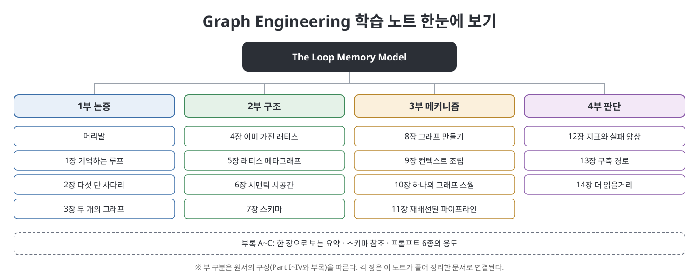

# **Graph Engineering 학습 노트: The Loop Memory Model**
(Graph Engineering: The Loop Memory Model, 장별 정리 노트)
 

이 문서는 Volodymyr Pavlyshyn의 『Graph Engineering: The Loop Memory Model』을 부와 장별로 정리한 한국어 학습 노트입니다. 원문을 번역한 것이 아니라 내용을 우리말로 풀어서 다시 설명했고, 처음 나오는 용어에는 풀이와 영어 병기를 붙였습니다. 책은 AI 에이전트가 생성, 비평, 수정을 반복하는 루프를 이미 많이들 만들지만 그 결과를 기억하고 추적하는 장치는 거의 없다는 문제의식에서 출발합니다. 그리고 에이전트 워크플로에 지속되는 기억과 추적성, 공유 지식을 그래프로 부여하는 방법을 4개 부와 부록 A~C로 풀어냅니다. 이 노트는 같은 순서를 따르며, 장마다 개념도와 표를 직접 만들어 넣었습니다.

> **이 노트를 읽을 때 유의할 점**
> - 이 노트는 원서의 **요약·해설본**이며 원서를 대신하지 않습니다. 정확한 스키마와 절차, 프롬프트 본문은 원서에서 확인하세요.
> - 책의 코드, 스키마 파일, 프롬프트 본문은 옮기지 않았습니다. 스키마는 표로 구조만 다시 정리했고, 프롬프트는 용도·입력·출력·제약만 요약했습니다.
> - 책이 소개하는 도구와 사례는 책이 쓰인 시점의 서술이며, 이 노트가 사실 여부를 검증한 것은 아닙니다. 불확실하거나 원서와 대조가 필요한 곳은 `참고(노트 작성자)`로 표시했습니다.
> - 일부 장은 표가 많아 분량이 깁니다. 핵심만 빠르게 보려면 각 부의 `핵심 정리`를 먼저 읽으세요.
 

---

## 목차

- [1부 논증 (머리말, 1~3장)](01.%201%EB%B6%80%20%EB%85%BC%EC%A6%9D/Readme.md)
  - [머리말](01.%201%EB%B6%80%20%EB%85%BC%EC%A6%9D/%EB%A8%B8%EB%A6%AC%EB%A7%90.md)
  - [1장 모두가 루프를 만들지만 기억하는 루프는 거의 없다](01.%201%EB%B6%80%20%EB%85%BC%EC%A6%9D/01%EC%9E%A5%20%EB%AA%A8%EB%91%90%EA%B0%80%20%EB%A3%A8%ED%94%84%EB%A5%BC%20%EB%A7%8C%EB%93%A4%EC%A7%80%EB%A7%8C%20%EA%B8%B0%EC%96%B5%ED%95%98%EB%8A%94%20%EB%A3%A8%ED%94%84%EB%8A%94%20%EA%B1%B0%EC%9D%98%20%EC%97%86%EB%8B%A4.md)
  - [2장 사다리: 다섯 가지 아키텍처, 다섯 가지 병목](01.%201%EB%B6%80%20%EB%85%BC%EC%A6%9D/02%EC%9E%A5%20%EC%82%AC%EB%8B%A4%EB%A6%AC%20%EB%8B%A4%EC%84%AF%20%EA%B0%80%EC%A7%80%20%EC%95%84%ED%82%A4%ED%85%8D%EC%B2%98%20%EB%8B%A4%EC%84%AF%20%EA%B0%80%EC%A7%80%20%EB%B3%91%EB%AA%A9.md)
  - [3장 그래프는 하나가 아니라 둘](01.%201%EB%B6%80%20%EB%85%BC%EC%A6%9D/03%EC%9E%A5%20%EA%B7%B8%EB%9E%98%ED%94%84%EB%8A%94%20%ED%95%98%EB%82%98%EA%B0%80%20%EC%95%84%EB%8B%88%EB%9D%BC%20%EB%91%98.md)
  - [핵심 정리](01.%201%EB%B6%80%20%EB%85%BC%EC%A6%9D/%ED%95%B5%EC%8B%AC%20%EC%A0%95%EB%A6%AC.md)
- [2부 구조 (4~7장)](02.%202%EB%B6%80%20%EA%B5%AC%EC%A1%B0/Readme.md)
  - [4장 이미 가진 래티스](02.%202%EB%B6%80%20%EA%B5%AC%EC%A1%B0/04%EC%9E%A5%20%EC%9D%B4%EB%AF%B8%20%EA%B0%80%EC%A7%84%20%EB%9E%98%ED%8B%B0%EC%8A%A4.md)
  - [5장 래티스 메타그래프](02.%202%EB%B6%80%20%EA%B5%AC%EC%A1%B0/05%EC%9E%A5%20%EB%9E%98%ED%8B%B0%EC%8A%A4%20%EB%A9%94%ED%83%80%EA%B7%B8%EB%9E%98%ED%94%84.md)
  - [6장 래티스를 위한 시맨틱 시공간](02.%202%EB%B6%80%20%EA%B5%AC%EC%A1%B0/06%EC%9E%A5%20%EB%9E%98%ED%8B%B0%EC%8A%A4%EB%A5%BC%20%EC%9C%84%ED%95%9C%20%EC%8B%9C%EB%A7%A8%ED%8B%B1%20%EC%8B%9C%EA%B3%B5%EA%B0%84.md)
  - [7장 스키마](02.%202%EB%B6%80%20%EA%B5%AC%EC%A1%B0/07%EC%9E%A5%20%EC%8A%A4%ED%82%A4%EB%A7%88.md)
  - [핵심 정리](02.%202%EB%B6%80%20%EA%B5%AC%EC%A1%B0/%ED%95%B5%EC%8B%AC%20%EC%A0%95%EB%A6%AC.md)
- [3부 메커니즘 (8~11장)](03.%203%EB%B6%80%20%EB%A9%94%EC%BB%A4%EB%8B%88%EC%A6%98/Readme.md)
  - [8장 그래프 만들기](03.%203%EB%B6%80%20%EB%A9%94%EC%BB%A4%EB%8B%88%EC%A6%98/08%EC%9E%A5%20%EA%B7%B8%EB%9E%98%ED%94%84%20%EB%A7%8C%EB%93%A4%EA%B8%B0.md)
  - [9장 컨텍스트 조립과 근거 기반 평가자](03.%203%EB%B6%80%20%EB%A9%94%EC%BB%A4%EB%8B%88%EC%A6%98/09%EC%9E%A5%20%EC%BB%A8%ED%85%8D%EC%8A%A4%ED%8A%B8%20%EC%A1%B0%EB%A6%BD%EA%B3%BC%20%EA%B7%BC%EA%B1%B0%20%EA%B8%B0%EB%B0%98%20%ED%8F%89%EA%B0%80%EC%9E%90.md)
  - [10장 하나의 그래프를 향한 스웜](03.%203%EB%B6%80%20%EB%A9%94%EC%BB%A4%EB%8B%88%EC%A6%98/10%EC%9E%A5%20%ED%95%98%EB%82%98%EC%9D%98%20%EA%B7%B8%EB%9E%98%ED%94%84%EB%A5%BC%20%ED%96%A5%ED%95%9C%20%EC%8A%A4%EC%9B%9C.md)
  - [11장 재배선된 파이프라인](03.%203%EB%B6%80%20%EB%A9%94%EC%BB%A4%EB%8B%88%EC%A6%98/11%EC%9E%A5%20%EC%9E%AC%EB%B0%B0%EC%84%A0%EB%90%9C%20%ED%8C%8C%EC%9D%B4%ED%94%84%EB%9D%BC%EC%9D%B8.md)
  - [핵심 정리](03.%203%EB%B6%80%20%EB%A9%94%EC%BB%A4%EB%8B%88%EC%A6%98/%ED%95%B5%EC%8B%AC%20%EC%A0%95%EB%A6%AC.md)
- [4부 판단 (12~14장)](04.%204%EB%B6%80%20%ED%8C%90%EB%8B%A8/Readme.md)
  - [12장 지표, 실패 양상, 만들지 말아야 할 때](04.%204%EB%B6%80%20%ED%8C%90%EB%8B%A8/12%EC%9E%A5%20%EC%A7%80%ED%91%9C%20%EC%8B%A4%ED%8C%A8%20%EC%96%91%EC%83%81%20%EB%A7%8C%EB%93%A4%EC%A7%80%20%EB%A7%90%EC%95%84%EC%95%BC%20%ED%95%A0%20%EB%95%8C.md)
  - [13장 구축 경로](04.%204%EB%B6%80%20%ED%8C%90%EB%8B%A8/13%EC%9E%A5%20%EA%B5%AC%EC%B6%95%20%EA%B2%BD%EB%A1%9C.md)
  - [14장 더 읽을거리](04.%204%EB%B6%80%20%ED%8C%90%EB%8B%A8/14%EC%9E%A5%20%EB%8D%94%20%EC%9D%BD%EC%9D%84%EA%B1%B0%EB%A6%AC.md)
  - [핵심 정리](04.%204%EB%B6%80%20%ED%8C%90%EB%8B%A8/%ED%95%B5%EC%8B%AC%20%EC%A0%95%EB%A6%AC.md)
- [부록 (A~C)](05.%20%EB%B6%80%EB%A1%9D/Readme.md)
  - [부록 A 한 장으로 보는 그래프 엔지니어링](05.%20%EB%B6%80%EB%A1%9D/%EB%B6%80%EB%A1%9D%20A%20%ED%95%9C%20%EC%9E%A5%EC%9C%BC%EB%A1%9C%20%EB%B3%B4%EB%8A%94%20%EA%B7%B8%EB%9E%98%ED%94%84%20%EC%97%94%EC%A7%80%EB%8B%88%EC%96%B4%EB%A7%81.md)
  - [부록 B 스키마 참조](05.%20%EB%B6%80%EB%A1%9D/%EB%B6%80%EB%A1%9D%20B%20%EC%8A%A4%ED%82%A4%EB%A7%88%20%EC%B0%B8%EC%A1%B0.md)
  - [부록 C 프롬프트](05.%20%EB%B6%80%EB%A1%9D/%EB%B6%80%EB%A1%9D%20C%20%ED%94%84%EB%A1%AC%ED%94%84%ED%8A%B8.md)

---

## 읽는 순서 제안

| 목적 | 추천 경로 |
|------|-----------|
| 왜 루프에 기억이 필요하고 그래프가 답인지 알고 싶다 | 1부 (머리말, 1~3장) |
| 지식을 어떤 구조와 스키마로 담는지 알고 싶다 | 2부 (4~7장) |
| 그래프를 만들고 에이전트가 읽고 쓰는 방식을 알고 싶다 | 3부 (8~11장) |
| 도입 여부를 판단하고 단계적으로 구축하고 싶다 | 4부 (12~14장) |
| 요약, 스키마 표, 프롬프트 용도를 빠르게 찾고 싶다 | 부록 (A~C) |

## 용어 몇 가지

| 용어 | 쉬운 설명 |
|------|-----------|
| 루프 메모리 (Loop Memory) | 에이전트 루프가 남기는 결정과 근거를 기억하는 장치 |
| 래티스 (lattice) | 마크다운 노드가 서로 연결된 지식 구조. 책의 출발점이 되는 기존 방식 |
| 지식 평면 / 작업 평면 | 오래 지켜야 할 지식과 매번 쌓이는 작업 기록을 나눠 담는 두 층 |
| 브리지 (bridge) | 두 평면을 잇는 유일한 연결 |
| 컨텍스트 조립 (context assembly) | 에이전트에게 줄 정보를 그래프에서 골라 한정된 크기로 만드는 일 |
| 근거 기반 평가자 (grounded evaluator) | 그래프의 근거에 비추어 결과를 판정하는 평가자 |
| 스웜 (swarm) | 여러 에이전트가 하나의 그래프를 함께 읽고 쓰는 구조 |

---

## 이 노트에 대하여

- 각 장 문서는 개요, 흐름, 본문 정리, 표, 그림, 핵심 정리, 이전·다음 링크 순서로 구성됩니다.
- 그림은 모두 이 노트용으로 새로 그린 SVG이며 책의 그림을 쓰지 않았습니다.
- 같은 저장소의 다른 학습 노트와 같은 형식을 따릅니다.

