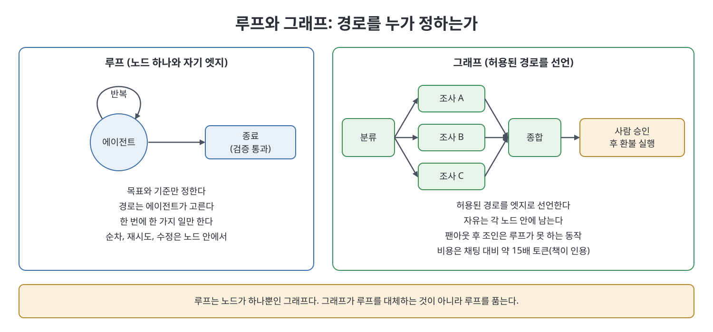
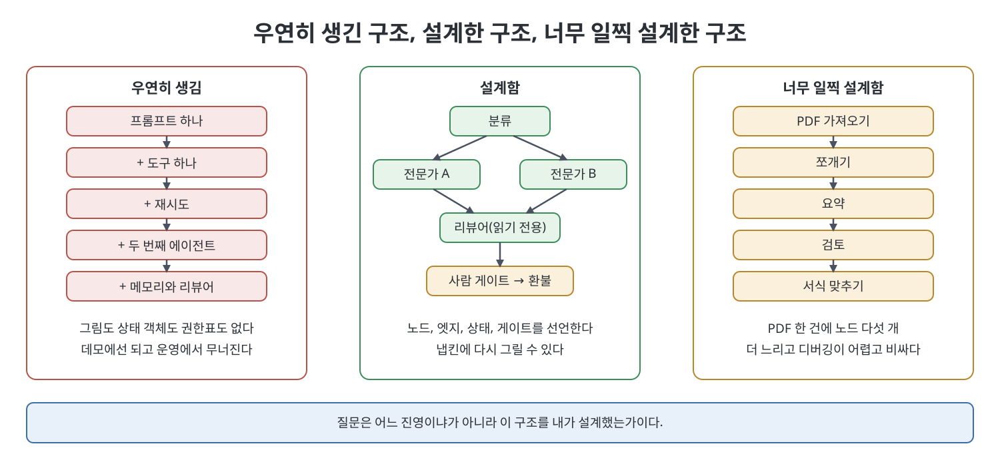

# 1장 그래프 엔지니어링은 당신이 소유하는 토폴로지다 (Graph Engineering Is Topology You Own)

이 장은 책 전체가 쓰는 이름의 뜻을 정한다. 책은 그래프 엔지니어링을 에이전트 시스템이 어떤 경로로 돌아가도록 허용할지 선언하는 일로 정의한다. 노드, 합법적 엣지, 실행 전체가 공유하는 상태, 갈라졌다 합쳐지는 지점, 되돌릴 수 없는 단계 앞의 게이트를 정한다. 루프(loop)는 일꾼 하나에 자기 자신으로 돌아오는 엣지 하나가 붙은 그림이다. 장은 2026년 7월에 이 이름이 퍼진 소동을 소재로 삼아 무엇이 새롭고 무엇이 오래된 것인지 가려낸다.

> **쉽게 말하면**
> 루프는 "목표만 줄 테니 길은 알아서 찾아라"이고, 그래프는 "갈 수 있는 길과 검문소를 내가 정해 둘게"다. 그래프는 루프를 없애지 않고 품는다. 예를 들어 PDF 한 건 요약은 루프 하나로 충분하고, 자료 세 곳을 동시에 조사해 종합한 뒤 사람이 승인해야 환불하는 일은 그래프가 필요하다.

> **참고(노트 작성자)** 이 장의 날짜, 게시물, 제품 상태, 수치는 책이 서술한 시점(2026년경)의 소개이며 노트가 검증하지 않았다. 도구와 버전은 바뀔 수 있다.

## 이 장의 흐름

1. 일은 토폴로지다: 루프와 그래프
2. 그 주에서 건진 세 가지 주장
3. 이름의 계보와 하네스라는 틀
4. 팬아웃이라는 힘과 비용
5. 숫자를 읽는 법
6. 설계했는가, 우연히 생겼는가

## 1. 일은 토폴로지다

책은 루프에서는 우리가 목표와 합격선을 정하고 경로는 에이전트가 고른다고 본다. 그래프에서는 유효한 경로와 길목의 점검을 우리가 선언하고, 남는 자유는 노드 안에 둔다. 핸드오프(노드 사이로 넘어가는 산출물)를 이름 붙일 수 없다면 아직 그래프가 아니다.

| 구분 | 루프 | 그래프 |
|------|------|--------|
| 경로를 정하는 쪽 | 에이전트 | 설계자가 선언한 엣지 |
| 자유가 있는 곳 | 작업 전체 | 각 노드 내부 |
| 할 수 있는 동작 | 순차, 재시도, 수정 | 거기에 팬아웃 후 조인, 전문가 인계, 사람 게이트 |
| 대표 사례 | Ralph 패턴(출력과 오류를 되먹임해 통과 기준까지 도는 bash 사이클) | LangGraph, AutoGen GraphFlow, ADK Workflow Runtime |

루프가 못 하는 동작은 하나, 갈라졌다 합치는 것이다. 순차, 재시도, 수정은 한 일꾼 안에서 일어난다. 전문가 둘이 동시에 일하고 종합 노드가 합친 뒤 읽기 전용 리뷰어가 보고 환불 앞에 사람이 서는 구조는 그릴 수 있고 버전 관리하고 테스트할 수 있는 그래프다. 일이 한 번의 순환에 들어가면 루프를 끝내면 된다.

## 2. 그 주에서 건진 세 가지 주장

책은 2026년 7월 18일 Peter Steinberger가 "아직 루프 얘기를 하는가, 이미 그래프로 넘어갔는가"를 물은 한 문장이 공개 이름이 되었다고 소개한다. 새 런타임이 아니라 이미 하던 결정에 이름이 붙은 것이라는 해석이다. 타임라인은 버리고 세 주장만 남긴다.

**첫째, 루프는 그래프의 퇴화한 경우다.** while 루프는 노드 하나와 자기 엣지를 가진 제어 흐름 그래프이고, 재시도 루프는 횟수 상한이 붙은 같은 그래프다. 그래프가 루프의 후계자인 것은 아니다. 트리가 연결 리스트의 후계자가 아닌 것과 같다. 상태 기계(state machine)를 한 번도 언급하지 않는 그래프 엔지니어링 글은 공학이 아니라 마케팅이라고 책은 경고한다.

**둘째, 이것이 그냥 LangGraph인가.** Harrison Chase의 질문에 책은 아이디어는 새롭지 않고 LangGraph가 유일한 구현도 아니라고 답한다. Anthropic의 2024년 12월 글이 나열한 다섯 패턴, 곧 프롬프트 체이닝, 라우팅, 병렬화, 오케스트레이터-워커, 평가자-최적화기는 산문으로 쓴 그래프 토폴로지다. 7월에 새로웠던 것은 무엇이 노드이고 엣지이며 상태에 무엇이 들어가는가라는 결정에 붙은 공동의 이름이었다. 구분 기준은 경로를 에이전트가 정하는가 설계자가 정하는가다.

**셋째, 프로덕션의 에이전트 그래프는 대개 DAG(순환 없는 방향 그래프)가 아니다.** 재시도, 정보 보충, 검증 뒤 수정, 반복 도구 사용, 사람 대기에는 순환이 필요하다. 병렬 작업자 수를 미리 알 수 없으므로 전이가 동적이어야 하고, LangGraph의 Send가 이를 위해 있다. 같은 날 Linear가 낸 Loops 제품은 트리거가 엣지, 실행 이력이 트레이스, 게시 대 초안이 사람 게이트인 그래프라고 책은 해석한다. 사용자가 원한 것은 읽고 한정하고 점검할 수 있는 반복 워크플로였다.

## 3. 이름의 계보와 하네스라는 틀

책은 7월 기원설을 경계하고 어휘의 계보만 남긴다. 2024년 1월 AlphaCodium 논문은 코드 생성의 단위가 프롬프트 하나가 아니라 생성, 테스트, 반복의 흐름이라고 주장했고, 같은 달 LangGraph가 순환 에이전트 그래프 라이브러리로 나왔다. 2026년 7월 4일 Josh C. Simmons의 에세이는 감사 추적, 재개 가능성, 승인 게이트, 지출 상한이라는 프로덕션 압력 때문에 암묵적 루프 대신 명시적 그래프를 쓰라고 했고, 책은 이 글을 실제 근거 문서로 꼽는다. 그 뒤 한 게시자가 프롬프트, 컨텍스트, 하네스, 루프, 그래프 순의 "사다리"를 올렸는데, 책은 이를 사람들이 그렇게 말했다는 경험적 사실로만 보고 아키텍처로 쓰지 않는다.

여기부터는 저자 자신의 합성이다. 책은 큰 변화를 사다리가 아니라 하네스 엔지니어링(harness engineering)으로 본다. 사전에 명세하는 결정론적 소프트웨어에서, 비결정적 에이전트를 실행 중에 제약하고 검증하고 조향하는 일로의 이동이다. 에이전트는 모델과 하네스의 합이며 책은 Birgitta Böckeler의 글을 소개한다. 그 우산 아래 프롬프트, 컨텍스트, 루프, 그래프, 메모리가 형제로 있다.

| 형제 | 설계 대상 | 그래프에서의 의미 |
|------|-----------|-------------------|
| 프롬프트 | 모델 호출 한 번의 지시 | 라우터, 작업자, 리뷰어 프롬프트는 서로 다른 대상이다 |
| 컨텍스트 | 유한한 창에 들어갈 토큰 | 노드마다 창이 있고 그래프가 경계를 넘는 산출물을 정한다 |
| 루프 | 한 에이전트의 반복 주기 | 능숙한 노드의 내부다 |
| 그래프 | 노드, 엣지, 공유 상태, 게이트 | 이 책의 주제인 토폴로지 |
| 메모리 | 실행을 넘어 기억하는 것 | 실행 그래프와 다른 두 번째 그래프(2장) |

한 형제에 뛰어나도 다른 형제에서 질 수 있다. 멈추지 못하는 노드로 만든 아름다운 그래프는 값비싼 방랑자일 뿐이다. 다섯 단계 열은 이름의 역사로는 쓸모 있어도 아키텍처로는 나쁘다. 뒤의 층이 앞의 층을 은퇴시키지 않는다.

## 4. 팬아웃이라는 힘과 비용

바뀐 것은 노드에 무엇을 넣을 수 있는가다. 초기의 노드는 결정적 코드나 LLM 호출 하나였지만 이제는 에이전트 한 번의 실행일 수 있다. 책이 소개하는 LangChain 문서 에이전트는 Slack과 Linear 작업은 고정 코드로, 분류기와 종합기는 도구 없는 단일 호출로, 문서 에이전트 둘은 전체 에이전트 스텝으로 섞는다. 그래프는 이 혼합이 난립이 되지 않게 한다.

핵심은 팬아웃(fan-out) 후 조인이다. "소스 다섯 곳을 조사하라"를 루프는 차례로 처리하며 첫 소스가 창을 채운다. 그래프는 소스마다 노드와 창을 주고 조인을 엣지로 만든다. 팬아웃 크기는 미리 모를 때가 많아 Send 같은 동적 장치가 필요하고, 상한은 프롬프트가 아니라 코드에 둔다. 조인은 부분 실패를 상태에 어떻게 표현할지 정하는 진짜 노드다.

비용은 공짜가 아니다. 책은 Anthropic의 멀티에이전트 리서치가 채팅 대비 약 15배 토큰을 썼다고 소개한다(넓게 병렬화되는 일의 수치, 상세는 5장). 인터넷에 도는 "호출 1배, 에이전트 4배, 그래프 15배" 사다리는 단일 호출 기준으로 재지 않았으니 민담이라는 지적이다. 책이 인용한 2025년 연구는 분해 가능한 금융 추론에서 80.8퍼센트 향상, 순차 계획에서 70.0퍼센트 하락을 보고한다. 파이프라인형 일에 에이전트를 더하면 나빠지고 팬아웃형 일에 더하면 나아질 수 있다는 정지 규칙이다. 지침은 간단하다. 루프를 먼저 익히고 일이 강제할 때만 쪼갠다. 쪼갤 때는 상태를 의도적으로 공유하고, 실패를 격리하고, 되돌리기 비싼 곳에 사람 게이트를 둔다.

## 5. 숫자를 읽는 법

책은 7월 이후 퍼진 두 주장을 증거 규율의 사례로 든다. 하나는 그래프 엔지니어링이 어느 대학과 AI 기업의 310만 달러 연구 주제였다는 주장으로, 책은 확인할 수 없었다는 2차 출처 사슬로만 소개한다. 다른 하나는 그래프가 RAG를 대체해 정확도 18퍼센트 상승, 비용 85퍼센트 감소를 냈다는 주장으로, 2026년 3월 산업 도면 GraphRAG 논문의 서로 다른 기준선을 이어 붙인 수치라는 팩트체크를 소개한다. 책은 이 숫자를 효과의 증거로 쓰지 않는다. 책이 소개하는 SmartScope 판정표도, 그래프가 루프를 불필요하게 만든다는 말은 근거 없음이고 그래프화가 신뢰성을 반드시 올린다는 말은 증거 불충분이라고 본다. 책이 요구하는 증거 기준은 URL, 과제, 분모가 있고 출처가 충돌하면 충돌을 그대로 보이는 것이다.

## 6. 설계했는가, 우연히 생겼는가

실패는 양쪽에 있다. 우연히 생긴 구조는 프롬프트에 도구, 재시도, 두 번째 에이전트, 메모리, 리뷰어를 차례로 더한 결과다. 그림도 상태 객체도 없고 어느 노드가 환불 도구를 부를 수 있는지 아무도 정하지 않았다. 데모에서는 돌다가 분산 시스템처럼 조용히, 그러다 한꺼번에 무너진다. 상태에 서로 다른 진실이 두 개 들어가고 재시도가 부수 효과를 두 번 실행한다. 반대로 너무 일찍 설계해 PDF 요약에 노드 다섯 개를 쓰면 에이전트 하나보다 느리고 비싸다.

같은 시기 두 번째 그래프가 끼어들었다. 책은 Neo4j 강사가 Google ADK로 가르친 지식 그래프 구축 과정이 유명 교육자의 "그래프 엔지니어링 강좌"로 오인된 사례를 든다. 지식 그래프는 데이터의 관계이고 워크플로 그래프는 작업의 관계다. 이 구분은 2장의 주제다.

판단 순서는 3장의 네 질문이 다룬다. 책은 7월의 소동을 기억할 필요는 없고 에이전트 실행의 신뢰도, 조율의 비용, 시스템이 갈 길을 그리는 일, 세 가지만 보라고 한다. 숙제는 발언 행위 목록(게시, 인용 게시, 답글, 시각)에서 발화자를 노드, 행위를 엣지로 하는 방향 그래프를 만들고 노드별 진입·진출 차수와 약하게 연결된 성분(weakly connected component)을 보고하는 과제이며, 런타임이나 창립 논문을 지어내지 말라는 조건이 붙는다.

## 핵심 정리

- 그래프 엔지니어링은 에이전트가 허용된 경로로만 돌게 토폴로지를 선언하고 소유하는 일이며, 판별 기준은 경로를 에이전트가 정하는가 설계자가 정하는가다.
- 루프는 노드 하나와 자기 엣지를 가진 퇴화한 그래프이고, 그래프는 루프를 대체하지 않고 품는다.
- 루프가 못 하는 동작은 팬아웃 후 조인이다. 이것이나 전문가 인계, 사람 게이트가 필요할 때 그래프를 쓴다.
- 하네스가 패러다임이고 프롬프트, 컨텍스트, 루프, 그래프, 메모리는 형제다. 사다리와 교체 서사는 거절한다.
- 숫자는 URL, 과제, 분모가 있을 때만 쓴다. 바이럴 수치는 증거가 아니다.
- 질문은 어느 진영이냐가 아니라 구조를 설계했는가이며, 대부분의 일은 루프에서 시작해야 한다.

 
 
 

이전: [머리말](%EB%A8%B8%EB%A6%AC%EB%A7%90.md) | 다음: [2장 실행 그래프와 메모리 그래프](02%EC%9E%A5%20%EC%8B%A4%ED%96%89%20%EA%B7%B8%EB%9E%98%ED%94%84%EC%99%80%20%EB%A9%94%EB%AA%A8%EB%A6%AC%20%EA%B7%B8%EB%9E%98%ED%94%84.md)

 

[Graph Engineering for Agentic AI Systems](../)
