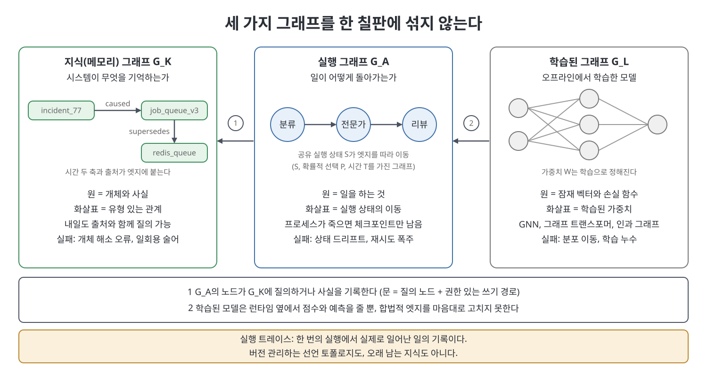
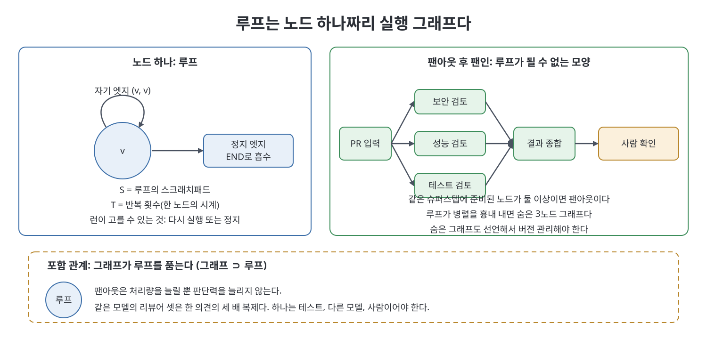

# 2장 실행 그래프와 메모리 그래프 (Execution Graphs and Memory Graphs)

이 장은 "그래프"라는 한 단어가 가리키는 세 대상을 갈라 놓는다. 실행 그래프(execution graph)는 일이 어떻게 돌아가는지의 토폴로지이고, 지식 그래프(knowledge graph)는 시스템이 무엇을 기억하는지의 토폴로지이며, 학습된 계산 그래프(learned computational graph)는 오프라인에서 훈련되는 모델이다. 책은 이 셋을 칠판 위에서 섞는 순간 설계 논의가 용어 수프가 된다고 경고한다. 장은 각 대상을 기호로 정의하고, 루프가 왜 실행 그래프의 한 점인지 보인 뒤, 칠판에 어느 그래프가 있는지 판별하는 질문을 준다.

> **쉽게 말하면**
> 실행 그래프는 "누가 다음에 무슨 일을 하나"를 그린 업무 흐름도이고, 지식 그래프는 "무엇이 무엇을 대체했나"를 적어 둔 사실 장부다. 흐름도는 돌아가고 장부는 조회된다. 예를 들어 "왜 Redis를 버렸나"는 일이 아니라 사실의 사슬을 따라가는 질문이다.

> **참고(노트 작성자)** 책은 2026년경의 도구와 사례를 전제하며 제품 상태와 측정값은 책의 소개다. 기호 G_A, G_K, G_L은 책의 표기를 따랐다.

## 이 장의 흐름

1. 충돌: 같은 말, 세 문제
2. 실행 그래프 G_A의 정의와 실제
3. 루프는 노드 하나의 퇴화 사례
4. 지식 그래프 G_K
5. GraphRAG와 학습된 그래프 G_L
6. 운영에서의 문, 그리고 판별 질문

## 1. 충돌: 같은 말, 세 문제

책은 한 레딧 글을 예로 든다. 작성자는 워크플로마다 DAG를 정의하고 노드를 에이전트로 두었으며, 구조는 ORG.md 파일에, 노드는 마크다운 파일에 적었다. 사람이 읽을 수 있는 파일로 쓴 작업 그래프일 뿐 지식 그래프도 GraphRAG도 GNN도 아니다. 책은 같은 낱말로 서로 다른 두 대상을 부르며 합의하지 못하는 이런 상태를 범주 오류라고 부른다.

한 탭에는 LangGraph, ADK 2.0 Workflow Runtime, AutoGen GraphFlow가 있어 노드가 일하고 엣지가 다음 단계를 말한다. 다른 탭에는 Neo4j, Microsoft GraphRAG, Graphiti 같은 메모리 쪽이 있어 노드는 개체와 사실이고 엣지는 유형 있는 관계다. 책은 GraphRAG의 노드는 행동하지 않고 그래프 엔지니어링의 노드는 행동한다고 요약한다.

| 대상 | 한 줄 정의 | 무엇이 오래 남나 |
|------|-----------|------------------|
| 실행 그래프 G_A | 선언된 작업 토폴로지(악보) | 코드와 함께 버전 관리됨 |
| 지식 그래프 G_K | 개체와 유형·시간·출처가 있는 사실 | 실행이 끝나도 질의 가능 |
| 학습된 그래프 G_L | GNN, 그래프 트랜스포머, 인과 그래프 | 훈련된 가중치 |
| 실행 트레이스 | 한 번의 실행에서 실제 일어난 일(연주) | 관측성 도구의 기록 |
| 개선 그래프 | 서로를 최적화하고 점검하는 루프들 | 실행 그래프의 한 종류 |



트레이스를 작업 그래프로 착각하면 선언된 엣지가 발화했는지는 묻지 않고 LLM 호출의 폭포만 디버깅하게 된다. 트레이스를 지식 그래프로 착각하면 대화 로그를 메모리로 취급하게 된다.

## 2. 실행 그래프 G_A의 정의와 실제

방향 그래프는 정점 집합 V와 순서쌍 집합 E의 쌍이다. 책은 에이전트 시스템을 이 맨몸의 쌍으로 묘사하기 어렵다고 보고 필요한 만큼만 주석을 단다.

$$G_A = (V_A, E_A, S, P, T)$$

- $V_A$: 일하는 단위인 노드. 결정적 코드, 단일 모델 호출, 도구, 전체 에이전트 루프, 평가자, 사람이 있고 유형이 중요하다. 글을 쓸 수 있는 리뷰어는 리뷰어가 아니다.
- $E_A$: "이 노드 다음에 저 노드가 발화해도 된다"는 허가. 순차, 조건, 팬아웃, 팬인, 순환, 인터럽트(interrupt, 사람 입력까지 멈춤)가 있다. 비즈니스 사실을 엣지로 저장하면 지식 그래프를 몰래 들여온 것이다.
- $S$: 공유 실행 상태. 프롬프트가 아니라 스키마로 다루며 노드는 부분 갱신을 반환하고 리듀서가 합친다.
- $P$: 확률적 부분. 일부 엣지는 모델이 고르지만 합법적 후속 노드 안에서만 고른다. 그래서 G_A가 GNN이 되지는 않는다.
- $T$: 슈퍼스텝(준비된 노드가 함께 발화하는 한 박자) 시간, 체크포인트(checkpoint), 인터럽트.

책의 지원 티켓 예가 전형이다. 분류기 노드가 이슈 유형을 상태에 쓰고, 라우터 엣지가 결제 건은 결제 전문가에게, 장애 건은 인프라 전문가에게 보낸다. 전문가는 각자 도구를 가진 작은 루프다. 다른 모델과 새 컨텍스트를 쓰는 읽기 전용 리뷰어가 검토하고, 반려되면 순환이 전문가를 되돌리며, 환불이면 도구로 가는 엣지에 사람 게이트가 선다. 환불 도구는 코드다. 노드는 약 여덟 개, 상태 필드는 열 개쯤이며 정책 사실은 상태에 넣지 않는다.

허용 목록이 곧 토폴로지다. 환불 도구로 가는 엣지가 없으면 프롬프트 주입에 당한 노드도 그 경로를 탈 수 없다. 노드를 더한다고 그래프가 더 참이 되지는 않고 더 비싸질 뿐이다.

## 3. 루프는 노드 하나의 퇴화 사례

책의 정리는 이렇다. $V_A = \{v\}$이고 엣지가 자기 엣지 (v, v)와 END로 가는 정지 엣지뿐이면 런이 고를 수 있는 것은 다시 발화하거나 멈추는 것뿐이다. S는 루프의 스크래치이고 T는 반복 횟수다. 이 객체는 루프이면서 그래프다. 큰 쪽을 작은 쪽의 대체물이라 부르면 포함 관계를 계승 관계로 착각한 범주 오류다. 책이 소개하는 Royce Lua의 문장대로 그래프 엔지니어링은 루프 엔지니어링을 죽이지 않고 포함한다. 수학에서 퇴화(degenerate)는 모욕이 아니다. 반지름 0인 원은 점이다.



루프가 못 하는 동작은 가지치기다. PR 리뷰에서 보안, 성능, 테스트 에이전트가 동시에 시작하고 네 번째가 결과를 합치는 식이다. 팬아웃은 같은 슈퍼스텝에 준비된 노드가 둘 이상일 때 성립하므로, 준비된 노드가 하나뿐인 그래프는 반복만 할 수 있다. 루프가 몰래 세 도구를 동시에 모은다면 버전 관리하지 않은 숨은 3노드 그래프다. 책은 두 가지를 주의시킨다. 같은 모델과 하네스의 리뷰어 셋은 한 의견이 세 번 나온 것이라 팬아웃은 처리량을 늘릴 뿐 판단력을 늘리지 않으며, 검사 하나는 테스트, 다른 모델, 사람처럼 네트워크가 스스로 만들 수 없는 것이어야 한다. 또 워커마다 비용을 낸다. 작업자를 더하는 이유는 채용 이유와 같아서 전문화, 병렬화, 컨텍스트 보호여야 한다.

## 4. 지식 그래프 G_K

책은 지식 그래프를 시스템이 기억하는 것이라 정의하고 기호로 쓴다.

$$G_K = (V_K, E_K, \tau, \pi)$$

$V_K$는 온톨로지(개체 유형 체계)로 검사받을 수 있는 개체와 사실, $E_K$는 supersedes, depends_on, caused 같은 유형 관계, $\tau$는 시간, $\pi$는 출처다. 시간은 두 축이다. 사실이 세상에서 참이던 시점과 시스템이 그것을 알게 된 시점이며, 책은 Graphiti가 엣지마다 두 시계를 둔다고 소개한다. 새 정보가 옛 엣지와 모순되면 옛 엣지의 유효 구간이 닫히고 이력은 남는다. 실행 상태 S도 제어 흐름 위의 확률 P도 없다. 저장소일 뿐이므로 G_K가 다음 행동을 정하게 하려면 G_A를 몰래 들여온 것이다.

유형의 가치를 책은 SurrealDB의 측정으로 보인다. 한 대화에서 추출한 속성 키 236개 중 85퍼센트가 한 번만 쓰였고(사실 325개, 키당 평균 1.4회) 동작 동사도 80퍼센트가 한 번뿐이었다. 같은 뜻을 residence, lives_in, home_city로 따로 적으면 질의가 허탕을 친다. 반면 기존 어휘를 보여 주고 재사용을 지시한 계열은 라벨당 4.3회였다. 처방은 쓰기 시점에 술어를 정규화하고 기존 개체에 멘션을 맞추는 것이다. 개체 해소(이름이 다른 둘이 같은 대상임을 알아보는 일)가 프로젝트가 죽는 자리다. 홉(hop)마다 정확도가 95퍼센트면 5홉 사슬은 77퍼센트, 85퍼센트면 44퍼센트만 믿을 수 있다. 유형 검사에 실패할 수 없는 "지식 그래프"는 유사도 그래프라고 부르라는 것이 책의 권고다.

## 5. GraphRAG와 학습된 그래프 G_L

그래프 엔지니어링은 G_A의 토폴로지이고, GraphRAG는 지식 그래프 위의 검색 패턴이다. 책이 설명하는 Microsoft GraphRAG 파이프라인은 텍스트에서 개체 지식 그래프를 추출하고, Leiden 커뮤니티 탐지를 돌리고, 커뮤니티를 요약한 뒤, 개체 중심의 로컬 검색과 요약 위의 맵리듀스인 글로벌 검색으로 답한다. 다중 에이전트 없이도 쓸 수 있다. 결론은 합성할 수 있지만 대체할 수 없다는 것이다. 에이전트 계층이 얹히면 그 계층이 작업 그래프이고 걷는 대상이 지식 그래프다. 1장의 +18/-85 수치는 G_K 쪽 검색 결과를 G_A 슬로건에 붙인 사례다.

G_L은 가중치 W를 가진 모델이다. LLM이 StateGraph의 엣지를 고르는 일은 학습된 인접 행렬 위의 메시지 전달이 아니다. 합법적 엣지는 사람이 썼고 모델은 그중 하나를 뽑을 뿐이다. 실행 메타데이터로 GNN을 훈련해 실패할 분기를 예측하는 것은 실재하는 교차점이지만 그 모델은 런타임이 아니라 G_A 곁에서 점수를 매긴다. G_K를 G_L에 합치면 출처를 잃는다. 가중치에는 누가 말했는지가 없다. 도달 가능성은 G_A, 개체 해소는 G_K, 링크 예측은 G_L의 성질이다. Hu Wei의 스케줄러 논문은 G_L이 아니라 G_A에 대한 논의다(10장).

## 6. 운영에서의 문, 그리고 판별 질문

책은 두 객체를 한 파일에 놓고 한쪽만 실행됨을 단언으로 보이는 예제를 싣는다. 개념만 새로 쓰면 이 정도다.

```python
class ExecGraph:                 # 실행 그래프: run이 있다
    def run(self, state): ...
class KnowledgeGraph:            # 지식 그래프: 질의만 된다
    def neighbors(self, src, rel): ...
assert not hasattr(KnowledgeGraph, "run")   # 사실은 실행되지 않는다
```

현실에서는 방이 분리되어도 집은 하나다. G_A의 질의 노드가 G_K에서 유형 사실을 읽고, 부수 효과 노드가 출처와 함께 새 사실을 되쓰며, 읽기와 같은 권한이 쓰기에도 적용된다. 되쓰는 경로가 선택 사항이면 망각을 안무한 셈이다. 트레이스를 출처 없이 G_K로 승격하면 환각이 정책이 되고, 사실을 S로 강등하면 병렬 전문가 둘이 고객 둘을 지어낸다. MCP는 G_A의 노드가 도구를 부르는 길이고 A2A는 엣지가 팀 경계를 넘는 길이다.

| 질문 | 실행 그래프 쪽 답 | 지식·학습 그래프 쪽 답 |
|------|------------------|----------------------|
| 원은 무엇인가 | 행동하는 것 | 사물(개체), 또는 잠재 벡터 |
| 화살표는 무엇인가 | 실행 상태의 이동 | 유형 관계, 또는 학습된 가중치 |
| 프로세스가 죽으면 | 트레이스나 체크포인트(멈춘 런일 뿐 기억 아님) | 내일도 출처와 함께 질의되면 G_K |
| 경로는 누가 정하나 | 에이전트 하나면 루프, 선언했으면 더 큰 G_A | 실행이 없으니 정하지 않음 |
| 조인은 무엇인가 | 대기 후 리듀서로 상태 병합 | 두 관계를 묶는 질의, 또는 메시지 전달 |

책은 열 가지 질문을 주며 위 표는 그 요지다. 영상이나 과정 제목의 "그래프 엔지니어링"이 가리키는 대상은 읽어 봐야 안다. 숙제는 작은 그래프 객체(정점, 엣지, 상태 스키마, 타임스탬프가 있는 삼중항)를 G_A, G_K, 트레이스로 분류하고 StateGraph 안의 supersedes 엣지 같은 혼합물을 걸러내는 과제다.

## 핵심 정리

- 그래프는 세 대상이다. 실행 그래프 G_A는 일의 토폴로지, 지식 그래프 G_K는 기억의 토폴로지, 학습된 그래프 G_L은 오프라인 모델이다. 트레이스는 따로 구분한다.
- G_A는 (V_A, E_A, S, P, T)로 쓰며 노드 유형, 엣지 종류, 상태 스키마, 확률적 선택, 슈퍼스텝 시간을 포함한다.
- 루프는 노드 하나와 자기 엣지를 가진 G_A다. 그래프가 루프를 품으며 팬아웃 후 조인이 루프가 못 하는 동작이다. 같은 모델의 리뷰어를 늘려도 판단력은 늘지 않는다.
- G_K는 유형, 시간 두 축, 출처가 있어야 지식 그래프이고 개체 해소가 가장 큰 비용이다. 사실은 실행되지 않으므로 엣지에 비즈니스 사실을 넣지 않는다.
- GraphRAG는 지식 그래프 위의 검색 패턴일 뿐 그래프 엔지니어링이 아니며 노드 안에 합성할 수는 있다.
- 칠판의 원이 일을 하는지, 사물인지, 벡터인지부터 물어 어느 방인지 정한다.

<br>
<br>
<br>

이전: [1장 그래프 엔지니어링은 당신이 소유하는 토폴로지다](01%EC%9E%A5%20%EA%B7%B8%EB%9E%98%ED%94%84%20%EC%97%94%EC%A7%80%EB%8B%88%EC%96%B4%EB%A7%81%EC%9D%80%20%EB%8B%B9%EC%8B%A0%EC%9D%B4%20%EC%86%8C%EC%9C%A0%ED%95%98%EB%8A%94%20%ED%86%A0%ED%8F%B4%EB%A1%9C%EC%A7%80%EB%8B%A4.md) | 다음: [3장 하네스 아래의 그래프](03%EC%9E%A5%20%ED%95%98%EB%84%A4%EC%8A%A4%20%EC%95%84%EB%9E%98%EC%9D%98%20%EA%B7%B8%EB%9E%98%ED%94%84.md)

<br>

[Graph Engineering for Agentic AI Systems](../)
