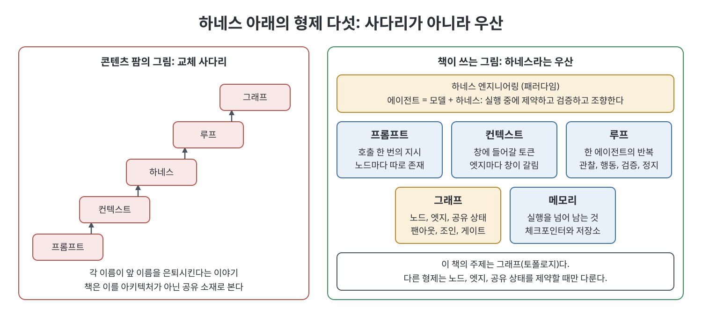
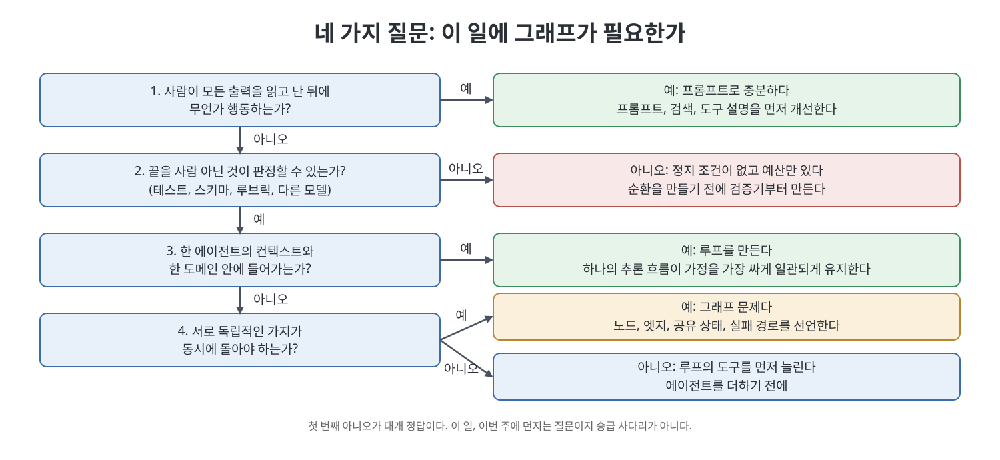

# 3장 하네스 아래의 그래프 (The Graph Under the Harness)

이 장은 프롬프트, 컨텍스트, 하네스, 루프, 그래프라는 다섯 이름을 사다리가 아닌 형제로 놓는다. 책은 하네스 엔지니어링을 그 아래의 패러다임, 곧 사전에 명세한 결정론적 소프트웨어에서 실행 중에 제약하고 검증하고 조향하는 비결정적 에이전트 시스템으로의 이동이라고 부르고, 메모리를 다섯째 형제로 더한다. 그래프 엔지니어링은 그중 토폴로지를 맡는다. 장은 각 형제가 토폴로지를 어떻게 제약하는지 훑고, 이 일에 그래프가 필요한지 가르는 네 질문과 비용, Cognition의 원칙을 정리한다.

> **쉽게 말하면**
> 프롬프트, 컨텍스트, 루프, 그래프, 메모리는 사다리의 칸이 아니라 한 공구함의 서로 다른 공구다. 새 공구가 생겼다고 망치를 버리지 않는다. 예를 들어 노드 다섯 개짜리 그래프를 짜도 각 노드는 여전히 프롬프트 한 번의 호출이라서, 지시가 엉성하면 다섯 노드가 함께 엉성해진다.

> **참고(노트 작성자)** 날짜, 인용된 글, 수치(15배, 90.2퍼센트 등)는 책이 서술한 2026년경 시점의 소개이며 노트가 검증하지 않았다. 수치의 상세는 책의 5장이 다룬다.

## 이 장의 흐름

1. 교체 이야기를 거절한다
2. 통제 단위로 본 형제들
3. 노드를 일꾼으로 만드는 환경
4. 형제별로 토폴로지를 제약하는 방식
5. 네 질문, 졸업이 아니다
6. 비용, Cognition의 원칙, 운영자

## 1. 교체 이야기를 거절한다

새 이름이 나오면 사람들은 앞 이름의 장례식으로 받아들인다. 컨텍스트 엔지니어링이 프롬프트를 낡게 만들고, 하네스가 컨텍스트를 해결하고, 루프가 프롬프팅을 끝내고, 그래프가 루프를 고풍스럽게 만든다는 이야기다. 책은 이를 공학이 아니라 콘텐츠 팜의 타임라인이라고 부른다. 2026년 7월 11일 한 게시자가 다섯 이름을 한 열로 늘어놓았고, 루프 엔지니어링의 명명자는 프롬프트 엔지니어링이 과도기였다고 썼다. 책은 이 열을 민속 분류로 취급한다. 성숙도 모델도 앞 이름이 은퇴하는 순서도 아니다.

책 자신의 합성은 이렇다. 하네스는 두 칸 사이에 끼인 한 칸이 아니라 우산이며, "에이전트 = 모델 + 하네스"라는 슬로건이 가리키는 모델 바깥의 모든 것이다. 책은 Royce Lua의 "루프는 그래프 안에 산다"는 말과 양립하되 Lua는 하네스를 한 칸으로 본다는 차이를 밝힌다. "그래프 엔지니어링으로 옮겼습니까"라는 물음에 책이 권하는 대답은 승급 보고가 아니라, 이 일에 이 정지 조건으로 이 단위를 설계하며 다른 형제도 여전히 유효하다는 설명이다.

## 2. 통제 단위로 본 형제들

통제 단위란 바꾸면 시스템 행동이 바뀌는 가장 작은 것이다. 책은 이름이 공개적으로 나타난 순서를 주의의 역사로 정리하되 퇴장의 역사가 아니라고 못 박는다.

| 시기 | 이름이 붙은 단위 | 새로 떠오른 질문 |
|------|-----------------|------------------|
| 2023 | 프롬프트 | 호출 하나의 지시를 어떻게 쓰나 |
| 2024 | 창(컨텍스트) | 유한한 주의 예산에 무엇을 넣나 |
| 2025 | 환경(하네스) | 도구, 파일, 권한, 검증기, 지출 상한을 어떻게 두나 |
| 2026 초 | 루프 | 한 에이전트가 어떻게 돌고 언제 멈추나 |
| 2026 중 | 토폴로지(그래프) | 누가 일하고 무엇이 팬아웃하며 사람은 어디 있나 |
| 이름 없이 존재 | 메모리 | 실행을 넘어 무엇이 남나 |

두 사실이 따른다. 첫째, 토폴로지에 뛰어나도 다른 형제에서 질 수 있다. 책이 소개하는 Anthropic의 멀티에이전트 리서치 시스템은 오케스트레이터-워커 그래프였지만 조정 실패를 고친 주된 수단은 프롬프트였다. 초기 버전은 단순 질의에 서브에이전트 50개를 띄웠고, 질의 복잡도에 맞춰 노력을 조절하라고 언어로 가르쳐 고쳤다. 둘째, 같은 구조를 구현한 두 엔지니어가 정반대 결과를 낼 수 있다. 아키텍처는 이해하고 속도를 높이는 사람과 이해를 건너뛰는 사람을 구분하지 못한다.

## 3. 노드를 일꾼으로 만드는 환경

노드마다 도구 세트, 권한 경계, 상태를 쓸 장소가 있다. 한 일꾼에 대해 이를 설계하지 않았다면 셋을 연결하는 것은 오케스트레이션이 아니라 사전을 공유하는 무인 프로세스 셋이다.

- **워크트리(worktree)**: git의 별도 작업 디렉터리. 쓰기 노드를 팬아웃하면서 워크트리를 주지 않으면 레이스 컨디션을 다이어그램으로 그린 꼴이다.
- **스킬**: 프로젝트 지식을 SKILL.md 같은 형태로 한 번 적어 둔 것. 특정 노드 유형에만 묶으면 리뷰어가 작성자를 겸하는 일을 막는다.
- **플러그인과 커넥터**: MCP로 노드가 파일 시스템 밖으로 닿는 길. 어느 노드가 어느 서버를 부를 수 있는가는 엣지 모양의 사실이므로 시스템 프롬프트가 아니라 코드로 강제한다.
- **환경 속 메모리**: 마크다운 파일이나 보드처럼 대화 밖에 사는 상태. 이것이 없으면 일꾼이 아니라 도구 붙은 채팅이다.

책은 Simon Willison의 글을 소개한다. 5달러 예산과 한 조직 안에서만 앱을 만들 수 있는 API 키를 준 실험에서 루프는 조사였고 환경이 폭발 반경이었다. 리뷰어가 환불 도구를 부를 수 있다면 그래프는 거짓이다.

## 4. 형제별로 토폴로지를 제약하는 방식

| 형제 | 토폴로지를 제약하는 방식 | 실패 신호 |
|------|------------------------|-----------|
| 그래프 | 노드와 엣지 목록, 확률적 선택, 상태 스키마와 리듀서, 인터럽트, 지출 상한, 사람 게이트 | 이름만 다르고 같은 일을 하는 노드들 |
| 프롬프트 | 모델 호출과 라우팅 결정이 모두 하나의 완성(completion) | 팬아웃 한도 없는 라우터의 서브에이전트 폭주 |
| 컨텍스트 | 모든 엣지가 하나의 창. 압축, 노트, 서브에이전트 격리가 엣지 정책 | 하염없이 쌓이는 상태 덤프 |
| 루프 | 노드는 관찰, 행동, 검증, 정지를 가진다. 검증기가 병목 | 정지 조건 없이 예산뿐인 노드 |
| 메모리 | 턴 안(창), 런 안(체크포인터), 런 너머(스토어)의 세 지속 시간 | 조인이 어제 답한 질문을 다시 묻는다 |

**그래프.** 라우팅은 정적, 조건부, 동적(팬아웃 수를 실행 중에 앎), 모델 샘플링의 네 종류이고 Anthropic의 다섯 패턴이 그 위에 있다. 공유 상태는 엣지가 실어 날라야만 경계를 넘는다. 작성자가 조사자의 기각된 출처를 못 보면 되살려 놓고, 리뷰어가 작성자의 전체 트레이스를 보면 관대하게 채점하며, 병렬 작업자가 서로의 결정을 모르면 조인이 모순을 물려받는다. 운영 그래프에는 안정적인 조직 그래프(누가)와 일시적인 작업 그래프(지금 무엇을)의 두 시간 규모가 있고 둘 다 실행 토폴로지다. 노드는 진짜 전문 분야일 때만 만들고, 냅킨에 그릴 수 없으면 너무 복잡한 것이다.

**프롬프트.** 도구 이름과 매개변수 설명도 사실상 프롬프트이며, 책은 SWE-bench용 에이전트에서 가장 큰 개선이 절대 경로를 요구한 것이었다고 소개한다. 90.2퍼센트 향상은 상자를 더해서가 아니라 오케스트레이터에게 몇 개를 띄울지 언어로 가르쳐서 나왔다. 토폴로지는 리뷰어 노드의 존재를 강제해도 리뷰어가 좋음이 무엇인지 알게 하지는 못한다.

**컨텍스트.** 어텐션은 쌍별이라 창이 차면 사실을 회상하는 능력이 떨어진다(context rot). 책이 소개하는 세 기법이 토폴로지와 대응한다. 압축(compaction)을 노드 경계에서 하면 그것이 엣지 정책이다. 구조화 노트는 창 밖에 적어 두었다 불러오는 것으로 이미 메모리 엔지니어링이다. 서브에이전트는 깨끗한 창에서 깊이 일하고 요약만 돌려주는 그래프 모양의 수이면서 암묵적 결정이 어긋나는 출처다. 엣지에는 덤프 대신 경로를 싣는 것이 가장 싸다.

**루프.** 어려운 것은 순환이 아니라 정지 조건이다. 테스트, 스키마, 루브릭, 두 번째 모델처럼 작성자가 아닌 무언가가 예라고 말해야 하며, 그렇지 못하면 예산일 뿐이다. 상태가 대화에만 있으면 내일 아침 재개할 런이 없다. 책은 Willison의 기준도 가져온다. 성공 기준이 분명하고 시행착오가 많은 문제에 루프가 맞다. 그래프를 설계해 생각을 피하는 것은 같은 항복을 더 예쁜 그림으로 하는 것이다.

**메모리.** 상태가 커지는 대화록이라면 상자 달린 루프일 뿐이다. 책은 메모리를 독립된 층으로 다룰 때의 세 규칙을 든다. 엣지는 데이터가 아니라 참조를 넘겨 토큰 팽창과 전화 게임을 막는다. 조인은 가시성을 정한다. 최종 산출물만 넘기면 얕은 핸드오프이고, 기각된 경로와 발견한 제약까지 넘기면 의미 있는 상호 검토가 된다. 재개가 노드 입구부터 다시 돌므로 부수 효과는 노드 하나에 하나씩 분리해 재개가 환불을 두 번 쏘지 않게 한다(노드 단위 멱등성).

## 5. 네 질문, 졸업이 아니다

책은 MarkTechPost가 사다리로 낸 네 질문을 가져오되 사다리는 버린다. 순서대로 묻고 첫 번째 아니오가 대개 정답이다.

사람이 모든 출력을 읽는다면 프롬프트로 충분하고 루프는 자율이 아니라 무감독 실행을 사 줄 뿐이다. 끝을 사람 아닌 것이 확인할 수 없다면 예산뿐이므로 순환 전에 검증기부터 만든다. 한 에이전트의 컨텍스트와 한 도메인에 들어가면 루프를 짓는다. 단일 추론 흐름이 가정을 가장 싸게 일관되게 유지하기 때문이다. 독립 가지가 동시에 돌아야 하면 그래프 문제이고 아니면 루프의 도구를 늘린다. 같은 브리핑도 월요일엔 그래프였다가 소스가 한 코퍼스로 합쳐지면 루프일 수 있고, PDF 요약기는 영원히 루프다.

## 6. 비용, Cognition의 원칙, 운영자

토폴로지 형제는 비싸다. 책은 Anthropic의 2025년 6월 글이 넓게 병렬화되는 리서치에서 채팅의 약 15배 토큰을 썼다고 소개하며, 이는 스티커 가격이 아니라 계획용 숫자다. 약한 검증기를 가진 루프는 퓨즈가 터질 때까지 나쁜 답을 만들고 그래프는 이를 병렬로 곱한다. 가장 싼 조정 수정은 여전히 프롬프트다. 서브에이전트 50개 사건의 해법은 스케일링 규칙을 한 번 쓴 프롬프트였으니, 그래프가 비싸다는 말이 나오면 오케스트레이터 프롬프트에 규칙이 있는지부터 보라는 것이 책의 권고다.

Cognition의 두 원칙은 창이 둘 이상 걸린 모든 곳에 걸린다. 하나는 전체 트레이스를 공유하라는 것이고 하나는 행동이 암묵적 결정을 담는다는 것이다. 노드의 출력만 넘기면 전화 게임이 된다. 조사자가 어떤 출처를 무시했는지는 트레이스에 있고 작성자가 받는 노트에는 없다. 병렬 작업자가 서로 못 보면 조인은 독립된 사실이 아니라 이미 확정된 해석들을 병합하는 외교를 하게 된다. 책의 기본값은 단일 스레드 선형 에이전트이며, 질문만 하는 서브에이전트를 쓰는 Claude Code가 긍정 사례다. 팬아웃은 가지가 정말 독립적이고 조인이 결정까지 볼 수 있을 때만 쓰고, 어기려면 15배를 치르고 조인을 설계한 상태에서 일부러 어겨야 한다.

마지막으로 책은 운영자가 아키텍처보다 중요하다고 말한다. 도메인을 모르는 컨텍스트 엔지니어는 잡담처럼 보인 결정을 압축해 없애고, 모르는 루프 엔지니어는 모델이 거짓말로도 만족시킬 정지 조건을 쓴다. 그래프에서는 다섯 노드가 줄지어 거짓말한다. 형제는 이를 막지 않고 더 빠르게 만들 뿐이다. 숙제는 짧은 시스템 설명(서브에이전트 50개를 띄운 라우터, 환불할 수 있는 리뷰어, 대화 로그인 저장소 등)을 다섯 형제에 비춰 어느 층이 일하고 어느 층이 이웃의 버그로 비난받는지 분류하는 과제다.

## 핵심 정리

- 프롬프트, 컨텍스트, 루프, 그래프, 메모리는 하네스 아래의 형제이고 서로를 은퇴시키지 않는다. 그래프는 토폴로지를 맡는다.
- 통제 단위의 이름은 주의의 역사이며 퇴장의 역사가 아니다. 노드는 모델을 부르는 한 계속 프롬프트다.
- 노드마다 도구, 권한, 쓸 상태가 있어야 일꾼이다. 도구 접근은 시스템 프롬프트가 아니라 코드로 강제한다.
- 네 질문은 순서대로 묻고 첫 아니오가 대개 답이다. 팬아웃이 진짜 트리거다.
- 15배는 계획 숫자다. 가장 싼 조정 수정은 오케스트레이터 프롬프트의 스케일링 규칙인 경우가 많다.
- 엣지는 컨텍스트 경계다. 병렬 작업자가 독립적이고 조인이 결정까지 볼 수 있을 때만 팬아웃하고, 아니면 단일 스레드로 압축한다.

 
 
 

이전: [2장 실행 그래프와 메모리 그래프](02%EC%9E%A5%20%EC%8B%A4%ED%96%89%20%EA%B7%B8%EB%9E%98%ED%94%84%EC%99%80%20%EB%A9%94%EB%AA%A8%EB%A6%AC%20%EA%B7%B8%EB%9E%98%ED%94%84.md) | 다음: [4장 에이전트 그래프의 해부](../02.%202%EB%B6%80%20%EC%84%A4%EA%B3%84/04%EC%9E%A5%20%EC%97%90%EC%9D%B4%EC%A0%84%ED%8A%B8%20%EA%B7%B8%EB%9E%98%ED%94%84%EC%9D%98%20%ED%95%B4%EB%B6%80.md)

 

[Graph Engineering for Agentic AI Systems](../)
