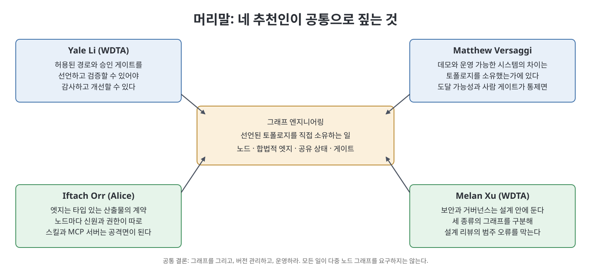

# 머리말 (Forewords)

이 글은 책 앞머리에 실린 네 편의 추천사(포워드)를 요약한 노트다. 추천사는 저자 켄 황(Ken Huang)이 『Graph Engineering for Agentic AI Systems』를 왜 지금 쓰는지, 이 책이 어떤 빈틈을 메우는지를 외부 전문가 네 명의 목소리로 보여 준다. 네 사람의 직함과 배경은 서로 다르지만 가리키는 문제는 같다. 에이전트 시스템의 구조, 곧 토폴로지(topology, 노드와 엣지가 이루는 연결 구조)를 누가 소유하고 있는가 하는 문제다.

> **쉽게 말하면**
> 에이전트를 둘 이상 붙이는 순간 구조는 이미 생겨 있다. 이 책은 그 구조를 우연에 맡기지 말고 그려서 직접 소유하라고 말한다. 예를 들어 "리뷰어 에이전트가 환불 도구를 호출할 수 있는가"는 프롬프트가 아니라 그림에서 정해야 하는 질문이다.

> **참고(노트 작성자)** 추천인의 직함과 단체 소개는 책이 서술한 시점(2026년경) 기준이며 노트가 검증하지 않았다. 추천사 문장은 옮기지 않고 요지만 정리했다.

## 이 글의 흐름

1. 책이 겨냥하는 문제
2. 네 추천인의 강조점
3. 네 편이 같은 말로 끝나는 이유
4. 책 전체의 구성

## 1. 책이 겨냥하는 문제

추천사들이 공통으로 소개하는 저자의 정의는 이렇다. 그래프 엔지니어링(graph engineering)이란 에이전트 시스템이 어떤 경로로 돌아가도록 허용할지를 미리 선언하는 일이다. 선언 대상은 다섯 가지다.

- 일을 나눠 맡는 전문화된 노드(node)
- 노드 사이에서 합법적인 엣지(edge)
- 한 번의 실행(run) 동안 모두가 공유하는 상태(state)
- 일이 갈라졌다가 다시 합쳐지는 지점
- 되돌릴 수 없는 단계 앞에 놓는 게이트(gate)

추천사가 되풀이하는 주장은 세 가지다. 첫째, 구조를 선언하지 않아도 구조는 존재한다. 다만 주인이 없을 뿐이다. 둘째, 실행 그래프(execution graph), 지식 그래프(knowledge graph), 학습된 계산 그래프(learned computational graph)는 서로 다른 대상이므로 한 방법인 듯 섞으면 안 된다. 셋째, 거절 기준이 필요하다. 모든 일이 다중 노드 그래프를 요구하지는 않으며, 엣지가 실어 나를 핸드오프(인수인계 대상)를 말로 설명할 수 없다면 노드를 더하기 전에 멈추라는 것이다.

## 2. 네 추천인의 강조점

| 추천인 | 책이 소개하는 배경 | 강조점 |
|--------|------------------|--------|
| Yale Li | WDTA 공동 창립자·집행 의장, CSA 중화권 지부 의장 | 모델이 강하다고 안전한 것은 아니다. 제어 경로, 출처가 있는 메모리, 부분 실패와 비용 통제가 필요하고, 토폴로지 자체를 거버넌스 산출물로 다뤄야 감사할 수 있다 |
| Matthew Versaggi | AI 분야 Presidential Innovation Fellow | 조직이 실패하는 까닭은 모델 부족이 아니라 시스템이 어떻게 돌도록 허용되는지 말하지 못해서다. 토폴로지는 장식이 아니라 통제면이다 |
| Iftach Orr | Alice 공동 창립자·CTO, OWASP Agentic Skills Top 10 공동 리드 | 선언되지 않은 토폴로지가 가장 흔한 실패 원인이다. 엣지는 타입 있는 산출물과 제한된 권한의 계약이고, 스킬·MCP 서버 같은 도구도 그래프에 들어오면 공격면이 된다 |
| Melan Xu | WDTA 집행이사, CSA 중화권 지부 사무총장 | 속도만으로는 진보가 아니다. 보안과 거버넌스를 설계 안에 두고, 도달 가능성·공유 상태 위험·승인 게이트를 점검 가능하게 하며, 벤더가 바뀌어도 남는 어휘를 제공한다 |

WDTA(World Digital Technology Academy)는 책이 소개하는 국제 비영리 기구이고, 두 추천인이 속한 곳이다. 책은 WDTA와 출판사 Packt가 공동으로 펴냈다고 밝힌다.

네 추천인은 강조점이 보안, 운영, 설계 검토, 표준화로 갈리지만 같은 세 가지 질문으로 모인다. 어떤 노드가 행동할 수 있는가, 어떤 전이가 허용되는가, 어느 단계에 사람의 승인이 필요한가.

## 3. 네 편이 같은 말로 끝나는 이유

추천사는 모두 "그래프를 그리고, 버전 관리하고, 운영하라"는 취지의 문장으로 마무리된다. Orr는 여기에 "엣지에서 강제하라"는 말을 덧붙인다. 이 구호는 구조를 코드처럼 다루라는 뜻이다. 그려 두면 리뷰할 수 있고, 버전을 붙이면 변경을 추적할 수 있고, 운영하면 실제 실행이 선언과 일치하는지 볼 수 있다.

보안 쪽 추천인들이 공통으로 꼽는 점검 단위도 같다. 도달 가능성(어떤 경로로 그 도구까지 갈 수 있는가), 공유 상태(어느 노드가 무엇을 덮어쓸 수 있는가), 권한 주체(각 노드가 누구의 이름으로 행동하는가), 되돌릴 수 없는 행동의 게이트다. 정적 프롬프트 테스트로는 이런 문제를 잡지 못하고, 여러 턴과 여러 도구가 얽힌 조건에서 경로(walk)를 평가해야 한다는 것이 Orr의 요지다.

## 4. 책 전체의 구성

추천사는 14개 장이 정의와 해부에서 시작해 패턴과 프레임워크, 프로덕션 운영, 컴퓨터 과학적 바탕, 보안과 신원, 경로 평가로 이어지고, 업계 이름이 바뀌어도 명시적 토폴로지를 지키라는 주장으로 끝난다고 소개한다. 이 노트는 책의 장을 여섯 부로 묶는다.

| 부 | 장 | 한 줄 요약 |
|----|----|-----------|
| 1부 기초 | 1~3장 | 토폴로지가 무엇이고 어떤 그래프를 말하는지 정한다 |
| 2부 설계 | 4~6장 | 해부, 만들지 말아야 할 때, 노드를 얻는 패턴 |
| 3부 구현과 지식 | 7~8장 | 배포 가능한 프레임워크, 메모리로서의 지식 그래프 |
| 4부 운영과 이론 | 9~10장 | 프로덕션 운영, 컴퓨터 과학적 근거 |
| 5부 보안과 경계 | 11~12장 | 보안·신원·거버넌스, 그래프 인텔리전스의 경계 |
| 6부 검증과 결론 | 13~14장 | 테스트·평가·검증, 이름이 잊혀도 남길 것 |

## 핵심 정리

- 책은 그래프 엔지니어링을 에이전트가 허용된 경로로만 돌게 토폴로지를 선언하고 소유하는 일로 정의한다.
- 네 추천인은 보안, 운영, 설계 검토, 표준화라는 서로 다른 자리에서 같은 문제를 짚는다. 구조가 암묵적이면 주인이 없다는 것이다.
- 실행 그래프, 지식 그래프, 학습된 그래프를 구분하고, 모든 일에 그래프가 필요하지는 않다는 거절 기준을 함께 가르치는 것이 책의 태도다.
- 실천 구호는 그리고, 버전 관리하고, 운영하라이며, 점검 단위는 도달 가능성, 공유 상태, 권한 주체, 게이트다.

 
 
 

이전: [최상위 Readme](../Readme.md) | 다음: [1장 그래프 엔지니어링은 당신이 소유하는 토폴로지다](01%EC%9E%A5%20%EA%B7%B8%EB%9E%98%ED%94%84%20%EC%97%94%EC%A7%80%EB%8B%88%EC%96%B4%EB%A7%81%EC%9D%80%20%EB%8B%B9%EC%8B%A0%EC%9D%B4%20%EC%86%8C%EC%9C%A0%ED%95%98%EB%8A%94%20%ED%86%A0%ED%8F%B4%EB%A1%9C%EC%A7%80%EB%8B%A4.md)

 

[Graph Engineering for Agentic AI Systems](../)
