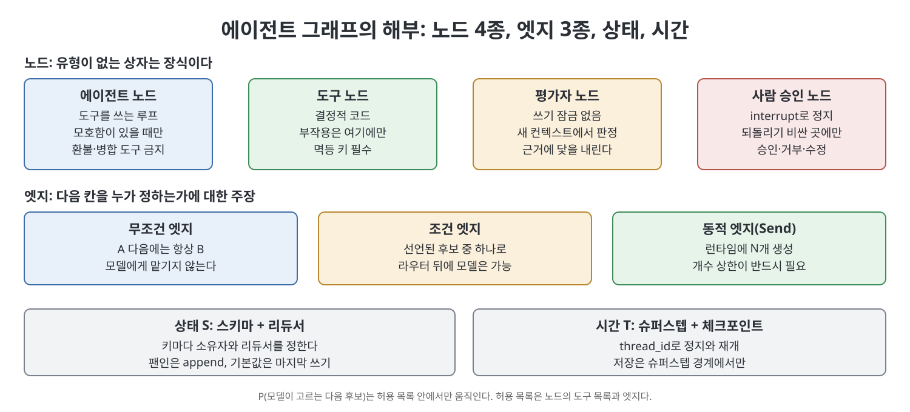
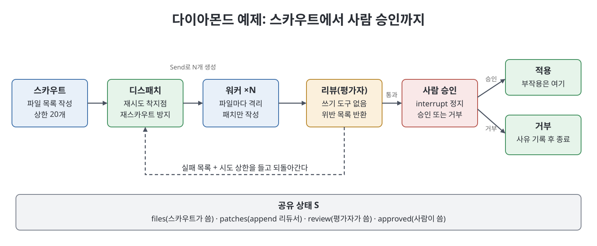

# 4장 에이전트 그래프의 해부 (Anatomy of an Agent Graph)

루프는 일꾼 한 명이 제자리를 도는 구조다. 그래프는 일꾼, 도구, 평가자, 사람이 이름 붙은 길로 이어지고 실행 기록을 함께 쓰는 조직이다. 이 장은 그 조직을 분해해 부품 이름을 붙인다. 노드는 네 종류, 엣지는 세 종류이고, 상태(state)는 계약이며, 체크포인트(checkpoint)가 있어야 정지와 재개가 가능하다. 책은 LangGraph를 정의가 아니라 작업용 문법으로 쓴다고 밝힌다. 이 장이 막으려는 실패는 같은 모델과 같은 하네스(harness)로 만든 검토자들이 서로 닮은 오류를 내놓는 일이다.

> **쉽게 말하면**
> 그래프의 모든 상자와 화살표는 유형을 말할 수 있어야 한다. 유형을 못 말하는 상자는 장식이니 지운다. 예를 들어 "환불 실행"은 도구 노드이고, 모델은 그 노드에 손댈 수 없다.

> **참고(노트 작성자)** 이 장이 소개하는 LangGraph, Google ADK 2.0, 수치와 날짜는 책이 쓰인 2026년경 기준이다. 버전별 기본값은 바뀔 수 있으니 쓰기 전에 공식 문서로 확인하는 것이 좋다.

## 이 장의 흐름

1. 다섯 요소 튜플: 프레임워크가 아니라 구조
2. 노드 네 가지 유형과 노드가 아닌 것
3. 엣지 세 가지 유형과 그리면 안 되는 엣지
4. 상태는 계약이다
5. 체크포인트, 동적 팬아웃, 실패 복구
6. 닮은 오류의 실패와 독립 검증
7. 사람 승인 노드와 ADK 2.0 환불 그래프
8. 예제: 스카우트, 병렬 워커, 리뷰, 사람 관문

## 1. 다섯 요소 튜플

책은 실행 그래프(execution graph)를 $G_A=(V_A,E_A,S,P,T)$ 다섯 요소로 적는다. 평범한 노드와 엣지에 세 글자가 더 붙은 것이며, 그 세 글자가 설계의 핵심이다.

| 기호 | 뜻 | 한 줄 요령 |
|------|----|-----------|
| $V_A$ | 유형이 있는 노드 집합 | 유형을 못 말하면 지운다 |
| $E_A$ | 유형이 있는 엣지 집합 | 다음 칸을 누가 정하는지의 주장이다 |
| $S$ | 공유 실행 상태(스키마 + 리듀서) | 대화 기록이 아니라 작업 기록이다 |
| $P$ | 허용된 후보 중 모델이 고르는 선택 | 후보 목록은 노드의 도구와 엣지가 정한다 |
| $T$ | 슈퍼스텝 시계와 체크포인트 | 멈출 수 없으면 그래프가 아니라 스크립트다 |

루프는 일꾼 노드 하나와 정지 규칙에 걸린 되돌림 엣지로 이루어진 특수한 경우이고, 대부분의 프로덕션 에이전트는 거기서 멈춰도 된다. 이 장은 전문 영역이 둘 이상이거나 팬아웃 개수가 데이터에 달렸거나 사람이 거부할 수 있어야 하는 경우만 다룬다.



## 2. 노드 네 가지 유형

노드는 함수다. 입력으로 현재 상태를 받고 부분 갱신을 돌려준다. 책은 노드를 직함이 아니라 유형으로 부르라고 권한다. 직함으로 부르면 도식이 썩고, 유형으로 부르면 설계 리뷰에서 반대할 근거가 생긴다.

| 유형 | 하는 일 | 하지 말아야 할 일 |
|------|--------|------------------|
| 에이전트 | 도구를 쓰며 도는 루프, 불확실성이 허가의 근거 | 환불·병합 같은 부작용 도구 보유 |
| 도구 | 결정적 코드(DB 조회, 테스트 실행, 결제 호출) | 판단을 넣는 일 |
| 평가자 | 산출물을 읽고 구조화된 판정 반환 | 쓰기 잠금 보유, 작성자와 모델·프롬프트 공유 |
| 사람 승인 | 인터럽트(interrupt)로 정지하고 값이 올 때까지 대기 | 모든 홉에 배치하거나 부작용 뒤에 배치 |

다음 홉을 모델 없이 말할 수 있다면 에이전트 노드가 아니라 코드를 넣는다. 도구 노드는 멱등성(idempotency)이 사는 곳이다. 재개하면 노드가 처음부터 다시 실행되므로 결제나 메일 발송에는 키를 걸어 둔다. 평가자는 작성자와 모델과 쓰기 집합을 공유하면 배지를 단 두 번째 의견일 뿐이다.

모델, 도구 목록, 격리 경계, 거부할 수 있는 사람 중 하나가 다를 때만 노드가 된다. 모델과 프롬프트와 도구가 같은 상자 둘은 모자를 두 개 쓴 노드 하나다. 구분법은 경로를 누가 정하느냐다. 노드 안에서는 에이전트가, 엣지에서는 설계자가 정한다.

## 3. 엣지 세 가지 유형

| 엣지 | 의미 | 주의할 실패 |
|------|------|-----------|
| 무조건 | A 다음에는 항상 B. 여럿이면 다음 슈퍼스텝에서 병렬 실행 | 의존이 없는데 그은 가짜 엣지가 독립 작업을 직렬로 만든다 |
| 조건 | 선언된 후보 중 하나. 라우팅 함수는 코드이고 뒤에 모델이 있을 수 있다 | 라벨이 지도에 없으면 "KeyError가 달린 희망"이다 |
| 동적(Send) | 런타임에 일 단위로 N개 생성 | 개수 상한이 없으면 스스로 건 서비스 거부 공격이다 |

되돌림 엣지(retry back-edge)는 실패 목록을 들고 이름 있는 소유자에게 돌아가는 조건 엣지이고, 시도 횟수 상한이 상태에 있어야 한다. 파일 하나가 실패했다고 START로 돌아가는 것은 복구가 아니라 세금이다. 책은 LangGraph의 기본 재귀 한도를 예산으로 믿지 말고 직접 정하라고 한다. 한 노드에는 라우팅 방식도 하나만 쓴다. 정적 엣지와 조건 엣지와 `Command`의 goto를 섞으면 감사 가능해 보이지만 스크립트처럼 돈다.

엣지는 곧 권한이다. 물어야 할 것은 "그리지 않은 길을 모델이 만들 수 있는가"다. 환불 도구를 에이전트 도구 목록에 넣으면 프롬프트 인젝션으로 환불이 일어날 수 있고, 도구 노드에 두면 그 길이 없다. 허용 목록은 프롬프트가 아니라 구조다.

## 4. 상태는 계약이다

상태 $S$는 스키마와 리듀서(reducer)다. 노드는 전체가 아니라 부분 갱신을 돌려주고, 기본 리듀서는 덮어쓴다. 병렬 워커 셋이 같은 키에 쓰면 마지막 하나만 남는다.

```python
# 짧은 예시: 리듀서가 없으면 마지막 쓰기만 남는다
from operator import add
from typing import Annotated, TypedDict
class State(TypedDict):
    patches: Annotated[list, add]   # 팬인: append
    status: str                     # 기본: 덮어쓰기, 소유자는 한 노드
```

책은 상태 드리프트(drift)를 프로덕션 그래프의 첫 번째 부패 원인으로 꼽는다. 노드마다 읽을 것, 쓸 것, 끝났다는 기계 확인 조건, 실패의 목록 표현 네 칸을 채울 수 있어야 노드다. 못 채우면 루프에 라벨만 붙은 것이다.

## 5. 체크포인트, 팬아웃, 복구

체크포인터는 슈퍼스텝 경계마다 상태를 저장하고, `thread_id`가 어느 실행인지 알려 준다. 둘 다 없으면 정지도 재개도 불가능하다. 대화 항목만 저장하는 세션은 내구성 있는 채팅 기록일 뿐 슈퍼스텝이 아니다. 체크포인트는 이중 환불도 막지 못한다. 멱등 키는 설계자의 몫이다.

개수가 런타임에 정해지는 일(문서 N개)은 `Send`로 푼다. 스카우트가 목록을 돌려주고 라우팅 함수가 항목마다 `Send`를 만들며, 결과는 append 리듀서로 모은다. 합류가 충돌 조정이라면 병렬은 이득이 아니다(암달의 법칙). 모델이 실행 중에 $E_A$를 고쳐 쓰는 것은 토폴로지가 아니다.

복구는 엣지로 그린다. 책이 꼽는 네 가지는 다음과 같다.

| 복구 | 쓸 때 | 쓰지 말 때 |
|------|------|-----------|
| 노드 재시도 | HTTP 429 같은 일시 오류 | 모델이 나쁜 패치를 쓴 경우 |
| 이전 소유자로 되돌림 | 평가자가 위반 목록을 줄 때 | START로 가는 경우 |
| 구멍 기록 후 건너뜀 | 평가가 누락 소스를 허용할 때 | 허용이 명시되지 않을 때 |
| 사람에게 주차 | 다음 엣지가 되돌릴 수 없고 평가자가 사람이 아닐 때 | 모델이 불확실하다는 이유만 있을 때 |

예외를 넓게 잡아 삼키면 런타임이 복구 기회를 잃는다. 환불 노드는 주문 번호와 티켓 번호 같은 키로 두 번째 실행이 첫 환불을 찾아 돌아오게 한다.

## 6. 닮은 오류와 독립 검증

에이전트가 에이전트를 검사하는 그래프는 서로 닮은 오류를 만들 수 있다. 팬아웃은 처리량을 늘릴 뿐 판단력을 늘리지 않고, 모델은 자기 출력을 더 좋게 평가하는 경향이 있다. 같은 모델과 프롬프트의 검토자 셋은 한 의견을 세 번 듣는 것이다. 닻(anchor)이 없는 그래프는 프로젝트 관리가 잘 된 더 큰 환각이라는 것이 책의 표현이다.

독립 검증은 세 형태가 있고 최소 하나가 필요하다. 첫째, 실제로 실행된 테스트(스키마 검증, 모든 주장에 URL이 있는지, 환불액이 구매액 이하인지). 둘째, 다른 모델이 새 컨텍스트에서 쓰기 도구 없이 보는 검사. 셋째, 되돌릴 수 없는 엣지에서 닻이 담긴 보고서를 보는 사람이다. "비판적으로 검토하라"고 쓴 네 번째 에이전트나 투표는 검증이 아니다.

## 7. 사람 승인 노드와 하이브리드 환불 그래프

사람 노드의 본문은 `interrupt()`를 호출하고 페이로드를 저장한 뒤 기다린다. 재개는 같은 `thread_id`에 `Command(resume=...)`를 보내는 것이다. 책이 정리한 계약은 이렇다. 맨몸의 try/except로 감싸지 않는다(정지가 예외로 구현된다). 호출 순서를 바꾸지 않는다. 한 노드 안에서 while로 반복하지 않는다. 앞선 부작용은 멱등이어야 한다. 페이로드는 JSON으로 직렬화되어야 한다.

사람의 위치는 평가자 뒤, 적용 도구 앞이다. 평가 전에 두면 테스트가 걸렀을 일에 검토자를 낭비하고, 부작용 뒤에 두면 사과가 된다. 승인과 거부의 분기는 `Command`의 goto로만 하고 정적 엣지를 따로 걸지 않는다.

책은 Google ADK 2.0 블로그의 환불 예제를 두 번째 문법으로 소개한다. 자율 에이전트는 다섯 도구로 순서까지 스스로 정한다. 하이브리드 버전은 구매 이력 조회를 도구 노드, 불만 분석을 단일 턴 에이전트, 라우터를 코드, 환불 실행을 도구 노드, 메일 초안을 도구 없는 에이전트, 티켓 종료를 도구 노드로 둔다. 메일 에이전트에서 환불로 가는 엣지가 없어서 프롬프트 인젝션이 있어도 결제로 가는 길은 그림에 없다. 책이 소개하는 약 50% 토큰 절감과 약 20% 지연 감소는 모의 API 기반의 예시 수치이며 법칙이 아니다.



## 8. 예제와 거절 목록

책의 예제는 작업을 파일 목록으로 쪼개 고치는 작은 다이아몬드로, 노드는 일곱 개다(그림). 워커의 결과는 append로 모이고, 리뷰는 파일마다 최신 패치를 읽어 위반 목록을 쓴다. 리뷰의 조건 엣지는 사람, 디스패치, 거부의 세 목적지만 선언한다. 적용은 인터럽트 뒤에 있어 재개가 이중 병합을 만들지 않는다. 호출은 같은 `thread_id`로 두 번이다. 처음엔 인터럽트까지 가고 두 번째에 승인 값을 준다.

책은 이 해부가 거절하는 것을 나열한다. 다섯 노드짜리 PDF 요약기, 같은 검토자 합창, 평가 전의 사람과 병합 후의 사람, 환불 도구를 쥔 에이전트 노드, START로 돌아가는 되돌림, 지도에 없는 라벨을 내보내는 라우터, 상한 없는 Send, 팬인을 덮어쓰는 리듀서다. 숙제는 후보 그래프 스키마를 보고 합법과 불법을 가려내는 유형이다.

## 핵심 정리

- 그래프의 기본 부품은 유형이 있는 노드 4종(에이전트, 도구, 평가자, 사람 승인)과 엣지 3종(무조건, 조건, 동적)이다.
- 상태 $S$는 스키마와 리듀서로 이루어진 계약이고, 키마다 소유자와 리듀서를 정한다. 팬인에 append가 없으면 마지막 쓰기만 남는다.
- 시간 $T$는 슈퍼스텝 경계의 체크포인트와 `thread_id`다. 멈출 수 없으면 스크립트다.
- 허용 목록은 프롬프트가 아니라 구조다. 환불 도구는 도구 노드에 두고, 에이전트에서 그리로 가는 엣지를 그리지 않는다.
- 독립 검증은 실행된 테스트, 다른 모델의 새 컨텍스트 읽기 전용 검사, 되돌릴 수 없는 엣지의 사람 중 하나 이상이다.
- 사람은 평가자 뒤 적용 앞에 두고, 부작용 도구는 인터럽트 뒤 별도 노드에 둔다.

<br>
<br>
<br>

이전: [3장 하네스 아래의 그래프](../01.%201%EB%B6%80%20%EA%B8%B0%EC%B4%88/03%EC%9E%A5%20%ED%95%98%EB%84%A4%EC%8A%A4%20%EC%95%84%EB%9E%98%EC%9D%98%20%EA%B7%B8%EB%9E%98%ED%94%84.md) | 다음: [5장 그래프를 만들지 말아야 할 때](05%EC%9E%A5%20%EA%B7%B8%EB%9E%98%ED%94%84%EB%A5%BC%20%EB%A7%8C%EB%93%A4%EC%A7%80%20%EB%A7%90%EC%95%84%EC%95%BC%20%ED%95%A0%20%EB%95%8C.md)

[Graph Engineering for Agentic AI Systems](../)
