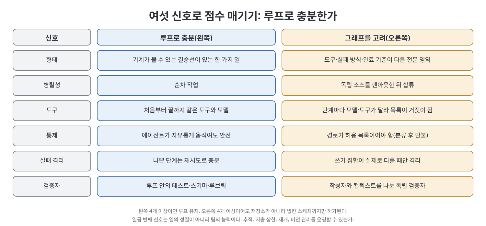
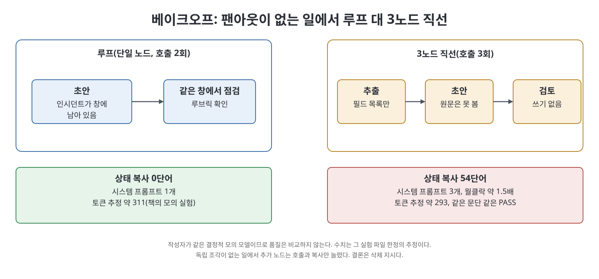

# 5장 그래프를 만들지 말아야 할 때 (When Not to Build a Graph)

대부분의 일에는 그래프가 필요 없다. 이 장은 만드는 법만큼 거절하는 법에 지면을 쓴다. 책은 루프를 노드가 하나뿐인 퇴화한 그래프로 보고, 대부분의 시스템이 거기서 이미 완성이라고 주장한다. 그래서 이 장의 기본 답은 "만들지 않는다"이다. 그래프는 분산 시스템이어서, 일이 루프에 들어가지 않을 때만 그 복잡도를 산다. 그 판단을 믿음이 아니라 점수표와 측정으로 하는 방법이 이 장의 내용이다.

> **쉽게 말하면**
> 다섯 단계짜리 PDF 요약기를 만들고 싶어지면 먼저 한 에이전트에게 파일 도구와 종료 조건만 주고 시켜 본다. 대개 그것으로 끝난다. 그래프는 일이 정말 쪼개질 때, 또는 되돌릴 수 없는 행동 앞에 사람 관문 하나를 세울 때 쓴다.

> **참고(노트 작성자)** 이 장의 수치(약 4배, 약 15배, 90.2%, +80.8%, -70.0% 등)는 모두 책이 인용하는 외부 자료 기준이고 2026년경 시점이다. 노트 작성자가 원문을 다시 검증하지는 않았으므로 인용하기 전에 출처를 확인하는 것이 좋다.

## 이 장의 흐름

1. 기본값은 만들지 않는 것, 루프는 퇴화한 그래프
2. 여섯 신호의 결정표
3. 과설계된 PDF 요약기와 베이크오프
4. 토큰 경제학
5. Cognition, Claude Code 서브에이전트, Anthropic의 가르침
6. 그래프가 해로운 일, Deep Agents와의 경계, 연구 결과가 말하는 정지 규칙
7. 체크리스트와 마이그레이션

## 1. 기본값과 퇴화한 그래프

책은 루프를 점유된 꼭짓점 하나, 자기 간선, 정지 규칙으로 이루어진 $G_A$로 정의한다. 반지름이 0인 원이 점이듯, 퇴화는 모욕이 아니라 바닥이다. 책은 LangChain이 초기 딥 리서치를 정해진 그래프 워크플로로 만들었다가 더 에이전트적인 핵심 루프로 옮겼다고 소개하며, 그래프를 가르쳐 온 쪽의 이 후퇴를 경계선으로 받아들이라고 한다.

루프가 구조적으로 못 하는 동작은 분기, 곧 팬아웃과 팬인 하나뿐이다. 두 번째 프롬프트, 스키마 검사, 더 좁은 도구 목록, 종료 조건은 한 노드 안에서 할 수 있다. 같은 모델 검토자 셋은 한 의견을 세 번 말하는 것이다.

## 2. 여섯 신호의 결정표

책은 한 커뮤니티가 정리한 여섯 신호표를 소개한다. 왼쪽이 루프로 충분한 경우, 오른쪽이 그래프를 고려할 경우다.

| 신호 | 루프로 충분 | 그래프를 고려 |
|------|-----------|-------------|
| 형태 | 기계가 볼 수 있는 결승선이 있는 한 가지 일 | 도구와 실패 방식과 완료 기준이 다른 전문 영역 |
| 병렬성 | 순차 | 독립 소스를 팬아웃한 뒤 합류 |
| 도구 | 같은 도구와 모델 | 단계마다 다르고, 도구 목록이 거짓이 될 때 |
| 통제 | 자유롭게 움직여도 안전 | 경로가 허용 목록이어야 함 |
| 실패 격리 | 재시도로 충분 | 쓰기 집합이 실제로 다를 때 |
| 검증자 | 루프 안의 테스트·스키마·루브릭 | 작성자와 컨텍스트가 분리된 독립 검증자 |

왼쪽이 네 개 이상이면 루프를 유지한다. 오른쪽이 네 개 이상이어도 허가되는 것은 저장소가 아니라 냅킨 스케치까지다. 예컨대 "분류한 뒤에만 환불한다"는 통제 신호 하나가 오른쪽이라 두 노드와 한 엣지짜리 허용 목록이 된다. 표가 말하지 않는 일곱 번째 신호는 팀의 능력이다. 추적, 지출 상한, 사람, 재개, 실행 중 스레드의 버전 관리를 운영할 수 있는가. 못 하면 루프를 유지한다. 운영할 수 없는 그래프는 비싼 장애다.

## 3. 과설계된 PDF 요약기와 베이크오프

가져오기, 청크, 요약, 검토, 서식으로 이루어진 PDF 요약기는 데모에서는 멋지지만 각 단계가 전문 영역이 아니라 한 일의 내부다. 한 에이전트가 파일 도구와 종료 조건으로 해낸다. 대조 사례는 다섯 독립 소스를 모으는 아침 브리프로, 이 일은 실제로 팬아웃한다.

책은 말뿐인 주장을 측정하는 실험을 붙인다. 짧은 인시던트 메모를 고객 상태 문단으로 바꾸고 작은 루브릭으로 확인하는, 독립 조각이 없는 일이다. 하나는 같은 컨텍스트에서 초안과 점검 두 번을 호출하는 루프, 다른 하나는 추출, 초안, 검토를 잇는 세 노드다. 작성자는 두 쪽 다 같은 결정적 모의 모델이라 품질은 점수에 넣지 않고, 추가 노드가 호출 수와 토큰 추정과 시계 시간에 얼마를 더하는지만 본다.

| 항목 | 루프 | 세 노드 직선 |
|------|------|------------|
| 호출 수 | 2 | 3 |
| 토큰 추정(책의 실행 예) | 약 311 | 약 293 |
| 시계 시간 | 기준 | 약 1.5배 |
| 상태 복사 | 0단어 | 54단어 |
| 시스템 프롬프트 | 1개 | 3개 |

책은 이 수치를 그 파일의 숫자로만 읽으라고 말한다. 토큰이 비슷한 것은 루프가 인시던트를 다시 보내는 대신 그래프가 추출로 압축하고 프롬프트를 세 번 내기 때문이다. 결론은 점수판이 아니라 삭제 지시다. 이 실험에는 사람이 없다. 큰 고객 명단에 발송하는 일이라면 해야 할 실험은 루프 대 루프 더하기 관문이고, 측정 대상은 되돌릴 수 없는 행동이 사람 없이 나갈 수 있는가다.

## 4. 토큰 경제학

책은 Anthropic의 2025년 6월 연구 시스템 글에서 계획용 상수를 가져온다. 에이전트는 채팅의 약 4배, 멀티 에이전트는 약 15배의 토큰을 쓰고, 토큰 사용량이 BrowseComp 성능 분산의 80%를 설명했다. Opus 4 리드와 Sonnet 4 서브에이전트 구성은 내부 연구 평가에서 단일 Opus 4를 90.2% 앞섰다. 하지만 이는 병렬화되는 폭넓은 조사에서 큰 비용을 치르고 얻은 이득이므로 PDF 요약기에 붙이면 안 된다. 15배는 단일 호출이 아니라 채팅 대비이고, 초기 연구 에이전트가 단순 질문에 서브에이전트 50개를 띄운 실패도 있었다. 상한, 재귀 한도, 최대 팬아웃을 직접 정해야 하는 이유다.

책은 한때 돌던 "정확도 +18%, 비용 -85%" 수치를 서로 다른 기준선이 붙은 반증된 마케팅으로 분류한다.

## 5. Cognition, Claude Code 서브에이전트, Anthropic

Cognition의 Walden Yan은 2025년 6월 글에서 두 원칙을 낸다. 전체 트레이스를 공유할 것, 행동에는 암묵적 결정이 담겨 충돌하는 결정은 나쁜 결과를 낳는다는 것이다. 제목은 그래프를 말라는 것이 아니라 멀티 에이전트를 말라는 것이다. 대표 예인 플래피 버드 복제에서는 파이프 담당과 새 담당을 따로 시켰더니 시각 스타일이 둘로 갈렸다. 마리오풍 초록 파이프라는 결정이 만드는 과정에 있었기 때문이다. 리뷰에서 "연구자, 작성자, 검토자를 추가하자"는 말이 나오면 이렇게 묻는다. 연구자의 암묵적 결정 중 작성자에게 필요하지만 전달되지 않을 것이 무엇인가.

Claude Code의 서브에이전트는 긍정적 예다. 하위 에이전트와 병렬로 일하지 않고, 대개 코드를 쓰지 않고 질문에 답만 한다. 이득은 속도가 아니라 컨텍스트 위생이다. 질문은 격리하고 부작용이 있는 결정은 격리하지 않는다. 읽기 전용 검색 팬아웃은 앞쪽이고 작성자 팬아웃은 뒤쪽이며, 쓰기를 할 수 있는 검사자는 두 번째 작성자다.

Anthropic의 2024년 12월 글은 가장 성공적인 구현이 단순하고 조합 가능한 패턴이었다고 하며, 워크플로(미리 정한 코드 경로)와 에이전트(LLM이 스스로 경로를 정함)를 구분한다. 책은 90.2%만 인용하고 15배와 50개 서브에이전트 실패, 코딩은 덜 맞는다는 말을 빼면 Anthropic을 분위기 용도로 쓰는 것이라고 지적한다.

## 6. 그래프가 해로운 일

그래프가 실제로 일을 나쁘게 만드는 부류가 있다.

| 부류 | 이유 |
|------|------|
| 열린 연구 | 다음 단계가 방금 알게 될 정보에 달려 가지를 열거할 수 없다 |
| 불안정한 경로 | 조건 엣지는 이름 붙일 수 있는 분기용이다 |
| 글쓰기 중심 | 목소리와 독자 같은 암묵적 결정이 흩어진다. 수집은 병렬화하고 결정은 직렬화한다 |
| 도구 많은 순차 작업 | 같은 도구를 두고 조율만 늘어난다 |
| 검증자를 소유하지 못함 | 같은 모델, 같은 프롬프트, 쓰기 권한 있는 검토자는 거짓 확신을 준다 |

LangChain은 그래프를 버린 것이 아니라 제품선을 나눴다. LangGraph는 노드, 엣지, 상태, 체크포인트, 인터럽트를 선언하는 저수준 그래프이고, Deep Agents는 계획, 파일 시스템, 서브에이전트를 환경으로 가진 하네스 형태의 사촌이다. 그래프는 구조를 안다는 주장이고 하네스는 경로가 나온다는 주장이다. 경로가 불확실하면 하네스로 둔다.

책이 소개하는 DeepMind, Google Research, MIT의 통제 실험(라이브 초록 기준 260개 구성)이 가장 깔끔한 정지 규칙이다. 분해 가능한 금융 추론에서는 중앙 조율이 단일 에이전트를 80.8% 올렸고, 엄격한 순차 추론 과제에서는 모든 멀티 에이전트 변형이 39%에서 70%까지 나빠졌다. 독립 에이전트는 오류를 17.2배 증폭했고 중앙 조율은 4.4배로 막았다. 단일 에이전트 기준선이 약 45%를 넘으면 조율의 이득이 줄었다. 초기 버전은 180개 구성과 +80.9%로 표기되었고 책은 라이브 초록을 기준으로 삼는다. 순서대로인 파이프라인이 나쁜 것이 아니라 추가 에이전트와 통신이 문제다.

## 7. 체크리스트와 마이그레이션

책의 체크리스트는 질문의 모음이다. 일을 기계가 볼 수 있는 결승선과 함께 한 문장으로 말할 수 있는가. 결정표를 점수로 매겼는가. 병렬 조각이 정말 독립인가. 검증자를 분리할 수 있는가. 약 4배와 약 15배를 감당할 수 있는가. 운영할 수 있는가. 비용이 두 배가 되면 무엇을 지우겠는가. 코딩 에이전트가 실패하는 다섯 방식(컨텍스트 열화, 자기 채점, 순차 병목, 명세 드리프트, 무한 재시도) 중 실제로 아픈 것을 짚지 못하면 그래프 문제가 아니라 측정하지 않은 루프다.

루프가 부담을 느끼는 신호가 오면 순서대로 쪼갠다.

| 증상 | 먼저 할 일 |
|------|-----------|
| 창이 검색 찌꺼기로 가득 | 서브에이전트처럼 답만 돌려주는 도구나 노트 파일 |
| 에이전트가 점검을 건너뜀 | 점검을 엣지로 만든다(분류 다음에만 환불에 도달) |
| 두 도구가 충돌 | 정체성이 아니라 도구 목록을 나눈다 |
| 사람이 도장만 찍음 | 부작용 직전 엣지에 인터럽트 |
| 마지막 단계만 실패했는데 전체 재시도 | 실패 복구를 엣지로 그린다 |

기존 루프에 노드를 정확히 하나 더한다면, 되돌리기 비싼 부작용 앞의 사람 승인 노드다. 작성자에서 환불 도구로 가는 엣지가 없으면 "환불하라"는 인젝션이 갈 곳이 없다. 대부분의 추가 노드는 의상이고 이것은 자물쇠다. 숙제는 일 설명을 받아 루프 유지와 그래프 구축을 판정하는 함수를 만드는 유형이다.

## 핵심 정리

- 기본 답은 만들지 않는 것이다. 루프는 노드 하나의 퇴화한 그래프이고, 대부분의 프로덕션 에이전트는 거기서 멈춘다.
- 루프가 못 하는 동작은 분기(팬아웃과 팬인)뿐이다. 같은 모델 검토자 여럿은 한 의견을 여러 번 파는 것이다.
- 여섯 신호(형태, 병렬성, 도구, 통제, 실패 격리, 검증자)를 점수화하고, 일곱 번째로 팀이 운영할 수 있는지 본다.
- 순차 작업에서 추가 노드는 호출과 상태 복사만 늘린다. 이득은 측정으로 보이고, 못 보이면 지운다.
- 멀티 에이전트의 이득과 비용은 일의 분해 가능성에 달렸다. 병렬 작성자는 암묵적 결정이 충돌하고, 읽기와 질문만 격리한다.
- 쪼갤 때 가장 먼저 더할 노드는 되돌릴 수 없는 엣지 앞의 사람 관문이다.

 
 
 

이전: [4장 에이전트 그래프의 해부](04%EC%9E%A5%20%EC%97%90%EC%9D%B4%EC%A0%84%ED%8A%B8%20%EA%B7%B8%EB%9E%98%ED%94%84%EC%9D%98%20%ED%95%B4%EB%B6%80.md) | 다음: [6장 노드를 얻을 자격이 있는 패턴](06%EC%9E%A5%20%EB%85%B8%EB%93%9C%EB%A5%BC%20%EC%96%BB%EC%9D%84%20%EC%9E%90%EA%B2%A9%EC%9D%B4%20%EC%9E%88%EB%8A%94%20%ED%8C%A8%ED%84%B4.md)

[Graph Engineering for Agentic AI Systems](../)
