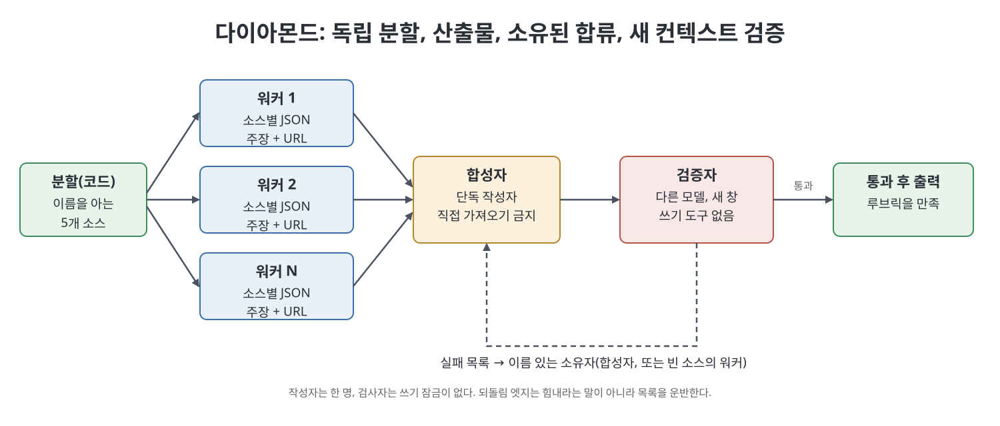
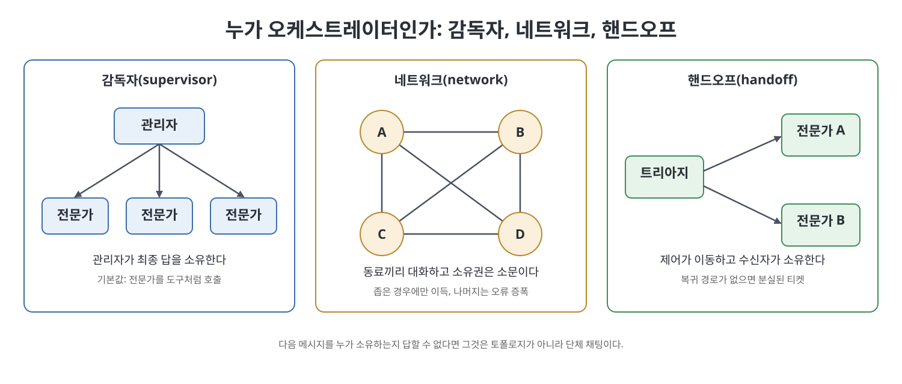

# 6장 노드를 얻을 자격이 있는 패턴 (Patterns That Earn Their Nodes)

5장의 거절을 통과한 일에는 소수의 토폴로지가 거의 전부를 덮는다. 이 장은 그 패턴 언어를 정리한다. 책은 각 패턴을 "루프가 자라서 그래프가 되었다"는 흐름으로 소개한다. 어떤 루프가 한계에 부딪혔는지, 그래프는 무엇을 더하는지, 검증자를 빼거나 작성자 컨텍스트를 검사자와 공유하면 어떻게 망가지는지를 함께 본다. 멀티 에이전트 이야기는 따로 종교를 세우지 않고 이 패턴들 안에 녹인다.

> **쉽게 말하면**
> 다섯 곳의 경쟁사 소식을 매일 정리하는 브리프는 다이아몬드(분할, 병렬 수집, 한 명이 합침, 새 창에서 검증)로 짠다. 반대로 PDF 한 편 요약은 다이아몬드를 그리지 않는다. 노드를 더하려면 하는 일이 루프이거나 전문 영역이거나 이름 붙일 수 있는 합류여야 한다.

> **참고(노트 작성자)** 책이 인용하는 제품 사례(Anthropic, OpenAI Agents SDK, Google ADK, Linear, Cognition 등)와 날짜는 2026년경 기준이다. 제품 동작은 바뀔 수 있으므로 사용 전에 공식 문서를 확인하는 것이 좋다.

## 이 장의 흐름

1. Anthropic의 다섯 워크플로와 Ng의 네 패턴
2. 다이아몬드와 팬아웃, 사람 관문
3. 메이커/체커와 평가자-최적화기
4. 오케스트레이터-워커, 감독자와 네트워크와 핸드오프, 계층
5. MCP와 A2A, 콘웨이의 법칙
6. 워커를 더할 때와 말 때, 프로즈 속의 그래프
7. 가짜 엣지, 정지 규칙, 삭제의 규율, 실행 예제

## 1. 다섯 워크플로와 Ng의 네 패턴

Anthropic의 2024년 12월 글에 나오는 다섯 워크플로는 이름만 다르지 그래프였다고 책은 말한다.

| 패턴 | 모양 | 이럴 때 쓴다 | 빠뜨리면 |
|------|------|------------|---------|
| 프롬프트 체이닝 | A, 게이트, B | 고정 하위 작업으로 깔끔히 분해될 때 | 개요가 이미 틀린 매끄러운 문서 |
| 라우팅 | 분류기와 전문가 별 모양 | 범주가 실재하고 분류가 키워드 목록보다 나을 때 | 스위치로 될 일에 LLM 사용 |
| 병렬화 | 섹션 분할 또는 투표 | 하위 작업이 독립일 때(투표는 서로 다른 시각일 때) | 플래피 버드식 두 스타일 |
| 오케스트레이터-워커 | 중앙 LLM이 분해, 위임, 종합 | 일을 미리 예측할 수 없을 때 | 이미 아는 체인을 요약만 하는 오케스트레이터 |
| 평가자-최적화기 | 생성과 평가의 두 노드 순환 | 기준이 명확하고 반복이 도움이 될 때 | 작성자가 둘이 되거나 정지가 없음 |

Andrew Ng가 2024년에 소개한 네 패턴(반성, 도구 사용, 계획, 멀티 에이전트 협업)은 노드 안쪽 층이다. 도구 사용과 반성은 노드 안에, 계획은 노드 안이나 오케스트레이터에 두고, 멀티 에이전트 협업만 5장의 표가 허락할 때 그래프가 된다. Ng는 상자의 내부, Anthropic은 화살표, LangGraph는 상태를 잊지 않는 런타임이라는 고도의 차이다.

## 2. 다이아몬드, 팬아웃, 사람 관문

다이아몬드는 그래프가 루프를 이길 때 가장 자주 쓰는 모양이다. 네 동작으로 이루어진다. 정말 독립인 분할(다섯 시장 소스는 되고 파이프와 새, 서론과 결론, 계약 없는 프런트와 백엔드는 안 된다). 느낌이 아니라 산출물을 쓰는 병렬 워커. 한 명의 소유자가 하는 합류. 새 컨텍스트에서 쓰기 도구 없이 루브릭으로 보는 검증자와, 소유자 이름이 적힌 되돌림 엣지다.

책의 구현 가능한 예는 이렇다. 다섯 경쟁사의 일일 브리프에서 분할은 이름을 아는 코드가 하고, 다섯 워커가 각자 주장과 URL이 든 JSON을 쓴다. 합성자는 직접 가져오기를 못 하고, 다른 모델이 읽기 전용 검증자가 된다. 실패하면 합성자로, 소스 셋이 비었으면 워커 셋으로 돌아간다. 관리자도 서식 노드도 없다.

개수가 입력 속성인 경우는 `Send` 팬아웃으로 푼다. 노드는 하나이고 호출만 N번이며 팬인은 append 리듀서다. N의 상한, 워커당 토큰 상한, 시계 시간 상한과 초과 시의 결정(표집, 청크, 거부, 사람에게 묻기)을 정하고, 합류가 all-of인지 any-of인지 도식에 적는다. 쓰기를 팬아웃하려면 워커가 만들지 않은 계약(명세, 타입, 테스트)이 있어야 한다.

사람 관문은 프롬프트 체이닝의 프로그램 게이트와 같되 게이트가 사람이다. 가치관이 아니라 배치다. 순서는 사람이 아닌 값싼 검사, 비싼 엣지 앞의 인터럽트, 승인과 거부와 수정 같은 스키마 있는 재개 페이로드다. 40개 워커의 40개 diff를 사람에게 쏟으면 병렬이 아니라 예쁜 도식의 대기열이다.

## 3. 메이커/체커와 평가자-최적화기

메이커/체커는 평가자-최적화기에서 쓰기 잠금을 작성자에게 남긴 것이다. 작성자만 쓰고, 검사자는 산출물과 루브릭만 보고 사고 과정은 보지 않으며, 불리언이 아니라 위반 목록을 돌려준다. 되돌림은 "더 열심히"가 아니라 목록과 소유자를 들고 간다. 검사자가 여럿이면 복제가 아니라 다른 시각(정확성, 보안, 실행 여부)이어야 하고, 실행 여부는 테스트 러너여야 한다.

평가자-최적화기는 시간이 붙은 메이커/체커다. 정지는 런타임 퓨즈가 아니라 직접 소유한 카운터이고, 파일 넷이 재시도 중이어도 파일 하나에서 셋은 이미 리듀서에 있으니 다시 계산하지 않는다. 트랜스크립트는 재시도하지 않고 산출물이 재시도한다. 비평이 "더 좋게 만들어라"이면 기분 있는 두 번째 작성자고, "모든 주장에 URL, 800단어 이하"이면 평가자다.

## 4. 오케스트레이터-워커, 감독자와 네트워크와 핸드오프, 계층

Anthropic의 연구 기능은 오케스트레이터-워커의 실제 예다. 리드가 계획을 메모리에 저장하고, 각자 창을 가진 서브에이전트를 띄우고, 종합한 뒤 CitationAgent에 넘긴다. 서브에이전트에는 목표, 출력 형식, 도구 지침, 경계가 주어진다. 실패 양상은 모호한 위임, 상한 없는 생성, 인용 세탁, 전화 놀이다. 읽기와 추출과 투표와 검토 워커는 되고, 공유 산출물의 쓰기 워커는 워커가 만들지 않은 계약이 없으면 안 된다.

누가 오케스트레이터가 될 수 있는지는 세 모양으로 정리된다.

| 모양 | 통제 | 소유권 | 실패 양상 |
|------|------|--------|---------|
| 감독자 | 중앙 노드가 분해, 위임, 종합 | 관리자가 사용자 답 소유 | 이름만 다른 요약 오케스트레이터 |
| 네트워크 | 동료끼리 직접 대화 | 불분명 | 오류 증폭, 트레이스 지옥 |
| 핸드오프 | 제어가 전문가에게 넘어감 | 수락 후 수신자가 소유 | 복귀 경로 없음, 수락자 없음 또는 둘 |

OpenAI Agents SDK의 에이전트-도구는 감독자이고 핸드오프는 뒤의 것이다. 책은 감독자를 그래프가 정당화됐을 때의 기본값으로 둔다. 계층은 보고선이 있는 오케스트레이터-워커인데, 책은 Google ADK 1.x의 계층 실행기가 2.0에서 그래프 워크플로 런타임으로 대체된 일을 경고로 든다. 형제를 호출할 수 있는 계층은 허용 목록을 모델에게 돌려준 것이다. 보고선이 컨텍스트를 실어 나르지는 않는다.

## 5. MCP와 A2A, 콘웨이의 법칙

| 엣지 | 답하는 질문 | 모양 | 주의 |
|------|-----------|------|------|
| MCP | 이 에이전트가 능력을 어떻게 쓰는가 | 구조화된 입출력, 대개 무상태, 노드별로 도구 범위를 제한 | 모든 서버를 모든 노드에 묶으면 밀수가 쉽다 |
| A2A | 이 에이전트가 다른 에이전트에게 어떻게 일을 부탁하는가 | Agent Card, Task, Message, Artifact. 공유 메모리 변경이 아니라 산출물을 받는다 | 계산기를 A2A로 감싸면 2+2에 작업 수명주기 세금을 낸다 |

둘은 경쟁이 아니라 보완이다. 직접 소유한 프로세스 안의 워커는 함수 호출이면 되고, 프로토콜은 신뢰나 프로세스 경계를 넘는 엣지에 쓴다.

콘웨이의 법칙(1968)은 시스템 설계가 조직의 소통 구조를 닮는다는 말이다. 에이전트 경계는 곧 인계이므로 팀 경계에 맞추면 팀의 빠진 컨텍스트와 승인 병목이 기계 속도로 상속된다. 책은 직함만 다른 전문화를 콘웨이라 부르고, 도구 허용 목록과 루브릭과 정지 조건이 있는 전문화를 엔지니어링이라 부른다. 이름 짓기에는 "일, 소유자, 완료 상태"를 묻고, 삭제에는 콘웨이를 쓴다.

## 6. 워커를 더할 때와 말 때

| 압력 | 워커를 더할 이유인가 | 시험 질문 |
|------|--------------------|---------|
| 전문화 | 예 | 이 워커가 하면 안 되는 일을 한 문장으로 말할 수 있는가 |
| 병렬화 | 예 | 한 쪽의 암묵적 결정이 다른 쪽을 구속하지 않는가 |
| 컨텍스트 보호 | 예 | 조사 흔적을 메인 기록에서 떼어내거나 검토자가 작성자의 사고를 못 보게 하는가 |
| 공유 상태, 복구 | 아니오 | 이것은 런타임이 필요한 이유이지 워커를 늘릴 이유가 아니다 |

세 이유 중 하나도 못 짚으면 이미 있는 노드에 둔다. 일이 단단히 결합돼 있으면(순차 의존, 공유 암묵 결정, 한 산출물의 변형) 한 노드에 둔다. 사다리에 다음 칸이 있다는 이유로 워커를 더하지 않는다.

책은 Linear의 Loops를 좁은 워크플로를 프레임워크가 아니라 보이게 만든 사례로 소개한다. 가시성은 관문이 아니다. 스킬은 프로즈 속의 그래프다. 마크다운 SOP가 곧 라우팅이며 배포 없이 고친다. 코드에는 불변식(리듀서, 멱등 키, 권한 검사, 지출 상한)을, 비즈니스에 따라 바뀌는 순서는 마크다운에 둔다. 환불 한도가 마크다운에 있으면 한도가 아니다.

## 7. 가짜 엣지, 정지 규칙, 실행 예제

가짜 엣지는 도식이 대칭을 원해서, 튜토리얼이 관리자를 원해서, 부서가 상자를 원해서, 모델이 길을 만들어서 생긴다. 삭제 점검표는 이렇다.

- 말만 하는 관리자 노드, 함수여야 할 서식 노드, 검토자를 검토하는 검토자
- 작성자에서 작성자로 가는 엣지, 모델이 만든 엣지, 부서 때문에 있는 엣지
- 테스트 없는 배포, 인터럽트 앞의 부작용, 상한 없는 Send, 한도 없는 되돌림

정지 규칙은 삭제의 나머지 반쪽이다. 평가자 만족, 예산 소진(토큰, 돈, 시간, 직접 센 재시도), 사람의 거부, 스키마 실패 시 닫힘이 있고, 재귀 한도는 마지막 울타리일 뿐 계획이 아니다.

책 끝의 실행 예제는 프레임워크 없이 세 메시지와 한 작성자를 보여 준다. 주장 채굴기, 회의론자, 인용 정찰병이 같은 패킷에서 서로 다른 일을 하고 불변 메시지를 돌려주며, 합성자만 브리프를 쓴다. 대조용으로 두 워커가 공유 딕셔너리에 쓰다 마지막 쓰기가 이기는 버그 경로도 있다. 숙제는 순차 경로, 감독자 별, 팬아웃 후 합류를 작은 인메모리 런타임으로 구현하는 유형이다.

## 핵심 정리

- 다섯 워크플로(체이닝, 라우팅, 병렬화, 오케스트레이터-워커, 평가자-최적화기)는 노드가 어떻게 이어지는지이고, Ng의 네 패턴은 노드가 안에서 무엇을 하는지다.
- 다이아몬드는 독립 분할, 산출물을 쓰는 워커, 한 명이 소유하는 합류, 새 컨텍스트 검증자로 이루어지며, 되돌림 엣지는 소유자와 목록을 운반한다.
- 팬아웃은 읽기, 추출, 투표에서 정당하고, 쓰기 팬아웃은 워커가 만들지 않은 계약이 있어야 한다. 팬아웃에는 상한과 합류 방식(all-of 또는 any-of)을 적는다.
- 사람 관문은 값싼 검사 뒤, 부작용 앞, 스키마 있는 재개와 함께 되돌릴 수 없는 엣지에만 둔다.
- 누가 사용자 메시지를 소유하는지가 감독자, 네트워크, 핸드오프를 가르는 기준이고, MCP는 능력, A2A는 신뢰 경계 너머의 동료를 잇는다.
- 워커를 더할 이유는 전문화, 병렬화, 컨텍스트 보호이고, 삭제 점검표와 정지 규칙이 패턴 언어를 정직하게 지킨다.

 
 
 

이전: [5장 그래프를 만들지 말아야 할 때](05%EC%9E%A5%20%EA%B7%B8%EB%9E%98%ED%94%84%EB%A5%BC%20%EB%A7%8C%EB%93%A4%EC%A7%80%20%EB%A7%90%EC%95%84%EC%95%BC%20%ED%95%A0%20%EB%95%8C.md) | 다음: [7장 에이전트 그래프를 실어 보낼 수 있는 프레임워크](../03.%203%EB%B6%80%20%EA%B5%AC%ED%98%84%EA%B3%BC%20%EC%A7%80%EC%8B%9D/07%EC%9E%A5%20%EC%97%90%EC%9D%B4%EC%A0%84%ED%8A%B8%20%EA%B7%B8%EB%9E%98%ED%94%84%EB%A5%BC%20%EC%8B%A4%EC%96%B4%20%EB%B3%B4%EB%82%BC%20%EC%88%98%20%EC%9E%88%EB%8A%94%20%ED%94%84%EB%A0%88%EC%9E%84%EC%9B%8C%ED%81%AC.md)

[Graph Engineering for Agentic AI Systems](../)
