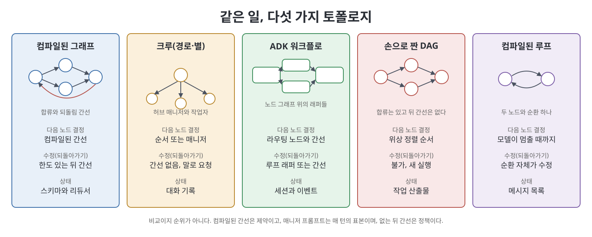
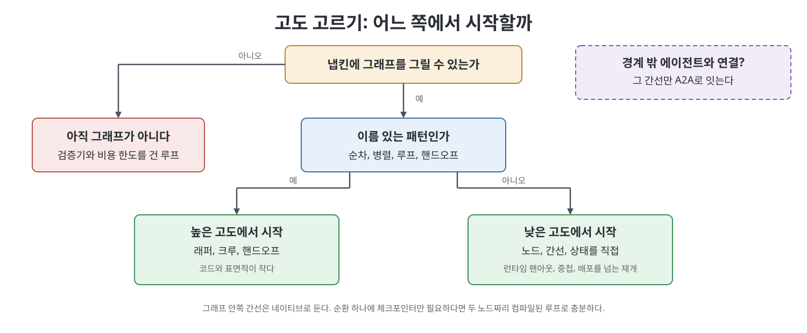

# 7장 에이전트 그래프를 실어 보낼 수 있는 프레임워크 (Frameworks You Can Ship an Agent Graph)

이 장은 에이전트 그래프(agent graph)를 실제 서비스로 내보내려 할 때 어떤 런타임 위에 올릴지를 다룬다. 저자 켄 황(Ken Huang)은 LangGraph, CrewAI, Google ADK, Microsoft Agent Framework, OpenAI Agents SDK 같은 도구를 브랜드가 아니라 실제로 실행하는 토폴로지(topology)로 비교하자고 제안한다. 제품 이름은 석 달이면 바뀌지만, 노드와 간선이 이루는 모양은 몇 가지뿐이어서 오래 남기 때문이다. 목적은 우승자를 뽑는 것이 아니라 설계 리뷰에 들고 갈 판단 기준을 얻는 것이다.

> **쉽게 말하면**
> 에이전트 프레임워크를 고르는 일은 로고를 고르는 일이 아니라 "어떤 모양의 그래프를, 어떤 클라우드 위에서, 어떤 잠금(lock-in)을 감수하고 돌릴 것인가"를 정하는 일이다. 모양부터 정하고, 그다음에 도구를 고른다.

> **참고(노트 작성자)** 이 장이 소개하는 제품 사실(출시일, 버전, 기본값, 다운로드 수, 유지보수 상태)은 모두 책이 2026년경 시점에 서술한 내용이다. 노트 작성자가 검증하지 않았고 빠르게 바뀔 수 있으니, 도입 전에는 각 프로젝트의 공식 문서를 직접 확인해야 한다.

## 이 장의 흐름

1. 질문의 답: 그래프 엔지니어링이 곧 LangGraph인가
2. 비교의 단위는 토폴로지: 다섯 가지 모양
3. 프레임워크별 모양: LangGraph, 크루, ADK, Microsoft, A2A, OpenAI·Claude SDK
4. 고도와 클라우드 중력: 무엇을 숨기고 어디에 묶이는가
5. 직접 짤 것과 짜지 말 것, 그리고 루프에 불과한 그래프
6. 마이그레이션 순서와 설계 리뷰 기준

## 1. 이것은 LangGraph일 뿐인가

책은 LangGraph를 만든 해리슨 체이스(Harrison Chase)가 2026년 7월에 던졌다는 냉소적인 질문으로 시작한다. 요지는 "그래프 엔지니어링이 뭔지 아직 모르겠고, 결국 LangGraph 아니냐"는 것이다. 책의 답은 두 번 아니오다. 첫째, 그래프 엔지니어링은 제품이 아니라 패턴이다. 일을 하는 노드, 다음을 정하는 엣지, 공유 상태, 멈췄다 다시 시작하고 재시도하고 갈라질 수 있는 런타임이 패턴의 전부다. 둘째, LangGraph를 이 기술의 정의로 삼는 것은 라이브러리와 규율을 혼동하는 일이다. 런타임을 고른다는 것은 영속성 모델, 클라우드, 언어, 휴먼 인 더 루프(human-in-the-loop) 방식, 기존 시스템에서의 이전 경로를 함께 고르는 것이다.

## 2. 다섯 가지 모양

책이 프로덕션에 올릴 수 있다고 꼽는 토폴로지는 다섯 가지다. 같은 일(분류, 조사, 작성, 검토, 필요하면 사람, 부작용)을 다섯 모양으로 그릴 수 있지만 서로 같은 기계가 아니다.



| 모양 | 대표 구현 | 이 모양이 못 하는 것 |
|------|-----------|----------------------|
| 컴파일된 상태 그래프 | LangGraph StateGraph | 없음에 가깝지만 토폴로지와 상태 스키마를 모두 직접 책임진다 |
| 크루(경로 또는 별) | CrewAI 프로세스, AutoGen 그룹 채팅 | 이름 붙은 합류, 한도 있는 되돌림, 재시작을 견디는 사람 승인 |
| ADK 워크플로 | Google ADK 2.0 | 래퍼를 넘는 모양은 결국 그래프를 직접 그려야 한다 |
| 손으로 짠 DAG | 위상 정렬 스케줄러, Airflow류 | 수정 간선. 되돌리려면 새 실행을 시작해야 한다 |
| 컴파일된 루프 | 두 노드짜리 ReAct 그래프 | 팬아웃, 새 컨텍스트의 검토자, 합류 |

핵심은 "누가 다음 노드를 정하는가"다. 컴파일된 간선은 제약이고, 매니저 프롬프트는 매 턴 뽑는 표본이며, 없는 뒤 간선은 의도했든 아니든 정책이다.

## 3. 프레임워크별로 보면

**LangGraph.** 책은 이를 저수준 기준 구현으로 소개한다. 상태 스키마를 정의하고 노드와 엣지를 더한 뒤 컴파일해야 실행되는데, 컴파일이 구조 검사와 체크포인터(checkpointer) 연결을 맡는다. 상태는 스키마와 리듀서(reducer)로 이루어지고, 노드는 부분 갱신만 돌려준다. 실행 모델은 Pregel에서 영감을 받아 슈퍼스텝 경계에서만 체크포인트를 남긴다. 그래서 인터럽트(interrupt) 후 재개하면 노드가 처음부터 다시 돈다. 책은 인터럽트 앞의 부작용이 두 번 실행될 수 있으니 멱등하게 만들라고 강조한다. 폭이 미리 정해지지 않은 팬아웃은 Send, 상태 갱신과 이동을 한 번에 하려면 Command를 쓰며, 같은 노드에서 Command와 고정 간선을 함께 쓰면 두 경로가 모두 발화한다는 함정도 지적한다.

```python
def charge(state):
    if state["idem_key"] in ledger:   # 재개로 다시 돌아도 두 번 결제하지 않는다
        return {}
    ledger.add(state["idem_key"])
    return {"paid": do_payment(state)}
```

**크루.** CrewAI는 순차(sequential)와 계층(hierarchical) 두 프로세스를 문서화한다고 책은 소개한다. 순차는 합류도 조건 간선도 없는 경로이고, 계층은 매니저가 허브인 별이다. AutoGen의 RoundRobin은 순환, Selector는 LLM이 다음 화자를 고르는 별이다. 방향 그래프로 팀을 기술하는 GraphFlow는 유지보수 모드 프로젝트에 얹혀 있어 출발점으로 삼지 말라고 한다. 크루의 상태는 대화 기록이어서 재시도가 되지 않으니, 쉬운 대신 통제가 약하다.

**Google ADK.** 책은 ADK가 1.x의 에이전트 계층에서 2.0의 워크플로 런타임(그래프 실행 엔진)으로 옮겨 갔다고 서술한다. 에이전트는 그래프 안의 한 종류 노드가 되었고 Sequential, Parallel, Loop는 같은 엔진 위의 편의 래퍼로 남았다. 모양이 정직하게 그 셋이면 래퍼를, LLM 분류 라우팅이나 입력에 따라 폭이 달라지는 팬아웃, 중첩 워크플로, 재시작을 견디는 사람 승인이 필요하면 그래프로 내려가라는 조언이다. 이행은 실행 계약이 바뀌는 일이므로 프로젝트로 다루고 모델과 버전을 고정하라고 한다.

**Microsoft Agent Framework와 A2A.** 책은 AutoGen이 유지보수 모드에 들어갔고 새 작업은 Semantic Kernel의 기업용 계층을 합친 Agent Framework로 가야 한다고 소개한다. A2A는 프레임워크가 아니라 서로 다른 팀·런타임의 에이전트끼리 대화하는 개방형 프로토콜이다. 한 프로세스 안의 엣지는 함수 호출이지만 팀과 클라우드를 넘는 엣지는 프로토콜이며, 두 그래프는 상태가 아니라 작업 수명 주기만 공유한다. 내 서브에이전트끼리 A2A로 잇는 것은 네트워크 분할과 끊기는 추적을 공짜로 사는 일이라 피하라고 한다.

**OpenAI Agents SDK와 Claude Agent SDK.** 이쪽은 모양이 아니라 소유권을 묻는다. 매니저가 통제권을 쥐고 전문가를 도구로 부르는 방식과, 라우팅 후 전문가가 주체가 되는 핸드오프(handoff)가 다르다. 두 SDK의 세션은 대화 기록일 뿐 체크포인터가 아니며, 한도 있는 되돌림 간선이 필요해지면 그래프를 쓰고 SDK는 그 노드 안에 두라고 책은 정리한다.

## 4. 고도와 클라우드 중력



고도(altitude)는 프레임워크가 얼마나 많은 모양을 이름 붙여 감춰 주느냐다. 책의 판별법은 냅킨 테스트다. 그림이 이름 있는 패턴이면 높은 고도에서 시작하고, 런타임에 자식 수가 정해지는 노드나 중첩 그래프, 배포를 넘는 재개가 필요하면 낮은 고도에서 시작한다. 그릴 수 없다면 아직 그래프가 아니라 야심 찬 프롬프트이니 루프에 머문다. 중첩 그래프는 부모를 작게 해 주지만 혼란을 숨기기도 하므로 자체 평가, 비용 한도, 이름 있는 담당자를 요구하라고 한다.

런타임이 모두 그래프 엔진을 갖춘 지금, 남는 싸움은 중력(gravity)이라고 책은 말한다.

| 계열 | 책이 짚는 중력 | 이점 |
|------|----------------|------|
| LangGraph | LangSmith 추적·평가, 파이썬 중심 생태계 | 모델 제공자 중립, 런타임 이식성이 가장 높은 편 |
| ADK | Google Cloud, Gemini 기본값, 이벤트 스키마 변화 | GCP 기반 조직이면 스택과 자연스럽게 맞는다 |
| Agent Framework | Azure와 Foundry, .NET | 기존 AutoGen·Semantic Kernel 이전 경로 |
| OpenAI Agents SDK | 호스티드 도구·추적·대화 | OpenAI 중심 팀이라면 순탄한 경로 |
| A2A | 한 벤더의 헬퍼로만 쓰면 잠금이 생긴다 | 프로토콜 계층의 이식성 |

책은 기본 모델을 고정하지 않으면 기본값이 바뀌는 순간 모델이 따라 바뀐다고 경고한다. 또 무엇을 옮길지(모델, 클라우드, 언어, 팀) 없이 포터블하자고 하는 말은 결정을 미루는 말이라고 한다.

## 5. 직접 짤 것과 짜지 말 것

스케줄러, 체크포인트 저장소, 인터럽트, 재시도, 합류, 추적 같은 런타임은 직접 짜지 않고 가져다 쓰라는 것이 책의 입장이다. 사람들이 흔히 손으로 짜는 DAG는 정말 순환 없는 일(추출·변환·적재 등)에는 맞지만 수정이 필요한 순간 막힌다. 순환을 새 실행으로 위장하면 이어하기가 아니라 새 thread_id와 새 청구서가 생긴다. 직접 짤 것은 런타임이 모르는 비즈니스 지식, 곧 상태 스키마, 노드 경계, 멱등 키, 사람 게이트 위치, 비용 한도, 도구 정책, 경로 평가다. 두 런타임이 필요하면 이음매는 숨은 래퍼가 아니라 A2A나 단순한 HTTP 계약이어야 한다.

반대편의 함정도 있다. ReAct 프리빌트를 컴파일했다면 체크포인터와 스트리밍을 얻었을 뿐 팬아웃도 합류도 새 컨텍스트 검토자도 없는 루프다. 책은 런타임이 필요해서 컴파일했다면 엔지니어링이고 그래프를 채택했다고 말하려고 컴파일했다면 허세라고 구분한다.

## 6. 마이그레이션과 설계 리뷰

책이 권하는 순서는 보수적이다. 쓰던 루프에 검증기, 비용 한도, 종료 조건을 붙이고, 그래프가 고쳐 줄 구체적 실패(담을 수 없는 전문성, 합류 못 하는 팬아웃, 멈출 수 없는 사람 게이트)를 이름 붙일 수 있을 때만 프레임워크 하나를 고른다. 노드 세 개짜리 그래프로 시작하고 체크포인트와 추적은 첫날부터 붙이며 멱등성을 먼저 확보한다. 프로덕션에서 벤더 둘을 비교하는 베이크오프는 금지다. 설계 리뷰 기준은 다음 표처럼 정리할 수 있다.

| 질문 | 확인 포인트 |
|------|-------------|
| 어느 모양인가 | 다섯 토폴로지 중 무엇인지, 그래프인지 체크포인터 붙은 루프인지 |
| 누가 사용자에게 답하나 | 매니저, 핸드오프, 검토자가 붙은 오케스트레이터 |
| 무엇이 크래시를 견뎌야 하나 | 대화 기록(세션)인지 진행 중인 슈퍼스텝(체크포인트)인지 |
| 사람은 어디에 있나 | 런타임이 실행을 멈춰 주는가 |
| 팬아웃 폭 | 컴파일 시점, 런타임 Send, 하드 한도. 모델이 알아서 정한다는 것은 한도가 아니다 |
| 잠금 | 추적, 세션 스키마, 기본 모델, 체크포인트 저장소, 채용 시장 |

책은 이 질문으로도 동점이면 회사 전략 문제라고 말하고, 출처 없는 성능 수치는 쓰지 않는다고 못박는다.

## 연습 과제

장 끝 과제는 모델 호출 없이 간단한 상태 그래프 실행기(노드, 엣지, 리듀서, 정지 보호가 있는 순환)를 직접 만들어 분류-조사-작성-검토 작업을 돌려 보는 유형이다. 검토자 되돌림이 반드시 멈추는지가 테스트 대상이다.

## 핵심 정리

- 그래프 엔지니어링은 제품이 아니라 패턴이며, 비교의 단위는 브랜드가 아니라 토폴로지다.
- 다섯 모양(컴파일된 상태 그래프, 크루, ADK 워크플로, 손으로 짠 DAG, 컴파일된 루프)은 누가 다음 노드를 정하는지, 되돌아갈 수 있는지가 다르다.
- 모양이 이름 있는 패턴이면 높은 고도, 런타임 팬아웃·중첩·재개가 필요하면 낮은 고도에서 시작한다.
- A2A는 프레임워크가 아니라 소유하지 않은 그래프와 잇는 경계 프로토콜이며, 한 그래프 안에서는 쓰지 않는다.
- 런타임은 직접 짜지 않고, 상태 스키마·멱등 키·사람 게이트·비용 한도처럼 비즈니스에 속한 것만 직접 짠다.
- 프로덕션에서 베이크오프를 하지 말고, 이름 붙인 실패 하나를 고치는 최소 그래프부터 도입한다.

<br>
<br>
<br>

[이전: 6장 노드를 얻을 자격이 있는 패턴](../02.%202%EB%B6%80%20%EC%84%A4%EA%B3%84/06%EC%9E%A5%20%EB%85%B8%EB%93%9C%EB%A5%BC%20%EC%96%BB%EC%9D%84%20%EC%9E%90%EA%B2%A9%EC%9D%B4%20%EC%9E%88%EB%8A%94%20%ED%8C%A8%ED%84%B4.md) | [다음: 8장 메모리로서의 지식 그래프](08%EC%9E%A5%20%EB%A9%94%EB%AA%A8%EB%A6%AC%EB%A1%9C%EC%84%9C%EC%9D%98%20%EC%A7%80%EC%8B%9D%20%EA%B7%B8%EB%9E%98%ED%94%84.md)

[Graph Engineering for Agentic AI Systems](../)
