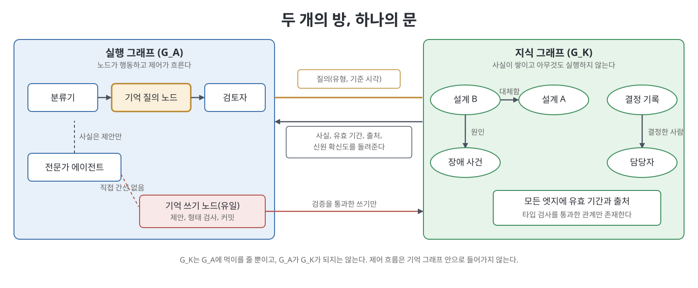
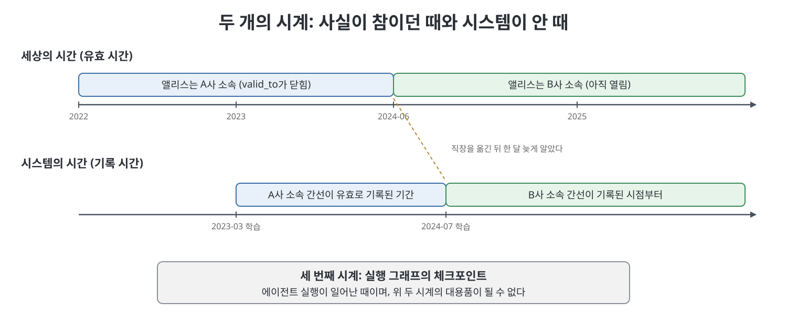

# 8장 메모리로서의 지식 그래프 (Knowledge Graphs as Memory)

이 장은 에이전트 시스템에서 그래프라는 낱말이 가리키는 두 번째 대상, 곧 시스템이 기억하는 것을 담는 지식 그래프(knowledge graph)를 다룬다. 7장까지가 일이 어떻게 흘러가는지(실행 그래프)를 다뤘다면, 이 장은 무엇을 기억하는지(메모리 그래프)를 다룬다. 저자는 메모리 엔지니어링 전반이 아니라 실행 그래프가 구조 있는 질문을 던질 때 읽는 그래프형 메모리만 범위에 넣는다. GraphRAG는 이 메모리 위의 검색 패턴일 뿐 그래프 엔지니어링과 같은 말이 아니라는 점이 장 전체를 관통한다.

> **쉽게 말하면**
> 실행 그래프는 일하는 방이고 지식 그래프는 서류 보관실이다. 일하는 방은 문 하나로만 보관실에서 근거 있는 사실을 꺼내 오고, 서류를 넣을 때는 검사를 통과한 것만 허용한다.

> **참고(노트 작성자)** 이 장의 도구 이름, 벤치마크 수치, 비용, 날짜는 책이 2026년경 시점에 인용한 것이며 노트 작성자가 직접 검증하지 않았다. 외부 글과 논문의 수치는 책이 소개하는 내용으로 읽어야 한다.

## 이 장의 흐름

1. 세 가지 그래프를 구분하고 G_K가 무엇인지 정한다
2. 엔티티 그래프와 유사도 그래프, 타입 있는 엣지
3. GraphRAG의 위치와 출처 있는 비용 수치
4. 하이브리드 검색, 엔티티 해석, 이중 시간 엣지
5. 검증 있는 구축, 기억 질의 노드, 실패 양상, 만들지 말아야 할 때

## 1. 세 가지 그래프

책은 2026년의 그래프라는 낱말이 서로 다른 세 대상을 가리킨다며 섞지 말라고 한다.

| 이름 | 무엇인가 | 다루는 곳 |
|------|----------|-----------|
| 실행 그래프 G_A | 에이전트, 도구, 평가자, 사람이 노드이고 제어 흐름이 간선이며 상태가 공유된다 | 2~7장 |
| 지식·메모리 그래프 G_K | 엔티티와 사실이 노드, 타입과 시간과 출처가 있는 관계가 엣지. 아무것도 실행하지 않는다 | 이 장 |
| 학습된 계산 그래프 | GNN, 그래프 트랜스포머, 인과 그래프 | 12장 |

G_K의 노드는 서비스, 사람, 결정 기록, 장애 사건, 공급업체, 원문 조각 같은 것이고, 엣지는 대체함(supersedes), 결정함, 원인임, 공급함, 언급함 같은 타입 있는 관계다. 책은 시간과 출처가 나중에 붙일 메타데이터가 아니라, 질문할 수 있는 그래프와 related_to 화살표 더미를 가르는 요소라고 본다. 비즈니스 사실을 오케스트레이터의 간선에 저장하면 G_K가 G_A로 새고, 지식 그래프가 다음 행동을 정하게 하면 G_A가 G_K로 샌다. 낡은 사실이 환불 경로를 정할 수 있다. 실행 트레이스(한 번의 실행 기록)도 G_K가 아니며, 대화 로그를 기억이라 부르는 실수가 여기서 나온다.

## 2. 엔티티 그래프와 타입 검사

책은 지식 그래프라 불리는 것이 최소 세 가지이며 수식어 없이 이름을 가질 자격이 있는 것은 하나뿐이라고 구분한다.

| 종류 | 노드와 엣지 | 평가 |
|------|-------------|------|
| 엔티티 그래프 | 타입 있는 정점, 선언된 쌍 사이에서만 허용되는 타입 엣지 | 순회가 존재론(ontology)을 지키는 추론이 된다. 진짜 지식 그래프 |
| 의미 유사도 그래프 | 조각이나 임베딩이 정점, 가까움을 뜻하는 약한 엣지 | 좋은 검색기일 수 있으나 지식 그래프 순회가 아니다 |
| 어휘 그래프 | 조각과 문서, 때로는 엔티티가 연결 | 유용한 색인이지만 존재론은 아니다 |

타입 검사에 실패할 수 없는 그래프는 유사도 그래프라고 부르라는 것이 저자의 말이다. 타입 어휘는 작게 유지한다. 책은 엣지 종류가 백 개면 제품이 아니라 온톨로지 프로젝트라고 한다. 인용된 SurrealDB의 측정은 속성 키의 85퍼센트가 딱 한 번만 쓰였고 행동 대상의 52퍼센트가 자유 텍스트였다는 것으로, 추출은 성공했다고 보고됐지만 걸어 다닐 그래프는 남지 않았다는 사례다. 해법은 쓰기 시점에 술어를 정규화하고 이미 있는 엔티티와 대조하는 것이다. 출처(provenance), 곧 누가 어느 문서에서 언제 말했는지와 권한도 사실에 붙여 질의 안에서 강제해야 한다.



## 3. GraphRAG는 G_K 위의 검색이다

책은 GraphRAG가 그래프 엔지니어링이냐는 면접 질문에 아니라고 답한다. GraphRAG의 노드는 개체이고 행동하지 않으며 실행 상태가 흐르지 않는다. 다만 실행 그래프의 한 노드가 GraphRAG 질의를 돌리는 합성은 현실적이다. 합성은 되지만 대체는 아니다. Microsoft GraphRAG는 엔티티 그래프를 추출해 Leiden 커뮤니티로 묶고 요약한 뒤, 엔티티 중심의 로컬 검색과 요약 전체를 쓰는 글로벌 검색으로 답한다. 평범한 벡터 RAG는 한 번의 사실 조회에는 알맞지만 부품, 공급업체, 리뷰, 결함처럼 사슬을 따라가야 하는 답에는 약하다.

책은 숫자 이야기를 둘로 가른다. 하나는 2026년 7월에 돌았다는, 그래프 엔지니어링이 RAG를 대체해 정확도가 오르고 비용이 줄었다는 수치로, 서로 다른 기준선을 이어 붙인 가짜라고 팩트체크됐다고 한다. 다른 하나는 Zep 논문의 실제 결과다. 시간 인식 지식 그래프 메모리가 LongMemEval에서 전체 컨텍스트 기준선보다 최대 18.5퍼센트 높은 정확도와 약 90퍼센트 낮은 지연을 보였다고 보고한다. 이름 있는 벤치마크와 기준선이 있는 결과이니 앞의 가짜와 섞지 말라는 것이다.

비용은 출처 있는 숫자만 쓰며, 실행 그래프의 에이전트 비용(5장의 몇 배)과 섞으면 안 된다.

| 항목 | 책이 소개하는 수치 | 읽는 법 |
|------|--------------------|---------|
| 원조 GraphRAG 색인 | 대형 기업 데이터 하나에 약 3만 3천 달러 추정 | 견적이 아니라 자릿수 경고 |
| 글로벌 검색 질의 | 평균 331,375 토큰 대 벡터 RAG 879 | 청구서가 아니라 벤치마크 평균 |
| LazyGraphRAG | 색인 비용 약 0.1퍼센트 | 요약을 질의 때로 미룸 |
| HippoRAG 2 | 질의당 약 1,008 토큰 | 멀티홉에 강하고 단순 조회도 안 나빠짐 |
| 단순 사실 조회 | 벡터 RAG 60.9 대 최고 그래프 방식 60.1 | 그래프가 불리한 영역 |

결정 절차는 질문 유형으로 길을 고르는 것이다. 단일 조회는 벡터 RAG, 안정된 코퍼스의 멀티홉은 HippoRAG 2나 PathRAG, 전체 주제는 GraphRAG나 LazyGraphRAG, 빠르게 변하는 에이전트 메모리는 Graphiti와 Zep 같은 시간 그래프, 코드는 grep 같은 에이전틱 검색, 창에 들어가는 코퍼스는 통째로 넣는다. 이 라우터는 실행 그래프의 노드이고, 그가 고르는 색인이 메모리 토폴로지다. 모든 것에 GraphRAG를 쓰는 것이 이름 붙은 패자다.

## 4. 하이브리드 검색, 엔티티 해석, 이중 시간

**하이브리드.** 실전에서는 벡터와 그래프를 정해진 순서로 함께 쓴다. 벡터나 BM25로 시작점을 잡고, 타입 있는 순회를 하고, 필요하면 재순위를 거쳐 이웃을 모델에 준다. 벡터는 왜 관련되는지는 틀려도 어느 문단에서 시작할지는 대체로 맞고, 순회는 빠뜨린 엣지가 있어도 뽑은 관계의 타입은 대체로 맞다. 서로의 구멍을 메운다. 이 전체는 실행 그래프에 노드 하나로 보여야 한다.

**엔티티 해석.** 지식 그래프 프로젝트가 죽는 지점이다. 홉마다 정확도가 95퍼센트면 5홉 신뢰도는 약 77퍼센트이고 85퍼센트면 약 44퍼센트로 동전 던지기에 가깝다. 타입 엣지는 틀려도 맞을 때만큼 자신 있게 보여 검토자가 알아채지 못한다. 책이 소개한 Graphiti는 후보를 임베딩과 전문 검색으로 모은 뒤 모델에게 중복 여부를 묻고, 같은 엔티티 쌍 사이에서만 엣지 중복을 제거한다. 기억 질의 노드는 신원 확신도를 돌려주거나 그 홉을 거부해야 한다.

**이중 시간.** 체크포인트는 실행이 일어난 때이지 사실이 참이던 때가 아니다. 책이 설명하는 Graphiti는 세상의 시간(유효 시간)과 시스템이 배운 시간(기록 시간)을 따로 추적하고, 엣지마다 네 개의 타임스탬프를 둔다. 새 정보가 옛 엣지와 모순되면 옛 엣지의 유효 구간을 닫을 뿐 지우지 않으므로, 같은 그래프가 지금 어디서 일하는지와 2024년에 어디서 일했는지를 모두 답한다.



구간을 닫는 것은 정정이지 삭제가 아니다. 커뮤니티 요약과 임베딩에 정보가 남으므로 엔티티를 지웠다는 말만으로는 삭제 요구를 충족하지 못한다고 책은 못박는다.

## 5. 구축, 문, 실패 양상

**제안하고 검증한다.** 책은 DeepLearning.AI의 지식 그래프 구축 강좌가 Neo4j의 앤드리아스 콜레거 강의이며 앤드류 응의 2026년 7월 강좌가 아니라고 바로잡는다. 에이전트가 스키마를 제안하고 사실을 검토하고 중복을 제거해 커밋하는 이 흐름은 그 자체가 실행 그래프이고 산출물이 G_K다. 원칙은 모델이 제안하고 검증이 처분한다는 것이다. 검증기(SHACL 또는 동등한 술어)는 허용된 타입 쌍인지, 양 끝이 해석되는지, 출처가 허용 목록에 있는지, 경쟁 사실이 구간으로 무효화됐는지를 본다. 유창한 문장도 타입이 맞지 않으면 실패한다.

```python
SHAPES = {("Part", "supplied_by", "Supplier"), ("ADR", "decided_by", "Person")}

def commit(src_type, pred, dst_type, edge):
    if (src_type, pred, dst_type) not in SHAPES:
        raise ValueError("shape fail")      # 저장하고 경고하는 길은 없다
    store.append(edge)
```

**기억 질의 노드와 쓰기 노드.** 기억 질의 노드는 G_K(와 벡터 색인)를 읽어 작은 타입 결과를 실행 상태에 쓰는 코드다. 입력은 질의 의도(조회, 멀티홉, 글로벌, 기준 시각), 출력은 타입과 유효 구간과 출처를 단 사실, 해석된 엔티티, 확신도이며, 맞지 않는 질문은 거절한다. 쓰기 노드는 G_K를 바꿀 수 있는 유일한 노드다. 전문가에서 쓰기 노드로 가는 간선을 만들지 않으면 프롬프트 주입을 당한 에이전트가 장기 기억을 오염시킬 수 없다. 책의 SQLite 예제도 분류기, 기억 질의, 검토자 세 함수가 이 문과 유일한 쓰기 함수만 통해 저장소를 만지게 한다. 요점은 도구가 아니라 문이다.

**실패 양상.** 책은 기억 그래프가 썩는 방식을 여섯 가지로 정리한다. 모두 한 번의 실행이 아니라 스레드를 넘어 살아남는다는 점이 실행 그래프의 실패와 다르다.

| 양상 | 증상 | 대응 |
|------|------|------|
| 낡은 엣지 | 유창하고 출처 있는 낡은 사실이 돌아온다 | 유효 구간 무효화, 현재 조회는 열린 엣지만 |
| 스키마 표류 | 어제는 거주지, 오늘은 집 도시로 이름이 갈린다 | 고정 술어 어휘, 모르는 술어는 거부 |
| 무한 팽창 | 노드와 색인 비용이 끝없이 늘어난다 | 홉 수, 반환 사실 수, 배치당 신규 노드 상한 |
| 미해석 신원 | 멀티홉이 동전 던지기가 된다 | 별칭 평가셋으로 해석 정확도 측정 |
| 형태 없는 쓰기 | 일관돼 보이는 오류가 기억이 된다 | 검증 통과 후에만 커밋 |
| 잘못된 삭제 | 요약에 지울 사실이 남는다 | 요약과 임베딩까지 삭제 설계 |

**만들지 말아야 할 때.** 코퍼스가 창에 들어가거나, 질문이 단일 홉 조회이거나, 코딩 에이전트에 grep으로 충분하면 만들지 않는다. 엔티티 해석, 고정 술어 어휘, 형태 검사기, 삭제 방안을 감당할 수 없을 때도 만들지 않는다. 멀티홉, 시간 질의, 코퍼스 전체 질문이 있고 정형과 비정형 데이터를 조인해야 하며 여러 에이전트가 권한 달린 같은 관점을 공유해야 할 때 만든다. 책은 대부분의 시스템이 이 조건에 해당하지 않는다고 본다.

## 연습 과제

레코드를 타입 삼중항으로 넣고 엔티티와 관계로 질의하며, 형태 검사에 실패한 쓰기는 커밋하지 않는 작은 지식 그래프 메모리를 만드는 유형이다. 삼중항 저장소가 다음 노드를 정하라는 요청은 거절해야 한다.

## 핵심 정리

- G_A는 일의 흐름, G_K는 기억이며, 서로의 역할을 가져가면 낡은 사실이 행동을 정하는 사고가 난다.
- 타입 검사에 실패할 수 없으면 유사도 그래프이고, 진짜 지식 그래프는 타입 엣지와 시간과 출처를 갖는다.
- GraphRAG는 G_K 위의 검색 패턴이며 질문 유형별로 벡터, 멀티홉, 글로벌, 시간 그래프, grep을 골라 쓴다.
- 엔티티 해석 오차는 홉마다 곱해지므로 기억 질의 노드는 신원 확신도를 돌려주거나 홉을 거부한다.
- 유효 시간과 기록 시간은 서로 다른 시계이고 체크포인트는 어느 쪽의 대용도 아니다.
- 모델이 제안하고 검증이 처분하며, 쓰기 노드만 G_K를 바꾸고, 홉과 사실 수와 노드 수에 상한을 둔다.

<br>
<br>
<br>

[이전: 7장 에이전트 그래프를 실어 보낼 수 있는 프레임워크](07%EC%9E%A5%20%EC%97%90%EC%9D%B4%EC%A0%84%ED%8A%B8%20%EA%B7%B8%EB%9E%98%ED%94%84%EB%A5%BC%20%EC%8B%A4%EC%96%B4%20%EB%B3%B4%EB%82%BC%20%EC%88%98%20%EC%9E%88%EB%8A%94%20%ED%94%84%EB%A0%88%EC%9E%84%EC%9B%8C%ED%81%AC.md) | [다음: 9장 프로덕션에서 그래프 운영하기](../04.%204%EB%B6%80%20%EC%9A%B4%EC%98%81%EA%B3%BC%20%EC%9D%B4%EB%A1%A0/09%EC%9E%A5%20%ED%94%84%EB%A1%9C%EB%8D%95%EC%85%98%EC%97%90%EC%84%9C%20%EA%B7%B8%EB%9E%98%ED%94%84%20%EC%9A%B4%EC%98%81%ED%95%98%EA%B8%B0.md)

[Graph Engineering for Agentic AI Systems](../)
