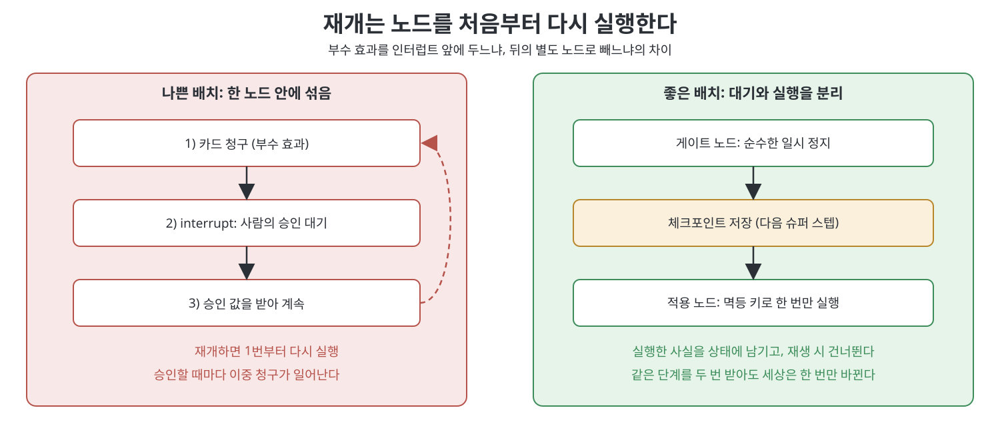
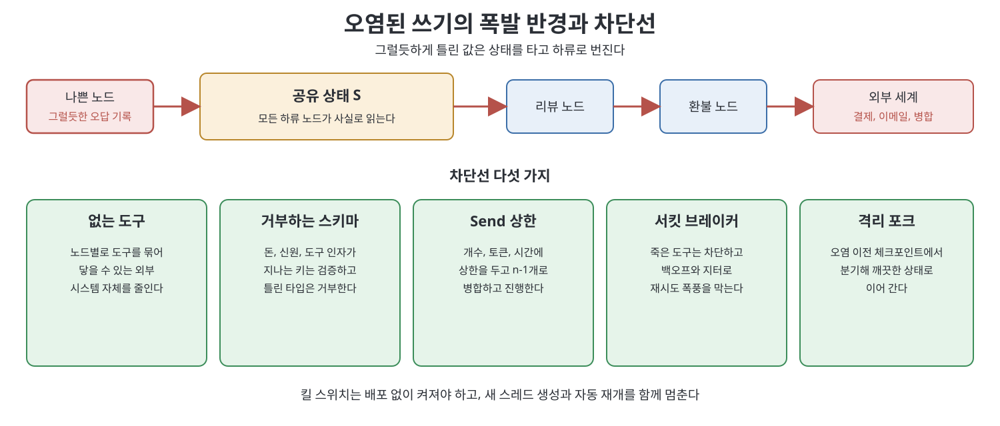

# 9장 프로덕션에서 그래프 운영하기 (Operating Graphs in Production)

이 장은 노트북에서 잘 돌던 에이전트 그래프가 실서비스로 나가는 순간 분산 시스템이 된다는 이야기를 한다. 부수 효과(결제, 이메일)가 생기고, 사람이 기다리고, 비용이 확률적으로 곱해지기 때문이다. 책은 앞으로 1년 동안 겪을 버그의 대부분이 모델 버그가 아니라 상태, 리듀서, 재개, 예산, 버전 버그라고 말한다. 모델은 말을 하는 부분이라 억울하게 비난만 받는다는 것이다. 그래서 이 장은 설계한 그래프가 아니라 체크포인트와 트레이스 안에 실제로 살아 있는 그래프를 운영하는 법을 다룬다. 책의 표현으로 설계는 그림이고 운영은 장부다.

> **쉽게 말하면**
> 에이전트 그래프는 한 번 켜면 며칠씩 살아 있는 프로세스다. 식당으로 치면 메뉴판(설계)보다 주방의 주문서 더미(체크포인트)를 관리하는 일이 더 중요하다. 주문서가 꼬이면 같은 요리가 두 번 나가고, 그건 요리사(모델)의 실력과 상관없다.

> **참고(노트 작성자)** 이 장은 LangGraph를 중심으로 설명하며, 기본 재귀 한도(책은 1000 또는 10007이라고 소개한다) 같은 수치와 API 이름은 2026년경 기준이다. 쓰는 버전에서 직접 확인하라. 책은 LangGraph 용어(super-step, reducer, interrupt)를 쓰지만 개념은 다른 프레임워크에도 통한다.

## 이 장의 흐름

1. 상태 드리프트와 리듀서: 가장 흔한 부패
2. 체크포인트, 재개, 재생과 멱등성
3. 사람 개입을 제품으로 설계하기
4. 관측성, 비용, 지연, SLO
5. 재귀 한도와 우아한 저하
6. 버전 관리, 평가, 권한, 장애 격리
7. 장애 유형과 운영 체크리스트

## 1. 상태 드리프트와 리듀서

책이 꼽는 1순위 부패는 상태 드리프트(state drift)다. 극적으로 터지지 않고 서서히 어긋나다가, 도구 호출이 거의 맞게 동작하는 순간에야 드러난다. 예를 들어 어느 노드는 `customer`를 객체로 쓰고, 세 단계 뒤 노드는 요약 문자열로 덮어쓴다. 다음 노드가 그 문자열을 도구 인자에 그대로 넣으면 거의 동작해서 더 찾기 어렵다. 작성자가 코드, 모델, 사람 셋이 섞여 있다는 점이 문제를 키운다. 모델은 매번 조금씩 다른 모양을 내놓는다.

책의 처방은 상태를 호환성 정책이 있는 API로 다루는 것이다. 키마다 스키마와 리듀서(reducer, 여러 노드의 업데이트를 합치는 함수)를 두고, 상태에는 원문 대신 참조와 요약만 담는다. 책은 체크포인트가 수백 KB로 비대해지면 쓰기 지연이 수십 ms에서 수백 ms로 늘어난다는 현장 사례를 소개한다. 시간 축 드리프트도 있다. 12번 버전에서 시작한 스레드가 19번 버전에서 재개되면 바뀐 키 때문에 기본 분기로 빠진다. 그래서 스레드 시작 시점에 `flow_version`을 찍고, 값이 없으면 현재가 아니라 가장 오래된 버전으로 간주한다.

리듀서는 "지능처럼 보이는 버그"의 단골 원인이다. 리뷰 노드가 메시지를 반환했는데 리듀서가 없어 기본값인 덮어쓰기가 적용되면 대화 전체가 사라지고, 다음 노드는 리뷰만 보고 문서를 처음부터 다시 쓴다. 사람은 에이전트가 품질에 까다로워졌다고 오해하지만 사실은 기억상실이다.

| 키의 성격 | 알맞은 리듀서 | 흔한 실수 |
|---|---|---|
| 대화 이력 | 아이디가 같으면 교체하는 병합 | 단순 이어 붙이기로 정정본이 중복 |
| 누적 목록 | 추가, 단 재생에도 안전해야 함 | 재개 때 같은 태그가 두 번 붙음 |
| 단일 값(작성자 하나) | 덮어쓰기 | 두 노드가 같은 키를 소유 |
| 카운터 | 정수 합산 | 정지 조건에 연결되지 않음 |

리듀서는 결정적이고 빨라야 하며 모델을 호출하면 안 된다. 모델로 두 초안을 합치는 리듀서는 추적도 예산도 재시도 정책도 없는 숨은 노드이므로, 이름 있는 노드로 꺼내라는 것이 책의 조언이다.

## 2. 체크포인트, 재개, 재생

체크포인터(checkpointer)가 없는 그래프는 함수이고, 있는 그래프는 프로세스다. 스냅샷은 슈퍼 스텝 경계에서 `thread_id`별로 저장되며 함수 중간의 일시 정지 지점은 저장되지 않는다. 그래서 인터럽트(interrupt) 뒤에 재개하면 노드가 첫 줄부터 다시 실행된다. 인터럽트 앞의 부수 효과가 다시 일어난다는 뜻이다. 멱등성(같은 작업을 여러 번 해도 결과가 한 번과 같음)은 스타일이 아니라 재개의 불변식이다.



책이 권하는 규칙은 세 가지다. 인터럽트 앞에는 멱등 연산(upsert, 결정적 키)만 둔다. 한 번만 일어나야 하는 효과는 인터럽트 뒤의 별도 노드로 뺀다. 효과마다 `thread_id`, 노드 이름, 업무 아이디로 멱등 키를 만들고 실행 사실을 상태에 남겨 재생 때 건너뛴다. 개념만 보이면 아래와 같다.

```python
def apply_refund(state):
    key = state["pending_effect_key"]
    if state["effect_facts"].get(key):
        return {}                      # 이미 적용됨: 다시 청구하지 않음
    charge(state["charge_id"], state["amount"])
    return {"effect_facts": {key: True}}
```

재생(replay)과 재개(resume)는 다르다. 재생은 과거 체크포인트에서 갈라져 다시 실행하는 포크라서 실제 효과 노드에 닿으면 세상을 포크하는 셈이다. 사고 재생이나 평가 재생은 효과 노드를 스텁으로 바꾸거나 샌드박스를 가리키게 하고, 트레이스에 `replay=true`를 붙인다. 책의 재생 런북은 자동 재개를 멈추고, 오염 이전 체크포인트와 실행할 컴파일(실서비스인지 스텁인지)을 정해 스레드에 메모로 남기는 순서다. 어떤 모드인지 말하지 못하는 팀은 모르는 사이 실서비스 재생을 하고 있다.

## 3. 사람 개입은 플래그가 아니라 제품이다

휴먼 인 더 루프(human-in-the-loop)에서 사람은 그래프의 노드이고, 인터럽트는 사람이 답해야 끝나는 엣지다. 첫 승인자가 폰을 든 변호사일 때 이 사실을 깨닫는다고 책은 말한다. 인터럽트에 넘기는 값은 질문, 세부 내용, 위험도, 차이, 기한, 노드명 같은 안정된 모양의 JSON이어야 한다. 병렬 인터럽트는 인터럽트 아이디별 응답 맵으로 한 번에 재개하므로 UI는 단일 모달이 아니라 대기 목록이어야 한다.

주의점은 이렇다. 인터럽트를 맨 try/except로 감싸지 말고(일시 정지가 예외라 삼켜진다), 노드 하나에 하나만 두며, 기한과 만료 시 기본 정책을 상태에 기록한다. 게이트는 되돌리기 비싼 곳(결제, 발송, 병합, 삭제)에만 둔다. 모든 노드에서 승인을 받으면 도장만 찍는 연극이 된다. 승인 대상의 해시를 페이로드에 넣어 상태가 바뀌었으면 재개를 거부하는 것은 사람에게 적용한 낙관적 동시성 제어다.

## 4. 관측성, 비용, 지연, SLO

관측성(observability)은 서비스 관측과 다르다. 노드 실행마다 `thread_id`, `checkpoint_id`, 스텝, 노드 이름을 남기고, 엣지에는 왜 탔는지, 상태 쓰기에는 어느 노드의 어느 리듀서인지를 남겨 선언된 토폴로지와 실제 트레이스를 조인한다. 노드 이름은 서비스 이름처럼 짓는다(예: `researcher.web`). `values` 스트림은 비공개 채널까지 내보내므로 화면에는 출력 키를 제한한다.

비용은 노드와 팬아웃 개수의 성질이다. 책은 "그래프는 15배" 같은 사다리가 유튜브 민담이며, Anthropic의 수치(멀티 에이전트 리서치가 채팅 대비 약 15배 토큰)는 채팅 대비라고 정정한다. 예산은 토큰, 금액, 스텝 셋 모두 코드로 강제하고, 평균 대신 p50, p90, p99를 낸다.

| 시계 | 무엇을 재는가 | 섞으면 생기는 일 |
|---|---|---|
| 기계 경로 | 인터럽트 대기를 뺀 슈퍼 스텝 시간 | 사람 대기가 지연 지표를 오염 |
| 사람 게이트 | 인터럽트 발행부터 재개까지 | 변호사를 기다리는 것이 장애로 집계 |
| 지출 | 노드, 스레드별 토큰과 금액 | 재개 재실행이 조용히 비용을 곱함 |

지연에는 암달의 법칙(순차 부분이 한계를 정한다)이 걸린다. 팬아웃에서 가장 느린 워커가 전체를 결정하므로 타임아웃과 마감 후 병합이 답이다. SLO는 "에이전트" 전체가 아니라 그래프 단계에 붙인다. 결과도 정상 종료, 폴백, 인터럽트 대기, 오류, 좌초(stranded) 다섯으로 나눠 센다.

## 5. 재귀 한도와 우아한 저하

재귀 한도를 넘으면 오류가 나지만 책은 한도를 올리는 것이 첫 수가 아니라고 말한다. 끝나지 않는 사이클을 찾아 상태에 정지 조건(수정 횟수, 완료 상태)을 넣고, 남은 스텝 값을 읽어 여유가 있을 때 폴백 노드로 보낸다. 폴백은 부분 결과와 이유를 돌려주고 그래프는 정상 종료한다. 대응도 원인별이다. 합의가 안 되면 마지막 초안과 `needs_human`을, 팬아웃이 터졌으면 끝난 워커만, 죽은 공급자는 차단한다.

## 6. 버전, 평가, 권한, 장애 격리

LangGraph는 최신 컴파일을 모든 스레드에 적용하므로 배포는 진행 중인 작업의 저장된 상태에 대한 호환성 변경이다. 책은 호환성을 세 겹으로 나눈다. 기술적 호환(노드를 지우거나 이름을 바꾸면 그 노드에 멈춘 스레드의 재개가 깨진다, 반면 남은 노드 사이의 엣지 변경은 안전하다), 업무적 호환(중간에 정책 검사를 끼우면 이미 통과한 스레드까지 검사받을 수 있으니 `flow_version`으로 분기), 비결정성 호환(태스크나 인터럽트 호출 순서를 바꾸지 않기)이다. 소스, 프롬프트, 도구 스키마, 정책 설정은 한 버전으로 묶어 커밋 해시를 체크포인트 메타데이터에 넣는다.

평가는 노드가 아니라 경로를 잰다. 책은 경로 커버리지(체크포인트, 재개 값, 기대 다음 노드를 묶은 픽스처), 검증자 일치도(심은 오류를 잡는가), 모델 없이 CI에서 도는 정지 조건 테스트, 선별한 골드 경로를 요구한다.

권한은 프롬프트가 아니라 노드에 건다. 컴파일 시점에 노드별로 도구를 묶고, 런타임에 인자 한도를 코드로 검사하며, 비밀 키는 상태가 아닌 노드 전용 컨텍스트에 둔다. 다른 팀의 서브그래프나 A2A 상대는 신뢰하지 않는 노드로 취급해 타입 있는 인터페이스와 예산, 타임아웃을 준다. 노드를 행, 도구와 저장소를 열로 하고 칸에 허용, 거부, 인터럽트 후 허용을 적은 권한 행렬을 토폴로지 옆에 둔다.

장애 격리에서 핵심은 나쁜 노드가 자주 성공한다는 점이다. 그럴듯한 오답을 상태에 쓰면 하류 노드가 모두 사실로 믿는다. 폭발 반경은 그 쓰기에서 도달 가능한 노드와 그 노드가 건드리는 외부 시스템 전부다.



## 7. 장애 유형과 운영 체크리스트

책은 장애가 세 가지 모양으로 몰린다고 정리한다.

| 유형 | 모양 | 막는 장치 |
|---|---|---|
| 오염된 상태(poison state) | 성공한 노드가 오답을 씀, 환불이 상태에는 맞음 | 쓰기 검증, 리듀서 멱등성, 오염 이전으로 포크 |
| 재시도 폭풍 | 도구 다운 중 워커 전원이 재시도, 공급자 장애가 우리 청구서가 됨 | 도구별 서킷 브레이커, 백오프와 지터, Send 상한 |
| 검증자 포획 | 검토자가 제작자와 맥락과 모델을 공유해 승인 | 다른 모델, 제작자 스크래치 차단, 심은 오류 CI |

책은 현장 증언을 직접 가져오지 못해 2차 자료의 공통 의견으로 서술한다고 밝히며, 핵심 가치는 토폴로지 그림이 아니라 상태 관리, 디버깅, 체크포인트라고 정리한다. 장 끝에는 열두 항목의 운영 체크리스트가 붙는데, 요약하면 위의 내용에 장애 런북과 배포 없는 킬 스위치를 더한 것이다. 킬 스위치가 없으면 되돌려도 진행 중인 스레드가 계속 돈을 쓴다.

Homework는 재시도(지터 포함), 멱등 키, 서킷 브레이커를 갖춘 단계 실행기를 구현하고, 같은 단계가 두 번 전달돼도 세상은 한 번만 바뀐다는 것을 픽스처로 보이는 유형이다. 외부 API 호출은 쓰지 않는다.

## 핵심 정리

- 프로덕션 그래프의 버그는 대부분 모델이 아니라 상태, 리듀서, 재개, 예산, 버전에서 나온다.
- 재개는 노드를 처음부터 다시 돌린다. 인터럽트 앞에는 멱등 연산만 두고 효과는 뒤의 별도 노드에 둔다. 재생은 효과를 낼 수 있는 포크다.
- 사람 개입은 안정된 페이로드, 기한, 해시 검사, 노드당 인터럽트 하나를 갖춘 제품이며, 게이트는 되돌리기 비싼 곳에만 둔다.
- 노드와 엣지를 조인해 관측하고, 기계 경로, 사람 대기, 지출의 세 시계를 섞지 않으며, 예산은 토큰, 금액, 스텝 모두 코드로 건다.
- 배포는 진행 중인 스레드에 대한 마이그레이션이다. `flow_version`을 찍고, 멈춰 있는 노드 이름은 지우지 않는다.
- 권한은 노드 단위로 묶고, 오염된 쓰기의 폭발 반경은 도구, 스키마, 상한, 서킷, 포크로 줄인다.

<br>
<br>
<br>

이전: [8장 메모리로서의 지식 그래프](../03.%203%EB%B6%80%20%EA%B5%AC%ED%98%84%EA%B3%BC%20%EC%A7%80%EC%8B%9D/08%EC%9E%A5%20%EB%A9%94%EB%AA%A8%EB%A6%AC%EB%A1%9C%EC%84%9C%EC%9D%98%20%EC%A7%80%EC%8B%9D%20%EA%B7%B8%EB%9E%98%ED%94%84.md) | 다음: [10장 에이전트 그래프의 컴퓨터 과학](10%EC%9E%A5%20%EC%97%90%EC%9D%B4%EC%A0%84%ED%8A%B8%20%EA%B7%B8%EB%9E%98%ED%94%84%EC%9D%98%20%EC%BB%B4%ED%93%A8%ED%84%B0%20%EA%B3%BC%ED%95%99.md)

<br>

[Graph Engineering for Agentic AI Systems](../)
