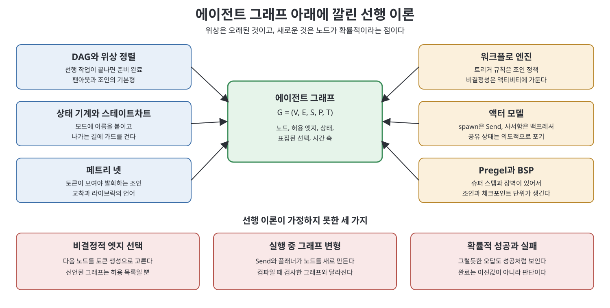
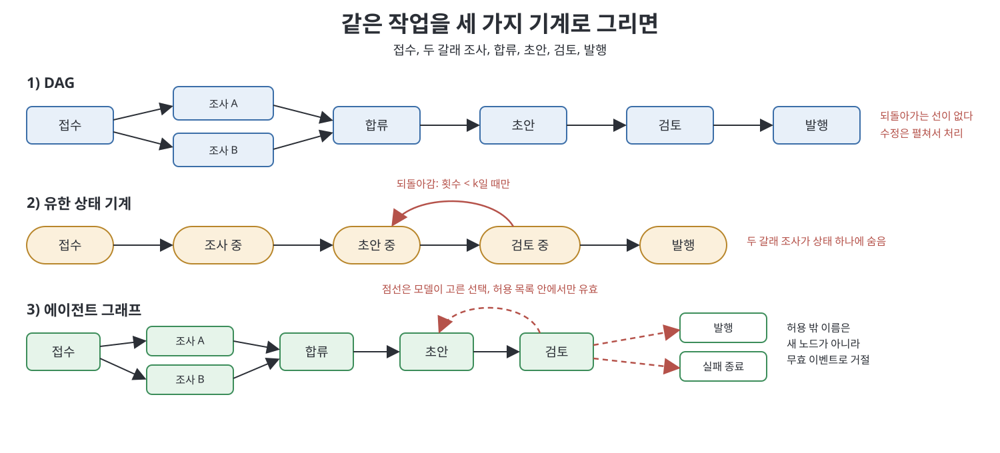

# 10장 에이전트 그래프의 컴퓨터 과학 (The Computer Science of Agent Graphs)

이 장은 에이전트 그래프가 어떤 오래된 이론 위에 서 있는지, 그리고 그 이론이 가정하지 못한 부분이 무엇인지를 정리한다. 책은 먼저 도전을 받아들인다. XState를 만든 David Khourshid가 2026년 7월경 남긴 지적의 취지는, 업계가 수십 년 된 소프트웨어 공학 패턴을 새 이름으로 다시 발견하고 있다는 것이다. 책은 이를 맞다고 인정하되, 그러니 아무것도 아니라는 결론은 게으르다고 답한다. 위상(topology)이 낡았으면 낡은 수학을 가져다 쓰고, 정말 새로운 세 곳만 주의 깊게 보면 된다는 것이다.

> **쉽게 말하면**
> 에이전트 그래프는 새 기계가 아니라 오래된 기계들을 한 지붕 아래 모은 것이다. 레시피(DAG), 신호등(상태 기계), 금고(페트리 넷)는 그대로 쓰면 된다. 다만 이 기계들은 일꾼이 시킨 대로 정확히 한다고 믿고 설계됐는데, LLM 일꾼은 가끔 딴소리를 한다. 이 장은 그 틈을 정리한다.

> **참고(노트 작성자)** 책이 인용하는 2026년경의 글과 논문(LangChain 회고, Hu Wei의 위치 논문 등)은 노트 작성자가 검증하지 않았다. 아래 비유는 노트 작성자의 해설이다.

## 이 장의 흐름

1. 도전과 세 가지 새로운 점
2. DAG, 상태 기계, 페트리 넷
3. 워크플로 엔진, 액터, 데이터플로, Pregel
4. 세 스트레스 지점의 복원책과 쓸 만한 알고리즘
5. 작은 그래프 하나, 기계 셋

## 1. 도전과 세 가지 새로운 점

책은 그래프 엔지니어링이 그래프를 발명하지 않았다고 인정한다. LangChain 회고도 루프는 방향 있는 순환 그래프라고 본다. 그러면 무엇이 남는가. 책은 노드가 결정적 함수에서 확률적인 언어 모델로 바뀔 때 깨지는 가정 세 가지를 든다.

| 새로운 점 | 고전 이론의 가정 | 에이전트 그래프에서는 |
|---|---|---|
| 비결정적 엣지 선택 | 엣지는 고정이거나 상태의 조건식 | 모델이 토큰을 생성해 다음 노드를 고른다. 선언된 그래프는 허용 목록일 뿐 |
| 실행 중 그래프 변형 | 실행 동안 위상이 고정 | Send나 플래너가 노드를 새로 만든다 |
| 확률적 성공과 실패 | 노드는 정상 출력 아니면 예외 | 유창한 오답도 성공처럼 보인다. 완료는 판단 |

책은 정리를 새로 만들지 않는다고 못박는다. 조상마다 고전 대상과 그 가정을 말하고, 에이전트 그래프에 대응시키고, 노드가 확률적일 때 무엇이 남는지 묻는다. 기준 대상은 앞에서 정의한 `G = (V, E, S, P, T)`, 곧 노드, 허용 엣지, 상태, 허용 후계자 중 모델이 표집한 선택, 슈퍼 스텝 같은 시간 축이다.



## 2. DAG, 상태 기계, 페트리 넷

**DAG**(방향 있고 순환 없는 그래프)는 모든 엣지가 앞으로만 가도록 줄 세울 수 있다. 책은 1962년 Kahn의 위상 정렬을 소개한다. 진입 차수 0인 노드부터 내보내고, 중간에 막히면 순환이 있다는 신호다. 비유는 레시피다. 야채 손질과 육수 끓이기는 서로 기다릴 필요가 없어 동시에 하고, 둘 다 끝나야 볶음으로 간다. 팬아웃과 조인은 LLM의 발명이 아니다. LLM 노드가 들어오면 노드가 반드시 끝난다는 보장, 노드 집합이 고정이라는 가정, 재시도가 안전하다는 가정이 흔들린다. 또 수정 루프는 순환인데 DAG 스케줄러는 순환을 오류로 본다.

**상태 기계**는 자판기나 신호등과 같다. 지금 모드에 이름이 있고, 사건이 오면 규칙대로 다음 모드로 간다. 책은 ReAct 루프가 가장 간결한 사례라고 본다. Harel의 1987년 스테이트차트는 계층(상태 안에 기계)과 병렬 영역을 더했고 XState가 구현한다. 에이전트 그래프의 노드는 상태, 허용 엣지는 전이, 공유 상태는 확장 상태에 해당한다. 교훈은 셋이다. 이름 붙인 상태가 없으면 그래프가 없다. 가드는 프롬프트보다 낫다(검토 통과 전 발행 금지는 전이에 걸고, 프롬프트에만 적으면 프롬프트 인젝션에 뚫린다). 노드가 통째로 에이전트면 중첩 스테이트차트로 본다.

LLM이 엣지에 앉으면 전이의 결정성이 깨진다. 책은 세 가지 복원책을 정직한 순서로 든다.

| 복원책 | 내용 | 예 |
|---|---|---|
| 결정적 전이, 확률적 노드 | 검토는 LLM이 하되 다음 노드는 판정값을 읽는 코드가 정한다 | Temporal의 워크플로와 액티비티 분리 |
| 경계 있는 비결정적 전이 | 모델이 선언된 이름 집합 중 하나만 고른다. 밖의 이름은 무효 이벤트 | 매핑이 있는 조건부 엣지 |
| 열린 전이 | 플래너가 상태와 전이를 새로 만든다. 더는 유한 상태 기계가 아님 | 템플릿 인스턴스인지 검사 |

종료 조건도 바뀐다. 고전 기계는 수락 상태에서 멈추지만 에이전트 그래프는 재귀 한도, 지출 한도, 사람의 취소로도 멈춘다.

**페트리 넷**(1962)은 순서도에 동그라미를 더한 것이 아니다. 장소는 토큰을 담고 전이는 토큰을 소비하고 생산한다. 비유는 열쇠 두 개가 모두 있어야 열리는 금고다. van der Aalst는 AND 분기, AND 합류, XOR 분기, XOR 합류 네 기호를 정리했고, 책은 이것이 오늘날 팬아웃, 장벽, 라우터, 병합이라고 말한다. 모두 완료 합류는 AND, 하나만 끝나면 진행하는 합류는 XOR에 나머지 취소를 더한 형태다. 페트리 넷이 남기는 것은 합류의 수학이다. 두 워커가 모두 필요한지, 하나면 되고 나머지는 취소하는지를 실행 전에 정하게 한다. 교착은 모두가 사람이나 도구를 기다리는 상태, 라이브락은 작성자와 검토자가 초안만 주고받는 상태다. 남지 않는 것은 발화의 원자성이다. LLM 전이는 입력을 소비하고 쓰레기를 생산했을 수 있다.

## 3. 워크플로 엔진, 액터, 데이터플로, Pregel

책은 7월의 글들이 건너뛴 선행 사례로 Airflow와 Temporal을 꼽고, 둘을 비결정성을 어디에 두느냐에 대한 두 답으로 읽는다.

| 엔진 | 비결정성에 대한 답 | 순환 |
|---|---|---|
| Airflow | 태스크 단위 실패. 실패한 태스크만 처음부터 재시도 | 금지. 수정 루프는 펼치거나 새 실행 |
| Temporal | 워크플로는 결정적, 비결정적 일은 액티비티에 격리하고 이력으로 재생 | 가능. 사람 개입은 신호 대기 |

교훈은 이렇다. LLM 호출은 비용이 드는 `random()`이므로 액티비티에 두어야 하고, 선택의 이력이 없으면 재생도 감사도 못 한다. 트리거 규칙(모두 성공, 하나 성공 등)은 조인 정책이므로 프롬프트가 아니라 규칙으로 쓴다. 타임아웃 없는 노드는 현장에서 멈춘 스레드가 된다.

**액터 모델**(Hewitt 등, 1973)은 각자 사서함이 있는 직원들이 쪽지로만 일하는 사무실과 같다. 액터는 메시지를 받으면 다른 액터에게 보내고, 새 액터를 만들고, 자기 행동을 바꿀 수 있다. 책의 대응은 이렇다. spawn은 Send이고, 행동 교체는 라우팅 노드이며, 사서함 규칙은 공유 저장소에 리듀서로 덧댄 것이다. 유지되지 않는 것은 기본 격리다. 책의 모델에서 상태는 일급 구성 요소이고, 공유 결정 맥락이 Cognition이 지적한 실패(암묵적 결정을 공유하지 못해 어긋남)를 막는다고 본다. 그래서 결제는 격리하고 조사 결정은 공유하는 식으로 노드마다 섞는다. 무한 spawn도 문제로, 책은 Anthropic 리서치 시스템 초기 버전이 단순한 질문에도 서브에이전트 50개를 만든 사례를 소개한다.

**데이터플로**(Kahn, 1974)에는 프로세스가 입력 이력의 결정적 함수이면 스케줄과 무관하게 결과가 하나라는 결정성 정리가 있다. 책은 LLM 노드가 첫 전제부터 어겨서 이 정리를 가장 깨끗하게 잃는다고 말한다. 남는 것은 규율이다. 채널에 이름을 붙이고, 두 작성자가 같은 목록에 쓰려면 합치는 규칙을 선언한다.

**Pregel과 BSP**(Valiant)는 조별 과제 라운드와 같다. 각 조원이 동시에 일하고, 종이 울리면(장벽) 결과를 공개하고, 다음 라운드에 서로의 결과를 본다. LangGraph는 계획, 실행, 갱신을 반복한다. 장벽 덕분에 조인에 락이 필요 없고, 체크포인트가 슈퍼 스텝 경계에서 저장되며, 노드 단위 멱등성이 의무가 된다. 단점은 낙오자로, 느린 LLM 호출 하나가 장벽을 붙잡는다.

## 4. 세 스트레스 지점의 복원책과 알고리즘

조상 모두가 같은 세 곳에서 걸렸고 복원책도 오래된 것이다.

- **비결정적 엣지 선택**: 돌이킬 수 없는 일(청구, 대량 발송, 병합)에는 정적 엣지를 쓴다. 상태를 모델이 채웠더라도 라우팅은 타입 있는 상태 위의 코드로 한다. 모델 라우터는 선언된 집합으로만 보내고 선택을 상태에 기록한다. 임의 문자열을 돌려주는 라우터는 열린 전이다.
- **실행 중 변형**: 변형이 템플릿만 인스턴스화하게 하고, 플래너가 새 위상을 내면 컴파일 검사를 거친 뒤 실행하며, 진행 중 스레드에 버전을 붙인다. 변형을 아예 금지하는 정적 DAG 주장과 순환 금지가 에이전트를 나쁘게 만든다는 LangChain의 주장은 일에 따라 둘 다 맞을 수 있다고 책은 본다.
- **확률적 성공과 실패**: 생산자와 판정자를 분리하고(판정자에게 기록까지 숨기면 암묵적 결정을 못 보므로 기록은 보여 준다), 스키마는 필요조건일 뿐이라는 점을 알며(잘 짜인 거짓말은 못 잡는다), 임계 경로 대신 기대 비용을 보고, 재시도는 멱등할 때만 안전하다고 본다. 책은 멀티 에이전트 실패 14가지를 세 계열로 정리한 MAST 연구가 이 세 지점의 경험적 버전이라고 본다.

쓸 만한 알고리즘은 네 가지다. 도달 가능성(검토 없이 발행에 닿는 길이 있는가, 조건부 엣지도 엣지다), 순환 탐지(에이전트에서는 순환이 제품이므로 거부가 아니라 이름과 한도를 붙인다), 임계 경로(선언 시간으로 하한, 트레이스의 p95로 진단), 위상 레벨(병렬이라 믿은 두 노드가 다른 레벨이면 우발적 엣지가 있다)이다. 변형이 있으면 선언 그래프와 실제 실행된 그래프 양쪽에 돌려 차이를 본다.

## 5. 작은 그래프 하나, 기계 셋

책은 접수, 두 조사 갈래, 모두 완료 합류, 초안, 수정 가능한 검토, 발행으로 된 작업을 세 기계로 구현한다. 프레임워크는 쓰지 않고 모델은 스텁이다. 모델이 필요한 컴퓨터 과학 주장은 주장이 아니라는 이유다.



| 기계 | 순환 | 두 조사 갈래 | 특징 |
|---|---|---|---|
| DAG 스케줄러 | 없음. 순환은 오류 | 같은 레벨로 병렬 | 수정은 펼쳐야 하고 일반 k가 없다 |
| 상태 기계 | 횟수가 k 미만일 때만 되돌아감 | 한 상태 안에 숨김 | 이 속임수가 페트리 넷이 필요한 이유 |
| 에이전트 그래프 | 한도 안에서 되돌아감 | 선언된 팬아웃 | 허용 목록 밖 제안은 거절 |

세 번째 구현의 핵심은 아래 한 장면이다.

```python
ALLOWED = ("revise", "publish", "fail")
proposed = stub_llm_route(brief)        # 모델이 고른 이름(표본)
if proposed not in ALLOWED:
    log("rejected_off_allowlist")       # 새 노드를 만들지 않고 거절
    proposed = decide_by_code(brief)    # 판정값으로 코드가 정함
```

책의 실행 결과를 보면, DAG는 되돌아갈 간선이 없어 첫 초안이 실패여도 발행까지 가고, 상태 기계는 한 번 되돌아간 뒤 발행하며, 에이전트 그래프는 허용 밖 이름을 로그에 거절로 남긴다.

Homework는 Kahn의 위상 정렬, 순환 탐지, 준비 집합 계산을 작은 DAG와 상태 기계 픽스처로 구현하는 유형이다. 되돌아가는 간선은 순환으로 닫힌 채 실패해야 한다.

## 핵심 정리

- 에이전트 그래프의 위상은 새롭지 않다. DAG, 상태 기계, 페트리 넷, 워크플로 엔진, 액터, Pregel의 수학을 가져다 쓰면 된다.
- 새로운 것은 노드가 확률적이라서 생기는 세 가지다. 모델이 엣지를 고르고, 실행 중 그래프가 바뀌고, 성공과 실패가 이진이 아니다.
- 복원의 원칙은 비결정성을 재생 가능한 상자에 가두는 것이다. 돌이킬 수 없는 일은 정적 엣지, 라우팅은 코드, 모델 라우터는 선언된 집합으로만 보낸다.
- 합류는 AND인지 XOR인지 먼저 정하고, 수정 사이클에는 이름과 한도를 둔다.
- 재시도 안전성, 발화 원자성, 데이터플로 결정성 같은 고전 보장은 LLM 노드에서 사라지고, 규율만 남는다.
- 도달 가능성, 순환 탐지, 임계 경로, 위상 레벨은 선언된 그래프와 실제 실행된 그래프 양쪽에 돌린다.

<br>
<br>
<br>

이전: [9장 프로덕션에서 그래프 운영하기](09%EC%9E%A5%20%ED%94%84%EB%A1%9C%EB%8D%95%EC%85%98%EC%97%90%EC%84%9C%20%EA%B7%B8%EB%9E%98%ED%94%84%20%EC%9A%B4%EC%98%81%ED%95%98%EA%B8%B0.md) | 다음: [11장 에이전트 그래프의 보안·신원·거버넌스](../05.%205%EB%B6%80%20%EB%B3%B4%EC%95%88%EA%B3%BC%20%EA%B2%BD%EA%B3%84/11%EC%9E%A5%20%EC%97%90%EC%9D%B4%EC%A0%84%ED%8A%B8%20%EA%B7%B8%EB%9E%98%ED%94%84%EC%9D%98%20%EB%B3%B4%EC%95%88%C2%B7%EC%8B%A0%EC%9B%90%C2%B7%EA%B1%B0%EB%B2%84%EB%84%8C%EC%8A%A4.md)

<br>

[Graph Engineering for Agentic AI Systems](../)
