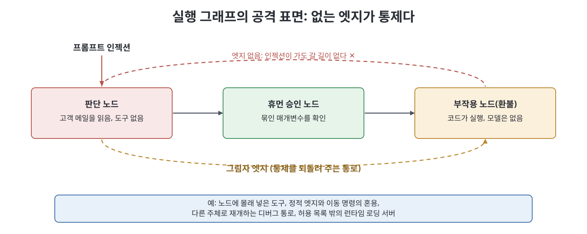
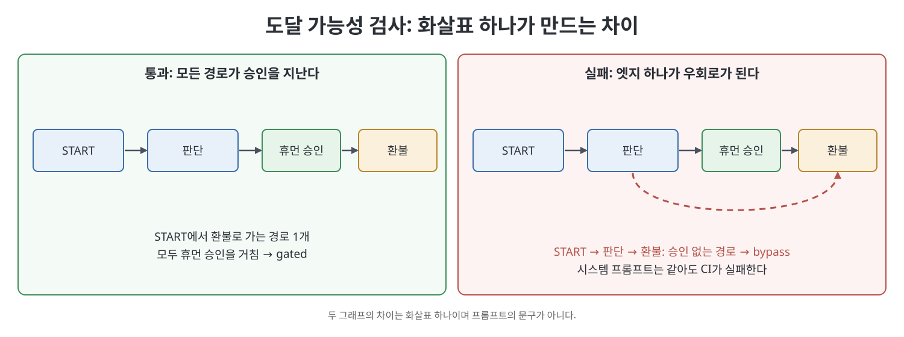

# 11장 에이전트 그래프의 보안·신원·거버넌스 (Security, Identity, and Governance of Agent Graphs)

이 장은 실행 그래프(execution graph) 자체를 보안 산출물로 보자는 주장이다. 노드 집합은 "누가 행동할 수 있는가"이고, 엣지 집합은 "누가 누구에게 일을 넘길 수 있는가"다. 저자 Ken Huang은 프롬프트 인젝션을 막는 문구를 더 다듬자는 이야기가 아니라, 그래프에 아예 없는 엣지가 어떤 문구보다 강한 통제라는 이야기를 한다. 이 노트는 방어 관점의 개념과 통제 항목 위주로 정리하며, 공격 방법의 세부는 다루지 않는다.

> **쉽게 말하면**
> 회사에서 "환불은 승인 없이 하지 마세요"라고 적어 붙이는 것보다, 환불 버튼이 있는 방으로 가는 문 자체를 잠가 두는 편이 안전하다. 에이전트 그래프에서 문은 엣지이고, 잠금은 설계 단계의 허용 목록(allowlist)이다.

> **참고(노트 작성자)** 책이 소개하는 MAESTRO, AIVSS v0.8, ADK 2.0, LangGraph 관련 날짜와 내용은 2026년경 시점 기준이며 노트 작성자가 따로 검증하지 않았다. 책 본문의 수식 표기(G_A, G_I, G_T)는 논의를 정리하기 위한 저자의 기호다.

## 이 장의 흐름

1. 실행 그래프가 곧 공격 표면이다
2. 허용 목록은 프롬프트가 아니라 표(행렬)다
3. 신원 그래프와 인가 그래프
4. 도달 가능성으로 게이트 우회 불가를 증명하기
5. 공급망 신뢰 그래프와 실행의 계보(provenance)
6. 폭발 반경과 휴먼 인 더 루프의 실패 양상
7. MAESTRO·AIVSS 위치 잡기, 실행 가능한 검사기, 책이 거부하는 것

## 1. 실행 그래프가 곧 공격 표면이다

책은 에이전트 그래프를 G_A = (V_A, E_A, S, P, T)로 다시 적는다. V_A는 노드(에이전트, 도구, 평가자, 휴먼 승인)이고, E_A는 허용된 전이, S는 공유 상태(state), P는 합법적인 후속 노드 중에서 모델이 고르는 선택, T는 체크포인트(checkpoint)와 인터럽트(interrupt) 등 실행 시간 구조다. 여기에 모든 노드가 "누군가의 권한으로" 돈다는 의미에서 주체(principal)라는 꼬리표를 붙인다.

핵심 논지는 이렇다. 프롬프트 인젝션은 P의 선택을 흔들 수는 있어도, E_A에 없는 후속 노드를 만들어 내거나 노드 도구 목록에 없는 도구를 쥐여 줄 수는 없다. 고객 이메일을 읽는 노드에서 환불 도구로 가는 엣지가 없다면, 모델이 속아도 갈 길이 없다. 반대로 "분석가가 결제를 확인할 수도 있으니" 하며 그 노드에 결제 도구를 주면, 사라진 경로를 프롬프트라는 희망으로 바꿔 버린 것이다.

책이 경계하는 대표 실패는 **그림자 엣지(shadow edge)**다. 선언한 E_A 밖으로 일이 흘러가는 모든 통로를 말한다. 노드에 몰래 들어간 도구, 정적 엣지와 동적 이동 명령을 섞어 두 경로가 모두 발화하는 설계, 라우팅 라벨로 쓰이는 필드를 다른 노드가 쓰는 경우, 다른 주체로 스레드를 재개하는 디버그 통로, 허용 목록에 없는 도구를 싣고 오는 런타임 로딩 서버 등이다. 책은 그림자 엣지가 냅킨 스케치에는 안 보이고 사고 보고서에 나타난다고 말한다.

## 2. 허용 목록은 프롬프트가 아니라 표다

책은 허용 목록을 설계 리뷰에 올릴 수 있는 네 개의 표로 분해한다. 표가 생성자 인자로 코드에 있으면 단위 테스트가 PR을 막을 수 있지만, README 주석으로만 있으면 편의 도구가 하나 추가되는 순간 어긋난다.

| 표 | 행과 열 | 막으려는 것 |
|---|---|---|
| 노드-도구 행렬 | 노드 × 도구, 빈칸은 거부 | 판단 노드가 부작용 도구를 쥐는 것 |
| 노드-라벨 행렬 | 라우팅 노드 × 합법적 다음 노드 | 모델이 노드 이름을 마음대로 부르는 것 |
| 생성 규칙 | 어떤 노드가 어떤 워커를, 몇 개까지 | 척후 노드가 적용 워커를 만들어 내는 것 |
| 재개 정책 | 어떤 주체가 어떤 스레드를 재개 | API 토큰만 있으면 누구나 승인 해제 |

여기에 책은 두 가지 불변식을 더한다. 첫째, 위험도가 큰 작업의 승인은 **매개변수에 묶여야(parameter-bound)** 한다. 금액, 주문 번호, 목적지가 승인 서명에 포함되지 않으면 "기분에 대한 승인"이 된다. 둘째, **멱등성 키**다. 환불은 (고객, 주문, 스레드) 같은 키로 한 번만 일어나야 이중 클릭이나 재개로 인한 두 번째 환불이 막힌다.

## 3. 신원 그래프와 인가 그래프

책은 에이전트의 "이름"(예: 빌링봇)을 신원(identity)으로 착각하는 관행을 지적한다. 진짜 신원은 G_A와 합쳐서 섞지 않고 **옆에 따로 두는 두 번째 그래프** G_I다. 정점은 사람, 에이전트, 서비스 계정, 벤더 런타임 같은 주체이고, 엣지는 can_invoke, runs_as, may_resume, delegates_to, issued_by 같은 관계다. 책은 이것이 관계 기반 접근 제어(relationship-based access control)의 한 형태이며 Google의 Zanzibar 논문이 산업적 구현이라고 소개한다.

합성 규칙은 단순하다. 모든 노드는 주체 하나를 가리켜야 하고, 노드가 쥔 도구는 그 주체가 호출할 수 있는 것이어야 하며, 인터럽트 재개는 호출자에서 스레드로 가는 may_resume 경로여야 한다. 만약 G_I에 분석가에서 환불 도구까지 가는 길이 있다면, G_A에서 엣지를 지운 것은 연극이 된다. 책이 제시하는 통제 항목은 다음과 같다.

- 도구를 쥐는 노드 유형마다 서비스 계정을 따로 둔다(그래프 하나에 계정 하나가 아님).
- 자격 증명은 노드 시작에 발급하고 종료에 폐기하며, 공유 상태에 쓰지 않는다.
- 재개 토큰은 스레드, 그래프 버전, 대기 중 부작용의 매개변수 해시에 묶는다.
- 워커를 만들 때(Send) 자격 증명을 상속시키지 않는다. 병렬 서브에이전트가 같은 키를 쓰면 판단의 격리가 아니라 키의 복제다.
- 외부 그래프(A2A, MCP, 벤더 도구)는 철회 가능한 issued_by 엣지를 가진 별도 주체로 다룬다.

사람도 주체다. 화면에 모델의 요약이 뜨면 설명을 승인하게 되고, 묶인 매개변수가 뜨면 행위를 승인하게 된다.

## 4. 도달 가능성으로 게이트 우회 불가를 증명하기

책의 가장 구체적인 방어 기법이다. 유향 그래프에서 정점 s에서 t로 가는 경로가 있으면 t는 도달 가능하다. 책이 컴파일러가 거부할 수 있는 형태로 세운 주장은 다음과 같다.

> 민감한 작업 a마다, START에서 a로 가는 모든 단순 경로는 휴먼 승인 노드를 a의 앞선 정점으로 한 번 이상 지난다.

경로 하나라도 승인 노드를 건너뛰면 그것은 모델의 잔여 위험이 아니라 **그리기 오류(drawing error)**이고, 가장 싼 종류의 오류다. 책은 두 그래프가 화살표 하나 차이일 뿐이라고 보여 준다. 시스템 프롬프트가 같아도 한쪽은 안전하고 한쪽은 우회로가 있다.

단순 경로(simple path)를 쓰는 이유는 재시도·재개 때문에 사이클이 있는 프로덕션 그래프에서 임의의 걷기(walk)를 세면 끝나지 않기 때문이다. 민감 작업을 포함하면서 승인이 없는 사이클은 별도의 지적 사항이다. 승인이 첫 진입에만 있어도 재시도 루프가 환불을 다시 호출하면 이중 지출 구조이며, 여기에는 멱등성 키가 통제다.

런타임에 그래프가 자라는 경우(Send, 플래너가 내놓는 노드 이름)에는 컴파일 시점 검사가 필요조건일 뿐이다. 책은 네 가지를 덧붙인다. 정적 허용 목록 검사, 생성 수의 상한과 워커 유형 제한, 변이 시 술어 재검사 또는 변이 거부, 그리고 의도가 아니라 실제로 발화한 정점과 엣지를 T에 기록하는 것이다. 책은 모델이 라벨을 고르는 조건부 엣지에 민감 작업 라벨을 숨기는 것을 부드러운 우회로로 보고, 모델이 노드 이름을 내지 못하게 하라고 한다.

## 5. 공급망 신뢰 그래프와 계보

실행 엣지가 "이번 실행의 허가"라면, 신뢰 그래프 G_T는 "부품을 누가 만들었나"다. 모델, 도구 구현, 프롬프트 템플릿, 검색 인덱스, MCP 서버, 하위 그래프, 컨테이너 이미지가 모두 정점이고 depends_on, signed_by, loads_at_runtime 같은 엣지가 있다. 서명 없는 런타임 로딩 엣지가 곧 지적 사항이다. 책의 운영 번역은 다음과 같다.

| 통제 | 의미 |
|---|---|
| 모델 고정 | 제공자와 날짜가 있는 스냅샷, 떠다니는 latest 금지 |
| 도구 해시 | 함수 이름이 아니라 내용 해시로 노드에 주입 |
| 서술자 서명 | MCP·A2A 서술자는 도구 목록을 바꾸므로 정책 문서처럼 서명 |
| 검색과 권한 분리 | 검색 문서는 도구를 추천할 수는 있어도 부여할 수 없다 |
| 그래프형 SBOM | 목록(PDF)이 아니라 무엇이 무엇을 언제 로드하는지의 그래프 |

**계보(lineage)**도 같은 맥락이다. 로그가 메시지를 남긴다면 계보는 "어떤 노드가 어떤 주체로, 어떤 체크포인트에서, 어떤 상태 키를 썼는가"를 남긴다. 승인 후 금액을 조용히 덮어쓰는 리듀서는 자기 그래프가 저지르는 매개변수 재바인딩이다. 책은 인터럽트 페이로드가 곧 승인 기록이어야 하며(묶인 매개변수, 그래프 버전, 노드 이름, 인증된 주체, 검증용 해시), 재생(replay)은 별개의 행위이므로 스레드를 분기해 계보에 남기라고 권한다.

## 6. 폭발 반경과 휴먼 인 더 루프의 실패

**폭발 반경(blast radius)**은 비유가 아니라 침해된 노드 v에서 도달 가능한 집합 R(v)다. 책은 이를 네 가지로 계산 가능하게 정의한다.

| 구분 | 정의 |
|---|---|
| 제어 흐름 | v에서 도달 가능한 노드(생성 규칙 포함) |
| 권한 | 그 노드들의 도구와 자격 증명의 합집합 |
| 상태 | v가 읽을 수 있고 이후 노드가 도구나 외부로 보내는 키 |
| 생성 | v가 만들 수 있는 워커 유형 × 개수 상한 |

방어는 이 네 집합을 의도적으로 줄이는 일이다. 민감 도구는 비신뢰 입력에서의 경로가 승인 노드를 거치는 곳에만 두고, 상태 키는 필요한 만큼만 읽게 하며, 같은 폭발 반경을 공유하면 안 되는 노드는 주체를 공유하지 않는다. 먼저 끝나는 쪽이 이기는 any-of 조인은 신뢰하는 검토자와 신뢰하지 않는 워커를 섞지 않는다. 설계 리뷰 질문으로 "사용자 텍스트를 가장 먼저 읽는 노드의 R(v), 도구, 주체, 상태 키를 나열하라"를 제안한다.

휴먼 승인 노드가 있어도 통제로 실패하는 양상을 책은 이렇게 분류한다. 이름은 책의 것이고 설명은 요약이다.

- **피로**: 그래프는 생성을 병렬화하지만 판단은 병렬화하지 못한다. 기계 검사를 앞에 두고, 의도적으로 묶어 승인하며, 인터럽트를 속도 제한하고, 승인까지 걸린 시간을 지표로 잰다.
- **연극**: 항상 예인 체크박스, 시간 초과 시 자동 승인, 기록만 하고 막지 않는 인터럽트. 타임아웃 엣지는 "시계가 달린 우회로"이므로 그리든지 지우든지 해야 한다.
- **승인 후 매개변수 재바인딩**, **엉뚱한 주체의 재개**, **재개 시 멱등성 실패**, **모델이 쓴 요약으로 사람을 속이는 것**, **하류 영향을 모르고 승인하는 혼동된 대리인**.

## 7. MAESTRO, AIVSS, 실행 가능한 검사기

책은 자신이 발표한 위협 모델링 프레임워크 MAESTRO의 7개 층(기반 모델, 데이터 운영, 에이전트 프레임워크, 배포와 인프라, 평가와 관측성, 보안과 규정 준수, 에이전트 생태계)을 실행 그래프 옆의 **두 번째 축**으로 쓰자고 제안한다. 층별 위협 목록이 토폴로지를 대체하지는 않는다. 책의 매핑에서 판단 노드는 3층에서 1층을 호출하는 정점이고, 휴먼 승인 노드는 6층 통제를 3층 정점으로 구현한 것이다(그래서 연극이 생긴다). OWASP AIVSS v0.8의 핵심 위험 10가지(도구 오용, 접근 제어 위반, 연쇄 실패, 신원 사칭, 공급망, 추적 불가 등)는 점수를 새로 만들지 않고 "토폴로지 객체"와 "점수가 아닌 검사"로 대응시킨다. 책은 이 표가 공식 대응표가 아니라 자신의 매핑이라고 밝힌다.

동반 프로그램(책 저장소)은 모델을 호출하지 않는다. 노드별 주체와 도구, 민감 작업 집합, 승인 노드 집합을 가진 유향 그래프에서 술어 하나(모든 단순 경로가 승인 노드를 지나는가)와 폭발 반경(BFS)을 구하고, 결과를 gated, bypass, unreachable, missing-node, tool-smuggle로 보고한다. 세 가지 시험 그래프는 승인이 있는 환불, 엣지 하나가 추가된 우회 환불, 척후가 곧바로 적용 노드에 닿는 팬아웃이다. 책의 요점은 이 검사를 E_A나 노드-도구 행렬이 바뀔 때마다 CI에서 돌리라는 것이다.

책이 거부하는 것은 시스템 프롬프트를 허용 목록 대신 쓰는 것, 막지 못하는 사람 상자, 상속된 자격 증명, 서명 없는 런타임 로딩이다. 토폴로지로 못 먹는 잔여 위험(판단 노드 인젝션, 사람의 도장 찍기, 공급자 변조)은 모니터링과 계약의 몫이라고 인정한다.

**Homework 유형** 주체와 노드, 허용 목록이 주어졌을 때 누가 어떤 노드를 호출하거나 재개할 수 있는지 계산하는 과제다. 기본은 거부이며, 재개 권한이 없는 주체는 스레드를 풀 수 없고 엣지의 부재를 암묵적 허용으로 읽으면 안 된다.

## 핵심 정리

- 실행 그래프는 이미 보안 산출물이다. 노드는 누가 행동하는지, 엣지는 누가 누구에게 넘기는지를 정한다.
- 프롬프트 인젝션은 선택을 흔들 수는 있어도 E_A에 없는 길이나 노드에 없는 도구를 만들지 못한다. 허용 목록은 프롬프트가 아니라 생성자 인자의 표로 둔다.
- 신원은 이름이 아니라 G_A와 합성되는 별도 그래프 G_I다. 승인은 매개변수와 해시에 묶고, 재개 권한은 주체와 스레드에 묶는다.
- 민감 작업으로 가는 모든 단순 경로가 승인 노드를 지나는지를 CI에서 검사한다. 폭발 반경은 R(v)와 도구·주체·상태로 계산한다.
- 공급망(서명, 해시, 고정)과 계보(누가 어떤 키를 썼는가)는 감사 가능성의 전제다. 휴먼 노드가 있어도 피로, 연극, 우회가 있으면 통제가 아니다.

 
 
 

이전: [10장 에이전트 그래프의 컴퓨터 과학](../04.%204%EB%B6%80%20%EC%9A%B4%EC%98%81%EA%B3%BC%20%EC%9D%B4%EB%A1%A0/10%EC%9E%A5%20%EC%97%90%EC%9D%B4%EC%A0%84%ED%8A%B8%20%EA%B7%B8%EB%9E%98%ED%94%84%EC%9D%98%20%EC%BB%B4%ED%93%A8%ED%84%B0%20%EA%B3%BC%ED%95%99.md) | 다음: [12장 그래프 인텔리전스는 런타임이 아니다](12%EC%9E%A5%20%EA%B7%B8%EB%9E%98%ED%94%84%20%EC%9D%B8%ED%85%94%EB%A6%AC%EC%A0%84%EC%8A%A4%EB%8A%94%20%EB%9F%B0%ED%83%80%EC%9E%84%EC%9D%B4%20%EC%95%84%EB%8B%88%EB%8B%A4.md)

 

[Graph Engineering for Agentic AI Systems](../)
