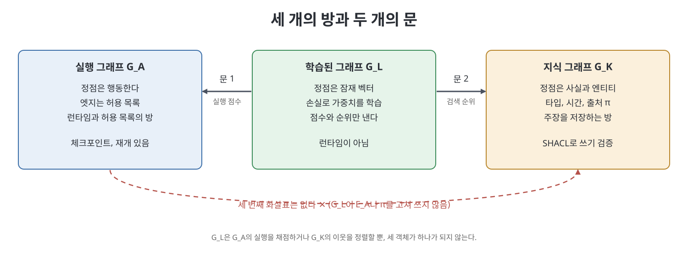
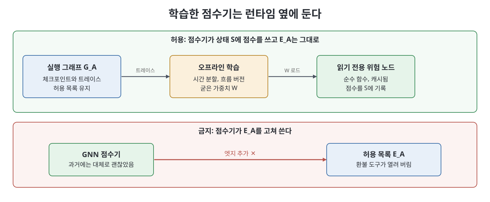

# 12장 그래프 인텔리전스는 런타임이 아니다 (Graph Intelligence Is Not the Runtime)

이 장은 책이 세 번째로 구분하는 "그래프", 곧 학습된 계산 그래프(learned computational graph, 이하 G_L)를 다룬다. 그래프 신경망(GNN), 그래프 트랜스포머, 데이터에서 추정한 인과 그래프가 여기에 속한다. 저자의 입장은 분명하다. 이것들은 오케스트레이터가 아니고, 사실을 저장하는 곳도 아니며, 책이 말하는 그래프 엔지니어링도 아니다. 다만 에이전트 시스템과 만나는 정당한 지점이 두 군데 있고, 그 지점에서도 G_L은 런타임 "옆"에서 점수를 매기거나 순위를 정할 뿐이다.

> **쉽게 말하면**
> 지도(그래프)가 있다고 해서 네비게이션 앱이 운전대를 잡는 것은 아니다. G_L은 "이 길은 과거에 자주 막혔다"라고 알려 주는 교통 통계이지, 도로 자체(허용된 경로)나 운전자가 아니다.

> **참고(노트 작성자)** 책이 인용하는 논문(GNN, GraphSAGE, Graphormer 등)과 2026년 블로그·arXiv 글은 책의 소개를 따른 것이며 노트 작성자가 검증하지 않았다. 책이 "추측(speculative)"이라고 표시한 부분은 이 노트에서도 추측으로 표시한다.

## 이 장의 흐름

1. 세 가지 그래프의 구분과 G_L의 최소 지식
2. 계속 팔리는 비교차점: LLM이 엣지를 고르는 것은 GNN이 아니다
3. 교차점 1: 실행 이력 위의 GNN으로 실패할 분기 예측
4. 교차점 2: 지식 그래프 위의 GNN으로 검색 재순위
5. 반드시 분리해야 할 영역과 인과 그래프의 오해
6. 시간·이종 그래프, 그래프 트랜스포머, 실패 양상, 설계 리뷰 질문

## 1. 세 가지 그래프와 G_L의 최소 지식

책은 2장부터 이어 온 구분을 다시 못 박는다.

| 그래프 | 정점이 하는 일 | 엣지의 뜻 | 사는 장 |
|---|---|---|---|
| 실행 그래프 G_A | 행동한다(에이전트, 도구, 평가자, 사람) | 허용된 전이 | 2~7, 9~11, 13장 |
| 지식·메모리 그래프 G_K | 사실이다(엔티티) | 타입·시간·출처가 있는 관계 | 8장 |
| 학습된 계산 그래프 G_L | 잠재 벡터이며 손실로 학습됨 | 입력으로 주어진 인접 구조 | 이 장 |

책이 G_L에서 쓰는 최소 지식은 네 가지다. 첫째, 계산의 본체는 **메시지 패싱**이다. 각 노드가 이웃의 메시지를 모아 집계하고 상태를 갱신하며, K층을 쌓으면 K홉 이웃을 본다. 둘째, 그래프는 프로그램 카운터가 아니라 **입력 데이터**다. 셋째, 학습은 오프라인이며 학습 중인 모델과 실행 중인 그래프는 다른 제품이다(굳은 점수기는 노드 안에서 서빙할 수 있다). 넷째, 표현력에는 오래된 한계가 있다. MPNN류 모델은 1-Weisfeiler-Leman 검사로 구분되지 않는 그래프를 구분하지 못한다. 책은 GNN이 2026년의 발명이 아니라 2009년 Scarselli 등의 논문에서 시작된 오랜 계보임을 환기한다.

## 2. 계속 팔리는 비교차점: LLM이 엣지를 고르는 것은 GNN이 아니다

책이 이 장에서 가장 강하게 거부하는 범주 오류다. 두 대상은 둘 다 동그라미와 화살표로 그려지고, 둘 다 모델이 들어 있으며, 영어로는 둘 다 "다음에 무엇이 일어날지 결정한다"고 말할 수 있다. 그러나 메커니즘은 거의 공유하지 않는다.

| 구분 | G_A의 조건부 엣지(LLM 선택) | G_L의 GNN 층 |
|---|---|---|
| 계산 | 프롬프트를 보고 다음 토큰을 샘플링한 뒤 파서가 유한 집합의 라벨로 매핑 | 은닉 상태와 입력 인접 구조의 함수 |
| 경로를 정하는 것 | 허용 목록(코드와 함께 버전 관리)이 합법 집합을 정하고 모델은 그 안에서 선택 | 훈련 분포, 손실, 사람이 고른 특징 |
| 역전파 | 없음 | 학습 단계에 있음 |
| 체크포인트·재개 | 있음 | 없음 |

책은 그럴듯한 구호 몇 개를 같은 범주로 묶어 반박한다. "LangGraph가 Pregel 메시지 패싱이니 GNN이다"는 둘의 이름이 같을 뿐 Pregel은 대규모 그래프 처리 시스템이고, 노드 안 LLM의 토큰 어텐션은 Graphormer가 아니며, 조건부 엣지는 학습된 어텐션이 아니라 허용 목록과 선택자의 결합이라는 식이다. Hu Wei의 정적 DAG 제안도 G_A의 스케줄러 논의이지 GNN이 아니라고 선을 긋는다.

## 3. 교차점 1: 실행 이력 위의 GNN

책이 인정하는 첫 번째 교차점은 **트레이스로 학습해 실패할 분기를 예측하는 점수기**다. 입력은 살아 있는 그래프가 아니라 이미 일어난 일의 모음이다. 한 번의 실행 기록은 G_A 위의 걷기에 측정값(토큰 수, 시간, 재시도, 검토 거절)을 붙인 것이다.

예를 들어 "청구 문의를 분류하는 노드 → 청구 노드 → 검토자"라는 구조에서, 검토자가 자주 거절하는 패턴은 청구 노드의 이웃 구조에 숨어 있다. 점수기는 노드 실패 확률, 엣지 실패 확률, 경로 비용 중 하나의 "머리(head)"를 가져야 한다. 책은 머리 이름을 못 대면 과제가 아니라 라이브러리일 뿐이라고 말한다. 또 이진 "에러 여부"가 아니라 MAST 같은 다중 에이전트 실패 분류(명세 문제, 에이전트 간 불일치, 검증 실패)에서 라벨을 빌리라고 권한다. 이진 라벨은 타임아웃이 실패한다는 뻔한 것만 배운다.

운영상 위험도 구체적이다. 전문가 노드를 늘리거나 검토자 프롬프트를 바꾸면 훈련했던 트레이스는 다른 프로그램이 되므로 `flow_version`을 특징과 학습 필터에 넣는다. Send로 개수가 변하는 워커는 노드를 하나로 묶고 개수를 특징으로 쓰거나 귀납적(inductive) 모델을 쓴다. 점수기가 닿는 문은 읽기 전용 위험 노드(순수 함수 도구 노드)여야 하며, 재개 시 다시 실행돼도 이중 청구나 이중 기록이 없도록 (스레드, 체크포인트, 흐름 버전, 모델 버전)으로 캐시한다.

## 4. 교차점 2: 지식 그래프 위의 GNN

두 번째 교차점은 G_K의 이웃 일부에서 R-GCN, HAN, 그래프 트랜스포머를 돌려 **검색 결과를 재순위(rerank)** 하는 것이다. 벡터 검색이 여전히 1차 키이고, 타입 있는 걷기가 본체이며, 출처 정보 π를 달아 내보낸다. GNN은 재순위기일 뿐이다. 책은 이것이 Microsoft GraphRAG와 다르다고 짚는다. GraphRAG의 학습된 부분은 추출·요약을 하는 LLM이지 엔티티 그래프 위의 GNN이 아니다.

책은 이 재순위기가 PPR(개인화 페이지랭크)이나 "타입 있는 이웃을 그대로 프롬프트에 넣기"보다 낫다는 것은 **추측**이라고 표시한다. 자주 갱신되는 G_K에는 학습 때 전체 그래프를 보는 전이적(transductive) 설정보다 쿼리마다 이웃을 샘플링하는 귀납적 설정이 어울린다고 본다. 링크 예측 GNN이 새 엣지를 제안하는 것도 유혹적이지만, 제안된 엣지는 제안된 사실이므로 SHACL 같은 검증을 거쳐야 하며 GNN은 커밋하지 않는다. 가중치는 출처가 아니다.

## 5. 반드시 분리해야 할 영역과 인과 그래프

책은 교차점은 합성이고 나머지는 벽이라고 한다. 이 벽을 표로 요약하면 다음과 같다.

| 일 | 맡는 곳 | G_L이 하면 안 되는 이유 |
|---|---|---|
| 허용 목록, 도달 가능성, 휴먼 게이트 | G_A | GNN 점수는 경계가 아니다 |
| 타입, 유효성, 엔티티 해소, SHACL | G_K 쓰기 경로 | 모델은 오타입 엣지를 거리낌 없이 전파한다. 해소되지 않은 언급으로 학습하면 "학습된 말장난"이 된다 |
| 데이터와 함께 이동하는 권한 | G_K와 쿼리 엔진 | 접근 제한 사실이 임베딩 표현으로 새어 나갈 수 있다 |
| 리듀서 | 결정적이고 모델 호출 금지 | 안에 역전파를 넣으면 추적도 예산도 없는 숨은 노드가 된다 |
| 메모리 | G_K | 트레이스를 출처 없이 사실로 승격하면 환각이 정책이 된다 |

**인과 그래프**는 거버넌스 대화에서 감사 문서처럼 오인되기 쉬운 부분이다. 책은 세 그림을 나란히 놓고 같은 동그라미가 다른 동사를 가진다고 설명한다. 인과 DAG는 가정된 메커니즘이고 do 연산이 쓰이며, 계보는 누가 주장했는가이고, 트레이스는 무엇이 발화했는가다. "근본 원인은 검토자 프롬프트"라는 말은 흔히 인과 사다리의 첫 단(연관) 주장에 이야기를 얹은 것에 불과하다. Granger 인과도 예측에는 쓸모 있어도 개입 효과를 말해 주지 않는다. 책의 실무적 결론은 "프로그램에 대한 질문(사람 게이트가 환불 도구를 막는가)은 발견이 아니라 도달 가능성으로 답한다"이다.

## 6. 시간·이종 그래프, 트랜스포머, 실패 양상, 리뷰 질문

에이전트 트레이스와 지식 그래프는 Cora 같은 동종·정적 인용망이 아니다. 노드는 에이전트·도구·평가자·사람 네 유형이고 엣지에는 정방향, 조건부, 재시도 되돌이, Send로 생긴 것이 있다. 하나의 인접 행렬로 납작하게 만들면 재시도 되돌이가 성공적 인계처럼 보인다. 책은 TGN 같은 시간 GNN의 노드 메모리를 지식 그래프의 기억처럼 부르지 말라고 경고한다. 그것은 가중치에 가까운 객체이고 출처가 없다. 그래프 트랜스포머(Graphormer, GraphGPS 등)는 문서 안에서 "문 앞"에는 둘 수 있어도 오케스트레이터가 아니며, 노드가 열 개 남짓이면 표나 2층 GCN이 정직한 첫 모델이고, 수백 스텝의 트레이스라면 이벤트 로그 위의 시퀀스 트랜스포머를 먼저 기준선으로 삼으라고 한다.

G_L이 에이전트 옆에서 실패하는 방식을 책은 운영 런북처럼 나열한다.

- **지난 분기의 조직을 학습한 점수기**: 이미 없앤 전문가를 낮은 위험으로 추천한다. 흐름 버전으로 분리한다.
- **허브를 세탁하는 재순위기**: 많이 언급되는 엔티티가 계속 상위에 오른다.
- **π를 잃어버린 임베딩**: k-NN으로 바꾸고 나서 어떤 문서가 근거인지 말할 수 없다.
- **스레드를 섞은 분할**: 무작위 분할은 같은 사건 패턴이 양쪽에 들어가 AUC가 부풀려진다. 시간, 흐름 버전, 스레드 순으로 나눈다.
- **인터럽트 경로의 GPU**: 사람을 기다리게 하는 경로에 점수기를 동기로 두지 않는다.
- **같은 데이터를 본 합창**: 작성자, 검토자, 점수기가 같은 실패 기록을 보고 함께 틀린다.
- **남의 데이터셋 수치 인용**: 설계 리뷰에는 자기 트레이스와 기준선으로 직접 잰 수치만 올린다.

책은 가장 중요한 한 그림으로 "점수기가 E_A를 고쳐 쓰는 구조"와 "점수기가 S에 점수만 쓰고 허용 목록은 그대로인 구조"를 대비한다. 첫째 구조는 프롬프트 인젝션된 점수기가 허용 목록을 넓힐 수 있게 하므로 허용되지 않는다.

책의 동반 코드는 LLM 없이 소수의 트레이스로 노드 특징을 집계하고 두 층 평균 메시지 패싱으로 선언된 엣지에만 실패 점수를 매기며, 점수기에 실행 함수가 없음을 단언한다(수치는 냅킨 수치). 책의 설계 리뷰 12문항은 대략 이런 질문이다. 화면의 동그라미는 행동인가, 사실인가, 벡터인가. 머리와 기준선은 무엇인가. 점수기가 E_A를 고쳐 쓰는가(답은 아니오). 재순위기가 π를 돌려주는가. 분할은 시간과 흐름 버전인가.

**Homework 유형** 아주 작은 그래프에서 한 층의 메시지 패싱을 직접 구현하는 과제다. 이웃을 바꾸면 임베딩이 움직이고, 고립시키면 움직이지 않아야 하며, 외부 API 없이 표준 라이브러리나 numpy만 쓴다.

## 핵심 정리

- 세 그래프를 섞지 않는다. G_A는 행동하고, G_K는 주장을 저장하며, G_L은 손실로 학습된 계산이고 런타임이 아니다.
- LLM이 조건부 엣지를 고르는 것은 GNN이 아니다. 전자는 허용 목록 안의 샘플이고 후자는 입력 그래프 위의 학습된 함수다.
- G_L의 허용된 일은 점수와 순위, 두 가지다. 트레이스 위 실패 분기 예측과 G_K 위 검색 재순위이며, 둘 다 런타임 옆에서 읽기 전용으로 쓰인다.
- G_L이 E_A를 고쳐 쓰거나, π를 대체하거나, 리듀서에 들어가거나, 부작용에 do 연산을 적용하는 것은 벽 너머의 일이다. 인과 그래프는 계보도 트레이스도 허용 목록도 아니다.
- 도입 전에 기준선(표, PPR, 시퀀스 모델)을 이기는지, 시간 분할인지, 흐름 버전을 쓰는지 확인한다. 그렇지 못하면 GNN은 쓰지 않는다.

 
 
 

이전: [11장 에이전트 그래프의 보안·신원·거버넌스](11%EC%9E%A5%20%EC%97%90%EC%9D%B4%EC%A0%84%ED%8A%B8%20%EA%B7%B8%EB%9E%98%ED%94%84%EC%9D%98%20%EB%B3%B4%EC%95%88%C2%B7%EC%8B%A0%EC%9B%90%C2%B7%EA%B1%B0%EB%B2%84%EB%84%8C%EC%8A%A4.md) | 다음: [13장 에이전트 그래프의 테스트·평가·검증](../06.%206%EB%B6%80%20%EA%B2%80%EC%A6%9D%EA%B3%BC%20%EA%B2%B0%EB%A1%A0/13%EC%9E%A5%20%EC%97%90%EC%9D%B4%EC%A0%84%ED%8A%B8%20%EA%B7%B8%EB%9E%98%ED%94%84%EC%9D%98%20%ED%85%8C%EC%8A%A4%ED%8A%B8%C2%B7%ED%8F%89%EA%B0%80%C2%B7%EA%B2%80%EC%A6%9D.md)

 

[Graph Engineering for Agentic AI Systems](../)
