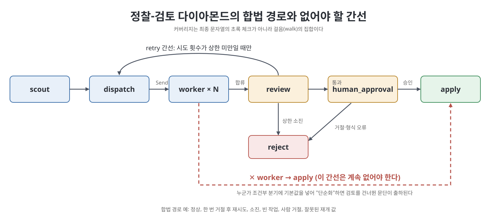
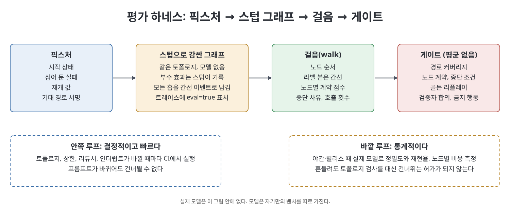

# 13장 에이전트 그래프의 테스트·평가·검증 (Testing, Evaluation, and Verification of Agent Graphs)

프롬프트 평가는 모델이 내놓은 답 한 덩어리에 점수를 매긴다. 그러나 에이전트 그래프는 답이 멀쩡해 보여도 중간에 검토 노드를 건너뛰거나, 재시도 상한을 넘기거나, 사람이 본 적 없는 패치를 적용했을 수 있다. 이 장은 평가의 대상을 최종 문장에서 **걸음(walk)**, 곧 한 실행이 실제로 지나간 노드와 간선의 기록으로 바꾼다. 4장의 정찰-검토 다이아몬드(scout-review graph)를 모델 없이 돌리는 작은 하네스로 만들어 검사 방법을 보여 준다. 9장이 "그래프가 살아남는가"를 묻는다면, 이 장은 "그린 대로 실행되었는가"를 묻는다.

> **쉽게 말하면**
> 시험 문제의 정답 문장만 채점하지 말고 풀이 과정을 채점하자는 이야기다. 검토 노드가 실제로 돌았는지, 멈춰야 할 때 멈췄는지를 코드로 확인한다.

> **참고(노트 작성자)** 이 장이 소개하는 도구(LangGraph의 남은 단계 키 등), 커뮤니티 사례, 날짜는 책이 쓰인 2026년경 기준이다. 노트 작성자가 검증하지 않았으므로 "책은 ~라고 소개한다" 수준으로 받아들이기 바란다.

## 이 장의 흐름

1. 평가 대상은 프롬프트가 아니라 걸음이다
2. 경로 커버리지와 합법·불법 경로
3. 노드별 계약 점수와 중단 조건 테스트
4. 골든 트레이스와 리플레이
5. 검증자 합의와 질의 가능한 그래프
6. 금지 행동, 하네스, 체크리스트

## 1. 평가 대상은 걸음이다

프롬프트 평가는 모델을 고정하고 입력을 바꿔 가며 호출 결과를 채점한다. 그래프 평가는 토폴로지를 고정하고 **픽스처(fixture)**, 곧 시작 상태·심어 둔 실패·재개 값을 바꿔 가며 걸음을 채점한다. 최종 문자열만 보면 세 시스템이 같아 보인다. 한 노드가 쓰고 스스로 확인하는 루프, 검토가 한 번 거절한 뒤 재시도에서 통과하고 사람이 승인한 다이아몬드, 그리고 조건부 간선의 기본값이 "적용"이라 검토가 한 번도 돌지 않았는데 문장은 매끄러운 다이아몬드다. 세 번째는 프롬프트 평가를 모두 통과하지만 "걸음에 review가 있어야 한다"는 단언 하나에 실패한다.

| 구분 | 프롬프트 평가 | 그래프 평가 |
|------|---------------|-------------|
| 고정하는 것 | 모델 | 토폴로지 |
| 바꾸는 것 | 프롬프트, 입력 | 시작 상태, 심은 실패, 재개 값 |
| 채점 단위 | 호출 하나의 문자열 | 걸음(노드 순서, 쓰기, 중단 사유) |
| 실패의 모양 | 나쁜 문장 | 건너뛴 검토, 소진된 재시도, 두 번 적용 |

경로 서명(path signature)은 노드 내부 재시도에는 둔감하되 검토 누락은 잡을 만큼 거칠게 잡는다. 책이 인용하는 MAST 연구(Cemri 등)는 다중 에이전트 실패의 상당수가 사실 오류가 아니라 설계, 에이전트 간 불일치, 검증 실패에 있다고 분류한다. 사실만 채점하면 이 부분을 놓친다. 또 이 장은 일반 LLM 평가나 프레임워크 비교가 아니며, 11장의 보안 도달 가능성과도 다르다. 보안은 위험한 경로가 그래프에 **존재하는가**를, 이 장은 좋은 행동의 픽스처에서 그 경로를 **실제로 탔는가**를 묻는다.



## 2. 경로 커버리지

책이 드는 합법 경로는 여덟 가지다. 하네스는 1~5와 잘못된 재개 값까지 여섯 픽스처를 싣고, 6~8은 다음에 추가할 픽스처로 남겨 둔다. 이런 경로는 운영 표본에서 저절로 얻어지지 않는다. 첫 주의 표본에는 정상 경로와 지난주 사고만 있다.

| 번호 | 경로 | 기대하는 결말 |
|:---:|------|---------------|
| 1 | 정상: 파일 둘, 패치 통과, 사람 승인 | apply 한 번 |
| 2 | 검증자가 한 번 거절한 뒤 수락 | 재시도 파동 후 승인 |
| 3 | 상한까지 거절 | reject, apply 없음 |
| 4 | 빈 Send 목록 | 멈춤 없이 empty_work 종료 |
| 5 | 사람이 거절 | apply 없음 |
| 6 | 사람이 수정 후 승인 | 수정된 상태로 apply |
| 7 | 워커 하나 실패, 합류가 all-of | 닫힌 채 실패, 부분 적용 없음 |
| 8 | 비용·단계 상한 도달 | 대체 노드 실행, apply 없음 |

불법 경로도 같은 목록에 **음성 픽스처**로 넣는다. 워커에서 apply로 직행, 사람 없이 apply, 정찰을 다시 타는 재시도, 같은 스레드의 apply 두 번 같은 것들이다. 컴파일된 간선상 불가능한 경로는 인접 리스트 검사로, 라우팅 버그로 가능해진 경로는 실행 후 걸음 서명으로 잡는다. 개수도 커버리지다. 두 워커가 같은 키에 쓸 때 덧셈 리듀서면 패치 둘이, 기본 리듀서면 마지막 하나만 남는데, 워커를 하나만 보내는 시험은 이 차이를 못 본다. 그래서 0개, 1개, 2개, 상한 개수로 시험한다. 순환은 경로를 무한히 만들므로 순환의 커버리지는 곧 상한의 커버리지다. 걸음은 로그 타임스탬프로 복원하지 않고 각 노드가 `trace.nodes`에 이름을 덧붙이게 하는 편이 가장 싸다.

## 3. 노드별 계약 점수와 중단 조건

노드 점수는 문장의 매끄러움이 아니라 **계약(contract)**, 곧 반환한 갱신, 호출한 도구, 쓰도록 허락된 키에 대한 술어다.

| 노드 유형 | 계약의 핵심 |
|-----------|-------------|
| 에이전트(정찰, 워커) | 자기 키만 쓴다, 목록 밖 도구를 부르지 않는다, 스키마와 배정된 파일을 지킨다 |
| 도구·코드(dispatch, apply) | 보내는 수가 상한 이하, 승인 뒤에만 실행, 같은 키로 반복해도 안전 |
| 평가자(review) | 쓰기 도구 없음, 만든 쪽의 스크래치를 보지 않음, 실패한 앵커를 건너뛰지 못함 |
| 사람 승인 | 페이로드에 근거 포함, 재개 값은 스키마 검증, 형식이 틀리면 닫힌 채 거절 |

점수는 평균하지 않고 접는다. 실행된 모든 노드가 계약을 만족하고, 서명이 합법 집합 안에 있고, 금지 서명이 없고, 중단 사유가 픽스처와 같아야 통과다. 검토가 실패인데 apply가 초록이면 실패한 걸음이다. 워커가 FIXME를 반환한 것은 워커의 위반이 아니고, 그것을 위반으로 바꾸는 것이 검토의 계약이다. BLEU, 임베딩 코사인, LLM 심사자 점수는 그래프 평가의 숫자로 쓰지 않는다. 검토를 건너뛰어도 코사인은 변하지 않는다.

중단 조건 테스트는 모델이 필요 없어 가장 먼저 쓰고 가장 나중에 지우는 테스트다. 상태를 조건의 참·거짓 영역에 놓고 라우터를 불러 다음 노드를 단언한다.

```python
def test_stop_rules():
    assert route(review_passed=True) == "human_approval"
    assert route(passed=False, attempts=MAX) == "reject"
    assert route(passed=False, attempts=1) == "dispatch"
    assert route(resume="???") == "reject"   # 잘못된 값은 닫힌 채 거절
```

(노트 작성자가 개념을 보이려고 새로 쓴 예시다.) 책은 "상태가 바뀌는 것"과 "진전하는 것"을 구분한다. 중단 조건 쪽으로 움직이는 필드가 없으면 상태가 계속 변해도 루프가 아니다. 사람이 한 주 돌아오지 않을 때 닫을지 열지도 제품 결정이며, 침묵 뒤 apply하는 열린 실패는 제품 버그다.

## 4. 골든 트레이스와 리플레이

**골든 트레이스**는 대화 기록이 아니라 걸음(노드 순서, 도구, 인터럽트 여부, 중단 사유, 상태 해시, apply의 멱등 키)이다. 합법 경로마다 하나 이상(합성도 좋다), 경로 버그였던 사고는 골든으로 졸업, 이름은 행동으로, 토폴로지를 바꿀 때 같은 커밋에서 기대 서명도 갱신한다. 라벨 없는 천 개보다 라벨 붙은 열 개가 낫다.

**리플레이**는 체크포인트에서 다시 실행하는 일이며 평가에서는 골든을 시험으로 바꾸는 수단이다. 스텁 apply가 같은 키로 두 번 불리면 재개에 안전하지 않다는 가장 싼 멱등성 시험이 되고, 한 슈퍼스텝에서 성공한 형제의 쓰기가 보존되는지도 확인한다. 모든 골든 리플레이는 경로 서명, 노드 점수, apply 호출 0~1회, 중단 사유를 단언하며 걸음에 근사 비교를 쓰지 않는다.

## 5. 검증자 합의와 질의 가능한 그래프

만든 쪽과 확인하는 쪽을 분리했다면 시험은 "검증자가 OK라고 했다"가 아니다. 심은 오류를 표시하는가, 깨끗한 초안은 통과시키는가, 만든 쪽의 사고 과정을 가려도 작동하는가를 본다. 책은 Cognition의 Walden Yan이 정리한 교훈, 곧 행동에 실린 암묵적 결정을 검토자가 물려받기 쉽다는 점을 시험으로 바꾼다. 입력은 명세와 패치뿐이고 워커의 추적은 넣지 않는다. 코퍼스에는 테스트가 실패한 패치, FIXME, 근거 없는 주장, 정찰이 나열하지 않은 파일, 깨끗한 패치를 둔다. 검토 노드만 단독으로 돌려야 쓰는 쪽의 운이 섞이지 않고, 점수는 정확도 하나가 아니라 플래그의 정밀도와 재현율이다. 모두 플래그하는 검토자는 재현율 1.0이지만 쓸모없다. 실패한 테스트 앵커는 CI에서 재현율 1.0을 요구한다.

그래프는 **런타임에 질의 가능**해야 한다. "세 홉 전에 어떤 간선이 폴백을 일으켰나"를 로그 grep 없이 물을 수 있어야 한다. 그래프 DB는 필요 없고, 노드를 감싸는 얇은 래퍼가 (출발, 간선 라벨, 도착, 단계) 이벤트를 상태에 덧붙이면 된다. 건너뛴 검토는 로그 줄이 아니라 "없는 정점"이라는 다른 종류의 사실로 드러난다.

## 6. 금지 행동, 하네스, 체크리스트

품질 관점의 금지 행동은 걸음에 대한 단언이다. 검토·사람 승인·승인 값이 모두 있어야 apply가 가능하고, apply와 정찰은 걸음당 한 번이며, 승인 값은 사람 노드만 쓴다. 이는 퍼저가 아니다. 프롬프트 주입 퍼저는 보안 시험으로 따로 돌리며 서로를 대체하지 않는다. 책의 하네스는 모델 없는 작은 기계로, 여섯 픽스처, 라우터 단위 시험, 검증자 합의, 리플레이, 소진 걸음에 apply가 없다는 변이 단언을 게이트로 둔다.



책이 하지 말라는 것은 토폴로지 전체의 주간 A/B, 부수 효과 있는 평가(스텁과 `eval=true`로 막는다), 안쪽 CI의 실제 모델(통계 평가는 야간의 바깥 루프), 라벨 없는 운영 트레이스를 스위트로 부르는 일, 같은 프롬프트 검토자 셋을 합의로 세는 일이다. 체크리스트의 정신은 평가 단위는 걸음, 합법·불법 경로를 모두 픽스처로 덮기, 노드 계약은 평균하지 않기다.

Homework는 실행 트레이스에 대한 불변식 검사기를 만드는 유형이다. 모델 호출 없이 명세와 걸음만 읽어 합류 완료, 멈춤 도달, 비용 제한 유무를 판정하고 통과·실패 트레이스를 각각 시험한다.

## 핵심 정리

- 그래프 평가의 대상은 최종 문자열이 아니라 걸음이며, 검토를 건너뛴 걸음은 문장이 매끄러워도 실패다.
- 합법·불법 경로를 모두 픽스처로 만들고, 워커 수 0·1·2·상한과 순환의 상한까지 커버리지에 포함한다.
- 노드는 계약(쓰기 키, 도구, 스키마, 앵커)으로 점수를 매기고 평균하지 않으며, 중단 조건은 모델 없는 단위 테스트로 먼저 쓴다.
- 골든은 큐레이션해 토폴로지와 함께 버전을 올리고, 리플레이로 멱등성을 시험한다.
- 검증자는 만든 쪽의 스크래치를 가린 채 단독으로 정밀도와 재현율을 재고, 실행은 간선 라벨이 붙은 질의 가능한 기록으로 남긴다.
- 안쪽 CI는 결정적으로, 통계 평가는 바깥 루프로 나누고 평가가 부수 효과를 만들지 않게 한다.

<br>
<br>
<br>

이전: [12장 그래프 인텔리전스는 런타임이 아니다](../05.%205%EB%B6%80%20%EB%B3%B4%EC%95%88%EA%B3%BC%20%EA%B2%BD%EA%B3%84/12%EC%9E%A5%20%EA%B7%B8%EB%9E%98%ED%94%84%20%EC%9D%B8%ED%85%94%EB%A6%AC%EC%A0%84%EC%8A%A4%EB%8A%94%20%EB%9F%B0%ED%83%80%EC%9E%84%EC%9D%B4%20%EC%95%84%EB%8B%88%EB%8B%A4.md) | 다음: [14장 이름이 잊혀도 그래프는 남겨라](14%EC%9E%A5%20%EC%9D%B4%EB%A6%84%EC%9D%B4%20%EC%9E%8A%ED%98%80%EB%8F%84%20%EA%B7%B8%EB%9E%98%ED%94%84%EB%8A%94%20%EB%82%A8%EA%B2%A8%EB%9D%BC.md)

<br>

[Graph Engineering for Agentic AI Systems](../)
