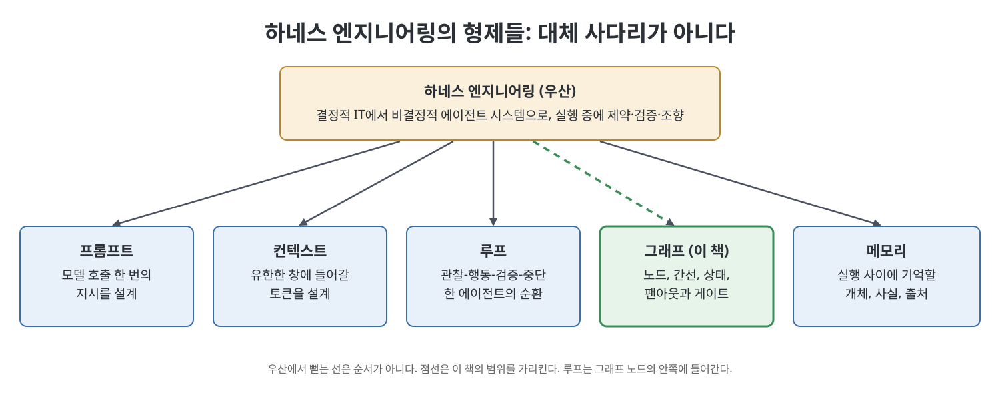
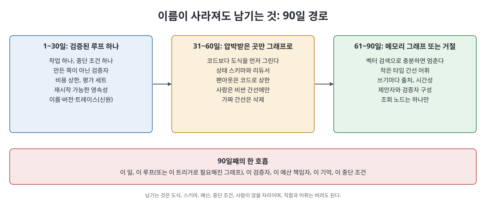

# 14장 이름이 잊혀도 그래프는 남겨라 (Keep the Graph After the Name Fades)

책의 마지막 장은 "그래프 엔지니어링"이라는 이름이 유행의 주기를 넘기지 못할 수도 있다는 가정에서 출발한다. 오래 남는 시스템의 공통점은 구조가 명시적이고, 버전이 붙고, 주인이 있다는 것이다. 이 장은 2026년 7월의 짧은 유행어 소동에서 이름과 실체를 분리하고, 하네스 엔지니어링을 우산으로 둔 이 책의 틀을 다시 세우며, 팀·교육·거버넌스·90일 실행 경로까지 정리한다. 결론은 첫 장의 약속과 같다. 루프를 먼저 익히고, 일이 강요할 때만 그래프로 나누고, 구조에 이름을 붙여 소유하라.

> **쉽게 말하면**
> 유행하는 단어는 날씨이고 구조를 설계하는 일은 기후다. 단어가 사라져도 도식, 스키마, 예산, 중단 조건, 사람이 앉을 자리는 남겨야 한다.

> **참고(노트 작성자)** 이 장은 2026년 7~8월의 게시물, 블로그, 제품 발표를 많이 인용한다. 날짜와 사실관계는 책이 소개하는 내용이며 노트 작성자가 확인하지 않았다. 인물을 평가하려는 것이 아니라 논의의 구도를 정리하려는 것이므로 이름은 출처 표시 정도로만 적는다.

## 이 장의 흐름

1. 단어와 변화를 분리한다
2. 하네스 우산 아래의 형제들
3. Chase의 질문과 두 그래프
4. 루프는 기본 그래프다
5. 팀, 교육, 타입 간선 어휘
6. 사람 게이트, 거버넌스, 스킬 대 코드
7. 중첩, A2A, 90일 경로, 남는 것

## 1. 단어와 변화를 분리한다

책은 소동의 경과를 이렇게 소개한다. 2026년 7월 18일 Peter Steinberger가 "아직 루프 얘기 중인가, 그래프로 넘어갔나"라는 취지의 한 문장을 올렸다. 새 런타임이나 제품이 아니었다. LangGraph는 이미 노드, 간선, 공유 상태, 체크포인터, 인터럽트, 시간 여행, Send를 갖고 있었고, AutoGen에는 GraphFlow가, Google ADK 2.0에는 그래프 워크플로 런타임이 있었다. 같은 주에 "그래프는 조직을 프로그램 가능하게 한다"는 요약, "LangGraph 아닌가"라는 되물음, "오래된 컴퓨터 과학"이라는 지적, "핵심은 목표와 검증"이라는 회의론이 나왔고, 책은 모두 동시에 맞을 수 있다고 본다. 실재한 변화는 에이전트 루프 한 번이 큰 프로그램의 한 단계로 들어갈 만큼 믿을 만해져 설계 문제가 한 층 위로 올라갔다는 점이다.

| 소동이 붙인 이름 | 책의 판정 |
|------------------|-----------|
| "그래프가 루프를 대체했다" | 근거 없음. 루프는 노드 안쪽에 들어간다 |
| "새 기술이 나왔다" | 아니다. 방향 그래프, 상태 기계, 오케스트레이션 엔진은 수년 전부터 있었다 |
| "이 용어가 7월에 부각됐다" | 사실이다 |
| "여러 루프를 조율하는 라벨로 쓸모 있다" | 합리적이다 |

새 단어가 오면 같은 체를 대 보라고 책은 권한다. 내가 갖지 못했던 제어 단위를 이름 붙이는가, 슬라이드의 말만 바꾸는가. 대개 후자이며, 용어집에 올릴 일이지 마이그레이션 사유가 아니다.

## 2. 하네스 우산 아래의 형제들

이 절의 틀은 책 전체의 틀이며 특정인의 주장이 아니라고 책은 거듭 밝힌다. 하네스 엔지니어링은 사전에 모두 명세하는 결정적 IT에서, 비결정적 에이전트를 실행 중에 제약·검증·조향하는 방식으로의 이동이며, 식으로는 Agent = Model + Harness다. 그 아래 다섯 형제는 서로 졸업하는 사다리가 아니다.

| 형제 | 설계 대상 | 그래프 안에서의 위치 |
|------|-----------|----------------------|
| 프롬프트 | 모델 호출 한 번의 지시 | 라우터·워커·검토자 프롬프트가 각각 별개 대상 |
| 컨텍스트 | 유한한 창에 넣을 토큰 | 그래프가 노드 경계를 넘는 산출물을 정함 |
| 루프 | 한 에이전트의 관찰-행동-검증-중단 | 유능한 노드의 내부 |
| 그래프(이 책) | 어떤 노드, 간선, 상태, 게이트 | 작업 배치 자체 |
| 메모리 | 실행 사이의 개체·사실·출처 | 별개의 그래프이며 8장이 구조 부분만 다룸 |

일이 한 에이전트의 컨텍스트에 들어가지 않을 때 토폴로지 설계를 얹되 프롬프트는 계속 쓴다. "그래프 엔지니어링으로 옮겼나"라는 물음에 책이 권하는 답은 예·아니오가 아니라 "이 일에, 이 중단 조건으로, 이 제어 단위를 설계했다"이다.

## 3. Chase의 질문과 두 그래프

Harrison Chase가 "결국 LangGraph 아니냐"고 물었을 때 책은 7장의 이중 부정(패턴이며 LangGraph만의 것이 아니다)에 "때로는 그렇다"를 더한다. LangGraph는 많은 사람이 말하는 실행 그래프 런타임이다. 그러나 **그래프 엔지니어링은 라이브러리가 아니라 학문**이며, 어떤 노드가 있고 어떤 간선이 합법이며 어떤 상태가 오가고 어디서 갈라졌다 합쳐지며 어디에 게이트가 있는지를 정하는 일이다. "LangGraph를 쓴다"는 의존성이고 "우리 토폴로지를 소유한다"는 실천이다.

혼동은 2장의 벽을 다시 세우면 줄어든다.

| 객체 | 정점과 간선 | 하는 일 |
|------|-------------|---------|
| 실행 그래프 | 에이전트·도구·평가자·사람, 제어 흐름 간선, 공유 상태 | 행동하며 상태가 간선을 따라 흐른다 |
| 지식·메모리 그래프 | 개체·사실, 타입·시간·출처가 붙은 관계 | 행동하지 않고 기억의 구조를 이룬다 |
| 학습된 계산 그래프 | GNN, 그래프 트랜스포머, 인과 그래프 | 오프라인 학습이며 가중치는 런타임이 아니다 |

## 4. 루프는 기본 그래프다

while 루프는 노드 하나와 자기에게 돌아오는 간선을 가진 제어 흐름 그래프이고, 재시도 루프는 거기에 상한을 더한 것이다. 그래프를 루프의 후계라 부르는 것은 트리를 연결 리스트의 후계라 부르는 것과 같다고 책은 말한다. 그렇다고 루프가 낡은 것은 아니며 대부분의 일에서 출하하는 방법이다. 5장의 기본값은 여전히 "아니오"다. 루프가 정직하게 못 하는 이동은 **팬아웃 뒤 합류** 하나다. 책의 은유는 "그래프는 레일, 루프는 모터"다. 
## 5. 팀, 교육, 타입 간선 어휘

루프 하나가 다른 루프와 조율해야 할 때 필요한 일은 조직 설계에 가깝다. 노드는 직무, 간선은 보고선과 인수인계, 상태는 직무들이 몰래 어긋나서는 안 되는 공유 문서다.

필요한 역할은 토폴로지 소유자(도식, 스키마, 리듀서, 권한 행렬), 노드 안 루프 소유자, 걸음 평가 소유자(배포를 막을 권한), 사람 승인 제품 소유자, 메모리 소유자, 체크포인트를 아는 온콜 정도다.

책은 전담 부사장이나 전사 재작성 강제는 필요 없고 "노드를 더하기 전에 도식·예산·중단 조건을 보인다"는 검토면 충분하다고 한다. 보상은 노드를 줄이고 가짜 간선을 지우고 비용을 낮춘 사람에게 가야 한다.

교육은 **루프를 먼저 완벽히 만든 뒤 쪼갠다**. 책의 여섯 주는 프롬프트와 평가, 도구와 실제 중단, 만든 쪽과 확인하는 쪽이 있는 루프, 저장과 재개, 압박받은 곳만 나눈 첫 그래프, 운영 순서다. 일곱 노드짜리 "에이전트 조직" 튜토리얼부터 가르치면 어느 노드가 메일을 보낼 수 있는지 답하지 못하는 사람이 나온다. 삭제도 가르친다.

타입 간선 어휘는 일부러 작게 둔다. 메모리 쪽은 `related_to` 하나로는 "대체된 사실은 현재로 취급하지 않는다" 같은 정책을 못 세우므로 대체, 의존, 결정, 원인 정도에 시간과 출처를 붙인다. 실행 쪽도 일반, 조건, 진입, 동적(Send), 인터럽트, 타 팀으로 가는 A2A면 충분하다. 삭제 시험은 양쪽이 같다. 새 팀원에게 한 문장으로 설명하고 이름과 실패 양상을 댈 수 없는 간선은 지운다.

## 6. 사람 게이트, 거버넌스, 스킬 대 코드

사람은 돈을 쓰고, 메일을 보내고, 데이터를 지우고, 운영을 바꾸는 **비싼 간선**에만 둔다. 모든 홉에 두면 지연만 큰 위원회다. 인터럽트 페이로드는 스키마여서 누구에게 무엇을 보여 주는지, 승인·거절·수정이 상태 갱신으로 무슨 뜻인지, 얼마나 기다리는지, 시간 초과 때 닫을지 열지 올릴지를 정한다. 환불에서 시간 초과 후 열린 채 실행되는 것은 정책이 아니라 구멍이다. 새벽 3시에 1초 만에 눌린 승인은 통제가 아니라 흔적이므로 도장 찍기 비율도 잰다. 모델은 분류하고 그래프가 환불하며, 사람은 분류가 아니라 환불에 앉는다.

거버넌스는 법무·재무·보안이 묻는 네 가지를 **노드에 붙인다**.

| 질문 | 노드에 붙이는 것 |
|------|------------------|
| 누가 했나 (신원, identity) | 배포를 넘어 안정적인 노드 이름, 스레드 id, 워커의 자식 id |
| 얼마 들었나 (예산) | 노드별 토큰·비용·단계 상한과 초과 시 정책(부분 결과, 에스컬레이션, 거절) |
| 어떻게 아나 (트레이스) | 보존 기간, 마스킹, 저장 위치, 체크포인트를 재생할 권한 |
| 허용되었나 (정책) | 어떤 노드가 어떤 도구·저장소·외부 그래프를 쓰는가를 코드로 강제 |

첫 운영 루프부터 네 필드를 붙이고, 감당할 수 없는 노드는 루프로 되돌린다.

스킬(마크다운 SOP)과 코드는 계층의 문제다. 상한, 리듀서, 멱등 키, 권한 검사 같은 불변식은 코드에, 비즈니스에 따라 바뀌는 순서는 마크다운에 둔다. 환불 한도를 마크다운에만 적어 놓으면 한도가 없는 것이다.

## 7. 중첩, A2A, 90일 경로, 남는 것

책은 예측 없이 이미 사실인 세 가지를 짚는다. 에이전트가 **노드**가 되고(환불은 함수, 분류는 한 번의 호출, 패치 작성은 풀 루프처럼 고도를 섞는다), 그래프 자체가 에이전트라 **중첩**되며(작동하는 중첩을 평탄화하지 않는다), 간선이 팀 경계를 넘는 **A2A**가 늘어난다. A2A 간선은 호출자와 피호출자의 신원, 페이로드 스키마, 함께 가는 예산, 트레이싱, 사람 게이트, 실패 격리를 갖춘 계약이다. 책은 단일 승자 런타임이나 루프의 죽음을 예측하지 않는다.

| 기간 | 목표 | 핵심 산출물 |
|------|------|-------------|
| 1~30일 | 검증된 루프 하나 | 중단 조건, 만든 쪽이 아닌 검증자, 비용 상한, 평가 세트, 재개, 신원 |
| 31~60일 | 압박받은 곳을 그래프로 | 도식 먼저, 상태 스키마, 키마다 리듀서, 코드로 상한 둔 팬아웃, 비싼 간선의 사람 |
| 61~90일 | 메모리 그래프 또는 정직한 거절 | 작은 타입 간선, 시간성과 출처, 조회 노드 하나 |

90일째에는 한 호흡으로 설명할 수 있어야 한다. 이 일은 무엇이고, 이 루프(또는 이 트리거로 필요해진 그래프)가 하고, 이 검증자가 확인하고, 이 사람이 예산을 책임지고, 이 종류의 그래프로 기억하며, 이렇게 멈춘다. 설명에 "그래프 엔지니어링"이라는 말이 필요하다면 아직 준비가 안 된 것이다. 폴더 이름을 바꾸는 것은 엔지니어링이 아니다.

Homework는 그래프 명세와 운영 트레이스를 받아 한 번도 타지 않은 죽은 노드와 간선, 폐기 후보를 보고하는 유형이다.

## 핵심 정리

- 이름은 날씨이고 구조는 기후다. 7월의 소동에서 새로 생긴 기술은 없었고, 완결된 루프가 노드 안에 들어갈 만큼 믿음직해졌다는 변화만 실재했다.
- 하네스 엔지니어링이 우산이고 프롬프트·컨텍스트·루프·그래프·메모리는 사다리가 아닌 형제이며, 이 책의 범위는 토폴로지다.
- 그래프 엔지니어링은 라이브러리가 아니라 학문이다. 루프는 한 노드짜리 그래프이므로 기본은 루프이고, 팬아웃 뒤 합류처럼 루프가 못 하는 일이 강요할 때만 나눈다.
- 팀은 조직 설계처럼 꾸리고 교육은 루프부터 하며, 간선 어휘는 설명할 수 있는 만큼만 둔다. 불변식은 코드에, 변하는 절차는 스킬에 둔다.
- 사람은 비싼 간선에 두고 신원·예산·트레이스·정책을 노드에 붙이며, 네 가지 중 하나라도 감당할 수 없는 노드는 루프로 되돌린다.
- 90일 계획은 검증된 루프, 압박받은 곳의 그래프, 메모리 그래프 또는 거절의 순서다.

 
 
 

이전: [13장 에이전트 그래프의 테스트·평가·검증](13%EC%9E%A5%20%EC%97%90%EC%9D%B4%EC%A0%84%ED%8A%B8%20%EA%B7%B8%EB%9E%98%ED%94%84%EC%9D%98%20%ED%85%8C%EC%8A%A4%ED%8A%B8%C2%B7%ED%8F%89%EA%B0%80%C2%B7%EA%B2%80%EC%A6%9D.md)

 

[Graph Engineering for Agentic AI Systems](../)
