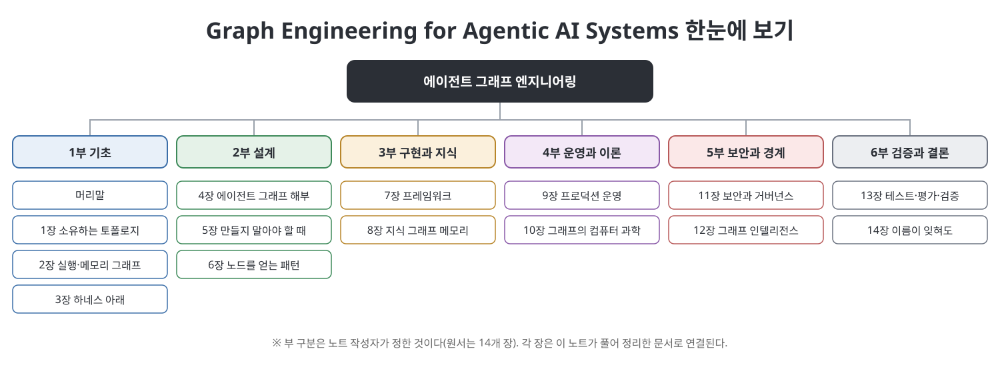

# **Graph Engineering for Agentic AI Systems 학습 노트**
(Graph Engineering for Agentic AI Systems, 장별 정리 노트)
 

이 문서는 Ken Huang의 『Graph Engineering for Agentic AI Systems』를 장별로 정리한 한국어 학습 노트입니다. 원문을 번역한 것이 아니라 내용을 우리말로 풀어서 다시 설명했고, 처음 나오는 용어에는 쉬운 풀이와 영어 병기를 붙였습니다. 책은 AI 에이전트 시스템의 구조를 실행 그래프, 메모리 그래프, 지식 그래프라는 그래프의 눈으로 설계하는 방법을 다룹니다. 14개 장에 걸쳐 그래프를 왜, 언제 쓰는지, 어떻게 설계·구현·운영하는지, 보안과 테스트는 어떻게 하는지를 설명합니다. 이 노트는 6개 부로 묶어 같은 순서를 따르며, 장마다 개념도와 표를 직접 만들어 넣었습니다.

> **이 노트를 읽을 때 유의할 점**
> - 이 노트는 원서의 **요약·해설본**이며 원서를 대신하지 않습니다. 정확한 수치와 인용, 코드는 원서에서 확인하세요.
> - 책의 코드와 표는 옮기지 않고 구조를 새로 정리했습니다. 각 장 끝의 Homework는 유형만 요약했고, References는 옮기지 않았습니다.
> - 책이 소개하는 프레임워크, 제품, 날짜, 벤치마크 수치는 책이 쓰인 시점(2026년경)의 서술이며 이 노트가 검증하지 않았습니다. 해당 부분은 "책은 ~라고 소개한다"로 표기하고 `참고(노트 작성자)`를 달았습니다.
> - 6개 부의 구분은 읽기 편하도록 노트 작성자가 묶은 것이며, 원서는 장으로만 구성됩니다.
> - 일부 장은 표가 많아 분량이 깁니다. 핵심만 빠르게 보려면 각 부의 `핵심 정리`를 먼저 읽으세요.
 

---

## 목차

- [1부 기초 (머리말, 1~3장)](01.%201%EB%B6%80%20%EA%B8%B0%EC%B4%88/Readme.md)
  - [머리말](01.%201%EB%B6%80%20%EA%B8%B0%EC%B4%88/%EB%A8%B8%EB%A6%AC%EB%A7%90.md)
  - [1장 그래프 엔지니어링은 당신이 소유하는 토폴로지다](01.%201%EB%B6%80%20%EA%B8%B0%EC%B4%88/01%EC%9E%A5%20%EA%B7%B8%EB%9E%98%ED%94%84%20%EC%97%94%EC%A7%80%EB%8B%88%EC%96%B4%EB%A7%81%EC%9D%80%20%EB%8B%B9%EC%8B%A0%EC%9D%B4%20%EC%86%8C%EC%9C%A0%ED%95%98%EB%8A%94%20%ED%86%A0%ED%8F%B4%EB%A1%9C%EC%A7%80%EB%8B%A4.md)
  - [2장 실행 그래프와 메모리 그래프](01.%201%EB%B6%80%20%EA%B8%B0%EC%B4%88/02%EC%9E%A5%20%EC%8B%A4%ED%96%89%20%EA%B7%B8%EB%9E%98%ED%94%84%EC%99%80%20%EB%A9%94%EB%AA%A8%EB%A6%AC%20%EA%B7%B8%EB%9E%98%ED%94%84.md)
  - [3장 하네스 아래의 그래프](01.%201%EB%B6%80%20%EA%B8%B0%EC%B4%88/03%EC%9E%A5%20%ED%95%98%EB%84%A4%EC%8A%A4%20%EC%95%84%EB%9E%98%EC%9D%98%20%EA%B7%B8%EB%9E%98%ED%94%84.md)
  - [핵심 정리](01.%201%EB%B6%80%20%EA%B8%B0%EC%B4%88/%ED%95%B5%EC%8B%AC%20%EC%A0%95%EB%A6%AC.md)
- [2부 설계 (4~6장)](02.%202%EB%B6%80%20%EC%84%A4%EA%B3%84/Readme.md)
  - [4장 에이전트 그래프의 해부](02.%202%EB%B6%80%20%EC%84%A4%EA%B3%84/04%EC%9E%A5%20%EC%97%90%EC%9D%B4%EC%A0%84%ED%8A%B8%20%EA%B7%B8%EB%9E%98%ED%94%84%EC%9D%98%20%ED%95%B4%EB%B6%80.md)
  - [5장 그래프를 만들지 말아야 할 때](02.%202%EB%B6%80%20%EC%84%A4%EA%B3%84/05%EC%9E%A5%20%EA%B7%B8%EB%9E%98%ED%94%84%EB%A5%BC%20%EB%A7%8C%EB%93%A4%EC%A7%80%20%EB%A7%90%EC%95%84%EC%95%BC%20%ED%95%A0%20%EB%95%8C.md)
  - [6장 노드를 얻을 자격이 있는 패턴](02.%202%EB%B6%80%20%EC%84%A4%EA%B3%84/06%EC%9E%A5%20%EB%85%B8%EB%93%9C%EB%A5%BC%20%EC%96%BB%EC%9D%84%20%EC%9E%90%EA%B2%A9%EC%9D%B4%20%EC%9E%88%EB%8A%94%20%ED%8C%A8%ED%84%B4.md)
  - [핵심 정리](02.%202%EB%B6%80%20%EC%84%A4%EA%B3%84/%ED%95%B5%EC%8B%AC%20%EC%A0%95%EB%A6%AC.md)
- [3부 구현과 지식 (7~8장)](03.%203%EB%B6%80%20%EA%B5%AC%ED%98%84%EA%B3%BC%20%EC%A7%80%EC%8B%9D/Readme.md)
  - [7장 에이전트 그래프를 실어 보낼 수 있는 프레임워크](03.%203%EB%B6%80%20%EA%B5%AC%ED%98%84%EA%B3%BC%20%EC%A7%80%EC%8B%9D/07%EC%9E%A5%20%EC%97%90%EC%9D%B4%EC%A0%84%ED%8A%B8%20%EA%B7%B8%EB%9E%98%ED%94%84%EB%A5%BC%20%EC%8B%A4%EC%96%B4%20%EB%B3%B4%EB%82%BC%20%EC%88%98%20%EC%9E%88%EB%8A%94%20%ED%94%84%EB%A0%88%EC%9E%84%EC%9B%8C%ED%81%AC.md)
  - [8장 메모리로서의 지식 그래프](03.%203%EB%B6%80%20%EA%B5%AC%ED%98%84%EA%B3%BC%20%EC%A7%80%EC%8B%9D/08%EC%9E%A5%20%EB%A9%94%EB%AA%A8%EB%A6%AC%EB%A1%9C%EC%84%9C%EC%9D%98%20%EC%A7%80%EC%8B%9D%20%EA%B7%B8%EB%9E%98%ED%94%84.md)
  - [핵심 정리](03.%203%EB%B6%80%20%EA%B5%AC%ED%98%84%EA%B3%BC%20%EC%A7%80%EC%8B%9D/%ED%95%B5%EC%8B%AC%20%EC%A0%95%EB%A6%AC.md)
- [4부 운영과 이론 (9~10장)](04.%204%EB%B6%80%20%EC%9A%B4%EC%98%81%EA%B3%BC%20%EC%9D%B4%EB%A1%A0/Readme.md)
  - [9장 프로덕션에서 그래프 운영하기](04.%204%EB%B6%80%20%EC%9A%B4%EC%98%81%EA%B3%BC%20%EC%9D%B4%EB%A1%A0/09%EC%9E%A5%20%ED%94%84%EB%A1%9C%EB%8D%95%EC%85%98%EC%97%90%EC%84%9C%20%EA%B7%B8%EB%9E%98%ED%94%84%20%EC%9A%B4%EC%98%81%ED%95%98%EA%B8%B0.md)
  - [10장 에이전트 그래프의 컴퓨터 과학](04.%204%EB%B6%80%20%EC%9A%B4%EC%98%81%EA%B3%BC%20%EC%9D%B4%EB%A1%A0/10%EC%9E%A5%20%EC%97%90%EC%9D%B4%EC%A0%84%ED%8A%B8%20%EA%B7%B8%EB%9E%98%ED%94%84%EC%9D%98%20%EC%BB%B4%ED%93%A8%ED%84%B0%20%EA%B3%BC%ED%95%99.md)
  - [핵심 정리](04.%204%EB%B6%80%20%EC%9A%B4%EC%98%81%EA%B3%BC%20%EC%9D%B4%EB%A1%A0/%ED%95%B5%EC%8B%AC%20%EC%A0%95%EB%A6%AC.md)
- [5부 보안과 경계 (11~12장)](05.%205%EB%B6%80%20%EB%B3%B4%EC%95%88%EA%B3%BC%20%EA%B2%BD%EA%B3%84/Readme.md)
  - [11장 에이전트 그래프의 보안·신원·거버넌스](05.%205%EB%B6%80%20%EB%B3%B4%EC%95%88%EA%B3%BC%20%EA%B2%BD%EA%B3%84/11%EC%9E%A5%20%EC%97%90%EC%9D%B4%EC%A0%84%ED%8A%B8%20%EA%B7%B8%EB%9E%98%ED%94%84%EC%9D%98%20%EB%B3%B4%EC%95%88%C2%B7%EC%8B%A0%EC%9B%90%C2%B7%EA%B1%B0%EB%B2%84%EB%84%8C%EC%8A%A4.md)
  - [12장 그래프 인텔리전스는 런타임이 아니다](05.%205%EB%B6%80%20%EB%B3%B4%EC%95%88%EA%B3%BC%20%EA%B2%BD%EA%B3%84/12%EC%9E%A5%20%EA%B7%B8%EB%9E%98%ED%94%84%20%EC%9D%B8%ED%85%94%EB%A6%AC%EC%A0%84%EC%8A%A4%EB%8A%94%20%EB%9F%B0%ED%83%80%EC%9E%84%EC%9D%B4%20%EC%95%84%EB%8B%88%EB%8B%A4.md)
  - [핵심 정리](05.%205%EB%B6%80%20%EB%B3%B4%EC%95%88%EA%B3%BC%20%EA%B2%BD%EA%B3%84/%ED%95%B5%EC%8B%AC%20%EC%A0%95%EB%A6%AC.md)
- [6부 검증과 결론 (13~14장)](06.%206%EB%B6%80%20%EA%B2%80%EC%A6%9D%EA%B3%BC%20%EA%B2%B0%EB%A1%A0/Readme.md)
  - [13장 에이전트 그래프의 테스트·평가·검증](06.%206%EB%B6%80%20%EA%B2%80%EC%A6%9D%EA%B3%BC%20%EA%B2%B0%EB%A1%A0/13%EC%9E%A5%20%EC%97%90%EC%9D%B4%EC%A0%84%ED%8A%B8%20%EA%B7%B8%EB%9E%98%ED%94%84%EC%9D%98%20%ED%85%8C%EC%8A%A4%ED%8A%B8%C2%B7%ED%8F%89%EA%B0%80%C2%B7%EA%B2%80%EC%A6%9D.md)
  - [14장 이름이 잊혀도 그래프는 남겨라](06.%206%EB%B6%80%20%EA%B2%80%EC%A6%9D%EA%B3%BC%20%EA%B2%B0%EB%A1%A0/14%EC%9E%A5%20%EC%9D%B4%EB%A6%84%EC%9D%B4%20%EC%9E%8A%ED%98%80%EB%8F%84%20%EA%B7%B8%EB%9E%98%ED%94%84%EB%8A%94%20%EB%82%A8%EA%B2%A8%EB%9D%BC.md)
  - [핵심 정리](06.%206%EB%B6%80%20%EA%B2%80%EC%A6%9D%EA%B3%BC%20%EA%B2%B0%EB%A1%A0/%ED%95%B5%EC%8B%AC%20%EC%A0%95%EB%A6%AC.md)

---

## 읽는 순서 제안

| 목적 | 추천 경로 |
|------|-----------|
| 에이전트 그래프가 무엇이고 루프와 어떻게 다른지 알고 싶다 | 1부 (머리말, 1~3장) |
| 그래프를 어떻게 설계하고 언제는 만들지 말아야 하는지 알고 싶다 | 2부 (4~6장) |
| 프레임워크 선택과 지식 그래프 메모리를 알고 싶다 | 3부 (7~8장) |
| 프로덕션 운영과 배경 이론을 알고 싶다 | 4부 (9~10장) |
| 보안, 신원, 학습된 그래프와의 경계를 알고 싶다 | 5부 (11~12장) |
| 테스트와 평가, 도입 경로를 알고 싶다 | 6부 (13~14장) |

## 용어 몇 가지

| 용어 | 쉬운 설명 |
|------|-----------|
| 에이전트 그래프 (agent graph) | 에이전트가 일하는 순서와 갈래, 검문소를 노드와 엣지로 미리 정해 둔 구조 |
| 실행 그래프 (execution graph) | 누가 다음에 무슨 일을 하는지를 그린 업무 흐름도 |
| 지식 그래프 (knowledge graph) | 무엇이 무엇을 대체했는지 등 사실과 출처를 적어 둔 장부 |
| 하네스 (harness) | 모델을 에이전트로 만들어 주는 실행 틀. 도구, 루프, 권한 등을 포함 |
| 체크포인트 (checkpoint) | 실행 중간 상태를 저장해 두었다가 이어 가거나 되돌리는 지점 |
| 인터럽트 (interrupt) | 실행을 멈추고 사람이나 외부 입력을 기다리는 지점 |

---

## 이 노트에 대하여

- 각 장 문서는 개요, 흐름, 본문 정리, 표, 그림, 핵심 정리, 이전·다음 링크 순서로 구성됩니다.
- 그림은 모두 이 노트용으로 새로 그린 SVG이며 책의 그림을 쓰지 않았습니다.
- 같은 저장소의 다른 학습 노트와 같은 형식을 따릅니다.

