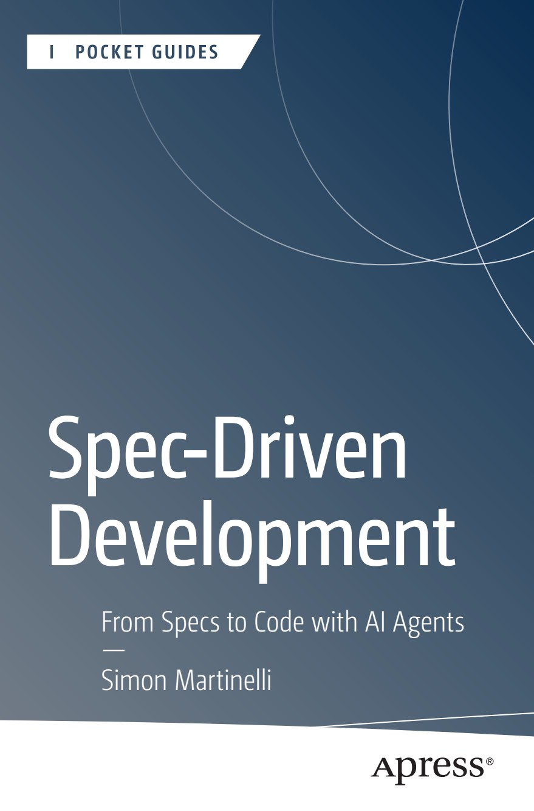

# **Spec-Driven Development 학습 노트**
(Spec-Driven Development: From Specs to Code with AI Agents, 장별 정리 노트)
<br>

<p align="center"></p>
<br>
<br>

이 문서는 Simon Martinelli의 『Spec-Driven Development: From Specs to Code with AI Agents』(Apress Pocket Guides)를 장별로 정리한 한국어 학습 노트입니다. 원문을 번역한 것이 아니라 내용을 우리말로 풀어서 다시 설명했고, 처음 나오는 용어에는 쉬운 풀이를 붙였습니다. 책은 코드를 먼저 쓰는 방식의 한계에서 출발해, 스펙(명세)을 진실의 원천으로 삼고 AI 에이전트가 그 스펙으로 코드와 테스트를 만들게 하는 개발 방식을 설명합니다. AI 통합 프로세스(AI Unified Process)라는 틀로 요구사항 카탈로그, 엔터티 모델, 시스템 유스케이스를 다루고, 스펙이 코드와 테스트를 이끄는 실무와 도구, 작업 관리자 사례 연구, 팀 규모 확장과 도입 방법까지 10개 장으로 안내합니다. 이 노트는 책의 장 구성을 그대로 따라 장마다 폴더 하나로 정리했습니다.

> **이 노트를 읽을 때 유의할 점**
> - 이 노트는 원서의 **요약·해설본**이며 원서를 대신하지 않습니다. 코드, 명령, 스킬 이름, 파일 구조처럼 정확성이 필요한 내용은 반드시 원서와 공식 자료에서 확인하세요.
> - 원서의 코드와 프롬프트는 핵심만 옮겼습니다. PDF 추출 과정에서 대소문자나 글자가 깨진 곳은 문맥으로 복원했고, 해당 문서에 그 사실을 적었습니다.
> - 책에 없는 보충 설명은 `참고(노트 작성자)`로 따로 표시했습니다.
> - 원서의 그림과 스크린샷은 싣지 않았고 글과 표로 풀어 설명했습니다. 표지 이미지만 책 소개용으로 넣었습니다.
> - 책이 소개하는 도구와 서비스(Kiro, Spec Kit 등)는 책이 쓰인 시점 기준입니다. 최신 이름이나 동작이 다를 수 있습니다.
<br>

---

## 목차

- [머리말과 이 책에 대하여](00.%20%EB%A8%B8%EB%A6%AC%EB%A7%90%EA%B3%BC%20%EC%9D%B4%20%EC%B1%85%EC%97%90%20%EB%8C%80%ED%95%98%EC%97%AC/Readme.md) — 책의 목적, 저자, 구성, 읽는 순서, 실습 준비물
- [왜 스펙 주도 개발인가](01.%20%EC%99%9C%20%EC%8A%A4%ED%8E%99%20%EC%A3%BC%EB%8F%84%20%EA%B0%9C%EB%B0%9C%EC%9D%B8%EA%B0%80/Readme.md) — 코드 우선의 문제, 스펙 주도의 의미, 진실의 원천, 기대 효과와 오해
  - [요약과 핵심 개념](01.%20%EC%99%9C%20%EC%8A%A4%ED%8E%99%20%EC%A3%BC%EB%8F%84%20%EA%B0%9C%EB%B0%9C%EC%9D%B8%EA%B0%80/%EC%9A%94%EC%95%BD%EA%B3%BC%20%ED%95%B5%EC%8B%AC%20%EA%B0%9C%EB%85%90.md)
  - [진실의 원천과 기대 효과, 오해](01.%20%EC%99%9C%20%EC%8A%A4%ED%8E%99%20%EC%A3%BC%EB%8F%84%20%EA%B0%9C%EB%B0%9C%EC%9D%B8%EA%B0%80/%EC%A7%84%EC%8B%A4%EC%9D%98%20%EC%9B%90%EC%B2%9C%EA%B3%BC%20%EA%B8%B0%EB%8C%80%20%ED%9A%A8%EA%B3%BC%2C%20%EC%98%A4%ED%95%B4.md)
  - [코드 우선의 문제와 스펙 주도의 의미](01.%20%EC%99%9C%20%EC%8A%A4%ED%8E%99%20%EC%A3%BC%EB%8F%84%20%EA%B0%9C%EB%B0%9C%EC%9D%B8%EA%B0%80/%EC%BD%94%EB%93%9C%20%EC%9A%B0%EC%84%A0%EC%9D%98%20%EB%AC%B8%EC%A0%9C%EC%99%80%20%EC%8A%A4%ED%8E%99%20%EC%A3%BC%EB%8F%84%EC%9D%98%20%EC%9D%98%EB%AF%B8.md)
- [AI 통합 프로세스 개요](02.%20AI%20%ED%86%B5%ED%95%A9%20%ED%94%84%EB%A1%9C%EC%84%B8%EC%8A%A4%20%EA%B0%9C%EC%9A%94/Readme.md) — AI 통합 프로세스의 원칙, 산출물, 추적성, 수명주기, RUP와의 비교
  - [RUP와의 비교](02.%20AI%20%ED%86%B5%ED%95%A9%20%ED%94%84%EB%A1%9C%EC%84%B8%EC%8A%A4%20%EA%B0%9C%EC%9A%94/RUP%EC%99%80%EC%9D%98%20%EB%B9%84%EA%B5%90.md)
  - [버전 관리, 추적성, 수명주기](02.%20AI%20%ED%86%B5%ED%95%A9%20%ED%94%84%EB%A1%9C%EC%84%B8%EC%8A%A4%20%EA%B0%9C%EC%9A%94/%EB%B2%84%EC%A0%84%20%EA%B4%80%EB%A6%AC%2C%20%EC%B6%94%EC%A0%81%EC%84%B1%2C%20%EC%88%98%EB%AA%85%EC%A3%BC%EA%B8%B0.md)
  - [요약과 핵심 개념](02.%20AI%20%ED%86%B5%ED%95%A9%20%ED%94%84%EB%A1%9C%EC%84%B8%EC%8A%A4%20%EA%B0%9C%EC%9A%94/%EC%9A%94%EC%95%BD%EA%B3%BC%20%ED%95%B5%EC%8B%AC%20%EA%B0%9C%EB%85%90.md)
  - [핵심 원칙과 산출물](02.%20AI%20%ED%86%B5%ED%95%A9%20%ED%94%84%EB%A1%9C%EC%84%B8%EC%8A%A4%20%EA%B0%9C%EC%9A%94/%ED%95%B5%EC%8B%AC%20%EC%9B%90%EC%B9%99%EA%B3%BC%20%EC%82%B0%EC%B6%9C%EB%AC%BC.md)
- [요구사항에서 스펙으로](03.%20%EC%9A%94%EA%B5%AC%EC%82%AC%ED%95%AD%EC%97%90%EC%84%9C%20%EC%8A%A4%ED%8E%99%EC%9C%BC%EB%A1%9C/Readme.md) — AI를 활용한 요구사항 수집, 엔터티 모델, 시스템 유스케이스, 메타데이터
  - [AI를 활용한 요구사항 수집과 사람의 검토](03.%20%EC%9A%94%EA%B5%AC%EC%82%AC%ED%95%AD%EC%97%90%EC%84%9C%20%EC%8A%A4%ED%8E%99%EC%9C%BC%EB%A1%9C/AI%EB%A5%BC%20%ED%99%9C%EC%9A%A9%ED%95%9C%20%EC%9A%94%EA%B5%AC%EC%82%AC%ED%95%AD%20%EC%88%98%EC%A7%91%EA%B3%BC%20%EC%82%AC%EB%9E%8C%EC%9D%98%20%EA%B2%80%ED%86%A0.md)
  - [메타데이터, 추적성, AI의 유스케이스 작성·검증 지원](03.%20%EC%9A%94%EA%B5%AC%EC%82%AC%ED%95%AD%EC%97%90%EC%84%9C%20%EC%8A%A4%ED%8E%99%EC%9C%BC%EB%A1%9C/%EB%A9%94%ED%83%80%EB%8D%B0%EC%9D%B4%ED%84%B0%2C%20%EC%B6%94%EC%A0%81%EC%84%B1%2C%20AI%EC%9D%98%20%EC%9C%A0%EC%8A%A4%EC%BC%80%EC%9D%B4%EC%8A%A4%20%EC%9E%91%EC%84%B1%C2%B7%EA%B2%80%EC%A6%9D%20%EC%A7%80%EC%9B%90.md)
  - [시스템 유스케이스의 구조와 좋은 흐름](03.%20%EC%9A%94%EA%B5%AC%EC%82%AC%ED%95%AD%EC%97%90%EC%84%9C%20%EC%8A%A4%ED%8E%99%EC%9C%BC%EB%A1%9C/%EC%8B%9C%EC%8A%A4%ED%85%9C%20%EC%9C%A0%EC%8A%A4%EC%BC%80%EC%9D%B4%EC%8A%A4%EC%9D%98%20%EA%B5%AC%EC%A1%B0%EC%99%80%20%EC%A2%8B%EC%9D%80%20%ED%9D%90%EB%A6%84.md)
  - [엔터티 모델과 요구사항 카탈로그 예시](03.%20%EC%9A%94%EA%B5%AC%EC%82%AC%ED%95%AD%EC%97%90%EC%84%9C%20%EC%8A%A4%ED%8E%99%EC%9C%BC%EB%A1%9C/%EC%97%94%ED%84%B0%ED%8B%B0%20%EB%AA%A8%EB%8D%B8%EA%B3%BC%20%EC%9A%94%EA%B5%AC%EC%82%AC%ED%95%AD%20%EC%B9%B4%ED%83%88%EB%A1%9C%EA%B7%B8%20%EC%98%88%EC%8B%9C.md)
  - [요약과 핵심 개념](03.%20%EC%9A%94%EA%B5%AC%EC%82%AC%ED%95%AD%EC%97%90%EC%84%9C%20%EC%8A%A4%ED%8E%99%EC%9C%BC%EB%A1%9C/%EC%9A%94%EC%95%BD%EA%B3%BC%20%ED%95%B5%EC%8B%AC%20%EA%B0%9C%EB%85%90.md)
- [실행 가능한 스펙 작성](04.%20%EC%8B%A4%ED%96%89%20%EA%B0%80%EB%8A%A5%ED%95%9C%20%EC%8A%A4%ED%8E%99%20%EC%9E%91%EC%84%B1/Readme.md) — 실행 가능한 스펙, 관찰 가능한 동작, 모호하지 않은 문장, 인수 기준
  - [모호하지 않은 스펙과 한 문장 한 규칙](04.%20%EC%8B%A4%ED%96%89%20%EA%B0%80%EB%8A%A5%ED%95%9C%20%EC%8A%A4%ED%8E%99%20%EC%9E%91%EC%84%B1/%EB%AA%A8%ED%98%B8%ED%95%98%EC%A7%80%20%EC%95%8A%EC%9D%80%20%EC%8A%A4%ED%8E%99%EA%B3%BC%20%ED%95%9C%20%EB%AC%B8%EC%9E%A5%20%ED%95%9C%20%EA%B7%9C%EC%B9%99.md)
  - [실행 가능의 의미와 관찰 가능한 동작](04.%20%EC%8B%A4%ED%96%89%20%EA%B0%80%EB%8A%A5%ED%95%9C%20%EC%8A%A4%ED%8E%99%20%EC%9E%91%EC%84%B1/%EC%8B%A4%ED%96%89%20%EA%B0%80%EB%8A%A5%EC%9D%98%20%EC%9D%98%EB%AF%B8%EC%99%80%20%EA%B4%80%EC%B0%B0%20%EA%B0%80%EB%8A%A5%ED%95%9C%20%EB%8F%99%EC%9E%91.md)
  - [요약과 핵심 개념](04.%20%EC%8B%A4%ED%96%89%20%EA%B0%80%EB%8A%A5%ED%95%9C%20%EC%8A%A4%ED%8E%99%20%EC%9E%91%EC%84%B1/%EC%9A%94%EC%95%BD%EA%B3%BC%20%ED%95%B5%EC%8B%AC%20%EA%B0%9C%EB%85%90.md)
  - [유스케이스 각 요소 작성법](04.%20%EC%8B%A4%ED%96%89%20%EA%B0%80%EB%8A%A5%ED%95%9C%20%EC%8A%A4%ED%8E%99%20%EC%9E%91%EC%84%B1/%EC%9C%A0%EC%8A%A4%EC%BC%80%EC%9D%B4%EC%8A%A4%20%EA%B0%81%20%EC%9A%94%EC%86%8C%20%EC%9E%91%EC%84%B1%EB%B2%95.md)
  - [인수 기준 전환과 충분한 만큼만](04.%20%EC%8B%A4%ED%96%89%20%EA%B0%80%EB%8A%A5%ED%95%9C%20%EC%8A%A4%ED%8E%99%20%EC%9E%91%EC%84%B1/%EC%9D%B8%EC%88%98%20%EA%B8%B0%EC%A4%80%20%EC%A0%84%ED%99%98%EA%B3%BC%20%EC%B6%A9%EB%B6%84%ED%95%9C%20%EB%A7%8C%ED%81%BC%EB%A7%8C.md)
- [스펙이 코드를 이끄는 실무](05.%20%EC%8A%A4%ED%8E%99%EC%9D%B4%20%EC%BD%94%EB%93%9C%EB%A5%BC%20%EC%9D%B4%EB%81%84%EB%8A%94%20%EC%8B%A4%EB%AC%B4/Readme.md) — 스펙이 코드를 이끄는 과정, 가이드라인 파일·스킬·MCP, 변경 동기화
  - [가이드라인 파일, 스킬, 플러그인, MCP 서버, 버전 관리](05.%20%EC%8A%A4%ED%8E%99%EC%9D%B4%20%EC%BD%94%EB%93%9C%EB%A5%BC%20%EC%9D%B4%EB%81%84%EB%8A%94%20%EC%8B%A4%EB%AC%B4/%EA%B0%80%EC%9D%B4%EB%93%9C%EB%9D%BC%EC%9D%B8%20%ED%8C%8C%EC%9D%BC%2C%20%EC%8A%A4%ED%82%AC%2C%20%ED%94%8C%EB%9F%AC%EA%B7%B8%EC%9D%B8%2C%20MCP%20%EC%84%9C%EB%B2%84%2C%20%EB%B2%84%EC%A0%84%20%EA%B4%80%EB%A6%AC.md)
  - [수동 스펙에서 능동 스펙으로와 UC-012 예제](05.%20%EC%8A%A4%ED%8E%99%EC%9D%B4%20%EC%BD%94%EB%93%9C%EB%A5%BC%20%EC%9D%B4%EB%81%84%EB%8A%94%20%EC%8B%A4%EB%AC%B4/%EC%88%98%EB%8F%99%20%EC%8A%A4%ED%8E%99%EC%97%90%EC%84%9C%20%EB%8A%A5%EB%8F%99%20%EC%8A%A4%ED%8E%99%EC%9C%BC%EB%A1%9C%EC%99%80%20UC-012%20%EC%98%88%EC%A0%9C.md)
  - [스펙 변경 동기화와 재생성 대 동기화](05.%20%EC%8A%A4%ED%8E%99%EC%9D%B4%20%EC%BD%94%EB%93%9C%EB%A5%BC%20%EC%9D%B4%EB%81%84%EB%8A%94%20%EC%8B%A4%EB%AC%B4/%EC%8A%A4%ED%8E%99%20%EB%B3%80%EA%B2%BD%20%EB%8F%99%EA%B8%B0%ED%99%94%EC%99%80%20%EC%9E%AC%EC%83%9D%EC%84%B1%20%EB%8C%80%20%EB%8F%99%EA%B8%B0%ED%99%94.md)
  - [요약과 핵심 개념](05.%20%EC%8A%A4%ED%8E%99%EC%9D%B4%20%EC%BD%94%EB%93%9C%EB%A5%BC%20%EC%9D%B4%EB%81%84%EB%8A%94%20%EC%8B%A4%EB%AC%B4/%EC%9A%94%EC%95%BD%EA%B3%BC%20%ED%95%B5%EC%8B%AC%20%EA%B0%9C%EB%85%90.md)
  - [유스케이스 요소와 코드 매핑](05.%20%EC%8A%A4%ED%8E%99%EC%9D%B4%20%EC%BD%94%EB%93%9C%EB%A5%BC%20%EC%9D%B4%EB%81%84%EB%8A%94%20%EC%8B%A4%EB%AC%B4/%EC%9C%A0%EC%8A%A4%EC%BC%80%EC%9D%B4%EC%8A%A4%20%EC%9A%94%EC%86%8C%EC%99%80%20%EC%BD%94%EB%93%9C%20%EB%A7%A4%ED%95%91.md)
  - [테스트, 검토, 사람의 책임, 전체 변경 흐름](05.%20%EC%8A%A4%ED%8E%99%EC%9D%B4%20%EC%BD%94%EB%93%9C%EB%A5%BC%20%EC%9D%B4%EB%81%84%EB%8A%94%20%EC%8B%A4%EB%AC%B4/%ED%85%8C%EC%8A%A4%ED%8A%B8%2C%20%EA%B2%80%ED%86%A0%2C%20%EC%82%AC%EB%9E%8C%EC%9D%98%20%EC%B1%85%EC%9E%84%2C%20%EC%A0%84%EC%B2%B4%20%EB%B3%80%EA%B2%BD%20%ED%9D%90%EB%A6%84.md)
- [테스트로서의 스펙](06.%20%ED%85%8C%EC%8A%A4%ED%8A%B8%EB%A1%9C%EC%84%9C%EC%9D%98%20%EC%8A%A4%ED%8E%99/Readme.md) — 테스트 트로피, 계층별 전략, TDD, AI 테스트 생성, 커버리지
  - [AI 시대의 테스트와 실행 가능한 가드레일](06.%20%ED%85%8C%EC%8A%A4%ED%8A%B8%EB%A1%9C%EC%84%9C%EC%9D%98%20%EC%8A%A4%ED%8E%99/AI%20%EC%8B%9C%EB%8C%80%EC%9D%98%20%ED%85%8C%EC%8A%A4%ED%8A%B8%EC%99%80%20%EC%8B%A4%ED%96%89%20%EA%B0%80%EB%8A%A5%ED%95%9C%20%EA%B0%80%EB%93%9C%EB%A0%88%EC%9D%BC.md)
  - [TDD의 위치와 AI 테스트 생성 흐름](06.%20%ED%85%8C%EC%8A%A4%ED%8A%B8%EB%A1%9C%EC%84%9C%EC%9D%98%20%EC%8A%A4%ED%8E%99/TDD%EC%9D%98%20%EC%9C%84%EC%B9%98%EC%99%80%20AI%20%ED%85%8C%EC%8A%A4%ED%8A%B8%20%EC%83%9D%EC%84%B1%20%ED%9D%90%EB%A6%84.md)
  - [요약과 핵심 개념](06.%20%ED%85%8C%EC%8A%A4%ED%8A%B8%EB%A1%9C%EC%84%9C%EC%9D%98%20%EC%8A%A4%ED%8E%99/%EC%9A%94%EC%95%BD%EA%B3%BC%20%ED%95%B5%EC%8B%AC%20%EA%B0%9C%EB%85%90.md)
  - [커버리지, 스펙 변경, AI가 검증할 수 없는 것](06.%20%ED%85%8C%EC%8A%A4%ED%8A%B8%EB%A1%9C%EC%84%9C%EC%9D%98%20%EC%8A%A4%ED%8E%99/%EC%BB%A4%EB%B2%84%EB%A6%AC%EC%A7%80%2C%20%EC%8A%A4%ED%8E%99%20%EB%B3%80%EA%B2%BD%2C%20AI%EA%B0%80%20%EA%B2%80%EC%A6%9D%ED%95%A0%20%EC%88%98%20%EC%97%86%EB%8A%94%20%EA%B2%83.md)
  - [테스트 트로피와 계층별 전략](06.%20%ED%85%8C%EC%8A%A4%ED%8A%B8%EB%A1%9C%EC%84%9C%EC%9D%98%20%EC%8A%A4%ED%8E%99/%ED%85%8C%EC%8A%A4%ED%8A%B8%20%ED%8A%B8%EB%A1%9C%ED%94%BC%EC%99%80%20%EA%B3%84%EC%B8%B5%EB%B3%84%20%EC%A0%84%EB%9E%B5.md)
- [스펙 주도 개발 도구](07.%20%EC%8A%A4%ED%8E%99%20%EC%A3%BC%EB%8F%84%20%EA%B0%9C%EB%B0%9C%20%EB%8F%84%EA%B5%AC/Readme.md) — Amazon Kiro, GitHub Spec Kit, AI 통합 프로세스 마켓플레이스, 도구 비교
  - [AI 통합 프로세스 마켓플레이스](07.%20%EC%8A%A4%ED%8E%99%20%EC%A3%BC%EB%8F%84%20%EA%B0%9C%EB%B0%9C%20%EB%8F%84%EA%B5%AC/AI%20%ED%86%B5%ED%95%A9%20%ED%94%84%EB%A1%9C%EC%84%B8%EC%8A%A4%20%EB%A7%88%EC%BC%93%ED%94%8C%EB%A0%88%EC%9D%B4%EC%8A%A4.md)
  - [Amazon Kiro와 GitHub Spec Kit](07.%20%EC%8A%A4%ED%8E%99%20%EC%A3%BC%EB%8F%84%20%EA%B0%9C%EB%B0%9C%20%EB%8F%84%EA%B5%AC/Amazon%20Kiro%EC%99%80%20GitHub%20Spec%20Kit.md)
  - [도구 선택과 비교, 앞으로의 도구](07.%20%EC%8A%A4%ED%8E%99%20%EC%A3%BC%EB%8F%84%20%EA%B0%9C%EB%B0%9C%20%EB%8F%84%EA%B5%AC/%EB%8F%84%EA%B5%AC%20%EC%84%A0%ED%83%9D%EA%B3%BC%20%EB%B9%84%EA%B5%90%2C%20%EC%95%9E%EC%9C%BC%EB%A1%9C%EC%9D%98%20%EB%8F%84%EA%B5%AC.md)
  - [도구는 선택, 규율은 필수](07.%20%EC%8A%A4%ED%8E%99%20%EC%A3%BC%EB%8F%84%20%EA%B0%9C%EB%B0%9C%20%EB%8F%84%EA%B5%AC/%EB%8F%84%EA%B5%AC%EB%8A%94%20%EC%84%A0%ED%83%9D%2C%20%EA%B7%9C%EC%9C%A8%EC%9D%80%20%ED%95%84%EC%88%98.md)
  - [요약과 핵심 개념](07.%20%EC%8A%A4%ED%8E%99%20%EC%A3%BC%EB%8F%84%20%EA%B0%9C%EB%B0%9C%20%EB%8F%84%EA%B5%AC/%EC%9A%94%EC%95%BD%EA%B3%BC%20%ED%95%B5%EC%8B%AC%20%EA%B0%9C%EB%85%90.md)
- [사례 연구 간단한 작업 관리자 만들기](08.%20%EC%82%AC%EB%A1%80%20%EC%97%B0%EA%B5%AC%20%EA%B0%84%EB%8B%A8%ED%95%9C%20%EC%9E%91%EC%97%85%20%EA%B4%80%EB%A6%AC%EC%9E%90%20%EB%A7%8C%EB%93%A4%EA%B8%B0/Readme.md) — 작업 관리자 사례 10단계: 비전부터 E2E 테스트와 스펙 우선 변경까지
  - [1~4단계 비전, 요구사항, 엔터티 모델, 유스케이스 다이어그램](08.%20%EC%82%AC%EB%A1%80%20%EC%97%B0%EA%B5%AC%20%EA%B0%84%EB%8B%A8%ED%95%9C%20%EC%9E%91%EC%97%85%20%EA%B4%80%EB%A6%AC%EC%9E%90%20%EB%A7%8C%EB%93%A4%EA%B8%B0/1~4%EB%8B%A8%EA%B3%84%20%EB%B9%84%EC%A0%84%2C%20%EC%9A%94%EA%B5%AC%EC%82%AC%ED%95%AD%2C%20%EC%97%94%ED%84%B0%ED%8B%B0%20%EB%AA%A8%EB%8D%B8%2C%20%EC%9C%A0%EC%8A%A4%EC%BC%80%EC%9D%B4%EC%8A%A4%20%EB%8B%A4%EC%9D%B4%EC%96%B4%EA%B7%B8%EB%9E%A8.md)
  - [5~6단계 스캐폴딩과 DB 마이그레이션](08.%20%EC%82%AC%EB%A1%80%20%EC%97%B0%EA%B5%AC%20%EA%B0%84%EB%8B%A8%ED%95%9C%20%EC%9E%91%EC%97%85%20%EA%B4%80%EB%A6%AC%EC%9E%90%20%EB%A7%8C%EB%93%A4%EA%B8%B0/5~6%EB%8B%A8%EA%B3%84%20%EC%8A%A4%EC%BA%90%ED%8F%B4%EB%94%A9%EA%B3%BC%20DB%20%EB%A7%88%EC%9D%B4%EA%B7%B8%EB%A0%88%EC%9D%B4%EC%85%98.md)
  - [7~8단계 첫 유스케이스 스펙과 구현](08.%20%EC%82%AC%EB%A1%80%20%EC%97%B0%EA%B5%AC%20%EA%B0%84%EB%8B%A8%ED%95%9C%20%EC%9E%91%EC%97%85%20%EA%B4%80%EB%A6%AC%EC%9E%90%20%EB%A7%8C%EB%93%A4%EA%B8%B0/7~8%EB%8B%A8%EA%B3%84%20%EC%B2%AB%20%EC%9C%A0%EC%8A%A4%EC%BC%80%EC%9D%B4%EC%8A%A4%20%EC%8A%A4%ED%8E%99%EA%B3%BC%20%EA%B5%AC%ED%98%84.md)
  - [9~10단계와 반복 UI 단위 테스트, E2E 테스트, 스펙 먼저 바꾸고 동기화](08.%20%EC%82%AC%EB%A1%80%20%EC%97%B0%EA%B5%AC%20%EA%B0%84%EB%8B%A8%ED%95%9C%20%EC%9E%91%EC%97%85%20%EA%B4%80%EB%A6%AC%EC%9E%90%20%EB%A7%8C%EB%93%A4%EA%B8%B0/9~10%EB%8B%A8%EA%B3%84%EC%99%80%20%EB%B0%98%EB%B3%B5%20UI%20%EB%8B%A8%EC%9C%84%20%ED%85%8C%EC%8A%A4%ED%8A%B8%2C%20E2E%20%ED%85%8C%EC%8A%A4%ED%8A%B8%2C%20%EC%8A%A4%ED%8E%99%20%EB%A8%BC%EC%A0%80%20%EB%B0%94%EA%BE%B8%EA%B3%A0%20%EB%8F%99%EA%B8%B0%ED%99%94.md)
  - [요약과 핵심 개념](08.%20%EC%82%AC%EB%A1%80%20%EC%97%B0%EA%B5%AC%20%EA%B0%84%EB%8B%A8%ED%95%9C%20%EC%9E%91%EC%97%85%20%EA%B4%80%EB%A6%AC%EC%9E%90%20%EB%A7%8C%EB%93%A4%EA%B8%B0/%EC%9A%94%EC%95%BD%EA%B3%BC%20%ED%95%B5%EC%8B%AC%20%EA%B0%9C%EB%85%90.md)
  - [프로젝트 준비와 도구](08.%20%EC%82%AC%EB%A1%80%20%EC%97%B0%EA%B5%AC%20%EA%B0%84%EB%8B%A8%ED%95%9C%20%EC%9E%91%EC%97%85%20%EA%B4%80%EB%A6%AC%EC%9E%90%20%EB%A7%8C%EB%93%A4%EA%B8%B0/%ED%94%84%EB%A1%9C%EC%A0%9D%ED%8A%B8%20%EC%A4%80%EB%B9%84%EC%99%80%20%EB%8F%84%EA%B5%AC.md)
- [스펙 주도 개발 규모 확장](09.%20%EC%8A%A4%ED%8E%99%20%EC%A3%BC%EB%8F%84%20%EA%B0%9C%EB%B0%9C%20%EA%B7%9C%EB%AA%A8%20%ED%99%95%EC%9E%A5/Readme.md) — 병목, 팀 규모, 바운디드 컨텍스트, 거버넌스, 스펙 파이프라인과 대시보드
  - [거버넌스, 흐름, 스펙 파이프라인과 대시보드](09.%20%EC%8A%A4%ED%8E%99%20%EC%A3%BC%EB%8F%84%20%EA%B0%9C%EB%B0%9C%20%EA%B7%9C%EB%AA%A8%20%ED%99%95%EC%9E%A5/%EA%B1%B0%EB%B2%84%EB%84%8C%EC%8A%A4%2C%20%ED%9D%90%EB%A6%84%2C%20%EC%8A%A4%ED%8E%99%20%ED%8C%8C%EC%9D%B4%ED%94%84%EB%9D%BC%EC%9D%B8%EA%B3%BC%20%EB%8C%80%EC%8B%9C%EB%B3%B4%EB%93%9C.md)
  - [병목과 팀 규모, 경계 컨텍스트](09.%20%EC%8A%A4%ED%8E%99%20%EC%A3%BC%EB%8F%84%20%EA%B0%9C%EB%B0%9C%20%EA%B7%9C%EB%AA%A8%20%ED%99%95%EC%9E%A5/%EB%B3%91%EB%AA%A9%EA%B3%BC%20%ED%8C%80%20%EA%B7%9C%EB%AA%A8%2C%20%EA%B2%BD%EA%B3%84%20%EC%BB%A8%ED%85%8D%EC%8A%A4%ED%8A%B8.md)
  - [요약과 핵심 개념](09.%20%EC%8A%A4%ED%8E%99%20%EC%A3%BC%EB%8F%84%20%EA%B0%9C%EB%B0%9C%20%EA%B7%9C%EB%AA%A8%20%ED%99%95%EC%9E%A5/%EC%9A%94%EC%95%BD%EA%B3%BC%20%ED%95%B5%EC%8B%AC%20%EA%B0%9C%EB%85%90.md)
- [모범 사례, 함정, 앞으로의 길](10.%20%EB%AA%A8%EB%B2%94%20%EC%82%AC%EB%A1%80%2C%20%ED%95%A8%EC%A0%95%2C%20%EC%95%9E%EC%9C%BC%EB%A1%9C%EC%9D%98%20%EA%B8%B8/Readme.md) — 실패 양상, 검토, 도입과 성숙도, 앞으로의 길
  - [도입과 성숙도, 앞으로의 길](10.%20%EB%AA%A8%EB%B2%94%20%EC%82%AC%EB%A1%80%2C%20%ED%95%A8%EC%A0%95%2C%20%EC%95%9E%EC%9C%BC%EB%A1%9C%EC%9D%98%20%EA%B8%B8/%EB%8F%84%EC%9E%85%EA%B3%BC%20%EC%84%B1%EC%88%99%EB%8F%84%2C%20%EC%95%9E%EC%9C%BC%EB%A1%9C%EC%9D%98%20%EA%B8%B8.md)
  - [실패 양상과 검토](10.%20%EB%AA%A8%EB%B2%94%20%EC%82%AC%EB%A1%80%2C%20%ED%95%A8%EC%A0%95%2C%20%EC%95%9E%EC%9C%BC%EB%A1%9C%EC%9D%98%20%EA%B8%B8/%EC%8B%A4%ED%8C%A8%20%EC%96%91%EC%83%81%EA%B3%BC%20%EA%B2%80%ED%86%A0.md)
  - [요약과 핵심 개념](10.%20%EB%AA%A8%EB%B2%94%20%EC%82%AC%EB%A1%80%2C%20%ED%95%A8%EC%A0%95%2C%20%EC%95%9E%EC%9C%BC%EB%A1%9C%EC%9D%98%20%EA%B8%B8/%EC%9A%94%EC%95%BD%EA%B3%BC%20%ED%95%B5%EC%8B%AC%20%EA%B0%9C%EB%85%90.md)

---

## 읽는 순서 제안

| 목적 | 추천 경로 |
|------|-----------|
| 스펙 주도 개발이 왜 필요한지 먼저 알고 싶다 | 1장 → 2장 |
| 스펙을 어떻게 쓰는지 배우고 싶다 | 3장 → 4장 |
| 스펙으로 AI에게 코드와 테스트를 만들게 하고 싶다 | 5장 → 6장 → 8장 |
| 도구를 고르고 싶다 | 7장 |
| 팀과 조직에 도입하고 싶다 | 9장 → 10장 |
| 전체를 빠르게 복습하고 싶다 | 각 장의 Readme와 요약과 핵심 개념 |

## 용어 몇 가지

| 용어 | 쉬운 설명 |
|------|-----------|
| 스펙 주도 개발 | 코드보다 먼저 스펙(명세)을 쓰고, 그 스펙을 기준으로 개발하는 방식. |
| 바이브 코딩 | 명확한 계획 없이 AI와 대화하며 즉흥적으로 코드를 만드는 방식. |
| 시스템 유스케이스 | 사용자가 시스템으로 목표를 이루는 과정을 단계와 규칙으로 적은 문서. |
| 실행 가능한 스펙 | 관찰 가능한 동작으로 쓰여 AI와 테스트가 그대로 따를 수 있는 스펙. |
| 추적성 | 요구사항에서 스펙, 코드, 테스트까지 서로 거슬러 올라갈 수 있는 연결. |
| 가이드라인 파일 | AI 에이전트에게 프로젝트 규칙을 알려 주는, 저장소에 두는 지침 파일. |
| 바운디드 컨텍스트 | 팀이 독립적으로 책임지는 업무 영역의 경계. |

---

## 이 노트를 만든 방법과 사용한 프롬프트

이 노트는 AI 코딩 도구(Claude Code)에 원서 PDF와 기존 노트 형식을 주고 작성하게 한 결과물입니다. 작성에 쓴 지시문을 아래에 정리합니다. 원문 텍스트는 PDF에서 추출했고, 장 단위로 나눠 작성한 뒤 파일명과 링크, 코드 블록, 비밀 값 유무를 기계적으로 점검했습니다.

### 1. 최초 요청

> 'Spec-Driven Development From Specs to Code with AI Agents (Simon Martinelli)' PDF를 'Repo-books' 저장소의 다른 작성된 폴더와 md 파일들을 참고해서 저장소의 'tech' 폴더에 문서를 작성합니다. 작성하는데 사용된 prompt는 'README.md' 파일에 정리해서 기록합니다.

### 2. 추가 요청

> 표지도 추가 합니다.

같은 저장소의 다른 책 폴더가 `images/cover.jpg`를 책 소개 맨 위에 두는 관례를 따라, PDF 1쪽을 이미지로 변환해 `images/cover.jpg`로 넣었습니다.

### 3. 작업 방식

| 단계 | 내용 |
|---|---|
| 형식 조사 | 같은 저장소의 기존 책 폴더(머리말 폴더, 장 폴더, 장 Readme, 요약과 핵심 개념, 표지 이미지)를 견본으로 삼았다. |
| 원문 추출 | PDF 167쪽의 텍스트와 목차(북마크)를 추출해 장별 쪽 범위를 정했다. |
| 장별 작성 | 장을 3개 묶음으로 나눠 각각 별도 작성자(에이전트)에게 아래 공통 프롬프트로 작성하게 했다. |
| 점검 | 문서 링크와 실제 파일명 일치, 금지 문자, 코드 블록 짝, 비밀 값과 추출 잡음 표식을 점검했다. |

| 담당 묶음 | 장 | PDF 쪽 범위 |
|---|---|---|
| 1 | 머리말, 1장, 2장, 9장, 10장 | 14~46쪽, 148~167쪽 |
| 2 | 3장, 4장, 5장 | 47~101쪽 |
| 3 | 6장, 7장, 8장 | 102~147쪽 |

### 4. 공통 작성 프롬프트(요지)

```text
역할: 영문 기술서 한 권을 한국어 학습 노트(마크다운 문서 묶음)로 정리하는 작성자다.
      담당 범위만 작성하고 저장소에는 올리지 않는다. 모든 문장은 한국어로 쓴다.
입력: 책 정보, PDF 추출 텍스트(쪽 구분자 포함), 담당 장과 쪽 범위, 출력 폴더명.
      원문은 구간별로 끝까지 읽는다.
형식: 견본 문서(장 Readme, 주제 문서, 요약과 핵심 개념)의 형식과 어조(평서문, 쉬운 설명)를 따른다.
      장 폴더 = Readme.md(소개, 핵심 요점, 문서 목록) + 주제 문서 + 요약과 핵심 개념.md.
      00 폴더 = Readme.md 한 개(목적, 저자, 구성, 읽는 순서, 준비물, 읽는 법).
내용 규칙:
  1. 번역이 아니라 이해한 뒤 우리말로 다시 설명한다. 원문 문장을 그대로 옮기지 않되
     원칙, 산출물, 절차, 수치, 사례, 주의점의 정보량은 줄이지 않는다.
  2. 실습(Step)은 단계별로 무엇을 만들고 어떤 결과가 나오는지 설명한다.
     코드와 예시는 핵심만 짧게(문서당 약 20~25줄 이내) 싣는다.
  3. 영어 용어는 처음 나올 때 한국어 풀이를 붙이고, 제품명·명령·경로는 영어 그대로 둔다.
     용어는 전체에서 통일한다(스펙, 시스템 유스케이스, 실행 가능한 스펙, 추적성 등).
  4. 원문에 없는 보충은 '참고(노트 작성자):'로 표시하고, 없는 사실을 지어내지 않는다.
     글자가 깨져 불확실한 곳은 그렇게 밝힌다.
  5. 비밀 값은 자리표시자로 쓰고, 그림과 스크린샷은 싣지 않는다.
  6. 문서는 도입 1~2문단, 구분선, 번호 붙인 절 순서. 표는 문서당 1~3개.
  7. 파일명에 / \ : * ? " < > | 를 쓰지 않는다.
보고: 작성 파일 목록과 글자 수, 복원한 부분, 다루지 못한 부분만 간결히 보고한다.
```

### 5. 이 프롬프트로 작성할 때의 한계

- 일부 문서는 원서 해당 절이 1~2쪽이라 2,500자에 못 미칩니다. 원문에 없는 내용을 채우지 않았습니다.
- PDF 텍스트 추출본은 표와 코드의 대소문자와 줄바꿈이 깨져 있어, 문맥으로 복원한 부분이 있습니다.
- 정확한 코드와 설정은 원서와 원서의 사례 저장소에서 대조하세요.

---

## 이 노트에 대하여

- 각 장 폴더는 Readme.md, 주제별 문서, 요약과 핵심 개념으로 구성됩니다.
- 같은 저장소의 다른 학습 노트와 같은 형식을 따릅니다.
