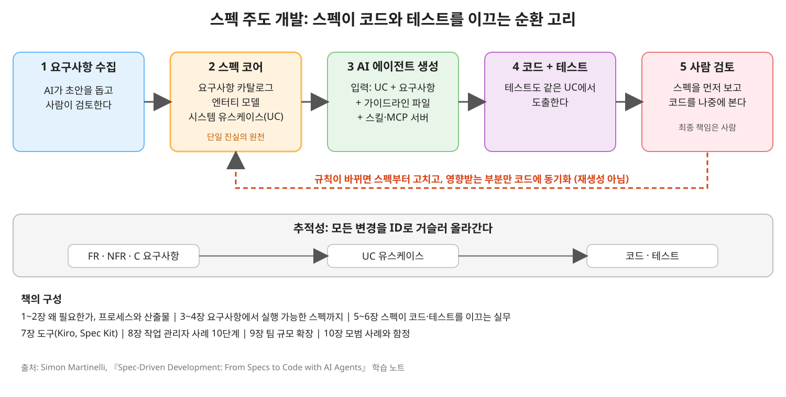

# Spec-Driven Development 한 페이지 요약

> **한 문장 설명**: 코드가 아니라 스펙(요구사항 카탈로그, 엔터티 모델, 시스템 유스케이스)을 단일 진실의 원천으로 삼아, AI 에이전트가 스펙에서 코드와 테스트를 만들고 사람이 검토·정제하는 개발 방식을 10개 장으로 정리한 노트입니다.

## 핵심 세 가지

1. **스펙이 먼저, 코드는 결과물입니다.** 스펙은 개발이 무시하는 문서가 아니라 변경의 출발점입니다. 예: "UC-012를 구현해 줘"처럼 특정 유스케이스를 가리켜 요청합니다.
2. **스펙은 AI가 따를 수 있게 씁니다.** 한 문장에 규칙 하나, 관찰 가능한 동작으로 쓰고, 스키마나 클래스 이름은 넣지 않습니다. 테스트도 같은 유스케이스에서 도출합니다.
3. **바뀌면 스펙부터 고칩니다.** 규칙이 바뀌면 유스케이스를 먼저 수정하고 영향받는 코드만 동기화합니다. 처음부터 다시 만들지 않습니다. 검토도 스펙을 먼저 봅니다.

## 구성 요소

| 구성 | 내용 |
|---|---|
| 스펙 코어 | 요구사항 카탈로그(FR, NFR, C), 엔터티 모델, 시스템 유스케이스(UC) |
| 에이전트 입력 | 유스케이스, 가이드라인 파일(CLAUDE.md 등), 스킬, MCP 서버 |
| 검증 | 같은 유스케이스에서 나온 테스트가 가드레일 역할 |
| 도구 | Amazon Kiro, GitHub Spec Kit. 도구는 선택, 규율은 필수 |
| 사례와 확장 | 작업 관리자 10단계, 바운디드 컨텍스트와 거버넌스 |

## 읽는 방법

- 왜 필요한지 알고 싶다면 1장과 2장을 읽습니다.
- 스펙을 쓰는 법은 3장과 4장, 실제 코드 생성은 5장과 8장입니다.
- 팀에 도입하려면 9장과 10장을 읽습니다.

전체 목차는 [Readme](Readme.md)를 참고하세요.
