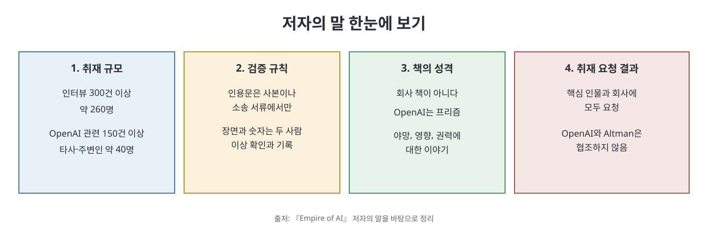

# 저자의 말

『Empire of AI』의 저자 캐런 하오는 본문에 들어가기 전, 이 책이 어떤 자료로 어떤 원칙에 따라 쓰였는지를 두 쪽 남짓한 글로 밝힌다. 이 글은 짧지만 책 전체를 어떤 태도로 읽어야 하는지 알려 주는 안내문이다. 취재 규모, 인용과 대화를 다루는 규칙, 책의 성격, 그리고 OpenAI 쪽의 협조 여부를 차례로 말한다.

> **이 글을 한 문장으로**
> 이 책은 OpenAI라는 한 회사의 내부 이야기를 다루지만, 그 이야기를 통해 AI 산업 전체와 '권력'을 들여다보려는 책이다.

---

## 이 장의 흐름

1. 취재의 규모: 누구를 얼마나 만났는가
2. 인용·대화·세부 사실을 다루는 규칙
3. 이 책은 '회사 책'이 아니라는 선언
4. 취재 요청과 OpenAI의 반응

---

## 1. 취재의 규모

저자에 따르면 이 책은 300건이 넘는 인터뷰, 약 260명의 증언과 방대한 서신·문서 자료를 바탕으로 한다. 인터뷰 대부분은 이 책을 위해 새로 진행했고, 일부는 저자가 지난 7년 동안 OpenAI와 AI 산업을 취재하며 MIT Technology Review, The Wall Street Journal, The Atlantic에 기사를 쓰던 때 얻은 것이다.

인터뷰 대상의 구성은 표로 정리하면 이해하기 쉽다.

| 구분 | 규모(책이 밝힌 수치) | 쉬운 설명 |
|------|---------------------|-----------|
| 전체 인터뷰 | 300건 이상, 약 260명 | 한 사람을 여러 번 만난 경우가 있어 건수가 인원보다 많다. |
| OpenAI 관련 | 150건 이상, 90명 넘는 현직·전직 임원과 직원, 일부 계약직 | 모델을 어떻게 만들었는지 자세한 기록을 접한 계약직도 포함된다. |
| 다른 회사 및 주변 인물 | 약 40명 | Microsoft, Anthropic, Meta, Google, DeepMind, Scale의 현직·전직 임원과 직원, 그리고 Sam Altman과 가까운 사람들 |

여기서 **Scale**은 AI 학습용 데이터에 이름표(라벨)를 다는 일을 대행하는 회사다. 이름이 나온 회사들은 대부분 AI 개발 경쟁의 당사자들이라고 보면 된다.

## 2. 인용과 대화를 다루는 규칙

저자는 독자가 책 속 장면을 얼마나 믿어도 되는지 기준을 밝힌다.

- 이메일, 문서, Slack 메시지를 따옴표로 인용한 경우는 사본이나 화면 캡처가 있거나 소송 서류에 그대로 실린 것이다. 사본이 없으면 따옴표 없이 내용만 풀어 쓴다. 예외 한 건은 미주에 표시한다.
- 대화 장면은 사람들의 기억, 당시의 메모, 또는 미주에 표시한 녹음·녹취록을 바탕으로 재구성한 것이다. 인용을 기억하는 사람에게는 몇 달 간격을 두고 같은 말을 다시 확인해, 기억이 흔들리지 않는지 시험했다고 한다.
- 장면, 숫자, 이름과 코드명, OpenAI 모델의 기술적 세부 사항(예: 학습 데이터 구성, 학습에 쓴 칩의 수)은 적어도 두 사람이 확인하고 당시의 메모나 문서로 뒷받침되는 것만 실었다. 몇 건은 다른 언론 보도로 확인했고 미주에 표시했다.
- 누군가의 생각이나 감정을 적었다면, 그 사람이 직접 말했거나 그 말을 들은 사람이 전했거나 이메일, 녹음, 공개 인터뷰에 남아 있기 때문이다.
- 이름이 언급되었다고 해서 그 사람을 직접 인터뷰했다는 뜻은 아니다.

쉽게 말하면, 책에 나오는 생생한 장면은 상상으로 꾸민 것이 아니라 여러 사람의 교차 확인을 거친 것이라는 선언이다. 이 노트를 읽을 때도 인물의 속마음이나 행동은 '저자에 따르면'이라는 단서가 붙은 서술로 받아들이는 것이 안전하다.

## 3. 이 책은 '회사 책'이 아니다

저자는 이 책이 기업 이야기가 아니라고 못 박는다. OpenAI의 내부 사정을 다루지만, 그것은 이 회사 너머를 보기 위한 **프리즘**(빛을 여러 색으로 갈라 보여 주는 유리)이다. 저자가 설명하는 책의 성격은 세 가지다.

- 과학적 야망이 공격적이고 이념적이며 돈에 이끌리는 추구로 바뀐 과정에 대한 인물 탐구
- AI가 세상에 남기는 넓은 발자국에 대한 조사
- 권력에 대한 사색

이를 위해 저자는 세계 곳곳에서 AI의 영향을 직접 겪는 공동체에 머물며 시간을 보냈다. 저자는 그 현장 사람들의 이야기가, 실리콘밸리에서 가장 폐쇄적인 조직 가운데 하나의 내부 이야기만큼 책에서 빛나기를 바란다고 쓴다.

## 4. 취재 요청과 OpenAI의 반응

저자는 책에 묘사된 핵심 인물과 회사 모두에 인터뷰와 입장을 요청했다. 책은 "OpenAI와 샘 올트먼은 협조하지 않기로 했다"고 밝힌다. 따라서 올트먼 본인의 시각은 직접 인터뷰가 아니라 공개 발언과 주변 증언, 문서를 통해 구성된 것이라는 점을 염두에 둘 필요가 있다.

---

## 핵심 정리

- 이 책은 300건 넘는 인터뷰와 방대한 문서에 기반하며, OpenAI 관련 인터뷰만 150건 이상이다.
- 장면과 숫자, 기술적 세부 사항은 적어도 두 사람의 확인과 당시 기록으로 검증했다고 저자는 밝힌다.
- 이 책은 OpenAI를 프리즘으로 삼아 권력과 AI의 전 지구적 영향을 보려는 책이다.
- OpenAI와 올트먼은 인터뷰 요청에 협조하지 않았다.

 

이전: [구간 개요](Readme.md) | 다음: [프롤로그 - 왕좌를 향한 질주](%ED%94%84%EB%A1%A4%EB%A1%9C%EA%B7%B8%20-%20%EC%99%95%EC%A2%8C%EB%A5%BC%20%ED%96%A5%ED%95%9C%20%EC%A7%88%EC%A3%BC.md)
