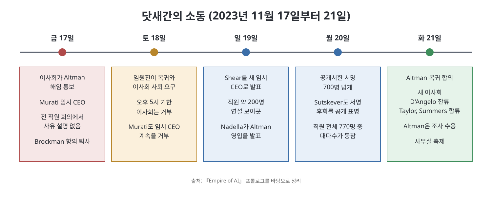

# 프롤로그 - 왕좌를 향한 질주

프롤로그는 2023년 11월 17일 금요일, OpenAI 이사회가 CEO 샘 올트먼을 해임하고 닷새 뒤 복귀시키기까지의 소동을 긴박하게 따라간다. 저자 캐런 하오는 이 사건을 한 회사의 권력 다툼으로 소비하지 말라고 말한다. 그는 이 사건이 'AI를 누가, 어떻게 통제할 것인가'라는 시대의 질문을 가장 선명하게 드러냈다고 보고, 그 질문에서 이 책의 중심 비유인 '제국'까지 이야기를 이끈다.

> **이 장을 한 문장으로**
> 닷새간의 쿠데타 소동은 비영리 이념 위에 세운 OpenAI의 지배 구조 실험이 실패했음을 보여 주었고, 소수 엘리트의 밀실 결정이 AI의 미래를 좌우한다는 사실도 드러냈다.

---

## 이 장의 흐름

1. 금요일: 해임 통보와 직원들의 충격
2. 같은 날 밤: 임원진과 이사회의 충돌
3. 주말: 최후통첩과 Microsoft의 영입 발표
4. 화요일: 합의, 그리고 '우리는 돌아왔다'
5. 저자의 해석: 이상의 붕괴와 '통치'라는 질문
6. 제국이라는 비유와 다른 길

---

## 0. 먼저 알아 둘 것: 등장 조직과 용어

- **OpenAI**: ChatGPT를 만든 회사. 비영리 조직이 위에 있고, 그 안에 영리 사업을 하는 자회사(OpenAI LP)를 둔 독특한 구조다.
- **이사회(board)**: 회사의 큰 결정을 감독하고 CEO를 임명하거나 해임할 수 있는 기구. 보통 회사 이사회는 주주의 이익을 지키지만, OpenAI 이사회는 책에 따르면 주주가 아니라 사명(AGI가 인류에게 이로워야 한다는 것)을 위해 움직이도록 설계되었다.
- **AGI(범용 인공지능)**: 사람처럼 폭넓은 일을 해내는 AI를 가리키는 말이다. 책은 OpenAI 창립자들이 이를 역사상 가장 강력한 AI라고 불렀다고 쓴다.
- **텐더 오퍼(tender offer)**: 회사가 상장하지 않은 상태에서 직원이 가진 지분을 투자자에게 팔 수 있게 열어 주는 거래다. 직원들에게는 큰돈이 걸린 일이었다.

---

## 1. 금요일: 해임 통보

2023년 11월 17일 정오 무렵, 올트먼은 라스베이거스 호텔에서 화상회의에 접속했다. 이사 다섯 명 가운데 네 명이 그를 기다리고 있었고, 수석 과학자 일리야 수츠케버가 해임을 통보했다. 임시 CEO는 기술책임자 미라 무라티가 맡게 됐다. 공동 창업자이자 사장인 그레그 브록먼은 이사직을 잃게 되었다는 통보를 받았다.

회사 발표문은 올트먼이 이사회와 소통하는 데 이사회와의 소통에서 일관되게 솔직하지 않았다는 취지로 설명했다. 구체적 내용은 없었다.

겉으로 OpenAI는 정점에 있었다. 책은 ChatGPT를 역사상 가장 빨리 성장한 소비자 앱이라고 묘사하고, 회사 가치가 최대 900억 달러로 평가되던 중이었다고 쓴다. 올트먼은 세계 순회로 가수 Taylor Swift에 비견될 만한 유명세를 얻은 인물이었다. 해임 소식에 직원들이 느낀 충격은 그의 좋은 평판과 해임 사이의 간극에서 나왔다.

직원들은 이유를 추측하느라 바빴다. 불법 행위인가, 누이가 SNS에서 제기한 주장과 관련 있는가, 다른 투자나 사우디 투자자와의 AI 반도체 사업 자금 모집 때문인가. 어느 것도 확인된 바 없다고 책은 전한다.

## 2. 설명하지 않는 이사회

수츠케버는 두 시간 뒤 전 직원 화상 회의를 열었다. 직원들은 구체적 사유를 물었지만, 그는 보도자료를 몇 번 읽어 보라고만 답했다. 세부 질문에 대한 기대치를 묻는 직원에게는 기대를 낮추라고 답했다고 책은 전한다. 위기를 함께 겪으면 팀이 더 단단해진다는 말에는 진실이 화해의 전제라는 반박이 올라왔다. 직원들의 불안은 분노로 바뀌었다.

그날 밤 임원진은 이사회와 대면했다. 사외이사 애덤 디안젤로(Quora 공동 창업자), 타샤 맥콜리(기업가), 헬렌 토너(조지타운대 CSET 연구자)와 수츠케버는 법적 의무를 이유로 추가 설명을 거부했다. 임원들은 격분해 이사회 사퇴와 직원 3명으로의 교체를 요구하고, 안 그러면 전원 퇴사하겠다고 했다. 이사회는 이 구조에서는 회사가 무너지더라도 사명에 부합할 수 있다는 논리로 맞섰다. 책에 따르면 토너는 "이 조치가 회사를 파괴하더라도 사명과는 일치할 수 있다"고 말했고, 이 말은 곧 직원들에게 '이사들은 회사가 망해도 상관없다'는 뜻으로 전달되었다.

## 3. 주말: 압박의 총동원

- **토요일(18일)**: 직원 수십 명이 올트먼의 저택에 모였다. 임원진은 오후 5시를 기한으로 복귀와 이사회 사퇴를 요구했으나 이사회는 거부했다. 무라티도 임시 CEO를 계속하기를 거부했다.
- **일요일(19일)**: 이사회는 Twitch 전 CEO Emmett Shear를 새 임시 CEO로 발표했다. 직원 약 200명이 그의 연설을 보이콧하고 사무실을 나왔다. 그날 밤 Microsoft CEO 사티아 나델라가 올트먼과 브록먼을 새 AI 부서의 책임자로 영입한다고 발표했고, 따라 나올 직원에게는 일자리를 보장한다고 알려졌다.
- **월요일(20일)**: 임원진이 쓴 공개서한에 24시간 안에 약 770명 중 700명 넘게 서명했다. 이사회 구성원이던 수츠케버도 서명했고, "이사회의 행동에 가담한 것을 깊이 후회한다"고 공개했다.

핵심은 **레버리지(협상력)** 의 이동이다. Microsoft라는 대안이 생기자 직원들은 이사회에 맞설 수 있다는 확신을 얻었고, 컴퓨팅 자원을 대는 Microsoft, 투자자, 실리콘밸리 유력 인사들이 한목소리로 올트먼 편에 서면서 이사회에는 선택지가 사라졌다.

## 4. 화요일: 합의와 '우리는 돌아왔다'

11월 21일 화요일, 잠을 못 잔 양측은 합의에 도달했다. 새 이사회는 디안젤로가 남고, Bret Taylor(전 Salesforce 공동 CEO)와 Larry Summers(전 미국 재무장관)가 합류하는 구도였다. 토너와 맥콜리는 물러난다. 올트먼은 조사를 받기로 했고, 그와 브록먼은 이사 자리 없이 복귀하기로 했다. 이후 회사는 '단결'을 연출했다. 추수감사절 인사 트윗, 브록먼과 수츠케버의 사진, DALL-E로 인쇄한 하트 스티커 등이 그 예다. 이듬해 1월 텐더 오퍼는 860억 달러 가치로 마무리되었다고 책은 쓴다.

| 날짜(2023) | 핵심 사건 |
|-----------|-----------|
| 11월 17일(금) | 이사회가 Altman 해임, Murati가 임시 CEO, Brockman 이사직 상실 후 퇴사 |
| 11월 18일(토) | 임원진의 복귀 요구와 이사회 거부, Murati 임시 CEO 거부 |
| 11월 19일(일) | Shear 임시 CEO 발표, 직원 약 200명 보이콧, Nadella의 Altman 영입 발표 |
| 11월 20일(월) | 공개서한 700명 넘게 서명, Sutskever 서명과 후회 표명 |
| 11월 21일(화) | Altman 복귀와 새 이사회 합의 |

## 5. 저자의 해석: 실험의 실패

저자는 이 소동을 두고 사람들이 던진 질문, 즉 단지 볼만한 구경거리인가 우리에게도 영향이 있는가에 답한다. 저자의 답은 이것이 우리 세대의 가장 시급한 질문, 즉 AI를 어떻게 통치할 것인가를 드러냈다는 것이다.

저자의 설명에 따르면 OpenAI는 처음에 이 질문에 대한 대담한 실험으로 자신을 소개했다. 일론 머스크와 올트먼 등이 비영리로 세우고 10억 달러를 약속했으며, 상업 제품 대신 연구에 전념하고 가능한 한 공유한다는 이상을 내세웠다. 경쟁이 과열되면 다른 곳을 돕겠다는 약속도 했다. 그러나 약 1년 반 만에 막대한 자금 필요가 드러났고, 머스크와 올트먼이 서로 CEO가 되려 다툰 끝에 올트먼이 이기고 머스크는 2018년 초 떠났다. 저자는 이것이 이타적 프로젝트가 아니라 자존심의 프로젝트였다는 첫 징후라고 본다. 이후 영리 자회사 OpenAI LP가 생기고 2019년 7월 Microsoft가 10억 달러를 투자했다.

저자는 2019년 8월 처음 OpenAI 사무실을 방문했을 때 이미 실험이 풀려 가고 있었다고 쓴다. 이후 4년간 OpenAI는 스스로 하지 않겠다고 했던 모든 것이 되었다는 것이 저자의 평가다. 비영리는 이름뿐이 되었고, 연구를 비공개로 돌렸으며, 스스로 경고한 '바닥을 향한 경쟁'을 촉발했다는 것이다. 그래서 올트먼의 축출과 복귀는 지배 구조 실험이 실패했다는 최종 증거라고 저자는 본다. 이유는 이사회가 돈의 힘에 굴복해서만이 아니다. 소수의 실리콘밸리 엘리트가 벌인 권력 다툼이 AI의 미래를 정하고, 직원들조차 밀실 결정 앞에서 결과를 몰랐다는 점이 더 중요하다.

## 6. 제국이라는 비유와 다른 길

저자는 AI가 하나의 기술이 아니라 다양한 기술의 집합이며, 지금의 대형 언어 모델은 수많은 주관적 선택의 결과일 뿐 필연이 아니라고 말한다. 생성형 AI는 겉으로는 신나는 도구지만, 내부에는 엄청난 데이터, 노동, 컴퓨팅 파워, 자연 자원이 들어간다. 비용은 취약한 사람들에게 쏠리고 이득은 위로 모인다고 저자는 주장한다.

이 구조를 설명하는 단 하나의 비유가 **제국**이다. 저자는 식민 제국이 자원을 빼앗고 노동을 착취했으며, 자신의 우월함을 내세워 정당화하고, 다른 제국과의 경쟁을 명분 삼았다고 정리한다. AI 기업도 폭력의 방식만 다를 뿐 같은 일을 한다고 그는 말한다. 작가·예술가의 작업물, 온라인에 올린 개인의 데이터, 데이터센터가 쓰는 땅·에너지·물을 가져가고, 데이터를 정리하는 전 세계 노동자를 쓴다는 것이다.

책이 제시하는 근거 수치도 있다. 저자는 GPT-4가 GPT-1보다 1만 5천 배 넘게 크다는 보도를 소개한다. 책을 마무리하던 2025년 1월에 OpenAI의 평가액은 1,570억 달러를 넘었다고 하고, 생성형 AI의 실제 경제 가치에 대한 의문도 커지고 있다고 쓴다. 다만 저자는 대안이 있다고 말한다. 작은 모델과 다양한 접근으로도 의료·교육·기후 같은 사회의 필요를 상당히 채울 수 있고, 정책 입안자(데이터 프라이버시·투명성·저작권), 인권 단체(데이터 라벨러의 최저임금과 노동권), 연구 지원 기관(연구 다양성), 그리고 우리 모두(산업이 만든 서사에 저항)가 할 일이 있다는 것이다.

> **쉽게 말하면**
> 프롤로그는 '이사회 쿠데타 실록'으로 시작해서 'AI는 누구의 것인가'라는 정치 질문으로 끝난다. 이 책을 읽는 내내 사건 하나하나를 이 질문과 연결해서 보면 된다.

## 등장 인물 정리

| 인물 | 프롤로그에서의 역할(책의 서술) |
|------|------------------------------|
| Sam Altman | OpenAI CEO. 해임 후 닷새 만에 복귀 |
| Ilya Sutskever | 수석 과학자이자 이사. 해임을 통보했으나 이후 후회를 공개 |
| Mira Murati | 기술책임자, 임시 CEO로 지명되었으나 곧 맡기를 거부 |
| Greg Brockman | 사장, Altman의 측근. 해임 당일 항의 퇴사 |
| Adam D'Angelo, Tasha McCauley, Helen Toner | 사외이사. 합의로 D'Angelo만 잔류 |
| Emmett Shear | Twitch 전 CEO, 이사회가 세운 새 임시 CEO |
| Satya Nadella | Microsoft CEO, Altman 영입 발표 |
| Bret Taylor, Larry Summers | 새 이사회에 합류 |

---

## 핵심 정리

- 2023년 11월 17일부터 21일까지의 해임과 복귀는 직원 700명의 서명과 Microsoft의 영입 카드가 이사회를 무력화한 사건이었다.
- 이사회는 해임 사유를 구체적으로 설명하지 않았고, 이 불투명성이 직원들의 분노를 키웠다.
- 저자는 OpenAI가 비영리·개방·협력이라는 초기 이상에서 멀어져 갔다고 보며, 이 사건을 지배 구조 실험이 실패했다는 증거로 해석한다.
- 저자는 거대 AI 기업을 자원 수탈과 노동 착취, 경쟁을 명분 삼는 '제국'에 비유하고, AI의 방향은 필연이 아니라 선택이라고 주장한다.

 

이전: [저자의 말](%EC%A0%80%EC%9E%90%EC%9D%98%20%EB%A7%90.md) | 다음: [핵심 정리](%ED%95%B5%EC%8B%AC%20%EC%A0%95%EB%A6%AC.md)
