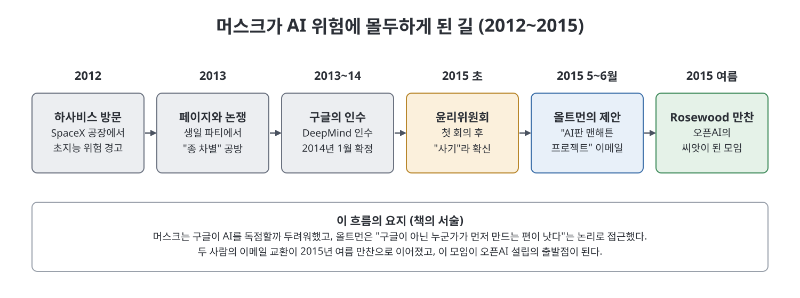
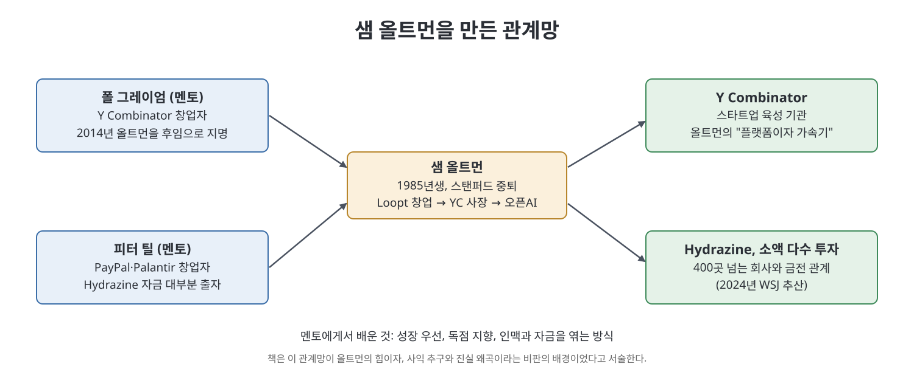

# 1장 신의 권리 (Divine Right)

2015년 여름, 샘 올트먼이 연 비공개 저녁 식사 자리에서 오픈AI의 씨앗이 뿌려진다. 이 장은 그 자리에 이르기까지의 두 갈래 이야기를 따라간다. 하나는 일론 머스크가 AI를 인류의 위협으로 여기게 된 과정이고, 다른 하나는 이 모임을 연 샘 올트먼이 어떤 사람이며 어떻게 실리콘밸리의 중심으로 올라갔는지다. 책의 제목처럼 한 사람의 야망과 인맥이 거대한 기술의 방향을 좌우하게 되는 출발점을 보여 주는 장이다.

> **쉽게 말하면**
> 1장은 "오픈AI를 누가, 어떤 불안과 야망으로 시작했는가"를 묻는 장이다. 기술 이야기보다 사람 이야기가 중심이다.

## 이 장의 흐름

1. 머스크가 AI 위험에 사로잡히는 과정 (하사비스, 래리 페이지, 구글의 DeepMind 인수)
2. 올트먼의 이메일 제안과 2015년 Rosewood 만찬
3. 올트먼의 성장 과정과 첫 창업 Loopt
4. 두 멘토, 폴 그레이엄과 피터 틸
5. 관계와 자금으로 쌓은 영향력, 그리고 그 대가

## 1. 머스크는 왜 AI를 두려워했나

먼저 용어 몇 개를 짚자. **AGI**는 사람 수준의 지능을 갖춘 범용 인공지능을 가리키는 말이다. **초지능**은 사람보다 훨씬 똑똑한 AI를 뜻한다. **실존적 위험**은 인류의 존속 자체를 위협하는 위험이다.

저자에 따르면 머스크는 2012년 영국 AI 연구소 DeepMind의 CEO 데미스 하사비스를 만난 뒤 이 문제를 진지하게 받아들였다. 하사비스는 초지능이 나오면 화성으로 도망가는 계획도 소용없다고 말했고, 머스크는 상황을 지켜보려고 이 회사에 500만 달러를 투자했다. 이듬해 생일 파티에서는 구글 공동창업자 래리 페이지와 논쟁을 벌였다. 페이지는 AI가 사람을 넘어서는 것을 문제로 보지 않았고, 이를 반대하는 머스크를 "종 차별주의자"라고 불렀다고 한다.

구글이 DeepMind를 인수하자(2014년 1월 확정) 머스크의 불안은 더 커졌다. 2015년 초 DeepMind 윤리위원회 첫 회의에 참석한 뒤에는 이 위원회가 허울뿐이라고 확신하게 되었다. 책은 이때부터 머스크가 하사비스를 막아야 할 악당처럼 묘사했고, 오픈AI를 그 반대편의 선으로 내세웠다고 전한다. 반면 DeepMind의 한 전직 연구원은 온화한 사람에게 보이는 지나친 반응처럼 느껴졌다고 회고한다고 책은 전한다.

여기에 철학자 닉 보스트롬의 책 『초지능』이 영향을 미쳤다. 이 책은 AI가 사람보다 똑똑해지면 통제하기 어렵다고 경고하고, 해법으로 AI를 사람의 가치에 맞추는 **정렬(alignment)** 을 제안했다. 이 아이디어가 훗날 오픈AI가 앞세우는 AI 안전 연구의 뿌리가 된다.

## 2. 올트먼의 제안과 Rosewood 만찬

올트먼은 2015년 5월 머스크에게 이메일을 보냈다. 요지는 AI 개발을 막을 수 없다면 구글이 아닌 누군가가 먼저 만드는 편이 낫다는 것이었다. 그는 Y Combinator(YC) 안에서 "AI판 맨해튼 프로젝트"를 시작하고, 기술이 비영리 재단을 통해 세상에 속하도록 하자고 제안했다. 6월에는 더 구체적인 구조를 보냈는데, 재단 이사회에 올트먼과 머스크가 앉고 판단이 애매할 때는 다섯 명이 결정한다는 내용이었다. 머스크는 짧게, 전부 동의한다고 답했다.

이어진 만찬에는 올트먼, 머스크, 그레그 브록먼, 다리오 아모데이, 일리야 수츠케버 등이 참석했다. 머스크는 한 시간 넘게 늦었다. 저자는 이 자리의 사람들이 곧 비영리 조직의 핵심 지도부가 되었으며, 이후 거의 모두가 올트먼과 부딪친 끝에 떠났다고 요약한다. 또 올트먼이 나중에 위험에 대한 입장을 바꿔 2023년에는 AI가 도구가 될 것이라는 쪽에 가깝다고 말했다는 점도 짚는다.

## 3. 샘 올트먼은 어떤 사람인가

올트먼은 1985년 시카고에서 태어나 세인트루이스에서 자랐다. 어머니는 의사(피부과 전문의)이자 법학 학위도 가진 사람이고, 아버지는 부동산 개발 쪽 사람으로 책은 소개한다. 어릴 때부터 호기심이 강하고 승부욕이 센 아이였다고 한다. 학교에서는 학업과 사교, 글쓰기까지 두루 잘했고, 고등학생 때 커밍아웃을 한 뒤 반대하는 학생들 앞에서 관용을 주제로 연설한 일화가 나온다.

저자가 강조하는 것은 두 얼굴이다. 겉으로는 자신감 넘치지만 속으로는 불안이 많은 사람이라는 것이다. 『뉴요커』의 기자는 올트먼이 "AGI를 최대한 빨리 만들자"와 "인류를 파괴하지 말자"라는 두 요구를 동시에 느끼는 듯하다고 썼다. 책은 이 이중성이 그의 경력의 모양을 정했다고 본다.

스탠퍼드에 진학한 올트먼은 위치 기반 소셜 앱 **Loopt**를 창업하려고 대학을 중퇴했다. Loopt는 YC의 첫 기수에 들어갔지만 큰 성공은 아니었다. 2012년 약 4,340만 달러에 팔렸고, 이는 투자자들이 넣은 돈과 비슷한 수준이었다. 그래도 올트먼은 이 시기에 이야기를 설득력 있게 푸는 능력, 협상력, 인맥을 쌓았다. 저자는 또 Loopt 경영진이 두 차례 이사회에 올트먼 해임을 요구했다는 『월스트리트저널』 보도를 전한다. 이유는 회사보다 자기 이익을 앞세운다는 것과 사소한 일까지 진실을 왜곡한다는 것이었다. 이사회는 올트먼 편을 들었다.

## 4. 두 멘토와 영향력의 방식

올트먼에게 가장 큰 영향을 준 사람은 YC 창업자 **폴 그레이엄**과 투자자 **피터 틸**이다. 그레이엄은 올트먼을 빌 게이츠에 비교하며 일찍부터 후원했고, 2014년 28세의 올트먼을 YC 사장으로 지명했다. 틸은 PayPal과 Palantir 창업자로, 올트먼의 투자 펀드 Hydrazine에 자금의 대부분을 댔다.

책은 두 사람에게서 올트먼이 배운 것을 이렇게 정리한다. 첫째는 성장이 모든 문제를 푼다는 믿음이다. 둘째는 스타트업이 독점을 목표로 해야 한다는 틸의 철학이다. 셋째는 조언과 돈으로 인맥을 만들고, 그 인맥으로 다시 기회를 얻는 방식이다. 올트먼은 소액을 여러 곳에 흩어 투자해 400곳이 넘는 회사와 금전 관계를 맺었다는 2024년 보도도 소개된다.

저자는 올트먼이 YC를 발판으로 "스스로 하나의 기관이 되었다"고 쓴다. 정책 담당자들이 그를 실리콘밸리로 통하는 관문처럼 여겼고, 2019년 3월 그가 YC에서 물러나던 날 척 슈머 상원의원이 오픈AI를 비공개로 찾았다는 일화도 나온다.

## 5. 영향력의 대가

올트먼을 따르는 사람이 많은 만큼 반대자도 늘었다는 것이 저자의 설명이다. 기회를 얻은 이들은 충성스러운 지지자가 되었지만, 다른 이들은 그가 상황을 자기에게 유리하게 비튼다고 보았다. 저자는 이것이 Loopt 경영진이 제기한 우려, 즉 권력 추구와 습관적 부정직이라는 비판과 이어진다고 말한다.

장 끝부분에서 저자는 올트먼의 여동생 애니와의 관계도 다룬다. 애니는 2021년 가족에게 버림받았다는 주장과 어린 시절 학대 주장을 공개했고, 2025년 1월 소송을 냈다. 올트먼과 어머니, 두 형제는 공동 성명에서 이를 "전혀 사실이 아니다"라며 부인했다. 저자는 이 사안을 부분적인 정보만으로 판단하기 어려운 가족사라고 전제한다. 이 노트도 사실 여부를 판단하지 않고, 책이 이 이야기를 어떤 맥락에 놓았는지만 적는다. 책은 이를 소수의 손에 모인 권력을 견제할 장치가 부족하다는 책 전체의 주제와 연결한다.

## 인물 정리

| 인물 | 이 장에서의 역할 | 쉬운 설명 |
|------|------------------|-----------|
| 샘 올트먼 | 오픈AI 제안자 | YC 사장을 지낸 창업가이자 투자자 |
| 일론 머스크 | 공동 출자자, 훗날 갈등 상대 | AI 위험을 강하게 우려한 기업가 |
| 데미스 하사비스 | DeepMind CEO | 머스크가 경계한 구글 계열 AI 연구소 수장 |
| 래리 페이지 | 구글 공동창업자 | AI의 초월을 문제로 보지 않은 인물 |
| 닉 보스트롬 | 철학자 | 『초지능』 저자, 정렬 개념의 배경 |
| 폴 그레이엄 | 첫 멘토 | YC 창업자, 올트먼을 후계자로 지명 |
| 피터 틸 | 두 번째 멘토 | PayPal·Palantir 창업자, 독점 지향 철학 |

## 핵심 정리

- 머스크의 AI 공포는 하사비스 면담, 페이지와의 논쟁, 구글의 DeepMind 인수를 거치며 굳어졌고, 오픈AI는 "구글에 맞서는 선"으로 기획되었다.
- 올트먼은 AI를 막을 수 없다면 구글이 아닌 누군가가 먼저 만들자는 논리로 머스크를 설득했다.
- 올트먼은 이야기를 설득력 있게 푸는 능력과 인맥, 두 멘토에게서 배운 성장과 독점 지향으로 권력을 쌓았다.
- 책은 이 상승 과정이 자기 이익 추구와 부정직이라는 비판을 함께 불렀다고 서술하며, 소수에게 권력이 몰리는 문제를 이후 장들의 배경으로 깐다.

 
 

이전: [1부 Readme](Readme.md) | 다음: [2장 문명화 사명](02%EC%9E%A5%20%EB%AC%B8%EB%AA%85%ED%99%94%20%EC%82%AC%EB%AA%85.md)

 

[Empire of AI](../)
