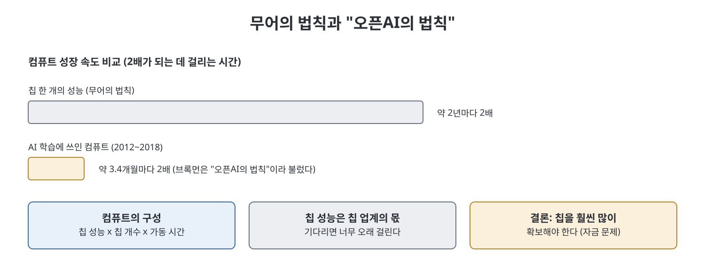
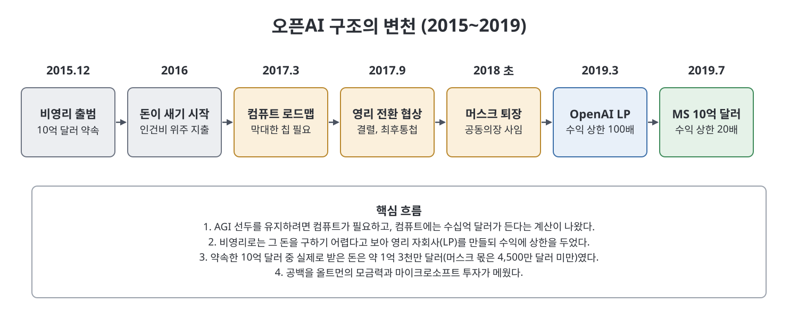

# 2장 문명화 사명 (A Civilizing Mission)

오픈AI가 실제로 만들어지고, 곧바로 돈 문제에 부딪혀 처음의 약속을 하나씩 바꿔 가는 과정을 다룬 장이다. 비영리와 개방성을 내걸고 출발한 조직이 머스크와 결별하고, 수익 상한이 있는 영리 자회사를 만들고, 마이크로소프트에서 10억 달러를 받기까지 약 4년의 이야기다. 제목의 "문명화 사명"은 선한 목적을 내세워 거대한 일을 정당화하는 태도를 가리키는 것으로 읽힌다.

> **쉽게 말하면**
> 이 장의 핵심은 "좋은 일을 하겠다는 약속과, 그 일에 필요한 돈 사이의 충돌"이다. 돈 문제가 커질수록 약속의 모양이 바뀐다.

## 이 장의 흐름

1. 창립 멤버 모집과 2015년 12월 출범
2. 출범 당시의 시대 분위기와 비판자들 (팀닛 게브루 등)
3. AI 안전의 두 얼굴: 다리오 아모데이와 학계의 반론
4. 방향을 못 잡은 초기 조직과 컴퓨트 계산
5. 영리 전환 갈등, 머스크 퇴장, OpenAI LP 설립, 마이크로소프트 투자

## 1. 사람을 모으고 이름을 세우다

브록먼이 가장 먼저 합류를 약속했고, 올트먼은 구글 연구원이던 일리야 수츠케버를 공동 창립자로 골랐다. 브록먼은 결제 회사 Stripe의 CTO를 지낸 엔지니어이고, 수츠케버는 AI 분야의 거장 제프리 힌턴의 제자다. 2012년 힌턴, 수츠케버, 알렉스 크리젭스키는 이미지 인식 대회 ImageNet에서 오류율을 크게 낮춰 AI 업계를 놀라게 했고, 이들의 회사는 구글에 인수되었다.

당시 AGI를 입에 올리는 것은 학계에서 과학 소설이나 사이비 취급을 받았다고 저자는 쓴다. 수츠케버조차 처음에는 신뢰를 잃을까 조심스러워했다. 반대로 브록먼은 AGI가 가까이 있다고 진심으로 믿었고, 인재 명단을 만들고 교수들을 만나 학생을 추천받고 후보를 철저히 조사해 설득했다. 머스크도 AGI가 멀리 있더라도 가능성이 1퍼센트만 되어도 신중히 따져 봐야 하지 않느냐는 식으로 연구자들을 설득했다고 한 교수는 회고한다.

오픈AI는 비영리로 출발하며 이름처럼 연구를 공개하는 "구글의 반대편"으로 자리 잡기로 했다. 그러나 책이 인용하는 내부 이메일에는 AI에 가까워질수록 덜 공개해도 된다는 수츠케버의 생각에 머스크가 동의하는 대목이 있다. 개방은 처음부터 절대 원칙이 아니었다는 것이 저자의 지적이다. 2015년 12월 발표에서 10억 달러 지원 약속이 공개되었는데, 책은 머스크가 구글이나 페이스북에 비해 초라해 보이지 않도록 큰 숫자를 쓰자고 제안했다고 전한다.

## 2. 이상과 시대 분위기

2016년 미국 대선 이후 실리콘밸리에는 기술 기업에 대한 반감, 이른바 techlash가 퍼졌다. AI 연구자들도 기업이 이윤을 위해 AI를 너무 빨리 상용화했다는 반성을 시작했다. 경찰과 대출 심사에 쓰이는 알고리즘이 차별을 굳히고, 추천 알고리즘이 사회를 양극화한다는 문제 제기가 있었다. 정부 자금에도 문제가 있었다. 구글 직원들은 국방부 드론 프로젝트(Project Maven)에 항의했다. 이런 분위기에서 오픈AI는 이윤에도 국가 권력에도 얽매이지 않는 "제3의 길"로 비쳤다.

모두가 환영한 것은 아니다. 스탠퍼드 박사과정이던 **팀닛 게브루**는 출범 소식을 접하고 11명 중 9명이 백인 남성이라는 점, 막대한 돈, AI 스타를 우상화하는 분위기를 비판하는 글을 썼다. 그는 AI의 해로운 영향은 미래가 아니라 이미 벌어지고 있다고 주장했고, 이후 학회에서 흑인 연구자 모임인 Black in AI를 시작하는 메일을 보냈다.

한편 브록먼은 달에 사람을 보낸 NASA 같은 사명감과 단합을 이상으로 삼았다. 모든 직원이 샌프란시스코 사무실에서 일하도록 했고, 직원을 모두 "기술 스태프 구성원"으로 부르게 했다. 저자는 이 정책이 베이 지역 밖에서 살기 어려운 여성과 유색인 연구자에게 불리하게 작용했다고 본다.

## 3. AI 안전의 두 가지 의미

**다리오 아모데이**는 신경과학자 출신 AI 연구자로, 2016년 기계학습의 "사고"를 막는 문제를 안전의 핵심으로 정리한 논문을 공동 집필했다. 이 관점의 안전은 통제 불능의 AI가 재앙을 일으키는 것을 막는 일, 곧 보스트롬이 말한 초지능 위험에 가깝다. 아모데이 남매는 효율적 이타주의(EA) 운동에 호의적이었고, 이 운동의 자금 조달 기관 Open Philanthropy는 오픈AI에 3,000만 달러를 기부해 이사회 자리를 얻었다. **효율적 이타주의**는 합리적 계산으로 세상에 최대의 선을 행하자는 사상이다.

이 접근은 곧 비판을 받았다. 같은 시기 미국 형사사법 시스템의 알고리즘이 흑인을 더 위험하다고 분류했다는 탐사 보도가 나왔고, 디보라 라지 같은 연구자는 AI 안전이 이론 속 위험에만 매달려 이미 존재하는 피해를 소홀히 한다고 반박했다. 오픈AI 안에서도 일부 연구자가 차별 영향 연구를 안전에 포함하자고 했으나, 한 임원은 "우리 역할이 아니다"라고 답했다고 책은 전한다. 아모데이는 2016년 7월 오픈AI에 합류해 안전 연구를 이끌었다.

## 4. 방향 없는 연구소와 컴퓨트의 계산

저자는 출범 1년이 지난 오픈AI가 사실 무엇을 하는지 잘 몰랐다고 쓴다. 로봇, 게임, 가상 세계 등 여러 프로젝트가 흩어져 있었고 눈에 띄는 성과는 적었다. 관리 체계도 모호했고 돈은 대부분 인건비로 나갔다(2016년 지출 약 1,100만 달러 중 700만 달러 이상). 2016년 3월 DeepMind의 AlphaGo가 이세돌을 이기자 머스크의 초조함은 커졌다. 머스크는 일정을 묻고 답이 없으면 계획이 없는 것이라고 몰아붙였다.

2017년 브록먼과 수츠케버는 AGI에 도달하려면 무엇이 필요한지 고민했고, 수츠케버는 **컴퓨트(compute, 계산 자원)** 가 가장 중요하다고 믿었다. 컴퓨트는 칩 한 개의 성능, 칩의 개수, 가동 시간으로 정해진다. 칩 성능은 약 2년마다 두 배가 되는 무어의 법칙을 따르는데, 그 속도로는 너무 오래 걸린다는 계산이 나왔다. 그런데 아모데이 등이 2012년 이후 주요 AI 성과에 쓰인 컴퓨트를 그려 보니 약 3.4개월마다 두 배가 되고 있었다. 브록먼은 이를 "오픈AI의 법칙"이라 불렀다.

결론은 칩을 훨씬 많이 확보해야 한다는 것이었다. 이 칩은 원래 게임 그래픽용으로 개발된 **GPU**이고, 대부분 엔비디아가 판다. 당시 GPU 8개를 넣은 서버가 15만 달러쯤 했고, 여러 해에 걸쳐 수만 개가 필요할 수 있었다. 즉 10억 달러로는 부족했다.

## 5. 갈등, 결별, 그리고 새 구조

영리 전환 논의에서 올트먼과 머스크는 둘 다 CEO 자리와 통제권을 원했다고 책은 쓴다. 브록먼과 수츠케버는 처음엔 머스크 쪽으로 기울었지만, 올트먼이 개인적 관계를 들어 설득하고 머스크의 불안정함을 우려하면서 마음이 바뀌었다. 2017년 9월 수츠케버가 올트먼과 머스크 양쪽에 보낸 메일에는 한 사람이 독재자가 될 수 있는 구조는 나쁘다는 취지와, 올트먼의 진짜 동기를 모르겠다는 의문이 담겼다. 머스크는 십 분 만에 더는 못 참겠다고 답하며 자금 지원을 끊을 수 있다고 못 박았다.

2018년 초 머스크는 공동의장직에서 물러났다. 공개적으로는 이해 충돌이 이유라고 설명되었다. 책에 따르면 약속된 10억 달러 중 실제로 받은 돈은 약 1억 3,000만 달러였고, 그중 머스크의 몫은 4,500만 달러 미만이었다. 머스크는 직원 회의에서 오픈AI가 비영리로는 실패할 것이며 테슬라에서 같은 목표를 추구하겠다고 밝혔다.

올트먼의 해법은 비영리 이사회가 지배하는 **유한 파트너십(LP)** 이라는 영리 자회사였다. 투자자 수익에 상한을 두고 사명이 투자자보다 우선한다고 문서에 적을 수 있다는 점이 장점이었다. 2018년 4월 헌장은 AGI를 "경제적으로 가치 있는 대부분의 일에서 사람을 능가하는 고도로 자율적인 시스템"으로 정의했다. 2019년 3월 OpenAI LP가 공개되며 올트먼이 CEO가 되었다. 첫 투자자의 수익 상한은 투자금의 100배였고, 온라인에서는 사실상 무제한과 다름없다는 비판이 나왔다.

그 사이 올트먼은 마이크로소프트 CEO 사티아 나델라와 접촉했다. 빌 게이츠는 게임 AI나 로봇 손에는 관심이 없었고, 책을 읽고 과학 개념을 이해하는 연구 보조 AI를 원했다고 한다. 2019년 4월 연구자들이 GPT-2를 개선한 시연을 보여 주자 게이츠의 마음이 어느 정도 움직였고, 같은 해 7월 마이크로소프트는 10억 달러 투자를 발표했다. 책은 이 투자의 수익 상한이 20배였다고 적는다. 같은 시기 올트먼은 YC에서의 시간 배분 문제로 압박을 받아 사장직에서 물러났다는 보도도 함께 소개된다.

## 등장 인물과 조직

| 이름 | 소속·역할 | 이 장에서 | 
|------|-----------|-----------|
| 그레그 브록먼 | 오픈AI CTO | 인재 모집, 조직 문화 설계 |
| 일리야 수츠케버 | 연구 책임 | 컴퓨트 중심 전략 주도 |
| 다리오 아모데이 | 안전 연구 책임 | 스케일링 관찰과 안전 개념 정립 |
| 팀닛 게브루 | AI 연구자 | 출범의 동질성을 비판 |
| 사티아 나델라 | 마이크로소프트 CEO | 10억 달러 투자 결정 |
| 빌 게이츠 | 마이크로소프트 창업자 | 마지막까지 투자에 신중했던 인물 |

## 핵심 정리

- 오픈AI는 비영리와 개방성을 내세워 "이윤과 국가 권력 사이의 제3의 길"로 출범했지만, 개방은 처음부터 조건부였다는 증거를 책이 제시한다.
- 컴퓨트 요구량이 2년 주기가 아닌 3.4개월 주기로 늘어난다는 계산이 막대한 자금 필요로 이어졌다.
- 머스크와의 결별 후 약속한 10억 달러 중 약 1억 3,000만 달러만 들어왔고, 올트먼이 LP 구조와 마이크로소프트 투자로 공백을 메웠다.
- AI 안전의 정의를 둘러싼 논쟁(통제 불능 AI 대 이미 벌어지는 피해)이 이 시기에 시작되었다.

 
 

이전: [1장 신의 권리](01%EC%9E%A5%20%EC%8B%A0%EC%9D%98%20%EA%B6%8C%EB%A6%AC.md) | 다음: [3장 신경 중추](03%EC%9E%A5%20%EC%8B%A0%EA%B2%BD%20%EC%A4%91%EC%B6%94.md)

 

[Empire of AI](../)
