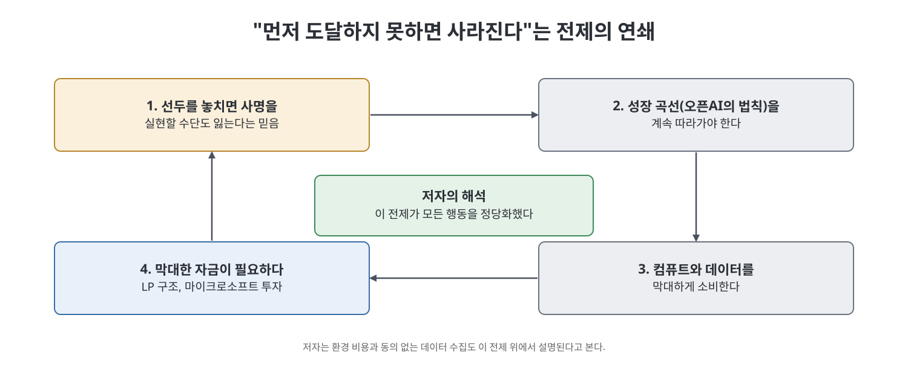

# 3장 신경 중추 (Nerve Center)

이 장은 저자 카렌 하오(Karen Hao) 본인이 등장하는 현장 취재기다. 2019년 8월 그는 MIT 테크놀로지 리뷰 기자로서 샌프란시스코의 오픈AI 사무실에 3일간 머물며 경영진을 인터뷰했다. 겉으로는 쾌적하고 열린 공간이었지만, 질문이 구체적인 곳에 이를수록 답은 원점으로 돌아왔다고 저자는 쓴다. 이 장은 오픈AI가 공개적으로 말하는 사명과 실제 운영 사이의 간극을 처음으로 드러낸 순간을 기록한다.

> **쉽게 말하면**
> "겉으로 하는 말"과 "속으로 돌아가는 사정"이 얼마나 다른지를 기자의 눈으로 확인하는 장이다.

## 이 장의 흐름

1. 파이어니어 빌딩 방문과 사무실이라는 상징
2. 브록먼, 수츠케버와의 인터뷰: AGI는 왜 필요한가
3. 환경 비용에 대한 질문과 답변
4. 브록먼이라는 인물
5. "먼저 도달해야 한다"는 전제와 취재 결과의 파장

## 1. 사무실이라는 무대

오픈AI는 당시 샌프란시스코 미션 지구의 옛 트렁크 공장 건물(Pioneer Building)에 있었다. 머스크가 3년 전 자기 회사를 통해 임대한 건물이었다. 저자는 로비의 밝은 햇빛, 나무 들보 천장, 보드게임이 꽂힌 선반을 묘사한다. 실리콘밸리에서 사무실 디자인은 회사의 재정적 자신감과 인재 유치력을 보여 주는 일종의 화폐라는 것이 저자의 설명이다. 이후 올트먼이 직접 설계에 관여한 두 번째 사무실에는 도서관과 분수까지 갖춰진다. 반면 건물 밖에서는 지역 상점이 밀려나고 노숙 인구가 늘고 있었다. 한 직원은 훗날 그곳에서 일한 시간이 "다른 우주에 들어간 것" 같았다고 회고했다고 한다.

저자가 취재를 요청하자 오픈AI는 대중에게 자신을 다시 소개할 때라며 3일간의 접근을 허락했다. 하지만 방문 내내 볼 수 없는 층, 참석할 수 없는 회의, 홍보 책임자를 흘끔거리는 연구자들이 이어졌다. 방문이 끝난 뒤 정책 책임자 잭 클라크가 직원들에게 저자와 허가 없이 말하지 말라고 경고했고, 경비원에게 저자의 사진이 전달되었다고 책은 전한다. 투명성을 내건 조직치고는 이상한 행동이었다는 것이 저자의 소감이다.

## 2. AGI는 왜 필요한가: 질문과 답이 맴돈 이유

저자는 "수십억 달러를 왜 하필 이 문제에 쓰느냐"고 물었다. 브록먼은 AGI가 사람 손이 닿지 않는 복잡한 문제, 예컨대 기후 변화와 의료를 풀 수 있기 때문이라고 답했다. 수츠케버는 사람은 소통이 느리고 인센티브 문제가 있는 반면, AGI는 지능을 가진 컴퓨터들이 결과를 아주 빠르게 공유하는 큰 네트워크일 것이라고 설명했다.

여기서 용어 구분이 중요하다. 오픈AI가 정의하는 **AGI**는 대부분의 경제적으로 가치 있는 일에서 사람의 지능에 필적하거나 넘어서는 이론상의 소프트웨어다. 반면 **AI**는 지금 있는 기술, 그리고 현재 능력을 다듬어 가까운 미래에 닿을 수 있는 기술을 말한다. 저자는 기후와 의료에는 이미 현재의 기계학습으로 도움이 되는 연구들이 있다고 설명한다. 기후 분야 연구자들은 오히려 기술이 아니라 확산과 정치적 의지가 병목이라고 말한다. 그렇다면 왜 AGI여야 하느냐는 질문에 대한 답은 끝내 구체적이지 않았다고 저자는 쓴다.

또 저자는 AGI가 사람을 대체하는 것이 목표 아니냐고 물었고, 브록먼은 기술은 사람을 위해 존재한다며 부인했다. 다만 기술이 일부 일자리를 없애 왔다는 점은 인정하고, 생존과 노동을 분리해 모두에게 경제적 자유를 주는 것이 목표라고 말했다. 그는 또 자신들이 AGI가 만들어질지 여부를 결정하는 것이 아니라 탄생의 초기 조건을 바꿀 수 있을 뿐이라고 주장했다. 저자는 이를 실리콘밸리의 단골 논리, 즉 "우리가 하지 않으면 남이 한다"는 불가피성 카드로 해석한다.

## 3. 환경 비용 질문

저자가 AI 자체의 탄소 배출을 묻자 수츠케버는 그 비용이 부인할 수 없는 것이라면서도 AGI가 결국 환경 비용을 상쇄할 것이라고 답했지만 예시는 들지 못했다. 저자는 이 대화가 어디서 시작해 어디로 갔는지를 꼼꼼히 기록한다. 수츠케버는 데이터센터가 가능한 한 친환경이어야 한다고 거듭 말했고, 브록먼은 비트코인의 전력 소비를 언급하는 식이었다. 저자는 이 답변들을 오픈AI가 AGI로 지구온난화를 막겠다는 도박을 하면서 그 과정이 온난화를 악화시킬 수 있다는 구조를 정면으로 마주하지 않는 모습으로 읽는다. 브록먼은 그 토끼굴로 깊이 들어가지 말자며 대화를 돌렸다.

저자는 이를 두고 브록먼이 미켈란젤로처럼 AGI가 이미 대리석 안에 있고 깎아 내기만 하면 된다는 태도로 말했다고 비유한다.

## 4. 브록먼이라는 인물

저자는 브록먼의 동기를 따로 탐색한다. 십대 때 앨런 튜링의 논문(기계가 생각할 수 있는가를 묻는 글)에 매료되어 튜링 테스트 게임을 만든 것이 출발이었다. 이후 Stripe에서 "10배 엔지니어"로 불릴 만큼 코딩 생산성이 뛰어났지만, 사람을 관리하는 일에는 약했다. 2015년 AI가 급성장하자 Stripe를 떠나 처음의 야망으로 돌아왔다.

직원들에게 그는 축복이자 저주였다. 막힌 팀의 문제를 몇 시간씩 붙들고 풀어 주는 엔진이었지만, 세부에 매몰되어 방향이 맞는지 점검하지 않거나 직접 코드를 가로채는 일도 있어 많은 이가 지쳤다고 책은 전한다. 한 전직 엔지니어는 그가 비전을 가진 올트먼 같은 사람이 아니라 어렵고 멋진 문제를 풀고 싶어 하는 사람이라고 평했다. 저자는 브록먼이 단순한 청소부가 아니라 AGI를 이끌고 역사에 이름을 남기고 싶어 하는 사람으로 보였다고 쓴다. 그는 2022년 오픈AI의 사장이 된다.

## 5. "먼저 도달하지 못하면 사라진다"

브록먼은 LP 구조와 새 투자자들이 사명을 더 강화했다고 주장했다. 오픈AI의 법칙(2장)을 따라가지 못하면 선두를 잃고, 선두를 잃으면 AGI의 방향을 바꿀 힘도 잃는다는 논리였다. 저자는 나중에야 이 말의 무게를 깨달았다고 쓴다. 이 전제, 곧 먼저 도달하거나 사라진다는 생각이 오픈AI의 모든 행동을 움직였다는 것이다. 이 전제는 신중한 숙고가 아니라 결승선을 먼저 넘는 속도에 맞춰 연구 일정을 짜게 했고, 환경에 미치는 영향과 상관없는 컴퓨트 소비, 동의나 규제를 기다리지 않는 데이터 수집을 정당화했다고 저자는 해석한다.

혜택 분배를 묻자 브록먼은 인터넷, 불, 자동차, 전기 같은 비유를 늘어놓았고 그 기술들의 부작용을 인정하면서도 공공 설비처럼 만들겠다는 구체적 방법은 보편적 기본소득 정도를 막연히 언급했다고 한다. 그는 AGI가 모든 가치를 한곳에 몰아 줄 수 있고 그것은 자신이 원하지 않는 세상이라고 말했다.

## 6. 기사와 그 후폭풍

2020년 2월 저자의 기사가 나왔다. 핵심 지적은 이것이다. 공개적으로 표방하는 바와 닫힌 문 뒤의 운영 사이에 불일치가 있고, 치열한 경쟁과 자금 압박이 투명성과 개방성이라는 창립 이상을 갉아먹었다는 것이다. 몇 시간 뒤 머스크는 오픈AI가 더 개방되어야 한다는 취지의 글과 함께 자신은 통제권이 없다고 올렸다. 올트먼은 직원에게 보낸 이메일에서 기사가 "치명적이진 않지만 분명히 나빴다"고 평했다. 내부 문서 유출이 가장 심각한 문제라고 보았으며, 대응은 운영 변화가 아니라 대외 메시지 조정이라는 방향이었다. 오픈AI는 이후 3년간 저자와 말하지 않았다.

## 핵심 인물과 장면 표

| 장면 | 내용 | 저자의 시선 |
|------|------|-------------|
| 사무실 방문 | 밝고 열린 공간, 통제된 접근 | 투명성 주장과 어긋남 |
| 사명 설명 | 기후·의료 해결, 경제적 자유 | 구체성 부족, 질문이 맴돎 |
| 환경 질문 | 비용은 인정, 상쇄 논리로 답 | 구조적 모순을 피함 |
| 브록먼 | 헌신적이지만 세부에 매몰 | 역사에 이름 남기려는 야망 |
| 기사 이후 | 대응은 메시지 조정 중심 | 취재 접근 3년 단절 |

## 핵심 정리

- 오픈AI는 겉으로는 열린 사명을 말했지만 접근은 철저히 통제했고, 저자는 그 간극을 체험했다.
- 경영진의 설명은 AGI가 기후와 의료를 풀 것이라는 큰 약속에 의존했으며, 구체적 경로를 묻자 답은 맴돌았다.
- 저자는 "먼저 도달하지 못하면 사라진다"는 전제가 컴퓨트와 데이터를 막대하게 소비하는 행동을 정당화했다고 해석한다.
- 비판 기사에 대한 오픈AI의 반응은 관행을 고치기보다 메시지를 다듬는 쪽이었다고 책은 서술한다.

 
 

이전: [2장 문명화 사명](02%EC%9E%A5%20%EB%AC%B8%EB%AA%85%ED%99%94%20%EC%82%AC%EB%AA%85.md) | 다음: [4장 근대성의 꿈](04%EC%9E%A5%20%EA%B7%BC%EB%8C%80%EC%84%B1%EC%9D%98%20%EA%BF%88.md)

 

[Empire of AI](../)
