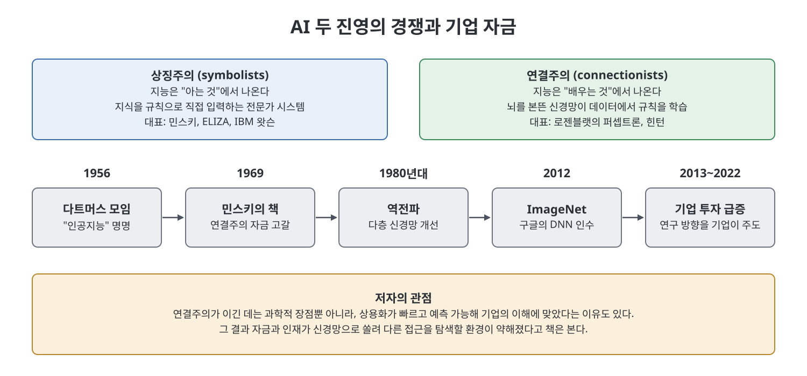

# 4장 근대성의 꿈 (Dreams of Modernity)

1부에서 가장 이론적인 장이다. 저자는 오픈AI 이야기를 잠시 멈추고 AI라는 분야 자체의 역사를 훑으며 하나의 질문을 던진다. 지금의 AI, 즉 거대한 데이터와 컴퓨터로 굴러가는 딥러닝과 생성형 AI는 과학적으로 필연이었을까, 아니면 돈과 권력을 가진 소수가 고른 길이었을까. 저자의 답은 후자 쪽에 가깝다. 이 장은 "AI는 모두를 이롭게 한다"는 약속 뒤에서 누가 이익을 얻고 누가 비용을 치르는지를 묻는다.

> **쉽게 말하면**
> 기술은 저절로 발전하지 않고, "누가 돈을 대는가"에 따라 방향이 정해진다는 것이 이 장의 주장이다.

## 이 장의 흐름

1. 기술 혁명의 역설: 약속은 모두를 위하지만 혜택은 소수에게
2. "인공지능"이라는 이름 자체가 마케팅이었다는 지적
3. 상징주의와 연결주의의 경쟁, 그리고 딥러닝의 승리
4. 딥러닝과 감시 자본주의, 데이터 식민주의
5. 기업이 연구를 장악한 결과와 신경망의 약점
6. 생성형 AI는 이 모든 흐름의 극대화

## 1. 기술 혁명의 역설

저자는 경제학자 대런 아세모글루와 사이먼 존슨의 책 『권력과 진보』를 끌어온다. 이 책에 따르면 기술은 필연이 아니라 추구할 가치가 있다는 집단적 믿음 속에서 발전한다. 그런데 그 믿음을 모을 수 있는 이는 이미 권력과 자원을 가진 사람이므로 기술의 방향도 소수 엘리트의 시각을 따르기 쉽다. 예로 1790년대 조면기(목화솜 분리기)가 든다. 이 기계는 미국 남부의 면화 수출을 키웠지만 노예제를 더 가혹하게 만들었고, 이익을 얻은 쪽은 노예들이 더 행복하다는 식으로 포장했다. 저자는 오늘날 AI에서도 같은 구조가 되풀이된다고 본다. 특히 과거 제국주의의 유산이 남은 글로벌 사우스(Global South) 국가에서 비용이 더 크게 나타난다는 것이다.

## 2. "인공지능"이라는 이름의 마케팅

1956년 다트머스 대학에 모인 과학자 스무 명은 새 분야에 이름이 필요했다. 존 매카시는 처음 "오토마타 연구"라는 말을 쓰다가 관심을 끌지 못하자 "인공지능(artificial intelligence)"이라는 표현을 골랐다. 지능이라는 말은 좋고 바람직하게 들리기 때문에 연구비와 인재를 끌어들이는 효과가 있었다. 저자는 AI 역사가 케이드 메츠의 표현을 인용해 이 작명을 분야의 "원죄"로 소개한다.

문제는 지능의 과학적 합의 정의가 없다는 점이다. 저자는 두개골 크기를 재 우열을 주장한 19세기 사례, 우생학과 연결된 IQ 검사의 기원을 들어 지능 측정의 어두운 역사를 환기한다. 매카시 자신도 지능이 무엇이냐는 질문에 아직 분명한 정의가 없다고 답했다. 그 결과 AI는 사람의 능력을 기준으로 연구를 조직했다. 시각, 언어, 청각, 창작을 각각 흉내 내는 분야가 생겼고, AI가 노동자를 대체하려는 것은 우연이 아니라 설계의 결과라고 저자는 말한다.

이 이름은 의인화도 낳았다. 1958년 프랭크 로젠블랫의 퍼셉트론은 카드 위 네모의 위치를 구분하는 간단한 패턴 인식기였지만, 언론은 걷고 말하고 자의식을 가질 것이라고 보도했다. 오늘날 AI 기업이 소프트웨어가 "배운다", "읽는다"고 표현하는 것은 저작권 소송에서 사람이 영감을 받는 것과 같다는 주장의 근거로도 쓰인다고 책은 지적한다. AI의 목표가 계속 바뀌는 점도 문제다. 튜링 테스트, 체스, 바둑이 차례로 정복되어도 분야는 목표를 달성했다고 보지 않았다. AGI라는 말은 그 새 이름이며, 합의된 정의가 없으니 오픈AI가 원하는 대로 정의될 수 있다는 것이 저자의 지적이다.

## 3. 두 진영: 상징주의와 연결주의

다트머스 이후 두 진영이 갈렸다. **상징주의**는 지능이 지식에서 나온다고 보고 세상의 지식을 규칙으로 기계에 입력하는 전문가 시스템을 추구했다. **연결주의**는 지능이 학습에서 나온다고 보고 뇌를 본뜬 **신경망**으로 기계가 데이터에서 스스로 규칙을 찾게 하려 했다.

연결주의 쪽 대표가 로젠블랫이고, 상징주의 쪽 대표가 MIT의 마빈 민스키였다. 민스키는 1969년 연결주의를 혹독하게 비판한 책 『퍼셉트론』을 공저했고, 이 책은 15년 넘게 이 분야의 연구 자금을 말려 버린 것으로 평가된다. 비슷한 시기 조지프 와이젠바움이 만든 챗봇 **ELIZA**는 사용자의 말을 되받아 질문하는 단순한 규칙 기반 프로그램이었는데, 사람들은 그 안에 이해가 있다고 믿었다. 와이젠바움은 이를 경계하며 사람과 기계의 구분을 흐리면 권력자가 기계 뒤에 숨어 도덕적 책임을 피하게 된다고 경고했다. 그러나 의도와 달리 이 시연은 상징주의를 띄웠다. 규칙을 일일이 입력하는 방식이 한계에 부딪혀 기대가 꺼지고 자금이 끊기는 시기가 반복됐는데, 이를 "AI 겨울"이라 부른다.

그 사이 힌턴 등 연결주의자들은 신경망을 여러 층으로 쌓고 **역전파**라는 알고리즘으로 층 사이 정보를 주고받게 하는 방법을 개발했고, 이를 **딥러닝**이라 불렀다. 당시에는 컴퓨터 성능과 데이터가 부족했으나 2000년대 후반 컴퓨터가 발전하고 인터넷에 데이터가 쌓이면서 기반이 갖춰졌다.

흔한 서사는 좋은 아이디어가 결국 이겼다는 것이다. 저자는 다른 시각을 제시한다. 상징주의 시스템(예: IBM 왓슨)은 상용화가 느리고 비싸고 예측이 어렵다. 반면 신경망은 정확한 추론이 없어도 통계적 패턴 인식만으로 돈이 되는 문제를 풀 수 있고, 투자 회수 경로가 짧고 분기 실적 주기에 맞으며, 데이터가 많은 기업에 유리하다. 구글은 신경망으로 음성 인식, 번역, 검색과 광고를 개선했고 힌턴 팀을 인수했다. 그 뒤 기업이 정부와 재단을 제치고 AI 연구의 최대 자금원이 되었다.

## 4. 감시 자본주의와 데이터 식민주의

딥러닝이 상업화되면서 소비자를 상품으로 삼는 **감시 자본주의**(쇼샤나 주보프의 용어)가 확산되었다. 기업은 이용자의 클릭과 사진, 대화까지 수집해 정밀한 프로파일링에 쓴다. 이 문화는 AI 연구자들이 모든 것을 수집 가능한 "데이터"로 보게 했다. 한 연구에 따르면 컴퓨터 비전 논문들은 사람의 글과 생각을 단순한 "텍스트"로, 감시를 "탐지"로 부르는 식으로 표현을 순화했다.

저자는 자신도 처음에는 이 시각에 물들어 있었다고 고백한다. 동의 없이 플리커 사진으로 얼굴 인식을 훈련했다는 보도를 보고서야 이것이 당연하지 않다는 점을 깨달았다. 학생의 뇌파를 측정하는 헤드밴드를 콜롬비아와 중국의 학교에서 시험한 스타트업, 남아공의 얼굴 인식 감시 카메라 사례도 소개한다. 이런 현상을 학자들은 **데이터 식민주의**라 부른다. 과거 식민지에서 자원을 가져가던 구조가 데이터를 대상으로 되풀이된다는 뜻이다.

## 5. 기업의 연구 장악과 신경망의 한계

스탠퍼드 AI 인덱스에 따르면 AI 분야 기업 투자는 2013년 146억 달러에서 2022년 2,350억 달러로 늘었고, 미국 정부의 비국방 AI 예산은 2021년 15억 달러였다. 인재도 돈을 따라 이동했다. AI 박사의 기업 취업 비율은 2004년 21퍼센트에서 2020년 70퍼센트로 올랐다. 이처럼 자금과 인재가 쏠리면서 딥러닝 외의 방식을 탐색할 환경은 약해졌다.

신경망의 약점은 분명하다. 통계적 패턴 인식기이기 때문에 엉뚱한 패턴에 매달리고, 학습 데이터가 조금만 달라져도 행동이 달라지며, 내부는 사람이 읽을 수 없는 숫자의 연쇄라서 **블랙박스**라고 불린다. 2018년 우버 자율주행차가 보행자를 인식하지 못해 사망 사고를 낸 사례, 테슬라 오토파일럿 관련 사고, 어두운 피부색이나 어린이를 덜 잘 인식하는 연구 결과가 이어서 소개된다. 훈련 데이터의 작은 불균형도 증폭되기 때문이다.

이 약점에 대한 두 입장이 맞선다. 힌턴과 수츠케버는 더 큰 모델과 데이터로 해결된다고 보고, 게리 마커스는 신경망이 인과 관계를 이해하지 못하므로 상징주의와 결합한 **신경 기호(neurosymbolic) AI**가 필요하다고 본다. 저자는 누가 옳은지는 부차적이고 더 큰 문제는 다른 가능성을 탐색할 자금과 환경이 사라진 것이라고 짚는다.

## 6. 생성형 AI는 극대화된 딥러닝

**생성형 AI**는 데이터를 학습해 비슷한 새 글과 이미지를 만드는 딥러닝 모델이다. 저자는 이를 딥러닝의 극대화 버전으로 본다. 감시 자본주의가 모은 데이터, 첫 상업화 시기(2012~2022년)에 다듬은 하드웨어와 소프트웨어, 데이터를 많이 삼키는 것을 도덕적 책무로 여기는 연구 문화 위에서 가능해졌다는 것이다. 또 ELIZA가 그랬듯 대화형 챗봇은 인간 같은 지능이 있다는 인상을 준다. 하지만 약점은 여전하다. 환각(hallucination), 즉 그럴듯하지만 틀린 답을 하는 문제는 확률적으로 다음 단어를 예측하는 방식의 특성이다. 변호사가 ChatGPT가 지어낸 판례를 인용했다 제재받은 사례, 빙(Bing) 챗봇이 이상한 대화를 이어 간 사례, 이미지 생성기가 고정관념을 재생산한다는 보도가 근거로 제시된다.

저자는 오늘의 스케일링(규모 키우기)이 자연 현상이 아니라 선택임을 강조한다. 무어의 법칙도 물리 법칙이 아니라 인텔 공동창업자가 정한 경제적·정치적 목표였고, 오픈AI의 법칙과 스케일링 법칙도 자기실현적 예언이라는 것이다.

## 핵심 개념 표

| 용어 | 쉬운 설명 |
|------|-----------|
| 상징주의 | 규칙과 지식을 사람이 직접 입력해 지능을 만들려는 접근 |
| 연결주의 | 뇌를 본뜬 신경망이 데이터에서 규칙을 학습하게 하는 접근 |
| 딥러닝 | 층을 깊게 쌓은 신경망으로 하는 기계학습 |
| AI 겨울 | 기대가 꺼지고 연구 자금이 끊긴 시기 |
| 감시 자본주의 | 이용자 정보를 수집해 이익을 내는 기업 모델 |
| 데이터 식민주의 | 데이터 수집이 과거 식민지 수탈 구조를 닮는다는 비판 |
| 블랙박스 | 내부 작동을 사람이 설명할 수 없는 모델 |
| 환각 | 그럴듯하지만 사실이 아닌 출력 |

## 핵심 정리

- 저자는 "인공지능"이라는 이름 자체가 마케팅이었고, 지능에 대한 합의 정의가 없어 목표가 계속 이동한다고 본다.
- 딥러닝의 승리는 과학적 장점뿐 아니라 기업의 상업적 이해와 맞았기 때문이기도 하다는 것이 책의 시각이다.
- 기업의 자금과 인재 독점으로 연구 방향이 신경망으로 좁아졌고, 감시와 데이터 수집을 당연시하는 문화가 생겼다.
- 신경망의 약점(불안정, 블랙박스, 편향)은 생성형 AI에서도 이어지며, 규모 확대는 필연이 아닌 선택이다.

 
 

이전: [3장 신경 중추](03%EC%9E%A5%20%EC%8B%A0%EA%B2%BD%20%EC%A4%91%EC%B6%94.md) | 다음: [5장 야망의 규모](05%EC%9E%A5%20%EC%95%BC%EB%A7%9D%EC%9D%98%20%EA%B7%9C%EB%AA%A8.md)

 

[Empire of AI](../)
