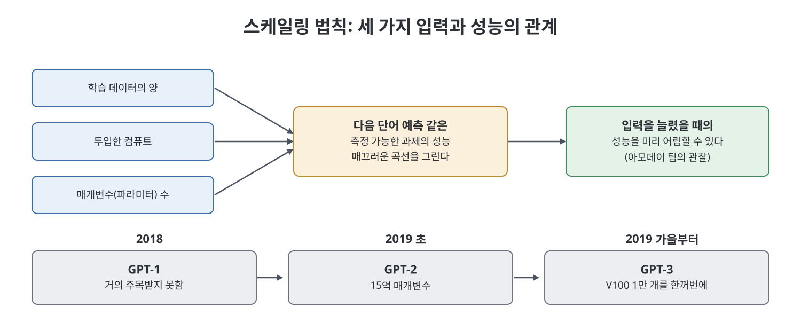
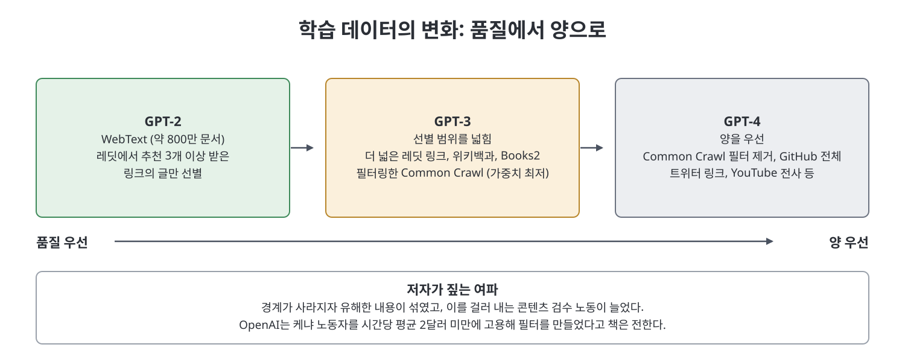

# 5장 야망의 규모 (Scale of Ambition)

1부의 마지막 장이다. 오픈AI가 "더 크게 키운다"는 단순한 믿음으로 GPT 시리즈를 만들어 가는 과정, 그리고 그 믿음이 연구 윤리, 데이터 수집, 노동에 남긴 흔적을 다룬다. 수츠케버의 신념에서 시작해 트랜스포머, GPT-1과 GPT-2, 스케일링 법칙, GPT-2 공개 논란, GPT-3의 거대한 훈련으로 이어진다. 이 장을 읽으면 오늘날 생성형 AI의 기본 공식인 "더 많은 데이터, 더 많은 컴퓨트, 더 큰 모델"이 어떻게 자리 잡았는지 알 수 있다.

> **쉽게 말하면**
> 오픈AI는 새로운 기술을 발명하기보다 이미 있는 모델을 "크게, 더 크게" 키우는 데 모든 것을 걸었고, 그 방식이 데이터와 노동, 환경에 큰 비용을 만들었다.

## 이 장의 흐름

1. 수츠케버의 딥러닝 신념과 스케일링 철학
2. 트랜스포머와 GPT-1, 알렉 래드퍼드의 실험
3. 스케일링 법칙과 GPT-2
4. GPT-2 공개 보류 논란과 단계적 공개
5. 언어 모델을 키우기로 한 결정과 "불가피성" 논리
6. GPT-3 훈련과 데이터 품질 하락, 그리고 그 노동 비용

## 1. 수츠케버의 믿음: 규모를 키우면 된다

수츠케버는 17세 때 약속도 없이 힌턴의 연구실을 찾아가 지금 면담하자고 한 일화로 소개된다. 그의 신념은 신경망의 인공 노드가 뇌의 뉴런을 충분히 닮았다는 가정에 있었다. 동물의 지능이 뇌 크기와 상관있듯, 단순한 신경망도 노드를 늘리면 지능이 생긴다고 보았다. 즉 더 복잡한 구조나 기발한 기법이 아니라 규모가 답이라는 극단적 입장이었다. 오픈AI 연구소장이 된 그는 연구의 방향을 거의 혼자 정할 수 있었고, 딥러닝이 아닌 것은 진지하게 고려되지 않았다고 한 교수는 증언한다.

수츠케버의 화법은 거침없다. 연구 공개를 접은 이유를 묻자 "솔직히 우리가 틀렸다"고 답하기도 했다. 반면 일부 직원은 그가 늘 규모를 키우자는 말만 되풀이한다고 생각했다가 나중에 단일한 초점의 가치를 인정했다. 직원들 사이에서는 그를 예언자처럼 보는 시선도 있었고, 저자는 그가 시간이 갈수록 예언자 같은 태도를 보였다고 묘사한다.

## 2. 트랜스포머와 GPT-1

2017년 8월 구글이 **트랜스포머**라는 새 신경망을 발명했다. 기존 방식이 단어를 바로 옆 단어와의 관계에서만 보았다면, 트랜스포머는 훨씬 긴 문맥 속에서 각 단어를 본다. 구글은 번역과 검색 개선에 쓰려 했지만, 수츠케버는 이것이 단순하고 확장 가능한 구조라는 점에 주목했다. 일부 연구자는 이를 이상한 아이디어로 여겼다.

알렉 래드퍼드가 출판되지 않은 영어 책 7,000여 권으로 트랜스포머를 훈련하며 과제를 번역이 아니라 **다음 단어 예측**으로 바꿨다. 수츠케버는 지능이 곧 압축이라는 생각을 가졌고, 그럴듯한 글을 만들려면 모델이 세상의 정보를 본질로 압축해야 한다고 보았다. 실험 결과 모델은 영어의 뉘앙스와 구조를 더 깊이 배웠다. 2018년 공개된 이 모델이 **GPT-1**(Generative Pre-Trained Transformer)이다. **사전 학습(pre-trained)** 은 범용 데이터로 먼저 훈련해 두고 나중에 특정 과제에 맞게 **미세 조정(fine-tune)** 하는 방식이다. GPT-1은 거의 주목받지 못했지만, 더 키워 볼 근거는 충분했다.

## 3. 스케일링 법칙과 GPT-2

같은 시기 아모데이 팀은 AI 안전 연구로 **인간 피드백 기반 강화학습(RLHF)** 을 시도했다. 가상 막대 로봇이 뒤로 공중제비를 돌게 하려고, 계약자들이 두 영상 중 더 나은 쪽을 고르게 해 약 900번의 비교로 가르쳤다. 이를 언어 모델에도 적용하려 하면서 더 큰 모델이 필요해졌다.

아모데이 팀은 또 하나를 발견했다. 데이터 양, 컴퓨트, 매개변수 수라는 세 입력과 모델 성능 사이의 관계가 매끄러운 곡선으로 그려진다는 것이다. 이를 **스케일링 법칙**이라 부른다. 덕분에 입력을 얼마나 늘리면 다음 단어 예측 같은 과제의 성능이 어느 정도 오를지 상당히 정확히 어림할 수 있었다. 15억 매개변수의 **GPT-2**는 이 곡선 위에서 예상대로 큰 폭으로 나아졌고, 긴 글을 사람 글과 헷갈릴 정도로 이어 갔다. 글쓰기 자동화가 처음으로 규모 있게 가능해진 순간이라고 저자는 쓴다.

그와 함께 어두운 면도 드러났다. 정치적 인물 이름만 주어도 음모론으로 흐르고, 학습 데이터에 섞인 극단적 선전이 불쑥 나오기도 했다. 안전 연구자들은 이를 장차 더 강한 AI가 보일 오작동의 예고로 읽었다.

## 4. GPT-2 공개 논란

아모데이와 정책 책임자 잭 클라크는 내부 설문과 "정보 위험" 회의를 거쳐 GPT-2 전체 공개를 보류하기로 했다. 테러리스트나 독재자, 클릭 장사꾼이 악용할 수 있고, 먼저 선례를 세우는 것이 낫다는 판단이었다. 2019년 2월 클라크는 언론에 이 기술이 위험해서 작은 버전만 공개한다고 널리 알렸다. 이는 전체 매개변수의 8퍼센트 규모였다.

외부 연구자들은 거세게 반발했다. 공개 과학이 분야의 기반인데, 위험하다고 광고하면서 검증은 막았다는 것이다. 단지 강력한 자동 완성일 뿐인데 과장이고 자기 홍보용 쇼라는 비난이 나왔다. 스탠퍼드 강연에서 한 교수는 "그래서 위험합니까?"라고 물어 웃음을 샀고, 래드퍼드는 풀이 죽었다고 한 연구자가 전한다. 내부에서도 이를 두고 늑대가 나타났다고 외친 격이라는 반응이 있었다.

한편 경영진은 이 적대감이 지속 불가능함을 이해했다. 연구 공동체를 소통의 이해관계자로 대하자는 내부 문서가 나왔고, 클라크 팀은 **단계적 공개** 전략을 세웠다. 더 큰 모델을 일정 간격으로 순차 공개하며 일부 기관과 협력해 위험을 점검하는 방식이다. 저자는 이것이 명성 관리의 성격도 있었다고 본다. 이 전략은 연구를 제한적으로 공개하는 것이 책임 있는 방식이라는 논의를 정책 기관과 업계에 퍼뜨렸다고 책은 평가한다.

## 5. 언어 모델을 키운다는 결정

아모데이는 연구를 "투자 포트폴리오"처럼 운영해, 성과가 있는 방향은 이어 가고 아닌 것은 접었다. Dota 2 프로젝트는 소임을 다했다고 보고 팀을 해체했다. 반면 GPT-2는 언어만으로 AGI가 나올 수 있다는 **순수 언어 가설**에 힘을 실었다. 언어는 인간의 주된 소통 수단이니 세상의 지식이 글로 있다는 논리다. 반대로 **접지(grounding) 가설**은 감각과 행동 같은 물리 세계와의 상호작용이 필수라고 본다. 저자는 이 논쟁이 내부 문서에서 장애인을 끌어와 지능의 우열을 가늠하는 불쾌한 방향으로 흐르기도 했다고 전한다.

아모데이는 모델을 최대한 빨리 키우되 바로 공개하지는 않아야 한다고 주장했고 올트먼도 동의했다. 다른 이들이 곧 따라올 것이므로 먼저 앞서 가 확보한 시간 동안 안전성을 다듬는 편이 낫다는 논리였다. 저자는 이 논리가 AGI는 불가피하다는 가정 위에서만 성립하며 오픈AI가 이후 수년간 같은 논리로 행동을 정당화했다고 분석한다. 한 중국 AI 연구자의 분석도 소개된다. 구체적 용도도 없이 10억 달러를 받아 거대한 모델을 만드는 일은 중국에서도, 심지어 구글이나 DeepMind에서도 ChatGPT 이전에는 일어나지 않았다는 것이다. 저자의 결론은 이것이 필연이 아니라 오픈AI라는 특정 조직의 이념, 돈, 올트먼의 추진력이 만든 결과라는 점이다.

## 6. GPT-3: 칩 1만 개와 데이터의 변질

마이크로소프트가 투자의 일부로 엔비디아 V100 GPU 1만 개짜리 슈퍼컴퓨터를 제공하기로 하자, 아모데이는 이를 한꺼번에 쓰고자 했다. 당시 학계는 칩 10개도 사치였고 해외 대학에는 칩 한 개를 여럿이 나눠 쓰는 곳도 있었으니 많은 이가 무모하다고 보았다. 하지만 수츠케버, 브록먼, 올트먼이 각자의 이유로 지지했다. 올트먼은 10억 달러 투자에 걸맞은 결과를 내야 하는 압박을 의식했다. 2019년 가을 아모데이는 "Nest" 팀을 꾸렸다. 이후 아모데이와 올트먼은 GPT-3의 공개 시기를 두고 충돌했고 올트먼이 이겼다고 책은 전한다.

칩이 1만 개가 되면 하나만 멈춰도 전체가 멈출 수 있어 중간에서 정확히 다시 시작하는 기술, 훈련을 칩들에 나누는 샤딩 전략이 필요했다. 데이터도 문제였다. GPT-2는 레딧에서 추천 3개 이상 받은 링크의 글(WebText, 약 800만 문서)만 썼다. GPT-3는 이것으로 부족해 더 넓은 레딧 링크, 위키백과, 내용이 공개된 적 없는 Books2(저자가 취재한 두 사람에 따르면 토렌트로 공유되던 온라인 그림자 도서 저장소 Library Genesis의 출간 도서가 들어 있었다), 마지막으로 품질이 낮은 Common Crawl을 위키백과와 닮은 것만 골라 가중치를 가장 낮게 섞었다. 2023년 작가협회와 작가들이 저작권 침해로 소송을 냈다고 책은 전한다. GPT-4 때는 필터를 풀고 GitHub 전체, 트위터 링크, 유튜브 전사 등 경고가 없는 모든 것을 끌어모았다.

품질 장벽이 사라진 결과가 노동으로 이어졌다. 이전에는 입력을 걸러 출력을 통제했지만, 생성형 AI는 입력이 인류 전체의 글이라서 출력을 통제해야 한다. 그래서 폭력, 성적 학대, 자해 같은 내용을 걸러 내는 콘텐츠 검수와 RLHF 작업이 크게 늘었다. 저자는 오픈AI가 케냐 노동자를 시간당 평균 2달러 미만에 고용해 필터를 만들었고 전 세계 계약자 1,000명 이상이 RLHF를 맡았다고 쓴다. 학자들은 데이터가 커질수록 혐오 콘텐츠도 늘어 편향이 심해진다는 "혐오 스케일링 법칙"을 제시하기도 했다.

## 연도별 정리

| 시기 | 사건 | 의미 |
|------|------|------|
| 2017.8 | 구글, 트랜스포머 발표 | 수츠케버가 확장 가능한 구조로 주목 |
| 2018 | GPT-1 공개 | 다음 단어 예측 학습 검증 |
| 2019.2 | GPT-2 전체 공개 보류 | 정보 위험 논란, 이후 단계적 공개 |
| 2019 가을 | Nest 팀, GPT-3 훈련 착수 | V100 1만 개를 한꺼번에 사용 |
| 이후 | GPT-4 데이터 수집 확대 | 품질보다 양, 검수 노동 증가 |

## 핵심 정리

- 오픈AI의 전략은 새 기법보다 트랜스포머를 키우는 것이었고, 스케일링 법칙이 이를 뒷받침했다.
- GPT-2 보류와 단계적 공개는 안전 논의이자 평판 관리이기도 했고, 개방 규범을 바꾸는 계기가 되었다.
- 스케일링 결정은 AGI가 불가피하다는 가정 위에서 정당화되었으나, 저자는 이것이 특정 조직이 만든 선택이라고 본다.
- GPT-3와 GPT-4로 갈수록 데이터 품질 기준이 낮아졌고, 그 비용은 저임금 검수 노동과 저작권 갈등, 환경 부담으로 이어졌다.

 
 

이전: [4장 근대성의 꿈](04%EC%9E%A5%20%EA%B7%BC%EB%8C%80%EC%84%B1%EC%9D%98%20%EA%BF%88.md) | 다음: [핵심 정리](%ED%95%B5%EC%8B%AC%20%EC%A0%95%EB%A6%AC.md)

 

[Empire of AI](../)
