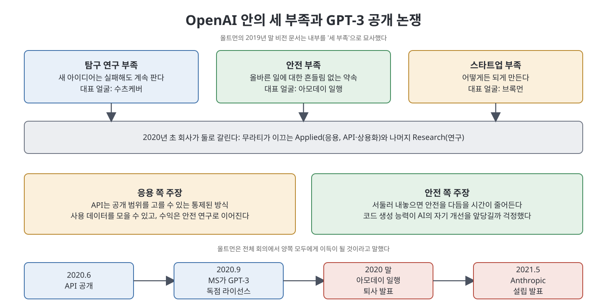
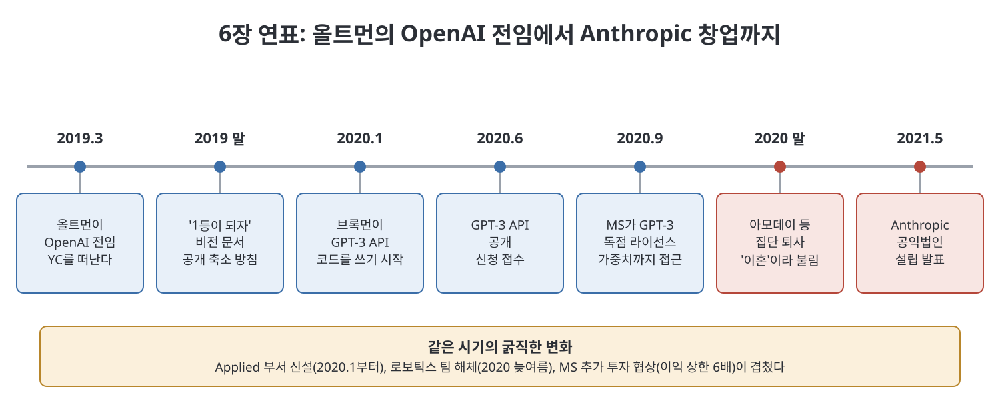

# 6장 승천 (Ascension)

6장은 샘 올트먼이 Y Combinator(YC)를 떠나 OpenAI에 전념하기 시작한 2019년부터 Anthropic이 세워지는 2021년까지를 다룬다. 올트먼은 OpenAI를 "여러 선두 기관 중 하나"가 아니라 "유일한 선두"로 만들려 했고, 그 목표가 회사 안의 균열을 키웠다는 것이 저자 카렌 하오의 서술이다. 이 장의 중심 사건은 GPT-3를 API로 내놓을지를 둘러싼 내부 갈등과, 그 결과로 다리오 아모데이 일행이 회사를 떠나 Anthropic을 만든 일이다.

> **이 장을 한 문장으로**
> 가장 빨리, 가장 크게 만들자는 올트먼의 전략이 회사를 상용화로 이끌었고, 이에 반대한 안전 연구자들은 결국 회사를 떠나 경쟁사를 세웠다.

---

## 이 장의 흐름

1. 올트먼의 'YC 방식'이 OpenAI로 옮겨 오다: 승자독식과 10배 규칙
2. 2019년 말 비전 문서: 1등, 마이크로소프트, 비공개 쪽으로의 전환
3. 안팎의 불안: 오타 사고, 보안 강화, 편집증에 가까운 분위기
4. 세 부족과 응용(Applied) 부서의 탄생
5. GPT-3 API 공개 논쟁과 그 성공
6. 안전 쪽의 패배와 'The Divorce', Anthropic의 출범

---

## 1. 올트먼의 YC 방식이 OpenAI로 오다

책에 따르면 올트먼은 새 CEO가 성공하려면 회사를 "다시 세워야" 한다고 믿었고, YC 대표가 되었을 때 그렇게 했다. 신규 펀드를 만들고, 핵융합·양자컴퓨팅·자율주행 같은 어려운 기술 분야로 영역을 넓혀 YC가 다루는 회사를 수백 곳에서 한 해 수천 곳으로 키웠다.

2019년 3월 OpenAI에 전념하게 되면서 그는 같은 사고방식을 들고 왔다. 핵심은 **승자독식** 관점과 **'10배'라는 숫자**다. 스타트업은 경쟁 제품보다 10배 나은 기술로 시장에 들어가야 하고, 세대마다 10배씩 좋아져야 하며, 개선 주기가 경쟁자보다 빨라야 한다는 것이다. 이 생각은 피터 틸의 독점 전략에서 나왔다고 책은 설명한다.

> **쉽게 말하면**: 동네 식당 한 곳이 되려는 것이 아니라, 업계에서 단 하나 남는 가게가 되겠다는 계획이다.

## 2. 2019년 말 비전 문서

올트먼은 2019년 말 회사 전체에 장기 구상을 담은 문서를 보냈다. 책이 소개하는 요지는 다음과 같다.

- 2020년 말까지 **기술 성과, 컴퓨트, 자금, 대비 태세** 네 분야에서 1등이 되어야 한다. 컴퓨트(compute)는 AI를 학습시키는 데 쓰는 계산 자원, 곧 연산용 칩과 전력을 뜻한다.
- 그중 기술 성과가 가장 중요하다. 속도를 늦출 수는 있지만 다른 곳이 빨리 가는 이상 영향력을 가지려면 빨리 가야 한다는 논리였다.
- 마이크로소프트(MS)를 끝까지 주된 파트너로 유지해야 한다. 이를 위해 자유로운 학술 연구 분위기에서 벗어나 상용화에 집중해야 한다. 문서에는 연구를 더 하려면 돈을 더 벌어야 한다는 취지의 문장이 있다.
- 투명성은 줄여야 한다. 논문과 모델 공개를 제한하고 보안을 강화하며, 일반 AI보다 좁은 기술의 성과만 보여 주자는 제안이다.
- 그러면서도 세상이 "우리가 이기고 있다"고 믿게 해야 하므로 매년 인상적인 시연을 하나씩 내놓자고 했다.

올트먼은 사무실 벽에 적혀 있던 해군 제독 리코버의 글도 문서에 인용했다. 개인이 세상의 운명이 자기에게 달린 것처럼 행동해야 한다는 취지다. 그 아래에 그는 사명을 개인의 선호보다 앞세우자고 적었다.

## 3. 안팎의 불안과 편집증

책은 이 무렵 회사 분위기를 이렇게 그린다. 이미 브록먼과 아모데이 남매 사이에 불화가 쌓이고 있었다. 도타 2 프로젝트의 우선순위를 낮춘 일, GPT-3 개발을 위해 컴퓨트를 한 팀으로 모은 일이 브록먼의 불만을 샀다. 아모데이 쪽은 브록먼이 함께 일하기 어렵다고 느껴 자신들의 언어 모델 작업에 끼워 주지 않았다. 갈등은 각자를 따르는 사람들로 번졌다.

또한 아모데이의 안전 팀은 올트먼이 MS에 약속한 기술 접근 범위가 자신들이 이해하던 것과 다르다는 사실을 알고 충격을 받았다. 훗날 안전 문제가 생겨도 그 약속 때문에 모델 배포를 막기 어려울 수 있다고 걱정했고, 올트먼의 정직성에 의심을 품기 시작했다고 책은 전한다.

회사에는 걱정 거리도 많았다.

- **오타 사고**: 2019년 GPT-2 후속 모델에 사람 피드백 기반 강화학습(RLHF)을 시험하던 중, 연구자가 코드에서 마이너스 부호를 플러스로 잘못 바꿨다. 학습이 거꾸로 돌아 모델이 모든 입력에 노골적인 음란 문장을 이어 붙였다. 고친 연구자는 코드 주석에 "효용 최소화 기계는 만들지 말자"는 뜻의 문장을 남겼다. 우스운 일이었지만 안전 연구자들에게는 AI가 엉뚱한 방향으로 갈 수 있다는 경고로 읽혔다. (RLHF는 사람이 모델의 답에 점수를 매겨 모델을 원하는 방향으로 다듬는 방법이다.)
- **'쌀알에 쓸 수 있는 비밀'**: 직원들은 OpenAI의 비결을 "규모(scale)"라는 한 단어로 요약할 수 있다고 농담했다. 비결이 이렇게 단순하다면 남들이 따라 하는 것도 시간문제라는 불안이 따랐다.
- **보안 집착**: 책은 아모데이가 전략 문서를 인터넷과 분리된 컴퓨터(에어갭)로 쓰고 종이로만 돌린 일, 올트먼이 머스크의 도청을 의심해 사무실 감사를 몰래 의뢰한 일, 모델 **가중치**(학습 결과를 담은 핵심 파일)를 지키려는 논의를 소개한다. 수츠케버가 지하 격납고 구상을 냈으나 실현되지 않았고, 일부 문에는 위급 상황용 위급 상황용 비밀번호가 설치되었다. 기관총에 견디는 서버실 견적을 받아 본 일은 곧 접었다.

경영진은 미국의 적대국이 먼저 AGI(사람 수준의 범용 인공지능)를 만들면 곤란하다는 논리를 앞세워 "덜 공개하고 더 빨리" 가는 것을 정당화했다고 책은 서술한다. 비미국 직원 중에는 왜 꼭 미국 조직이어야 하느냐고 되묻는 사람도 있었다.

## 4. 세 부족, 그리고 응용 부서

올트먼은 비전 문서에서 회사 안에 (희화적으로 말해) 세 부족이 있다고 썼다.

| 부족 | 가치 | 직원들이 읽은 대표 인물 |
|------|------|------------------------|
| 탐구 연구(Exploratory Research) | 실패해도 새 아이디어를 판다 | 수츠케버 |
| 안전(Safety) | 옳은 일에 대한 흔들림 없는 약속 | 아모데이와 안전 팀 |
| 스타트업(Startup) | 어떻게든 해낸다 | 브록먼 |

올트먼은 누구도 이름을 대지는 않았지만 직원들은 행간을 읽었다. 곧 팬데믹으로 모두 원격 근무를 하면서 부족들은 더 쉽게 서로 고립되었다.

한편 아모데이 팀은 GPT-2 때처럼 점점 큰 모델을 단계적으로 학습시켜 1만 개 규모의 GPU에서 1,750억 개 파라미터 모델에 도달했다. 작은 모델부터 ada, babbage, curie, davinci라는 과학자 이름을 붙였다. (파라미터는 모델 안에서 학습으로 조정되는 숫자의 수로, 모델 크기의 척도다.)

그 사이 올트먼과 브록먼은 상용화를 준비했다. 2020년 1월 브록먼이 GPT-3용 **API**의 첫 코드를 쓰기 시작했다. API는 외부 개발자가 모델의 기능을 호출해 쓰되 모델 자체(가중치)는 가져가지 못하게 하는 접점이다. 회사는 미라 무라티가 이끄는 **Applied(응용)** 부서와 나머지 **Research(연구)** 부서로 나뉘었다.

## 5. GPT-3 API 논쟁과 그 성공

응용 부서는 API가 공개 대상을 고르고 사용 데이터를 모을 수 있는 가장 통제된 출시 방식이라고 보았다. 안전 쪽은 서둘러 내놓으면, 빠르게 확장한 이유였던 '안전을 다듬을 시간'이 사라진다고 반박했다. 코드 생성 능력 때문에 논쟁은 더 뜨거워졌다. 연구 쪽은 반겼지만 안전 쪽 일부는 AI가 자기 코드를 고쳐 스스로 강해질 수 있다고 우려했다. 수츠케버·자렘바 팀과 아모데이 팀이 각자 코드 생성 모델을 따로 만들어 직원들이 "왕좌의 게임" 같다고 느낄 정도였다.

올트먼은 전체 회의에서 양쪽에게 각자 원하는 결과를 줄 수 있다고 말했다고 책은 전한다. 결정적인 계기는 구글이 곧 비슷한 모델을 낼지 모른다는 소문이었다. 그래서 2020년 6월 API가 공개되고 대기 신청 양식이 열렸다. 구글의 모델은 나오지 않았고(구글은 LaMDA를 ChatGPT 이후에 내놓았다), 저자는 경쟁을 과대평가해 기술을 서둘러 내놓은 결정이 이번이 마지막은 아니었다고 쓴다.

GPT-3의 반응은 폭발적이었다. 에세이, 대본, 코드를 모두 쓸 수 있었고, 몇 가지 예시만 보여 줘도 새 작업을 해냈다. 연구 논문은 NeurIPS에서 상을 받았고, OpenAI는 인재 영입과 연봉 경쟁에서도 힘을 얻었다. 홍보·정부 업무를 맡을 스티브 다울링을 영입했고 이후 안나 마카누도 합류한다.

## 6. 안전의 패배와 'The Divorce'

그러나 안전 쪽과 응용 쪽의 마찰은 이어졌다. API 판에는 콘텐츠 필터도 RLHF도 없었고, 안전 쪽은 이를 먼저 고치자고 했다. 회의는 맴돌았고, 응용 쪽의 웰린더는 이 상황이 1944년 미 정보기관의 '조직 방해 요령' 문서와 같다고 비꼬았다. 슬랙과 구글 문서마다 논쟁이 번졌다.

그 사이 MS는 관계를 더 깊게 하려 했다. 올트먼은 20억 달러 규모의 추가 투자를 이익 상한 6배 조건으로 협상하기 시작했고, 로보틱스 팀은 2020년 늦여름에 해체되었으며, 9월에는 MS가 GPT-3를 독점 라이선스했다. MS는 모델 가중치에도 접근해 자사 제품과 Azure용 API에 쓸 수 있게 되었다.

아모데이 남매와 잭 클라크 등은 슬랙에서 조용해졌다. 책은 이들이 개별적으로 이사회 구성원에게 올트먼에 대한 우려를 전했다고 쓴다. 올트먼이 결정을 기정사실로 만들고, 반대자들이 의견을 낼 수 있다고 믿게 해 두었다가 되돌리기 어려운 때에 이르러서야 알렸다는 주장이다. 아모데이 남매는 이를 "가스라이팅", "심리적 학대"라고 표현했다고 한다.

이들은 따로 회사를 세우자는 결론에 이르렀다. 스케일링 법칙 때문에 최전선 모델의 학습 비용은 계속 오를 테니 떠나려면 서둘러야 한다는 판단이었다. 2020년 말 전체 회의에서 다리오가 준비된 성명을 읽고 퇴사를 알렸고, 2021년 5월 공익법인 **Anthropic**이 공개되었다. 사내에서 이 일은 'The Divorce(이혼)'라 불렸다.

저자는 이 결별이 안전 문제만이 아니라 **권력과 통제**의 문제이기도 했다고 평가한다. 또 시간이 갈수록 Anthropic이 규모 경쟁, 비밀주의, 협력 수사 속의 경쟁이라는 점에서 OpenAI와 본질적으로 다르지 않았다고 쓴다. 이는 저자의 판단이다.

---

## 연표

| 시기 | 사건 |
|------|------|
| 2019년 3월 | 올트먼이 OpenAI에 전임, YC를 떠남 |
| 2019년 | 오타로 RLHF가 거꾸로 돌아간 사고 |
| 2019년 말 | 올트먼의 비전 문서(1등, MS, 비공개 방향) |
| 2020년 1월 | 브록먼이 GPT-3 API 코드 작성 시작, Applied 부서 신설 |
| 2020년 6월 | GPT-3 API 공개 발표 |
| 2020년 늦여름 | 로보틱스 팀 해체 |
| 2020년 9월 | MS가 GPT-3 독점 라이선스 |
| 2020년 말 | 아모데이 일행 퇴사 발표 |
| 2021년 5월 | Anthropic 공익법인 공개 |

## 주요 인물

| 인물 | 이 장에서의 역할 |
|------|----------------|
| 샘 올트먼 | OpenAI CEO. 1등과 상용화를 밀어붙임 |
| 그레그 브록먼 | 공동창업자. API 개발과 상용화 쪽 |
| 일리야 수츠케버 | 수석 과학자. 탐구 연구 쪽으로 읽힘 |
| 다리오·다니엘라 아모데이 | 안전 쪽 리더 남매. GPT-3 개발 주도 후 퇴사, Anthropic 창업 |
| 미라 무라티 | 신설 Applied 부서 책임자 |
| 잭 클라크, 재러드 캐플런 | 아모데이와 함께 떠난 핵심 인물 |

---

## 핵심 정리

- 올트먼은 YC에서 쓰던 **승자독식과 10배 규칙**을 OpenAI에 그대로 적용해 1등을 목표로 삼았다.
- 2019년 말 비전 문서는 MS와의 협력, 상용화, **공개 축소**를 방향으로 제시했다.
- 이 시기 회사는 **세 부족**으로 갈라졌고, 보안 집착과 불신이 커졌다.
- **GPT-3 API**의 공개는 응용과 안전의 대립 끝에 구글에 대한 경쟁 불안으로 결정되었고, 큰 성공을 거뒀다.
- 그 성공이 MS와의 관계를 깊게 했고, 밀려난 아모데이 일행이 **Anthropic**을 세웠다.

 
 
 

[이전: 5장 야망의 규모](../01.%201%EB%B6%80/05%EC%9E%A5%20%EC%95%BC%EB%A7%9D%EC%9D%98%20%EA%B7%9C%EB%AA%A8.md) | [다음: 7장 갇힌 과학](07%EC%9E%A5%20%EA%B0%87%ED%9E%8C%20%EA%B3%BC%ED%95%99.md)
