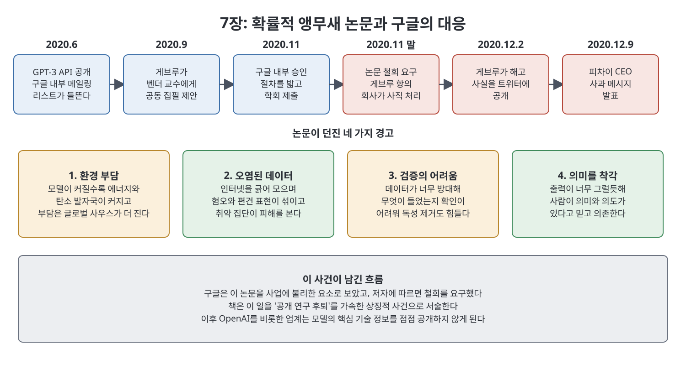

# 7장 갇힌 과학 (Science in Captivity)

GPT-3 API는 업계 전체가 거대 언어 모델 경쟁에 뛰어들게 만든 신호탄이었다. 7장은 이 흐름을 구글, 딥마인드, 메타, 중국 기업의 반응으로 먼저 훑은 뒤, 거대 모델이 낳는 환경 비용과 사회적 해악을 경고한 연구자 팀닛 게브루가 2020년 말 구글에서 쫓겨난 사건을 길게 다룬다. 저자는 이 사건을 계기로 기업이 연구를 통제하기 시작했고, 그 결과 과학이 자본의 울타리 안에 '갇히게' 되었다고 본다.

> **이 장을 한 문장으로**
> 모델이 커질수록 연구를 공개하는 일이 불편해졌고, 구글은 불편한 논문을 막았으며, 업계는 그 뒤로 핵심 기술 정보를 감추는 쪽으로 굳어졌다.

---

## 이 장의 흐름

1. GPT-3가 구글, 딥마인드, 메타, 중국 기업에 던진 파장
2. 거대 모델의 환경 비용: 스트루벨의 연구와 GPT-3 수치
3. 팀닛 게브루와 AI 속 다양성 운동
4. GPT-3에 대한 경고와 '확률적 앵무새' 논문의 탄생
5. 구글의 철회 요구와 게브루의 해고
6. 파장, 제프 딘의 반박, 그리고 투명성의 후퇴

---

## 1. 업계의 반응: 느렸지만 방향은 정해졌다

GPT-3 API가 나온 직후의 관심은 2년 뒤 ChatGPT가 일으킨 광풍에 비하면 미지근했다고 책은 평가한다. 하지만 불씨는 이때 놓였다.

- **구글**: 자신들이 발명한 트랜스포머(Transformer, 현재 대형 언어 모델의 기반이 되는 신경망 구조)로 OpenAI가 앞서자 충격을 받았다. 연구 책임자 제프 딘이 흩어진 컴퓨트를 모아 하나의 거대 모델을 학습시키자고 제안했지만, 경영진은 ChatGPT가 '코드 레드'를 일으킨 뒤에야 움직였다. 딘은 기회를 놓쳤다고 불평했다. 이후 딥마인드와 구글 브레인이 하나의 '구글 딥마인드'로 합쳐져 Gemini로 이어진다.
- **딥마인드**: OpenAI 안전 팀 출신 제프리 어빙이 규모를 키우는 접근의 이점을 주장한 메모를 들고 합류했고, GPT-3가 그 방향으로 자원을 더 쏟게 했다.
- **메타(당시 페이스북)**: 연구자들이 자원을 요청했지만 경영진은 관심이 없었다. 수석 AI 과학자 얀 르쿤은 순수한 규모 확대 방식이 곧 한계를 드러낼 것이라 보며 OpenAI의 방식을 싫어했다. 저자에 따르면 ChatGPT 이후 저커버그는 이 흐름을 외면한 것을 깊이 후회하게 된다.
- **중국**: 알리바바, 화웨이, 바이두도 큰 관심을 보였지만 이를 연구 목록에 더할 새 항목으로 다뤘을 뿐, 다른 프로젝트를 접지는 않았다.

## 2. 거대 모델의 환경 비용

이 장에서 저자는 모델이 커지는 추세가 이미 일부 연구자들을 경계하게 만들었다고 짚는다. 2019년 6월 매사추세츠대 박사과정생 에마 스트루벨이 낸 논문이 대표적이다.

- 구글이 검색에 쓰는 트랜스포머를 **한 번** 학습시키는 데 약 1,500킬로와트시가 든다. 미국 평균 전력 구성으로 환산하면 뉴욕-샌프란시스코 왕복 비행 한 번에 가까운 탄소 배출이다.
- 그런데 AI 개발은 한 번으로 끝나지 않는다. 최적의 모델을 얻으려고 학습을 수없이 되풀이한다. 스트루벨의 이전 프로젝트에서는 6개월간 4,789번 학습했다.
- 구글이 '신경망 구조 탐색(NAS, 시행착오로 가장 좋은 구조를 찾는 알고리즘)'으로 Evolved Transformer를 만드는 전체 과정은 GPU 기준으로 약 65만 6천 킬로와트시, 자동차 다섯 대의 수명 배출량에 해당한다고 추정했다.

GPT-3는 이 수치를 넘어섰다. 책에 따르면 아이오와에 있는 슈퍼컴퓨터로 수개월 학습하며 1,287메가와트시를 썼고, 배출량은 스트루벨이 추정한 Evolved Transformer의 두 배였다. 다만 이 수치는 거의 1년 뒤에야 알려졌다. 당시 OpenAI가 공개한 숫자는 1,750억 개 파라미터라는 모델 크기뿐이었다.

> **쉽게 말하면**: 예전에는 노트북으로도 돌리던 AI 학습이 이제는 발전소 규모의 전기를 쓰는 일이 되었다.

## 3. 팀닛 게브루와 AI 속 다양성

게브루는 에티오피아 출신 연구자로, 2018년부터 구글에서 윤리 AI 팀을 공동으로 이끌었다. 그는 흑인 연구자 모임인 Black in AI를 공동 창립해 학회 때마다 포럼과 멘토링을 열었다. 책은 이 모임이 Queer in AI, Latinx in AI 같은 다른 소수자 모임으로 이어졌다고 소개한다.

그가 공동 저자인 연구 'Gender Shades'(조이 불라무이니 주도)는 얼굴 분석 소프트웨어가 피부색이 어두운 여성에게서 특히 크게 실패한다는 것을 보여 주었다. 책에 따르면 이후 시민권 운동이 이어졌고, 아마존·마이크로소프트·IBM이 경찰에 대한 얼굴 인식 판매를 중단했는데 이는 GPT-3 API 공개와 같은 달이었다.

제프 딘과 사미 벤지오가 구글 입사를 권했고 게브루는 망설임 끝에 2018년 합류했다. 공동 팀장인 마거릿 미첼과 함께 업계에서 보기 드물게 다양하고 학제적인 팀을 만들었다. 대외적으로는 구글이 AI의 사회적 영향을 진지하게 다룬다는 이미지에 기여했지만, 내부에서는 계속 힘든 싸움이었다고 책은 쓴다.

## 4. GPT-3에 대한 경고와 '확률적 앵무새'

GPT-3 API 공개 직후 구글 내부 메일링 리스트는 들떠 있었다. 게브루는 언어 모델이 편견을 퍼뜨릴 수 있다는 선행 연구를 들어 흥분을 가라앉히자고 했지만 반응이 거의 없었다. OpenAI도 논문에서 GPT-3가 성별, 인종, 종교 편견을 담고 있다고 인정하고 대책은 미래 연구 과제로 남겼다. 게브루는 Reddit이 섞인 Common Crawl로 학습한 모델이 그곳의 혐오를 증폭할 것이라고 두 번째 메일로 경고했다. 책은 이후 API 사용자들이 모델의 끔찍한 출력 사례를 온라인에 올렸다고 쓴다.

그는 딘의 동의를 얻어 연구를 제안했고, 2020년 9월 워싱턴대 언어학자 에밀리 벤더에게 접촉했다. 벤더는 OpenAI에 학습 데이터 문서화를 제안했다가 프로그램 취지와 맞지 않는다며 거절당한 경험이 있었다. 두 사람은 곧 논문을 함께 쓰기로 했다. 제목은 "확률적 앵무새의 위험: 언어 모델이 너무 커질 수 있는가"였다.

논문의 네 가지 경고는 다음과 같다.

| 경고 | 내용 |
|------|------|
| 환경 | 모델이 클수록 에너지·탄소 부담이 커지고, 그 부담은 글로벌 사우스에 더 무겁게 떨어진다 |
| 데이터 | 닥치는 대로 긁어 모은 데이터가 혐오와 편견 표현을 포함하고 취약 집단을 해칠 수 있다 |
| 검증 | 데이터가 방대해 내용을 감사하기 어렵고 독성을 제거하기도 어렵다 |
| 의미 착각 | 출력이 그럴듯해서 사람들이 의미와 의도가 있다고 믿고 조언자나 친구로 여길 수 있다 |

## 5. 철회 요구와 해고

게브루는 2020년 11월 구글의 통상 절차에 따라 학회 제출 승인을 구했고 매니저 벤지오가 승인했다. 그러나 책에 따르면 경영진은 이 초안을 사업상 부담으로 보았다. 구글은 트랜스포머로 모든 제품을 돌리고 있었고, OpenAI에 추월당한 지금 더 큰 모델 경쟁을 늦출 생각이 없었다.

추수감사절 일주일 전 목요일, 게브루는 사유를 모른 채 메건 카촐리아 부사장과의 화상 면담에 불려가 논문을 철회하라는 말을 들었다. 누가 어떤 문제를 제기했는지, 일부 수정은 가능한지, 다른 소속으로 내면 되는지 물었지만 모두 거절당했다. 저자는 이것이 구글이 연구를 다뤄 온 방식에서 크게 벗어난 일이라고 썼다. 또한 GPT-2 이후 OpenAI가 연구를 숨기는 것을 정당화한 선례, GPT-3 논문이 학습 방법을 거의 밝히지 않고도 상을 받은 사실이 구글이 그렇게 할 수 있게 만든 배경이라는 연구자들의 평을 전한다.

게브루는 추수감사절에 6쪽 분량의 반박문을 썼다. 이후 카촐리아가 반박을 외면한 채 철회나 구글 저자 삭제를 요구하자, 그는 자신의 이름을 빼는 조건으로 피드백을 준 사람의 공개와 더 투명한 검토 절차를 요구했다. 받아들여지지 않으면 인수인계 후 떠나겠다고도 했다. 동시에 구글 브레인 여성 메일링 리스트에 거친 어조로 경험을 적었다. 12월 초 카촐리아는 이 요구를 수용할 수 없고 "사직을 존중한다"며, 그 메일이 관리자에게 기대되는 태도와 맞지 않는다는 이유로 즉시 사직을 수리한다고 알렸다. 게브루는 그날 밤 해고되었다고 트위터에 올렸다.

## 6. 파장, 그리고 투명성의 후퇴

저자 카렌 하오는 이 소식을 접한 뒤 벤더에게서 초안을 받아 MIT 테크놀로지 리뷰에 논문 내용을 처음으로 자세히 보도했다고 직접 밝힌다. 항의 서한 서명자는 약 7,000명으로 늘었고 구글 직원 약 2,700명이 포함되었다. 12월 9일 순다르 피차이 CEO가 사과 메시지를 냈고, 의회 쪽도 구글에 질의서를 보냈다. 석 달이 채 되기 전에 미첼도 해고되었고 벤지오를 포함한 몇 사람이 사임했다.

책은 이 사건을 빅 AI가 '빅 토바코'처럼 비판적 연구를 왜곡하고 검열하는 방향으로 가는 징후로 읽는다. 독립적 검증이 어려울 만큼 인재·자원·기술이 영리 기업에 집중된 점, 권력을 쥔 곳의 다양성 부족, 내부 고발자에 대한 보호 부재도 함께 드러났다고 본다.

제프 딘은 이 일로 명성에 타격을 입었다. 책에 따르면 그는 논문이 "출판 기준에 미달했다"고 했고, 특히 스트루벨의 환경 추정이 구글의 실제 배출을 과대평가했다고 오래 반박했다. 구글은 TPU라는 효율적인 자체 칩과 최적화된 데이터센터를 썼다는 것이다. 저자는 이 반박이 스트루벨의 연구를 실제로 뒤집지는 못했다고 본다. 스트루벨은 구글의 실제 배출을 계산한 것이 아니라 일반 칩과 평균 데이터센터를 가정한 추정이었고, 구글이 내부 수치를 공개한 적도 없었기 때문이다. 이후 딘 팀이 쓴 논문에서 스트루벨은 이름이 이용당한다는 의구심과 압박감을 느끼고 공동 작업에서 빠졌고, 2022년 2월 구글 블로그는 스트루벨 추정이 88배 과대평가였다고 주장했다. 이 과정에서 구글 쪽이 수츠케버에게 GPT-3 정보를 문의했고, 그 결과 OpenAI와 마이크로소프트가 처음으로 환경 영향 계산에 필요한 기술 정보를 내놓았다.

그 뒤 구글은 비판적 연구에 대한 더 엄격한 검토 절차를 두었고, ChatGPT 이후 업계 전반이 상업적 가치가 있는 모델의 기술 정보를 영업 비밀로 걸어 잠갔다. OpenAI도 학회 발표를 거의 중단했다. 2023년 스탠퍼드 연구진의 투명성 지표는 평가한 열 개 기업(OpenAI, 구글, Anthropic 포함) 모두에게 F를 주었고 최고점은 54퍼센트였다.

저자는 가장 우려되는 결과로 **과학적 무결성의 침식**을 든다. 딥러닝 연구는 학습용 데이터와 시험용 데이터를 분리한다는 전제 위에 서 있다. 학습 데이터를 감사할 수 없으면 이 전제가 무너지고, 모델의 점수가 오른 것이 지능이 좋아져서인지 정답을 외워서인지 알 수 없다.

---

## 연표

| 시기 | 사건 |
|------|------|
| 2019년 6월 | 스트루벨, 대형 모델의 에너지·탄소 비용 논문 |
| 2020년 6월 | GPT-3 API 공개, 구글 내부 열광 |
| 2020년 9월 | 게브루가 벤더에게 공동 집필을 제안 |
| 2020년 11월 | 논문 승인 후 구글 경영진이 철회 요구 |
| 2020년 12월 2일 | 게브루가 해고되었다고 트위터에 알림 |
| 2020년 12월 9일 | 피차이 CEO 사과 |
| 2022년 2월 | 구글 블로그가 스트루벨 추정을 반박 |
| 2023년 | 스탠퍼드 투명성 지표, 평가 기업 전원 F |

## 주요 인물

| 인물 | 이 장에서의 역할 |
|------|----------------|
| 팀닛 게브루 | 구글 윤리 AI 팀 공동 리더, 논문 공저자, 해고됨 |
| 에밀리 벤더 | 워싱턴대 언어학 교수, 논문 공저자 |
| 마거릿 미첼 | 윤리 AI 팀 공동 리더, 이후 해고 |
| 제프 딘 | 구글 리서치 책임자, 논문과 환경 추정에 반박 |
| 에마 스트루벨 | 대형 모델 탄소 비용 논문의 저자 |
| 메건 카촐리아 | 구글 리서치 부사장, 철회를 요구 |

---

## 핵심 정리

- GPT-3는 구글, 딥마인드, 메타, 중국 기업의 대형 모델 경쟁을 서서히 자극했다.
- 스트루벨의 연구는 모델이 커질수록 **에너지와 탄소 비용**이 커진다는 점을 처음 수치로 보였다.
- 게브루와 벤더의 '확률적 앵무새' 논문은 **환경, 데이터, 검증, 의미 착각**의 네 가지 위험을 경고했다.
- 구글은 논문 철회를 요구했고 게브루는 해고되었다. 책은 이를 기업이 비판적 연구를 통제하는 전환점으로 본다.
- 이후 업계는 모델 정보를 **비공개**로 돌렸고, 저자는 이것이 과학의 검증 기반을 흔든다고 경고한다.

 
 
 

[이전: 6장 승천](06%EC%9E%A5%20%EC%8A%B9%EC%B2%9C.md) | [다음: 8장 상업의 새벽](08%EC%9E%A5%20%EC%83%81%EC%97%85%EC%9D%98%20%EC%83%88%EB%B2%BD.md)
