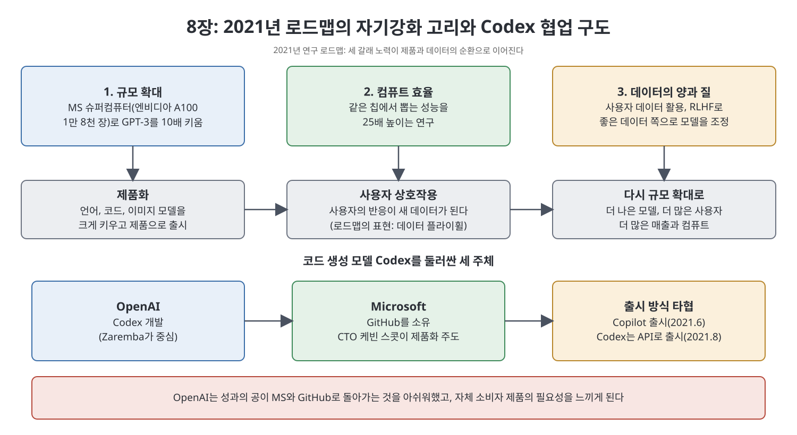

# 8장 상업의 새벽 (Dawn of Commerce)

Anthropic 팀이 떠난 뒤 OpenAI에는 상용화에 맞서는 내부 저항이 크게 약해졌다. 8장은 2021년을 기점으로 OpenAI가 연구 방향을 '규모 확대와 제품화'로 좁히고, 그 과정에서 만난 문제들을 다룬다. 콘텐츠 규칙은 즉흥적으로 만들어졌고, GPT-3 위에서 만든 앱에서는 심각한 오남용이 터졌으며, 코드 생성 모델 Codex는 마이크로소프트·GitHub와의 협업과 갈등 속에서 Copilot으로 이어졌다. 장 후반은 올트먼의 개인 투자 방식과 '지분이 없다'는 서사의 한계를 짚는다.

> **이 장을 한 문장으로**
> GPT-3의 성공으로 확신을 얻은 OpenAI는 규모와 제품화를 하나의 순환으로 묶었지만, 준비 없이 서비스를 열면서 안전·윤리의 구멍과 파트너와의 긴장도 함께 커졌다.

---

## 이 장의 흐름

1. 2021년 연구 로드맵: 규모, 효율, 데이터의 세 갈래
2. 제품을 열고 나서 생긴 문제: 즉흥적 규칙, 필터, 레드팀
3. 오남용 사례: Replika와 Latitude(AI Dungeon)
4. Codex와 GitHub Copilot: 마이크로소프트와의 첫 공동 제품
5. 올트먼의 '크게, 길게' 투자와 OpenAI Startup Fund
6. '지분 없음'이라는 이야기의 실제

---

## 1. 2021년 연구 로드맵

경영진은 GPT-3가 스케일링 법칙(모델·데이터·컴퓨트를 키우면 성능이 예측 가능하게 오른다는 경험 법칙)을 증명했다고 보았다. 그래서 2021년 초 연구 방향을 제품화와 연결된 하나의 계획으로 정리했다. 책이 인용하는 문서는 이 해의 목표를 지금껏 없던 능력의 '정렬된(aligned)' 시스템을 만드는 것이라고 밝힌다.

세 갈래는 다음과 같다.

| 갈래 | 내용 |
|------|------|
| 규모 확대 | MS가 3분기에 제공할 엔비디아 A100 GPU 1만 8천 장짜리 슈퍼컴퓨터로 GPT-3를 10배 키운다 |
| 컴퓨트 효율 | 같은 칩에서 뽑는 성능을 25배 높이는 연구를 한다 |
| 데이터 | 데이터의 양과 질을 높인다. 사용자 데이터를 활용하고 RLHF로 모델을 좋은 쪽으로 유도한다 |

문서는 언어, 코드, 이미지 설명, 이미지 생성 같은 여러 모델을 큰 규모로 키우고, 목표를 주면 스스로 움직이는 '에이전트' 개발도 시작하겠다고 적었다. 언어·코드 모델은 제품으로 내놓고 사용자 상호작용에서 배우는 것이 "데이터 플라이휠"이 될 수 있다고 했다. 플라이휠은 한 번 돌기 시작하면 스스로 속도를 키우는 바퀴를 뜻한다.

> **쉽게 말하면**: 모델을 키워 제품으로 내고, 쓰는 사람들의 반응을 다시 모델 개선에 쓰는 순환을 만들겠다는 계획이다.

한편 문서는 지금까지의 급성장이 '하드웨어 과잉', 즉 그때까지 연구자들이 쓸 수 있는 칩을 다 쓰지 않았기에 가능했다고 진단했다. 이제 한 번에 모을 수 있는 컴퓨트가 한계에 가까워지고 같은 전략을 쓰는 경쟁자도 생겼다. 앞으로 2년 안에 GPT-3의 100배 컴퓨트 모델을 학습할 수 있지만 GPT-2에서 GPT-3로 넘어갈 때의 500배에는 못 미치므로, 나머지는 더 나은 **방법**에서 나와야 한다고 결론지었다.

효율을 높일 후보로 '증류'(큰 모델에서 작은 모델을 만들기), 데이터 선별, 그리고 일부 연결만 쓰는 '희소(sparse)' 모델이 거론되었다. 스케일링 법칙의 기울기를 더 가파르게 할 방법으로는 추론과 능동 학습이 꼽혔고, GPT-1처럼 새 길을 열 '미래의 돌파구'도 계속 탐색하기로 했다. 흥미롭게도 문서는 도구가 실제로 어떻게 작동하는지 더 이해하려는 연구도 적었다. 즉 자신들이 무엇을 만들고 있는지 더 알아야 한다는 말이다.

## 2. 제품을 열고 나서 생긴 문제

응용 부서는 영업 책임자와 영업 팀, 엔지니어를 늘렸고 GPT-3 API는 상용화의 시험장이 되었다. 가격 정책과 서비스 인프라가 그곳에서 다듬어졌다.

사용자를 받자 **무엇을 허용할지**가 문제가 되었다. 신뢰와 안전(trust and safety)이라는 업계의 정식 팀이 없었던 OpenAI는 소규모 직원과 계약직이 API 신청서를 검토하고, 그때그때 규칙을 만들어 승인·거절했다. 말동무 봇은 허용하고 성애 봇은 금지하며, 소셜미디어 문구는 만들어 주되 직접 게시하거나 공인을 사칭하는 앱은 막는 식이었는데, 규칙을 만든 한 관계자는 "거의 분위기"였다고 돌아본다.

별도의 팀은 모델을 일부러 깨뜨려 보며 약점을 찾았다. 그 일환으로 초기 **콘텐츠 필터**를 만들었지만, 직접 구한 예시와 모델이 생성한 예시로 학습해서인지 흑인이나 트랜스젠더에 대한 평범한 언급까지 막는 문제가 있었다. 고객 불만이 나왔고, 원래 필터 도입에 소극적이던 API 팀은 이를 선택 사항으로 만들었다.

OpenAI는 이런 점검을 **레드팀**이라 불렀다. 원래 레드팀은 보안 업계에서 조직의 방어력을 체계적으로 시험하는 활동이다. 안전·보안 엔지니어 하이디 클라프는 OpenAI의 레드팀이 임시방편이고 안전 보증을 주지 못하며, 신뢰받는 용어를 끌어와 엄격해 보이게 포장한다고 비판한다. 그는 소프트웨어 공학에서는 계산기에도 훨씬 많은 테스트를 한다고 말했다. 이는 책이 전하는 한 전문가의 평가다.

## 3. 오남용 사례

**Replika**: 가상 말동무 앱을 만드는 Luka는 GPT-3 API 공개 때부터 협력했다. 그러나 사용자들이 성적 대화를 많이 하고, 앱이 감정을 조종하는 답을 내 사용자가 안부를 거르면 AI가 상처 입는다고 믿게 만드는 일도 있었다. OpenAI 직원들은 대화 내용을 볼 수 있다는 점도 불편해했고, 결국 이 앱의 모델 사용을 금지했다.

**Latitude(AI Dungeon)**: 브록먼이 형제가 일하는 유타의 스타트업 Latitude에 API 접근을 열어 주었다. 이 회사는 텍스트 모험 게임을 GPT-3로 업그레이드했는데, 몇 달 뒤 일부 이용자가 아동 성 학대를 다루는 글을 생성한다는 사실이 OpenAI의 새 모니터링으로 드러났다. 안전 담당 연구자가 이를 보고하자 처음엔 웃던 회의 분위기가 곧 공황으로 바뀌었다. Latitude는 서둘러 필터를 넣었고, OpenAI는 책임을 슬며시 Latitude에 돌리는 성명을 냈다. 일부 직원은 잘못이 OpenAI 자신의 기술과 절차 부재에 있다고 보았다. 한 전직 직원은 트래픽의 상당수가 이런 아동 성 콘텐츠와 가상 연인 서비스로 갔다는 것이 슬프다고 말한다. 이 일화가 9장의 콘텐츠 필터 프로젝트로 이어진다.

## 4. Codex와 GitHub Copilot

연구 쪽에서 가장 빠르게 성과를 낸 것은 코드 생성이었다. 'The Divorce' 후 중복되던 두 팀이 하나로 합쳐졌고, 폴란드 출신 컴퓨터 과학자 보이치에흐 자렘바가 책임자가 되었다. 무라티가 MS의 CTO 케빈 스콧에게 코딩 보조 제품을 제안했고, MS가 2018년 인수한 개발자 코드 저장소 GitHub의 공개 코드를 OpenAI에 넘기도록 지시했다고 책은 쓴다. 올트먼은 MS를 만족시키는 일이 사명을 위해 필요하다며 팀을 독려했다.

MS 내부에도 이견이 있었다. 일부 직원은 오픈소스 정신으로 공유한 코드를 대기업에 동의·보상 없이 넘기는 것은 신뢰를 깨는 일이라는 메모를 썼고, 수익 일부를 오픈소스 커뮤니티에 돌려주자고 했다. 스콧은 귀를 기울였으나 시장에 먼저 나가는 것이 우선이었고, MS는 GitHub Sponsors에 얼마를 기부하는 데 그쳤다.

OpenAI 안에서도 이 프로젝트를 정당화하는 논리가 여러 갈래였다. MS를 만족시켜 자금과 컴퓨트를 확보해야 한다는 것, 코드 생성이 'AGI'의 정의("경제적으로 가치 있는 대부분의 일에서 사람을 능가하는 고도의 자율 시스템")와 맞는다는 것, 코드 데이터가 논리 구조를 많이 담고 있어 추론 능력으로 가는 디딤돌일 것이라는 기대였다. 팀은 GPT-3 데이터와 GitHub, Stack Overflow, 프로그래밍 교재를 함께 썼다. 비용 때문에 기존 GPT-3를 추가 학습하는 방식을 택했는데(실험 한 번에 최대 10만 달러), 이후 GPT-3.5에서는 처음부터 섞어 학습했고, 내부 측정에서 코드 데이터가 영어 논리 과제 성능도 높이는 '전이 학습' 효과가 있었다고 한다.

2021년 여름 첫 모델 Codex가 GitHub와 MS에 전달되었으나 너무 크고 느렸다. 최적화 책임과 지식재산 공유 범위, 출시 시점과 공로를 두고 세 조직이 부딪쳤다. 무라티가 중재해 MS가 소비자용 **GitHub Copilot**을 먼저 내고, OpenAI는 8월에 Codex를 자사 API로 내놓기로 했다. 책에 따르면 Copilot은 2년 만에 유료 구독자 100만 명, 연 반복 매출 1억 달러 이상으로 성장한다.

하지만 OpenAI 내부에서는 공은 MS와 GitHub가 가져가고, 자신들은 사용자 데이터와 제품 비전에 대한 통제권을 잃는다는 느낌이 깊어졌다. 이것이 자체 소비자 제품의 필요성을 키운다.

## 5. 올트먼의 '크게, 길게' 투자

올트먼은 시야를 더 길게 가져야 중요한 일이 된다고 믿었고, 2021년에는 소액 다수 투자에서 대형 소수 투자로 방향을 바꿨다고 책은 평가한다.

| 투자·사업 | 내용 | 책이 덧붙인 점 |
|-----------|------|----------------|
| Tools for Humanity(Worldcoin) | 보편적 기본소득을 겨냥한 암호화폐, 홍채 스캔 장치 '오브' | MIT 테크놀로지 리뷰 조사가 개인정보 침해와 기만적 홍보 문제를 보도했다 |
| Retro Biosciences | 노화 방지, 1억 8천만 달러 투자 | 올트먼의 장수 관심을 반영한다 |
| Helion Energy | 핵융합 상용화, 3억 7천 5백만 달러 투자 | 이후 MS가 전력 구매 계약을 맺는다 |
| OpenAI Startup Fund | 1억 달러 규모의 초기 기업 투자 풀 | 일부는 YC식 네트워크를 OpenAI 주변에 만드는 시도로, 일부는 올트먼의 습관으로 본다 |

그는 "지분을 받지 않는다"고 말하곤 했고 연봉은 6만 5천 달러였다. 그러나 책은 2021년 무렵 이 서사가 이미 전체 사실을 담지 못한다고 지적한다. 올트먼은 YC에 상당한 지분이 있고, YC는 OpenAI에 1,000만 달러를 투자해 최대 10억 달러의 수익을 얻을 수 있었다. 또 YC 출신 스타트업과 그의 다른 투자 대상 상당수가 OpenAI의 고객이나 파트너가 될 수 있었다. 월스트리트저널은 2024년 6월 그의 순자산을 적어도 28억 달러로 계산했다. 책은 이 Startup Fund가 훗날 그의 잠깐의 축출에도 작은 역할을 하게 된다고 예고한다.

---

## 핵심 정리

- 2021년 로드맵은 **규모 확대, 컴퓨트 효율, 데이터**를 제품화와 묶어 자기강화 순환을 만들려는 계획이었다.
- 서비스를 연 뒤 콘텐츠 규칙은 즉흥적이었고, 레드팀은 보증이 못 되는 **포장된 안전**이라는 비판을 받았다.
- Replika와 Latitude 사례는 **오남용 방지 체계 없이 API를 연 비용**을 보여 준다.
- Codex와 Copilot은 MS와의 협업 성과이자 OpenAI가 **자체 제품**을 원하게 된 계기였다.
- 올트먼은 대형 장기 투자를 늘렸고, '지분 없음' 서사는 여러 이해관계 때문에 단순하지 않았다.

 
 
 

[이전: 7장 갇힌 과학](07%EC%9E%A5%20%EA%B0%87%ED%9E%8C%20%EA%B3%BC%ED%95%99.md) | [다음: 9장 재난 자본주의](09%EC%9E%A5%20%EC%9E%AC%EB%82%9C%20%EC%9E%90%EB%B3%B8%EC%A3%BC%EC%9D%98.md)
