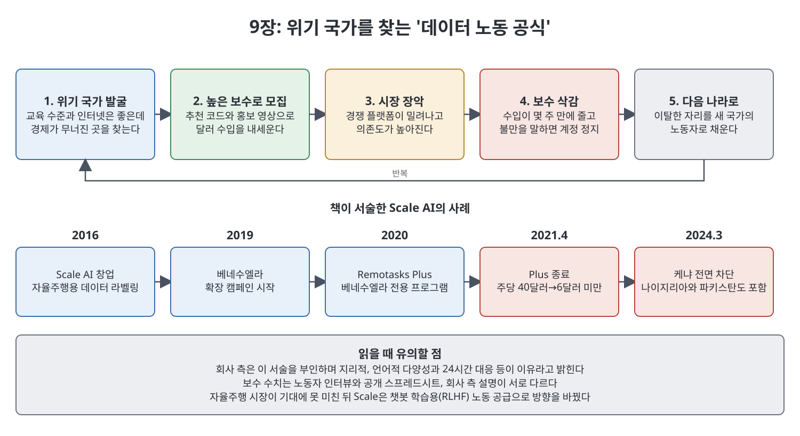
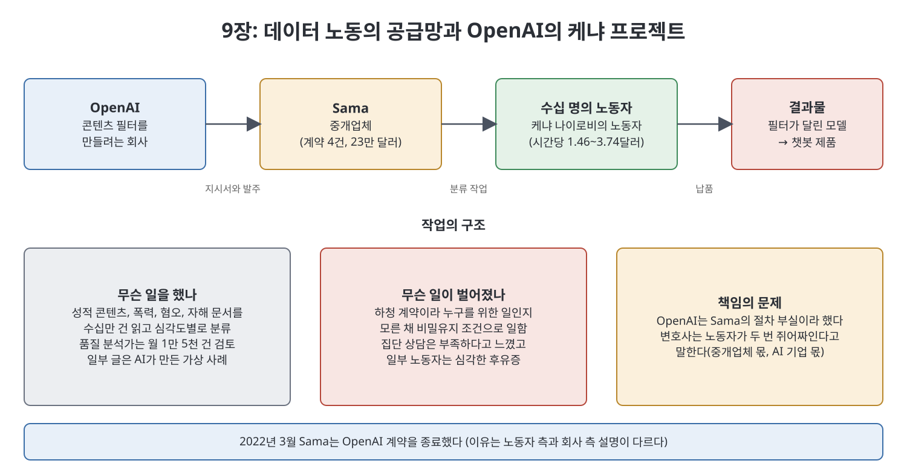

# 9장 재난 자본주의 (Disaster Capitalism)

9장은 이 책에서 가장 무거운 장 가운데 하나다. 생성형 AI가 깨끗해 보이는 답을 내놓기까지 얼마나 많은 사람의 노동이 숨어 있는지, 그리고 그 노동이 어떤 조건에서 조달되는지를 추적한다. 중심에는 OpenAI가 콘텐츠 필터를 만들려고 케냐 노동자들에게 맡긴 작업이 있다. 저자는 이를 한 번의 불행한 사고가 아니라, AI 산업이 경제 위기에 빠진 사람들을 값싼 노동력으로 삼는 구조의 일부로 해석한다.

> **이 장을 한 문장으로**
> 모델을 크게 키우기 위해 오염된 데이터를 쓸어 담은 대가를, 저임금 노동자들이 유해한 글을 대신 읽고 분류하는 방식으로 치르고 있다.

---

## 이 장의 흐름

1. 2021년 콘텐츠 필터 프로젝트와 하청업체 Sama
2. 왜 케냐인가: 식민지 유산과 '값싼 노동' 시장
3. 데이터 라벨링 산업의 뿌리: 유령 노동, MTurk, 자율주행
4. 베네수엘라의 위기와 노동자 오스카리나 푸엔테스의 삶
5. Scale AI와 '위기 국가 공식'
6. 모팟 오키니의 이야기
7. RLHF 노동: InstructGPT에서 ChatGPT까지
8. 케냐 차단과 케냐 노동자 위니의 사례

---

## 1. 콘텐츠 필터와 Sama

GPT-3는 필터 없이 API로 나갔다가 8장의 Latitude 사태를 겪었다. 그래서 2021년 OpenAI는 모델 출력에서 성, 폭력, 학대 같은 내용을 걸러 내는 자동 필터를 새로 만들기로 했다. 이 필터는 모델을 감싸 위험한 출력이 사용자에게 가기 전에 표시하고 지우는 역할을 한다. 책은 이후 ChatGPT도 같은 필터의 혜택을 본다고 쓴다.

필터를 만들려면 해로운 글 수십만 건을 사람이 읽고 분류해 줘야 했다. 6개월을 찾은 끝에 OpenAI는 메타의 콘텐츠 검토를 2019년부터 맡아 온 아웃소싱 기업 **Sama**(올트먼의 별명과 같은 이름이다)를 골랐고, 총 23만 달러에 계약 4건을 맺었다. 일은 케냐의 노동자 수십 명에게 갔다.

## 2. 왜 케냐인가

저자는 케냐가 가난하고 글로벌 사우스에 있으며 외국 투자를 갈망하는 정부를 가졌다는 공통분모를 가진, 실리콘밸리가 가장 힘든 일을 맡겨 온 나라 중 하나라고 설명한다. 식민지 유산으로 시민을 착취로부터 지킬 제도가 약하고 경제 위기가 잦아, 무슨 조건이든 일감을 받는 노동력을 찾기 쉽다는 것이다. 수도 나이로비는 유리 고층 빌딩과 외곽의 슬럼가가 뚜렷이 갈린 곳으로 묘사된다.

Sama는 원래 Samasource라는 샌프란시스코의 사회적 기업으로, 가난한 나라 사람들에게 존엄한 일자리를 준다는 사명으로 2008년에 출발해 윤리적 아웃소싱 기업으로 평판을 얻었다. 설립자 레일라 자나는 2020년 1월 37세에 세상을 떠났고 팬데믹이 겹치면서, 노동자들 말로는 경영이 흐트러졌다(회사 측 대변인은 부인). 2022년 초 타임지 빌리 페리고 기자가 Sama의 메타 콘텐츠 검토 프로젝트가 노동자에게 큰 정신적 상처를 입혔다고 폭로했고, 약 200명이 소송을 냈다.

## 3. 데이터 라벨링 산업의 뿌리

데이터 라벨링(annotation)은 AI가 배울 자료에 사람이 정답표를 붙이는 일이다. 메리 그레이와 시다르트 수리의 책 『Ghost Work』(2019)는 실리콘밸리 뒤에 값싼 조각 노동이 있음을 보였다. 자율주행차가 차선, 신호, 보행자를 알아보게 하려면 사람이 영상 속 사물을 한 프레임씩 따라 그리고 '자전거', '사람' 같은 이름표를 붙인다. 회사 입장에서는 싸게 해낼수록 좋다.

이 일의 초기 중개인은 아마존의 Mechanical Turk(MTurk)였다. 누구나 일감을 올리고 가격을 정하는 범용 사이트다. 그런데 자율주행 데이터는 한 장의 실수가 생사를 가를 수 있어 훈련과 상세한 지침이 필요했고, Scale AI, Hive, Appen 같은 전문 플랫폼이 부상했다.

## 4. 베네수엘라와 푸엔테스

이 무렵 엉뚱하게도 베네수엘라에서 가입자가 몰려왔다. 2016년부터 초인플레이션과 실업이 덮치고 제재로 경제가 무너진 이 나라에서 수십만 명이 온라인 일감으로 몰렸고, 일부 외주업체 인력의 75퍼센트를 차지하기도 했다. 연구자는 이를 "기막힌 우연"이라 불렀지만, 저자는 여기서 불길한 공식을 읽는다. 교육 수준이 높고 인터넷이 되며 어떤 임금이라도 받겠다는 절박한 인구가 있으면 값싼 노동이 마르지 않는다는 것이다.

저자는 2021년 12월 콜롬비아에서 베네수엘라 난민 오스카리나 푸엔테스를 만났다. 그는 석사 과정 중 Appen 계정을 만들었고, 고국이 무너지자 콜롬비아로 이주했다. 콜센터 일을 하다 쓰러져 중증 당뇨 진단을 받았고, 출퇴근이 어려워져 다시 Appen에 접속했다. 일감은 선착순이라 대기열에 머무는 시간이 며칠에서 몇 시간, 몇 초로 줄었고, 한 번 놓친 일감이 한 달 생활비였던 적도 있었다. 그는 주중에는 집을 못 떠나고 밤에도 알림 소리에 맞춰 잤다. 플랫폼 규칙은 불투명해서 VPN 사용은 계정 폐쇄로, 너무 빠른 제출은 무보수로 이어졌고, 노동자들은 서로 확장 프로그램을 만들어 공유했다. 푸엔테스가 바란 것은 정규직 계약, 상담할 관리자, 고정 급여, 건강보험이라는 소박한 안정이었다. 옥스퍼드 인터넷 연구소의 Fairwork 프로젝트가 제시하는 기준(생활임금, 정규 근무, 병가, 명확한 계약, 의견 전달과 노조 결성 자유)과 비슷하다. 저자는 문제는 일 자체보다 일의 구조라는 점이 희망이라고 쓴다.

## 5. Scale AI와 위기 국가 공식

2016년 당시 19세의 MIT 중퇴생 알렉산드르 왕이 공동 창업한 **Scale AI**는 '가장 싼 값에 최고 인력'을 목표로 삼았다. 책에 따르면 MTurk의 인력이 미국·인도에 몰린 것과 달리 케냐와 필리핀부터 찾았고, 베네수엘라에서 가입이 몰리자 이를 최우선 모집 대상으로 삼았다. 2019년 추천 코드와 달러 뭉치 영상으로 확장 캠페인을 열고, 이듬해 'Remotasks Plus'를 열어 일정한 시급과 성장 기회를 약속했다. 경쟁사는 밀려났다.

저자와 현지 기자가 공개된 스프레드시트와 디스코드를 살핀 결과, 주당 40달러로 시작한 노동자들의 수입이 몇 주 만에 6달러 미만이나 0으로 떨어졌다고 한다. 2021년 4월 프로그램은 종료되었다. 회사 내부 설명은 시급제 검증이 어려워 부정 청구가 의심되어 중단했다는 것이고, 대변인은 베네수엘라인의 평균 시급이 90센트 남짓이라고 답했다. 질문을 많이 하다 계정이 잘린 노동자는 회사가 "사용자를 짜낸 뒤 버리고 새 사용자를 데려오는" 방식이라 느꼈다고 말한다. 회사 측은 가난한 지역을 겨냥했다는 서술을 부인한다.

Scale은 이후 팬데믹으로 무너진 다른 경제권에서도 비슷한 절차를 반복했다고 책은 쓴다. 높은 보수로 끌어들이고 자리를 잡으면 낮추는 식이며, 북아프리카의 한 노동자 그룹은 몇 달 만에 보수가 3분의 1 넘게 깎였다. 임금을 지키는 CloudFactory 같은 회사는 고용 계약을 주지만 계약을 Scale에 많이 뺏겼고, Sama도 이런 경쟁 압력 속에서 기준이 흔들렸다고 노동자들은 말한다.

## 6. 모팟 오키니

케냐 빅토리아 호수의 섬 출신 모팟 오키니는 2019년 Sama에 들어가 처음 2년은 자율주행 등 컴퓨터 비전 라벨링을 했다. 2021년 11월 '회복탄력성 검사'를 통과해 새 팀으로 옮기고서야 이 일이 OpenAI용 필터 프로젝트이고 글이 훨씬 심각하다는 것을 알았다. 그는 성적 콘텐츠 팀의 품질 분석가로 월 1만 5천 건을 검토했다. 글에는 인터넷 어두운 곳에서 긁어 온 것뿐 아니라 OpenAI 연구자들이 언어 모델에 지시해 만든 가상의 끔찍한 사례도 있었다. 글은 점점 길어졌고 동료들은 무너졌다. 집단 상담은 부족했고, 약한 모습을 보이면 대체될까 두려워했다고 책은 쓴다. Sama 대변인은 노동자 누구도 상담 접근에 문제를 제기하지 않았다고 말한다.

오키니는 잠과 관계가 무너졌다. 2022년 3월 Sama는 OpenAI와의 계약을 종료했다(노동자들은 타임지 보도의 여파로 보았고, 회사는 OpenAI가 범위를 벗어난 이미지를 보냈기 때문이라 설명했다). 이후 그의 파트너는 그를 떠났고, 동생 앨버트가 합류해 곁을 지켰다. ChatGPT가 나오자 프리랜서 작가인 앨버트의 일감이 줄었다. 오키니는 ChatGPT를 안전하게 만드는 데 참여한 것이 자랑스럽지만 대가가 합당했는지 스스로 묻는다고 말했다.

OpenAI는 책임을 Sama의 부실한 절차에 돌렸다. 저자는 노동자 경험이 시공간을 넘어 일관된 점을 근거로 이것이 구조적이라고 본다. 외주는 AI 기업이 가장 지저분한 일을 자기 눈앞에서 치우고 책임에서 멀어지는 방식이라는 것이다. 케냐 노동자를 대리한 변호사 머시 무테미는 노동자가 중개업체 이윤과 AI 기업 이윤을 위해 두 번 쥐어짜인다고 말한다.

## 7. RLHF 노동

OpenAI는 Sama 외에도 1,000명이 넘는 계약직을 RLHF에 썼고 이를 위해 Scale AI에 크게 의존했다. 올트먼과 Scale의 CEO 알렉산드르 왕은 개인적으로 가까웠다. RLHF의 흐름은 이렇다. 노동자가 좋은 답을 직접 쓰고, 모델을 미세 조정한 뒤 여러 답을 좋은 순으로 순위 매긴다. 이렇게 만든 2022년 1월의 **InstructGPT**는 "6살에게 달 착륙을 설명하라"는 요청에 GPT-3처럼 엉뚱한 변주를 되풀이하지 않고 알아듣는 답을 냈다. 안전 연구자들이 RLHF가 제품성을 높인다는 점을 입증한 셈이다.

이 기법은 이메일 쓰기, 시, 요약, 수학까지 모든 과제로 확장되었고, 지침서는 수십 쪽이었다. 존 슐먼은 2023년 4월 강연에서 신경망은 본질적으로 확률로 동작해서 RLHF로도 환각(그럴듯한 거짓 답)을 근본적으로 없앨 수 없다고 말했다. 슐먼은 이어 대화형 모델 개발을 이끌었고 그것이 ChatGPT의 기반이 되었다. 답을 쓰고 순위를 매기는 일은 이제 자율주행의 영상 따라 그리기 같은 AI 산업의 표준 노동이 되었고 Scale의 기업가치는 2024년 140억 달러로 뛰었다.

## 8. 케냐 차단과 위니의 사례

2022년 말부터 RLHF 프로젝트가 Remotasks로 몰렸고 영어를 쓰는 케냐가 다시 대상이 되었다. 이번엔 사무실 없이 원격으로 운영해 노동자 간 연대가 더 어려워졌다. 나이로비에서 저자가 만난 위니는 성소수자임을 이웃에게 숨긴 채 동반자 밀리센트, 여러 아이들과 가난하게 살았고, 챗봇 프로젝트로 하루 식비를 벌었다. 그러나 일은 두어 달 뒤 끊겼고 빚이 쌓였다.

2024년 3월 Scale은 케냐 전체를 Remotasks에서 막았고 나이지리아, 파키스탄도 포함했다. 이유는 부정 행위 우려였다. 책은 그 '부정' 중 상당수가 ChatGPT로 답을 만들어 생산성을 높이는 노동자였다는 아이러니를 지적한다. 또한 업계는 의사, 프로그래머, 박사 같은 고학력자를 찾기 시작했고 Scale은 미국에서 시급 최대 40달러를 주는 새 플랫폼 Outlier로 옮겼다. 위니에게 온 이메일은 "현재 지역의 운영을 중단한다"는 차가운 문장뿐이었다.

저자는 이를 AI 제국의 논리로 일반화한다. 생산성 향상과 경제적 자유라는 약속의 이면에서 가장 취약한 사람이 손해를 보고, 그 노동의 평가절하는 결국 다른 모든 사람의 노동을 평가절하할 전조라는 것이다.

---

## 주요 인물과 조직

| 이름 | 이 장에서의 역할 |
|------|----------------|
| Sama | 케냐에서 OpenAI 필터 프로젝트를 맡은 하청업체 |
| 모팟 오키니 | Sama 소속 품질 분석가, 성적 콘텐츠 팀 |
| Scale AI(알렉산드르 왕) | 데이터 라벨링과 RLHF 인력 플랫폼. OpenAI의 주요 노동 공급처 |
| 오스카리나 푸엔테스 | Appen에서 일한 베네수엘라 난민 |
| 위니 | Remotasks의 케냐 노동자 |
| 머시 무테미 | 케냐 노동자를 대리한 변호사 |
| 존 슐먼 | OpenAI 공동 창업 멤버, RLHF와 대화형 모델 담당 |

---

## 핵심 정리

- OpenAI의 콘텐츠 필터는 케냐 노동자들이 유해 텍스트를 시간당 약 1.46~3.74달러에 분류해서 만들어졌다.
- 데이터 노동의 저임금 구조는 베네수엘라 위기에서 굳은 **'위기 국가 공식'**과 맞물린다.
- Scale AI는 높은 보수로 모집한 뒤 낮추는 방식을 되풀이했다고 책은 서술한다(회사 측은 부인).
- **RLHF**는 사람이 쓰고 순위를 매기는 노동으로 유지되며, 환각을 없애지는 못한다.
- 저자는 이를 AI 제국이 노동을 평가절하하는 구조적 문제로 보며, 그 영향이 다른 직업군으로 번질 수 있다고 경고한다.

 
 
 

[이전: 8장 상업의 새벽](08%EC%9E%A5%20%EC%83%81%EC%97%85%EC%9D%98%20%EC%83%88%EB%B2%BD.md) | [다음: 핵심 정리](%ED%95%B5%EC%8B%AC%20%EC%A0%95%EB%A6%AC.md)
