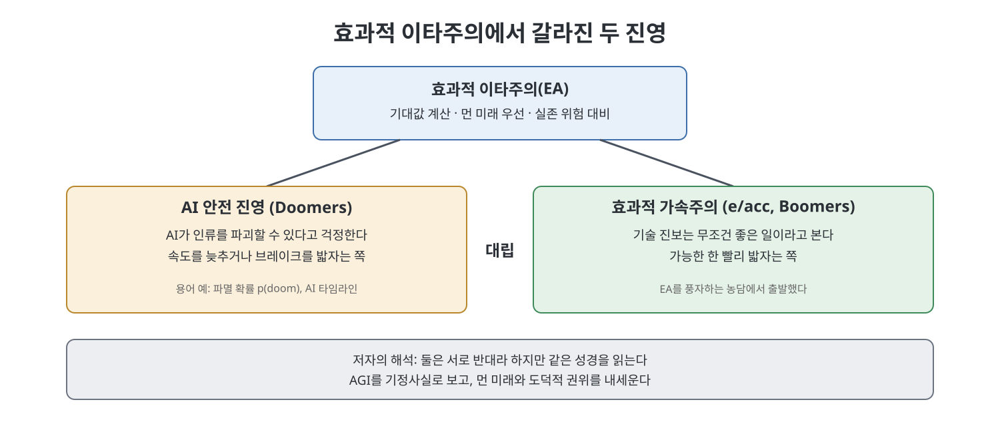
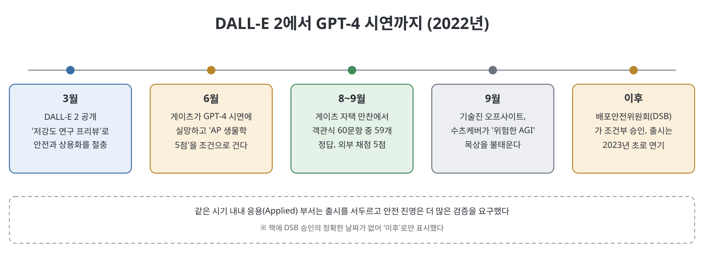

# 10장. 신과 악마 (Gods and Demons)

10장은 2022년을 전후한 OpenAI 내부의 사상 대립과 제품 출시 갈등을 다룬다. 저자는 먼저 효과적 이타주의(EA)가 실리콘밸리에 퍼진 경위를 설명하고, 이 사상이 AI를 "인류를 멸망시킬 수 있는 위험"으로 보는 안전 진영과 "무조건 빨리 가자"는 가속 진영으로 갈라지는 과정을 보여 준다. 이어서 이미지 생성 모델 DALL-E 2의 출시, 데이터가 바닥나던 GPT-4 개발, 빌 게이츠를 설득한 시연을 따라가며 안전과 상용화가 매번 부딪히는 모습을 그린다. 장의 끝에서는 수츠케버가 AGI를 불태우는 의식을 치른다.

> **이 장을 한 문장으로**
> OpenAI 안에서는 '세상을 구할 것인가, 세상을 먼저 장악할 것인가'를 두고 같은 성경을 다르게 읽는 두 무리가 매 제품마다 부딪혔다.

---

## 이 장의 흐름

1. 샌프란시스코의 빈부 격차와 기술 업계의 거창한 말 (저자의 시선)
2. 효과적 이타주의(EA)가 퍼진 과정과 Doomers 대 Boomers 구도
3. DALL-E 2: 이미지 생성 모델과 데이터 오염, 안전 대 응용의 충돌
4. GPT-4: 데이터 고갈, 유튜브 수집, 빌 게이츠 시연
5. 출시 연기, 배포안전위원회, 신뢰안전팀의 고군분투
6. "AGI를 느껴라": 지능에 대한 믿음과 의심, 수츠케버의 의식

---

## 1. 모순을 안고 사는 도시

저자는 자신이 샌프란시스코에서 일하던 경험으로 장을 연다. 무료 점심이 넘치고 야근하면 택시비를 대 주는 회사 앞에서, 길가에는 약에 취한 사람과 노숙인이 있었다는 것이다. 기술 업계는 세상을 바꾼다고 말하면서 문 앞의 문제는 못 본 척한다. 저자는 올트먼 역시 이런 모순 가까이까지 갔다가 인정하지는 않는다고 본다. 올트먼은 AGI를 안전하게 만드는 일은 가능하다고 하면서 샌프란시스코의 주택난은 너무 어렵다고 말한다는 것이다.

이 도입부는 장의 주제를 미리 보여 준다. 먼 미래의 거대한 이야기와 눈앞의 현실 사이의 간극이 이 장 전체를 관통한다.

## 2. 효과적 이타주의(EA)와 두 진영

**효과적 이타주의(Effective Altruism, EA)** 는 영국에서 건너와 실리콘밸리에서 가장 충성스러운 청중을 만났다. 저자는 이 사상이 "세상을 더 낫게 만들자"는 도덕, 엄밀한 논리, 먼 미래에 대한 집중, 자본주의에 대한 신뢰를 한 묶음으로 내놓았기 때문에 이곳에 딱 맞았다고 설명한다. OpenAI 안전 진영의 많은 사람이 초기부터 이 사상의 지지자였다.

### 기대값이라는 계산법

EA의 핵심 도구는 **기대값**이다. 어떤 일이 일어날 확률에 그 일의 좋고 나쁜 정도를 곱한 값이다. 이 계산은 직관과 어긋나는 결론으로 이어지기도 한다. 공동 창립자 윌리엄 맥어스킬은 2013년 논문에서, 도덕적으로 애매한 직업으로 큰돈을 벌어 효율적으로 기부하는 편이 자선단체에서 직접 일하는 것보다 장기적으로 더 이타적일 수 있다고 주장했다. 이것이 "벌어서 기부하라(Earn to give)"라는 구호가 되었다. 책은 이 계산에 쓰인 숫자들이 임의적이었다는 점도 짚는다.

EA는 풀어야 할 문제를 고르는 기준도 내놓았다. 규모가 크고, 해결 가능하고, 부당하게 소외된 문제여야 한다는 것이다. 이 기준에서 맥어스킬이 꼽은 세 가지는 세계 보건(모기장 보급 등), 공장식 축산 폐지, 그리고 **실존적 위험**이다. 실존적 위험이란 가능성이 낮더라도 인류 전체를 없앨 수 있는 위험이며, 팬데믹, 핵전쟁과 함께 "통제 불능의 인공지능"이 여기 들어갔다.

> **쉽게 말하면**
> 확률이 아주 낮아도 피해가 인류 전체라면 기대값은 엄청나게 커진다. 그러니 지금 눈앞의 문제보다 먼 미래의 대재앙을 우선하자는 논리다.

### 돈이 들어오고, 말이 퍼지고

2021~2022년에는 EA와 연결된 AI 안전 연구 자금이 급증했다. 책에 따르면 오픈 필랜스로피(Open Philanthropy)와 FTX 퓨처 펀드의 영향이 컸고, 연간 1억 달러를 넘는 수준으로 뛰었다. 한편 FTX 창업자 샘 뱅크먼프리드(SBF)는 EA의 상징적 인물이었지만, 2022년 11월 FTX가 무너지고 사기 혐의로 25년형을 받으면서 EA의 평판도 크게 흔들렸다.

이 흐름 속에서 AI 안전 커뮤니티의 용어가 업계 전반에 퍼졌다. 책이 소개하는 말들은 아래와 같다.

| 용어 | 뜻 |
|------|-----|
| AI 타임라인 | AGI 같은 이정표가 얼마나 빨리 올 것이라고 보는가 |
| p(doom) | 파멸(재앙) 확률. AGI가 재앙적 결과로 이어질 가능성을 얼마로 보는가 |
| 하드웨어 오버행 | OpenAI의 2021년 연구 로드맵에도 등장한 용어 |
| AI 테이크오프 | AGI가 초지능이 되어 인류를 능가하는 과정 |
| 가속 위험 | 기업·국가 간 경쟁이 AI 발전을 위험할 정도로 앞당기는 위험 |

### Doomers와 Boomers

EA에 대한 반작용으로 **e/acc(효과적 가속주의)** 가 나타났다. 처음에는 EA를 풍자하는 농담이었지만, 기술 진보는 도덕적 의무이니 최대한 빨리 가야 한다는 정반대 입장으로 자리 잡았다. 사람들은 두 진영을 **Doomers(파멸론자)** 와 **Boomers(가속론자)** 라고 불렀다. 일부는 앤스로픽과 OpenAI를 각각의 얼굴로 봤고, 또 일부는 OpenAI 자체를 두 이념의 전장으로 봤다. 올트먼이 어느 편인지는 불분명했고, 시기에 따라 양쪽에 공감하는 모습을 보였다고 책은 말한다.

저자의 핵심 해석은 이렇다. 두 진영은 서로를 반대편이라 말하지만 사실은 같은 성경을 읽고 있다. 둘 다 AGI를 기정사실로 보고 종교적 열정으로 말하며, 먼 미래에 집착하고, AI 개발을 자신들이 통제해야 한다는 도덕적 권위를 주장한다. 한쪽이 지옥불을 경고하면 다른 쪽은 천국을 약속한다는 것이다.

## 3. DALL-E 2: 안전과 응용의 충돌

2022년 초 OpenAI는 API 뒤에 숨기지도, 마이크로소프트에 넘기지도 않고 소비자에게 직접 제품을 내놓기로 했다. 대상은 글을 입력하면 그림을 그리는 모델 DALL-E 2였다. 이 모델은 글과 이미지를 함께 다루는 **멀티모달** 연구 흐름 위에 있다. 2021년 1월 공개된 DALL-E 1과 이미지 설명 모델 CLIP을 거쳐, DALL-E 2는 물리학에서 착안한 **확산(diffusion)** 기법을 써서 훨씬 선명한 이미지를 만들었다.

책이 눈여겨보는 대목은 확산 기법이 컴퓨팅 비용을 크게 줄였다는 점이다. 외부 연구진이 만든 오픈소스 모델 스테이블 디퓨전은 A100 256개만으로 학습할 수 있었다고 한다. 개발한 뮌헨대 교수 비욘 옴머는 이미지 생성도 거대 기업만 할 수 있는 영역이 되는 것을 막고 싶었다고 말한다. 저자는 이를 생성형 AI 안에서도 규모가 유일한 길은 아니었다는 사례로 든다.

### 데이터 문제와 안전 장치

학습 데이터에는 음란물이 많이 섞여 있었다. 책에 따르면 연구진은 아동 성착취물(CSAM)을 걸러 내려 노력했지만 다른 성적 이미지는 남겼고, 그 결과 모델은 학습에 없던 합성 이미지도 조합해 만들 수 있었다(**조합 생성**). 원인을 데이터에서 제거하지 못하니 모델 바깥에 필터, 이용자 행동 감시, 반복 위반 시 계정 정지 같은 장치를 덧붙이는 방식으로 대응했다. 책은 DALL-E 3 때는 이런 이미지를 빼면 성능이 떨어진다는 이유로 오히려 더 남겼다고 서술한다. 이 선택의 여파로 2023년 12월 마이크로소프트 엔지니어 셰인 존스가 Copilot Designer에서 선정적이고 폭력적인 이미지가 쉽게 나온다는 점을 알리며 FTC에 서한을 보냈다고 한다.

### 출시를 둘러싼 갈등과 절충

안전 진영은 DALL-E 2가 딥페이크, 설득과 조작 등에 악용될 수 있으니 더 검증하자고 했다. 응용 부서는 위험을 0으로 만들 수는 없으며 통제된 방식으로 내놓고 현실의 반응을 보는 것이 곧 안전을 높이는 길이라고 맞섰다. 이 논쟁의 밑에는 "OpenAI는 무엇인가"라는 물음이 있었다. 안전 진영에게는 헌장에 따라 인류의 이익을 앞세우는 비영리 연구소였고, 응용 부서에게는 투자자 수익을 위해 현실적으로 움직여야 하는 회사였다.

저자는 두 부서의 지표가 달랐다는 점도 지적한다. 응용 쪽에는 사용자 증가와 매출이라는 분명한 목표가 있었지만, 안전 쪽은 성과를 수치로 재기 어려웠다. 올트먼은 안전팀에는 공감을, 응용팀에는 계속 밀어붙이라는 말을 했다고 책은 전한다.

중재는 미라 무라티가 맡았다. 그녀는 DALL-E 2를 제품이 아닌 **"저강도 연구 프리뷰"** 로 내놓자는 절충안을 냈다. 이름 덕분에 강한 제한을 걸 수 있고, 무료라 이용자 불만 부담도 적었다. 사실적인 얼굴 생성을 막는 등 거친 차단막을 쳤다. 2022년 3월 출시 후 반응은 폭발적이었지만, 이후 얼굴 제한이 없고 무료인 미드저니와 스테이블 디퓨전에 밀리자 경영진은 제한을 풀라고 재촉했다. 이 과정에서 인도의 외주업체 직원들이 하루 수백 장의 성적·폭력적 이미지를 검수하며 나이를 가늠하느라 고생했다는 점도 책은 적는다.

## 4. GPT-4: 데이터가 바닥나고, 유튜브로 향하다

GPT-3보다 10배 키우는 일은 가장 쉬운 목표처럼 보였지만 가장 어려운 일이 되었다. GPT-3 확장 팀의 3분의 1이 앤스로픽으로 떠났고, 더 큰 문제는 데이터가 부족해졌다는 것이다. 책은 이 프로젝트가 그렉 브록먼에게 맞는 일이었다고 설명한다. 브록먼은 직책에 비해 영향력이 컸고, 규칙과 절차를 싫어해 프로젝트마다 갑자기 개입해 계획을 뒤흔드는 면이 있었다. 무라티가 그를 관리하게 되었지만 올트먼이 그에게 관대해 한계가 있었다고 저자는 묘사한다. 그래서 큰 일을 맡겨 에너지를 쏟게 하는 것이 낫다는 판단이 있었다는 것이다.

브록먼은 새 데이터원으로 유튜브를 택했다. 책은 유튜브 CEO가 나중에 이런 수집이 약관 위반이라고 밝혔다고 적는다. 뉴욕타임스를 인용해 100만 시간이 넘는 영상을 모았고, 래드퍼드가 만든 음성 인식 도구 위스퍼로 글로 바꿨다고 한다. 학습 플랫폼도 새로 만들었고 사전 학습에만 석 달이 걸렸다. 처음 모델은 "엉망"이었지만 사람이 평가하는 강화학습(RLHF)을 거치며 눈에 띄게 좋아졌다. 브록먼이 공책에 그린 웹사이트 스케치를 몇십 초 만에 코드로 바꾸는 시연도 이 모델의 멀티모달 능력을 보여 준 예다.

### 빌 게이츠 시연

2022년 6월 시연을 본 게이츠는 아는 것은 많지만 복잡한 문제는 못 푸는 천재(책의 표현으로 idiot savant) 같다며 실망했고, AP 생물학 시험에서 5점을 받으면 주목하겠다고 했다. 브록먼은 이를 도전으로 받아들여 칸 아카데미의 문제를 학습에 활용했다. 그해 늦여름 게이츠 집 만찬에서 GPT-4는 객관식 59문항을 맞히고 외부 채점에서 5점을 받았다. 게이츠는 평생 본 시연 가운데 가장 놀라운 둘 중 하나라고 말했고, 이 소식은 사내 분위기를 단숨에 끌어올렸다. 올트먼은 전 직원에게 "우리에게 기적이 일어났다"고 말했다.

이 성공은 두 갈래로 이어졌다. 하나는 영화 〈Her〉의 AI 비서 같은 **슈퍼어시스턴트** 제품 구상이고, 다른 하나는 마이크로소프트의 흥분이다. 마이크로소프트는 자사 제품 전반에 붙일 대화형 도우미(Copilot)를 구상했고, 2023년 1월 100억 달러 규모의 세 번째 투자가 공개됐다.

## 5. 출시 연기와 안전 조직의 현실

GPT-4는 원래 2022년 가을에 내놓을 계획이었으나 준비가 안 되어 있었다. OpenAI와 마이크로소프트는 각각 세 명씩 참여하는 **배포안전위원회(DSB)** 를 만들어 출시 가능 여부를 판단하게 했고, GPT-4는 충분히 시험하고 조정한다는 조건으로 승인을 받았다. 올트먼은 연기를 신중함의 증거라고 설명했지만 받아들이는 방식은 달랐다. 응용 쪽은 큰 문제가 없으면 출시한다고 들었고, 안전 쪽은 모든 점검을 통과해야 출시한다고 들었다. 책은 올트먼이 양쪽에서 "GPT-4가 구글을 깨울 수 있다"는 말을 하면서도 안전 진영 앞에서는 "가속 위험"이라는 그들의 어휘를 썼다고 전한다.

한편 신뢰안전팀(Trust and Safety, 사기·사이버 범죄 같은 일상적 악용을 막는 조직)을 이끈 데이브 윌너는 경력자를 급히 모으며 준비했다. 이 팀은 실존적 AI 안전 쪽 사람들과 같은 '안전'이라는 이름을 쓰면서도 서로 다른 언어를 쓴다는 혼란을 겪었다. 그러던 중 경영진은 GPT-3 시절부터 이어 온 개발자 심사 절차를 중단하라고 했다. 대기자 명단이 길고 사용자 불만이 많았기 때문이다. 윌너 팀은 RLHF로 모델 자체를 정렬하고, 나머지는 사후 단속으로 보완하는 안을 냈지만 자원이 충분히 배정되지 않아 축소되었다. 우려를 전한 직원에게 브록먼은 늘 걱정하는 문제이긴 하지만 실제로 일어나는 것을 본 적은 없다고 답했다고 한다.

## 6. "AGI를 느껴라"

그해 여름 이사회에서 브록먼이 GPT-4를 시연하자 독립 이사들은 기술이 크게 도약했음을 느꼈다. 이사들은 서면 보고와 더 많은 자료를 요구했지만, 올트먼은 이사회가 조언자 역할에 머물기를 바랐다고 책은 전한다. 반면 헬렌 토너는 이 이사회가 공공의 사명을 이익보다 앞세우도록 만들어졌다고 말한다.

직원들의 믿음도 갈렸다. 많은 이가 AGI는 "언제"의 문제라고 여기게 됐지만, 한 연구자는 GPT-4가 단지 더 커졌을 뿐이며 시험 성적도 학습 데이터에 답이 있었을 가능성을 철저히 점검하지 않았다고 말한다. 같은 시기 구글에서는 엔지니어 블레이크 르무안이 자사 모델 LaMDA가 감정이 있다고 주장했다. 에밀리 벤더는 말을 기계적으로 만들어 내는 기계 뒤에 마음이 있다고 상상하는 버릇을 우리가 아직 멈추지 못했다고 경고했다. 책은 한 연구자가 언급한 고릴라 코코의 수화 사례를 들어, 사람이 의미를 투영하는 경향을 보여 주려 한다.

수츠케버는 반대로 확신을 굳혔다. 그는 모델이 추론을 하고 있다고 믿어 힌턴에게 AGI가 임박했다고 말했고, 직원들에게 "AGI를 느껴라"라고 했다. 그해 9월 테나야 로지 오프사이트에서 그는 목상에 불을 붙이는 의식을 치렀다. 책에 따르면 그 목상은 OpenAI가 만든 '정렬된' AGI가 사실은 거짓말쟁이였다는 상황을 나타냈으며, 그것을 파괴하는 것이 OpenAI의 의무라는 퍼포먼스였다.

---

## 등장 인물과 조직 정리

| 이름 | 소속·역할 | 이 장에서의 모습 |
|------|-----------|------------------|
| 윌리엄 맥어스킬 | EA 공동 창립자 | 기대값 논리와 세 가지 우선 과제를 제시 |
| 샘 뱅크먼프리드(SBF) | FTX 창업자 | EA에 돈과 인지도를 불어넣었으나 2022년 FTX 붕괴로 몰락 |
| 미라 무라티 | OpenAI 임원 | 안전과 응용 사이의 중재자. DALL-E 2의 '연구 프리뷰' 절충 |
| 그렉 브록먼 | OpenAI 공동 창립자 | 유튜브 데이터 수집, 게이츠 시연 등 GPT-4의 추진력 |
| 데이브 윌너 | 신뢰안전팀 책임자 | 남용 방지 체계를 급조해야 했음 |
| 빌 게이츠 | 마이크로소프트 창업자 | GPT-4를 'AP 생물학 5점' 시험으로 평가 |
| 일리야 수츠케버 | OpenAI 수석과학자 | AGI 임박을 확신하고 목상 의식을 연출 |

## 핵심 정리

- **EA는 먼 미래의 위험을 기대값으로 계산하는 사상이다.** 이 사상이 AI를 실존적 위험으로 보는 안전 진영의 토대가 되었고, 이에 대한 반작용으로 가속 진영(e/acc)이 생겼다. 저자는 두 진영이 AGI를 기정사실로 본다는 점에서 닮았다고 해석한다.
- **DALL-E 2는 안전과 상용화의 타협물이었다.** '저강도 연구 프리뷰'라는 이름으로 절충했지만 경쟁 제품에 밀리자 제한을 서둘러 풀었고, 학습 데이터 오염의 부담은 외주 검수자와 필터가 졌다.
- **GPT-4는 데이터 고갈 속에서 만들어졌다.** 유튜브 영상을 대량으로 글로 바꾸는 방법을 택했고, 게이츠의 시험을 통과하며 내부 확신과 마이크로소프트의 투자를 끌어냈다.
- **안전 문제는 조직 구조로 풀지 못했다.** 배포안전위원회가 생겼어도 개발자 심사 중단처럼 속도를 위한 결정이 이어졌고, '안전'이라는 한 단어 아래 서로 다른 언어를 쓰는 팀들이 섞여 있었다.
- **AGI에 대한 믿음은 과학이라기보다 확신에 가까웠다.** 책은 GPT-4의 성적을 의심하는 시선과 마음을 투영하는 인간의 경향을 함께 보여 주며, 수츠케버의 의식은 그 믿음의 극단을 상징한다.

---

이전: [3부 개요](Readme.md)  |  다음: [11장 정점](11%EC%9E%A5%20%EC%A0%95%EC%A0%90.md)
