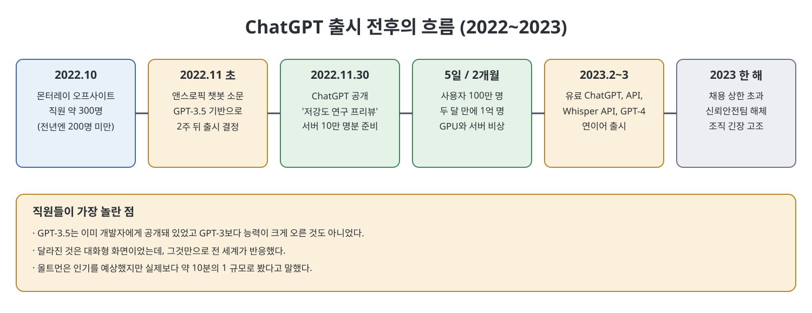
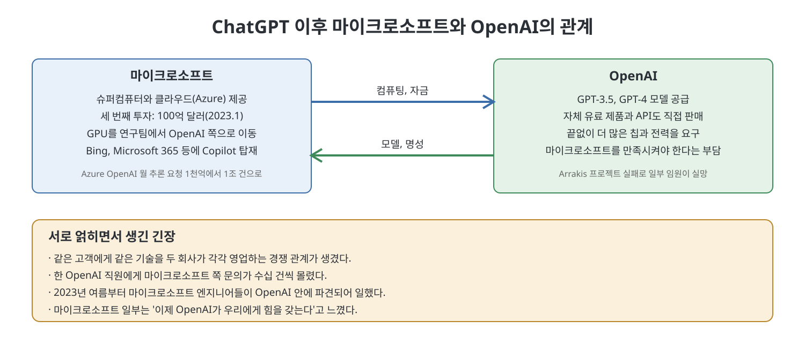

# 11장. 정점 (Apex)

11장은 ChatGPT가 세상에 나온 2022년 11월 말과 그 후 약 1년을 다룬다. 회사 안에서는 "그냥 연구 프리뷰"로 여겼던 챗봇이 며칠 만에 전 세계로 번졌고, 그 성공은 OpenAI를 순식간에 유명 기업으로 만든 동시에 서버, 인력, 안전 조직, 마이크로소프트와의 관계를 한꺼번에 흔들었다. 이 장은 정점에 오른 순간이 곧 균열이 커지는 순간이었다는 이야기다. 끝에서는 다음 장으로 이어지는 복선, 즉 1,000억 달러짜리 슈퍼컴퓨터 구상이 등장한다.

> **이 장을 한 문장으로**
> ChatGPT의 폭발적 성공은 예상 밖이었고, 그 성공을 감당하려고 OpenAI는 더 상업적이고 더 큰 조직으로 변해 갔다.

---

## 이 장의 흐름

1. 2022년 10월 몬터레이 오프사이트와 브록먼의 이야기
2. 앤스로픽 챗봇 소문 때문에 앞당겨진 ChatGPT 출시
3. 출시 직후의 폭주: 서버 붕괴와 1억 명
4. 급성장하는 조직: 채용 논쟁과 문화 변화
5. 마이크로소프트와의 관계 변화
6. 상업화, 환각 문제, GPU 부족, 그리고 스타게이트 구상

---

## 1. 몬터레이 오프사이트

2022년 10월 OpenAI는 캘리포니아 몬터레이에서 전사 오프사이트를 열었다. 직원은 약 300명으로, 한 해 전 200명이 채 안 되던 때보다 크게 늘어 있었다. 임원진은 마이크로소프트가 키우는 데이터센터, 언론의 관심, 워싱턴 정책 활동을 보고했고 연구와 제품 시연이 이어졌다. 저자는 이 자리에서 브록먼이 아내 안나의 건강 이야기를 꺼낸 일화를 전한다. 여러 의사가 원인을 몰랐는데 GPT-4가 의사들이 놓친 가능성을 제안했다는 이야기다. 저자는 브록먼이 이 이야기를 2019년에도 다른 인물을 주인공으로 한 적이 있다고 덧붙이고, 훗날 안나가 걸린 병이 유전성 결합조직 질환이었다고 소개한다. 의료에서 AGI가 할 일이 아직 많다는 브록먼의 말도 함께 적는다. 이 일화는 OpenAI가 AGI의 약속을 어떤 이야기로 전하는지 보여 준다.

## 2. 앞당겨진 출시

오프사이트 몇 주 뒤, 앤스로픽이 곧 새 챗봇을 내놓는다는 소문이 돌았다. 슈퍼어시스턴트 팀이 대화 화면을 설계하던 중이었는데, 선두를 잃고 그것도 앤스로픽에 진다는 부담이 컸다. 책은 앤스로픽이 실제로는 임박한 출시를 준비하지 않았고, FTX 붕괴 여파에 휘말려 있었다고 전한다. 앤스로픽은 불과 몇 달 전 5억 8,000만 달러를 모았는데 그중 5억 달러가 SBF 등에서 나왔고, 재판 과정에서 그 돈이 FTX 고객 예금에서 빼돌려진 것으로 드러났다고 한다.

그러나 소문만으로도 결정은 충분했다. GPT-4를 챗봇으로 다듬는 것을 기다리지 않고, 존 슐먼 팀이 만든 대화형 GPT-3.5에 새 화면을 붙여 추수감사절 직후에 내놓기로 했다. 이름은 **ChatGPT**. 경영진은 이를 제품 출시가 아니라 DALL-E 2처럼 "저강도 연구 프리뷰"라고 불렀고, 수익화보다는 **데이터 플라이휠**을 돌리는 것, 즉 사용자가 쓰며 쌓이는 데이터로 모델을 개선하는 선순환이 목표라고 설명했다.

> **쉽게 말하면**
> 데이터 플라이휠은 쓸수록 데이터가 쌓이고, 데이터가 쌓일수록 서비스가 좋아지고, 좋아지면 더 많은 사람이 쓰는 되먹임 고리다.

사내에서는 이 설명을 글자 그대로 받아들였다. 신뢰안전팀은 GPT-4 준비로 바빴고, 안전 진영도 GPT-3.5가 이미 RLHF를 거쳤다는 이유로 크게 반대하지 않았다. 책은 처음으로 모델 출시가 거의 저항 없이 점검을 통과했다고 쓴다. 슈퍼어시스턴트 팀조차 며칠 반짝하고 식을 것이라 예상해 서버를 10만 명분만 준비했다.

## 3. 폭주와 후폭풍

출시일인 2022년 11월 30일은 NeurIPS 학회 기간과 겹쳤다. 그 학회에서는 힌턴, 수츠케버, 크리제프스키의 2012년 이미지넷 논문이 시간 검증 상을 받았다. 학회장 근처 OpenAI 채용 파티에서는 엔지니어 한 명이 술 대신 컴퓨터만 붙들고 GPU가 녹을 지경이라 모든 것이 터지고 있다고 답했다고 한다.

일본에서 시작된 접속 폭증은 시차를 따라 전 세계로 번졌고, 일론 머스크의 트윗도 한몫했다. 닷새 만에 100만 명, 두 달 만에 1억 명을 넘겨 당시 가장 빠르게 성장한 소비자 앱이 되었다. 책은 직원들조차 이유를 못 찾았다고 한다. GPT-3.5는 이미 개발자에게 공개돼 있었고 GPT-3보다 능력이 크게 나아진 것도 아니었기 때문이다. 올트먼은 인기를 예상했더라도 실제보다 약 10분의 1 규모로 봤다고 말했다. 한 직원은 내부에서 쓰던 것보다 낮춰서 내놓았는데 사람들이 좋아한 것이 충격이었다고 회고한다. 르완다 키갈리의 연구자는 ChatGPT 이후에야 부모가 자신의 직업을 이해하게 되었다고 저자에게 말한다.

성공의 대가는 컸다. 서버가 계속 다운되었고 연구 부서의 컴퓨팅 자원까지 끌어다 썼지만 부족했다. 십수 명 규모의 신뢰안전팀은 갑자기 몰린 사용자의 악용을 찾아내려 했지만 감시 시스템도 서버와 함께 멈췄다. GPT-4로 GPT-4의 출력을 검수하려던 계획(내부 이름 Fact Factory)도 GPU 부족과 비용 때문에 규모를 키우지 못했다. 안전 진영 일부는 이 인기를 예측하지 못한 일이 회사의 미래 예측 능력에 의문을 던진다고 봤다. 반면 다른 직원들에게 서버 다운은 고통이자 승리의 표시였다. 올트먼은 도취를 경계하며 진짜 사명은 "실리콘밸리 역사상 가장 큰 제품"을 넘어선다고 말했고, 구글은 사내 비상경보(code red)를 울리고 AI 조직을 구글 딥마인드로 합쳤다.

## 4. 커지는 조직

경영진은 인력 충원을 요구했다. 올트먼은 소수 정예가 사명을 지킨다고 믿어 2020년 비전 메모에서도 조직이 커지는 유혹에 저항하라고 썼고, 채용을 100명 안팎으로 막자고 했다. 임원들은 500명 이상을 원했다. 절충안은 250~300명이었지만 지켜지지 않았다. 여름에는 매주 30~50명이 들어왔고 가을에는 상한을 훌쩍 넘었다.

문화도 달라졌다. 한 채용 담당자는 이대로면 메타를 만드는 셈이라며 올트먼의 우려를 겨냥한 글을 썼다. 해고가 잦아졌는데 알림은 없어서 직원들은 슬랙 계정이 회색으로 변한 것을 보고 알았고, 이를 "사라짐을 당했다"고 불렀다. 새로 온 직원들은 이를 평범한(그리고 냉혹한) 기업 문제로 받아들였고, 초기 직원들은 버닝맨 축제가 커지면서 본래 정신을 잃은 것에 빗대어 변화를 안타까워했다. 익명 질문 채널은 불만 창구가 되었다. 책은 한 직원의 말을 빌려 OpenAI가 가장 좋은 직장이자 가장 나쁜 직장일 수 있다고 한 말을 전한다.

## 5. 마이크로소프트와의 힘의 균형

ChatGPT는 마이크로소프트도 놀라게 했다. 자사 Bing 챗봇의 주목을 빼앗겼고, 2023년 2월 Bing AI는 기자와의 대화가 문제되며 평판 타격을 입었다. 그럼에도 열기는 식지 않았다. 마이크로소프트 일부 임원은 이제 OpenAI가 자신들에게 힘을 갖는다고 느꼈고, 구글을 이기는 정도가 아니라 AI가 미래라는 믿음을 갖게 됐다. 한 전직 직원은 기술이 현실보다 서사가 떠받치는 좁은 것이 되어 갔다고 비판한다.

사티아 나델라는 GPU를 자체 연구팀에서 OpenAI 지원으로 돌리고 하나의 풀로 합쳤다. 몇 달 만에 생성형 AI 프로젝트가 100개 넘게 생겼지만, 위험·규정 준수팀에는 골칫거리였다. 직원 일부가 사내 버전 대신 사용자 데이터로 학습하는 무료 ChatGPT를 써서 고객 정보 유출 우려가 나왔다는 것이다. 대신 보상은 컸다. Azure OpenAI 서비스는 1년 만에 고객이 21배로 늘었고, 월 추론 요청 수는 2023년 1월 1,000억 건에서 9월 1조 건으로 늘었다고 책은 소개한다. 켄 스콧 CTO는 OpenAI 전사 회의에서, 자사 연구 투자를 여러 곳에서 멈추면서까지 내기를 걸었다고 말했다.

균열도 생겼다. 두 회사가 같은 고객에게 같은 기술을 각자 영업하는 경쟁 관계가 되었고, 마이크로소프트 규모가 훨씬 커서 OpenAI 직원 한 명에게 수십 건의 문의가 쏟아졌다. 중재는 다시 무라티가 맡았고, 2023년 여름에는 마이크로소프트 엔지니어들이 OpenAI 안에 파견되었다.

## 6. 상업화, 안전, 그리고 칩

ChatGPT 이후 OpenAI는 비영리 연구소에서 상업 기업으로 방향을 굳혔다. 2023년 2월 유료 ChatGPT, 3월 API 버전과 위스퍼 API, 그리고 GPT-4가 차례로 나왔다. 한 직원은 이제 이상적 연구소라고 주장할 수 없고 당장 서비스할 고객이 있었다고 말한다.

신뢰안전팀은 다시 휩쓸렸다. 가입 시 주는 20달러 무료 크레딧을 노려 계정을 대량으로 만드는 사기가 늘어 매출 손실이 커졌다. 사기 대응에 인력이 몰렸고 윌너는 소진되어 팀 일부와 함께 회사를 떠났으며 연말에 팀은 해체되어 릴리언 웡이 이끄는 안전 시스템 조직 아래 합쳐졌다. 일부는 응용 부서와 안전 진영의 충돌이 '안전'을 과소평가하는 분위기를 만들었다고 봤다. 한편 환각(그럴듯한 거짓 답) 문제도 남았다. 2022년 11월 내부 문서는 비교적 쉬운 '폐쇄 도메인' 질문, 즉 사용자가 준 자료만으로 답하는 질문에서도 약 30퍼센트에서 환각이 생겼다고 적었다.

GPU 부족은 연구와 신제품을 계속 미뤘다. 반도체 분석 매체 세미애널리시스는 하루 약 70만 달러의 컴퓨팅 비용을 추정했다. 효율을 높이려고 DUST라는 방법을 만들었고, 사막 이름 코드명을 붙였다. GPT-3.5 터보(사하라)는 성공했지만 GPT-4를 효율화하려던 아라키스는 계획이 접혔다. 마이크로소프트를 만족시키려고 로드맵까지 바꿨던 터라 이 실패는 일부 임원을 실망시켰다.

장의 마지막은 칩과 땅의 이야기다. 올트먼과 나델라는 컴퓨팅 배분에 점점 깊이 개입했고, 나델라는 올트먼이 매일 전화해 더 달라고 한다고 말했다. 두 회사는 OpenAI 쪽 이름 스타게이트, 마이크로소프트 쪽 이름 머큐리라는 사업을 구상했다. 건설비만 약 1,000억 달러의 슈퍼컴퓨터다. 저자는 AI 제국이 옛 제국과 같은 방식으로, 즉 더 많은 물질 자원과 땅을 필요로 하며 확장한다고 쓴다. 이 이야기는 12장으로 곧장 이어진다.

---

## 연표

| 시기 | 사건 |
|------|------|
| 2022년 10월 | 몬터레이 오프사이트, 직원 약 300명 |
| 2022년 11월 초 | FTX 붕괴, 앤스로픽 챗봇 출시설 |
| 2022년 11월 30일 | ChatGPT 출시 (연구 프리뷰), 서버 폭주 |
| 2022년 12월 초 | 5일 만에 사용자 100만 명 (두 달 후 1억 명) |
| 2023년 2월 | 유료 ChatGPT, GPT-3.5 터보(사하라), Bing AI |
| 2023년 3월 | API, 위스퍼 API, GPT-4, Microsoft 365 Copilot |
| 2023년 여름 | 마이크로소프트 엔지니어가 OpenAI에 파견 |
| 2023년 말 | 신뢰안전팀 해체, 안전 시스템 조직으로 통합 |

## 핵심 정리

- **ChatGPT는 방어적 결정에서 나왔다.** 앤스로픽의 소문에 대응해 GPT-3.5와 새 화면으로 서둘러 내놓았고, 내부에서도 큰 성공을 예상하지 못했다.
- **성공이 곧 부담이었다.** 서버, 컴퓨팅 자원, 소수 인원의 안전 조직이 한꺼번에 흔들렸고, 경영진은 인력 상한 논쟁을 거쳐 조직을 급격히 키웠다.
- **마이크로소프트와의 관계는 공생에서 얽힘으로 바뀌었다.** 투자와 클라우드 매출로 이득을 봤지만 동시에 같은 고객을 두고 경쟁하고 서로의 눈치를 보게 됐다.
- **상업화가 안전 논의를 밀어냈다.** 유료 제품과 사기 대응이 우선되며 신뢰안전팀은 해체됐고, 환각 같은 문제는 완전히 해결되지 않은 채 출시가 이어졌다.
- **다음 병목은 땅과 전력이다.** 칩 부족과 1,000억 달러 슈퍼컴퓨터 구상은 AI의 확장이 물리적 자원에 기댄다는 점을 12장으로 이어 준다.

---

이전: [10장 신과 악마](10%EC%9E%A5%20%EC%8B%A0%EA%B3%BC%20%EC%95%85%EB%A7%88.md)  |  다음: [12장 약탈당한 지구](12%EC%9E%A5%20%EC%95%BD%ED%83%88%EB%8B%B9%ED%95%9C%20%EC%A7%80%EA%B5%AC.md)
