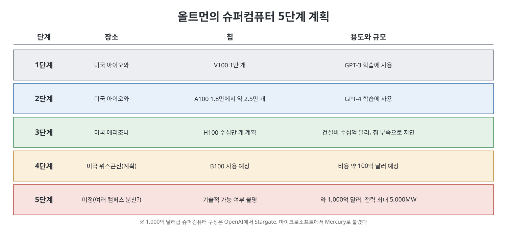
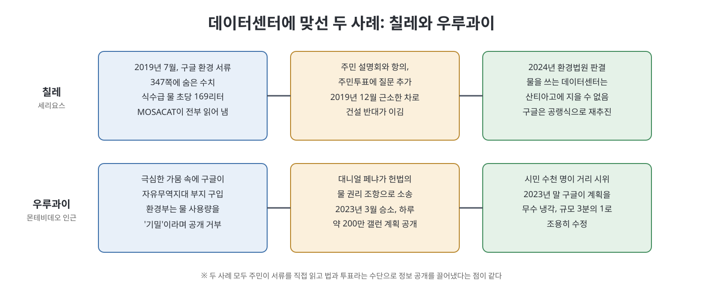

# 12장. 약탈당한 지구 (Plundered Earth)

12장은 무대를 샌프란시스코에서 남미의 칠레와 우루과이로 옮긴다. "클라우드"라는 말이 풍기는 가벼운 이미지와 달리, 생성형 AI는 거대한 데이터센터와 전기, 물, 구리와 리튬 같은 광물을 대량으로 필요로 한다. 저자는 이 물질적 비용이 누구에게 가장 무겁게 돌아가는지를 칠레의 광산 지역과 산티아고의 데이터센터 반대 운동, 우루과이의 가뭄과 소송을 통해 보여 준다. 핵심 질문은 하나다. 이렇게 큰 규모의 AI가 정말 필요한가, 그 비용은 누가 치르는가.

> **이 장을 한 문장으로**
> AI 제국은 옛 제국처럼 땅, 물, 에너지를 가져다 쓰며 자라고, 그 부담은 힘이 약한 지역 공동체가 진다. 그러나 그곳 사람들이 맞서 싸우기도 한다.

---

## 이 장의 흐름

1. 칠레는 어떻게 자원 공급국이 되었나 (스페인 식민 지배, 시카고 보이즈, 피노체트)
2. 데이터센터의 실제 모습: 메가캠퍼스, 전력, 물, 환경 정보의 은폐
3. OpenAI와 마이크로소프트의 슈퍼컴퓨터 5단계 계획과 그 환경 비용
4. 칠레 북부의 구리와 리튬, 소니아 라모스의 저항
5. 산티아고: 케리쿠라와 세리요스, MOSACAT의 싸움
6. 우루과이: 기밀로 가려진 물 사용량과 대니얼 페냐의 소송
7. 마이크로소프트의 진입과 새로운 상상: 데이터센터를 다시 설계하기

---

## 1. 칠레의 역사: 자원을 내주는 나라

칠레는 안데스 산맥이 길게 뻗은 나라이고 북쪽에는 세계에서 가장 건조한 아타카마 사막이 있다. 원주민은 그곳을 삶의 터전으로 일구었지만, 스페인 식민 지배 이후 칠레는 땅, 물, 광물을 다른 나라의 이익에 대 주는 역할을 맡게 되었다고 저자는 쓴다. 지금도 수출의 약 60퍼센트가 광물이고, 구리와 최근에는 리튬이 중심이다.

20세기에는 미국이 이 구조를 굳히는 역할을 했다고 책은 설명한다. 1950~60년대 칠레는 정부 규제와 국내 산업화를 앞세우는 개발 경제학으로 기울었고 광산을 가진 미국 기업은 세금과 규제에 불만이었다. 그러자 미국은 1956년 "칠레 프로젝트"로 칠레 학생 100명을 시카고 대학에 보내 밀턴 프리드먼의 시장 중심 이론을 배우게 했다. 저자는 나오미 클라인의 책을 근거로 이를 교육이 아니라 사상 주입이라고 본다. 이 졸업생들, 이른바 **시카고 보이즈**가 돌아와 이념을 퍼뜨렸고, 1973년 쿠데타로 집권한 피노체트는 이들에게 경제 정책을 맡겼다. 교육, 의료, 연금, 심지어 물까지 민영화되었고 성장과 함께 극심한 불평등이 남았다.

그래서 AI 호황이 오자 칠레는 새로운 규모의 **추출주의(extractivism, 자원을 캐내 파는 데 의존하는 경제 방식)** 의 최전선이 되었다. 북부의 구리와 리튬뿐 아니라 수도권의 땅, 물, 에너지가 데이터센터로 향한다. 정부는 2024년 5월 기존 22곳에 더해 28곳의 데이터센터를 유치해 26억 달러의 외국 투자를 받겠다고 자랑스럽게 발표했다. 반면 이 서사에 가장 강하게 맞서는 저항도 칠레에서 나온다는 것이 저자의 관찰이다.

## 2. 데이터센터는 어떤 곳인가

"클라우드"는 하늘에 떠 있지 않다. 생성형 AI는 건물과 서버, 냉각 장치로 이루어진 실제 시설에서 돌아간다. 2000년대 이후 대형 기업은 컴퓨터를 외곽의 거대 창고에 모았고, 구글, 마이크로소프트, 아마존, 메타 같은 **하이퍼스케일러**가 업계를 좌우한다. 이들은 데이터센터를 대학 캠퍼스에 비견되는 "캠퍼스"라 부르고, ChatGPT 이후에는 **메가캠퍼스**라는 말이 나왔다. 서버가 내는 열을 식히려는 팬과 에어컨, 증발식 냉각 장치가 24시간 소음을 낸다.

전력 규모도 다르다. GPU 선반 하나는 다른 칩 선반의 약 3배 전력을 쓰고, 국제에너지기구에 따르면 ChatGPT 질문 하나는 일반 구글 검색의 약 10배 전기가 든다. 예전에는 150메가와트급이 큰 시설이었지만 앞으로 1,000~2,000메가와트급 메가캠퍼스가 거론된다. 이는 샌프란시스코 도시 하나 반에서 세 곳 반이 쓰는 전기와 맞먹는다고 책은 적는다. 그 결과 가스·석탄 발전소 폐쇄가 미뤄지고, 마이크로소프트는 스리마일섬 원전 재가동에 나섰으며, 미국 데이터센터의 전력 비중은 2022년 3퍼센트에서 2030년 8퍼센트로 오를 전망이라고 한다.

> **쉽게 말하면**
> 질문 한 번에 쓰는 전기와 물은 작아 보여도, 전 세계가 하루 종일 쓰면 도시 몇 개 분량이 된다.

저자는 기업들이 이 영향을 가리는 것도 문제로 본다. 기술 세부 정보가 비공개로 바뀌어 탄소 발자국 추정이 어려워졌고, 데이터센터는 곧 효율적이 될 것이고, 생성형 AI가 기후 혁신을 이끌 것이며, AGI가 기후변화를 해결하리라는 반론이 퍼진다. 허깅페이스의 기후 책임자 사샤 루치오니는 앞의 두 주장이 오해를 부른다고 말한다. 기후에 쓸모 있는 AI는 대개 작고 전력이 적게 드는 기존 머신러닝이지 생성형 AI가 아니라는 것이다. 그가 이끈 연구에서는 글 1,000개를 만드는 데 스마트폰을 거의 네 번 충전하는 에너지가, 이미지 1,000장을 만드는 데 242번 충전하는 에너지가 든다고 측정되었다. 그는 500명이 넘는 논문 저자에게 정보를 요청했지만 거의 답을 얻지 못했다고 한다.

물도 문제다. 서버 냉각에는 배관 막힘을 막기 위해 마실 수 있을 만큼 깨끗한 물(**식수급**)이 자주 쓰인다. 캘리포니아대 리버사이드 연구진은 2027년까지 AI 수요가 연간 1.1조~1.7조 갤런의 담수를 쓸 수 있다고 추산했다. 건설을 막으려는 주민에 맞서 개발사가 위장 회사를 앞세워 진입하거나 지역 사업에 기부로 반발을 누그러뜨리고 지속가능성 약속을 나중에 뒤집는 사례도 소개된다. 버지니아에서는 변호사가 개발사에 주민 모임에 첩자를 심자고 쓴 이메일이 발견되었다.

## 3. 슈퍼컴퓨터 5단계와 환경 비용

브록먼이 2019년 저자에게 가장 큰 컴퓨터를 가진 쪽이 가장 큰 이익을 얻는다고 말했듯, OpenAI는 처음부터 막대한 컴퓨팅을 확보하려 했다. 올트먼은 마이크로소프트와 짓는 슈퍼컴퓨터를 **단계(phase)** 로 불렀다.

1단계는 아이오와의 V100 1만 개로 GPT-3를 학습했고, 2단계는 같은 아이오와에서 A100 약 2.5만 개로 GPT-4를 학습했다. 3단계는 지가와 세금 조건이 좋은 애리조나에서 H100 수십만 개를 목표로 했다. 4단계는 위스콘신에서 약 100억 달러를, 5단계는 1,000억 달러에 전력 최대 5,000메가와트를 구상했다. 5단계는 기술적 가능성조차 불분명했고, 병목은 돈보다 에너지였다. 한 직원은 땅과 전력이 바닥나고 있다고 말했다. 해법으로는 여러 캠퍼스로 분산 학습하거나, 올트먼이 가끔 말했듯 핵융합 돌파구를 기대하는 길이 거론됐다.

책은 이 시설들이 자리 잡은 지역의 물 사정도 짚는다. GPT-4를 학습한 아이오와는 2년째 가뭄이었고, 한 달 동안 학습하는 사이 해당 지구 물의 약 6퍼센트(약 1,150만 갤런)가 마이크로소프트 데이터센터에서 쓰였다고 AP 통신이 보도했다. 애리조나는 천 년 만의 최악의 가뭄에 콜로라도강이 위태롭고 2023년 열 관련 사망이 급증했다. 그럼에도 올트먼과 임원들이 전사 회의에서 환경 비용을 거론한 적은 없다고 저자는 전한다. 그가 꺼낸 것은 조급함이었다. 메타가 35만 개의 H100을 확보하겠다고 하자 마이크로소프트가 너무 느리다고 불만을 가졌다는 것이다.

## 4. 칠레 북부: 구리와 리튬, 소니아 라모스

소니아 라모스는 광산 가족에서 자랐고 1957년 추키카마타 광산 붕괴로 사람이 죽고 가족이 가난에 빠지는 것을 목격했다. 그 뒤 광업은 이익을 위해 무엇이든 하는 시스템이라고 확신했다. 칠레는 세계 구리의 4분의 1을 생산하며, 추키카마타는 세계 최대의 노천 구리 광산이다. 광산은 지역의 물을 빼앗아 한 염호 분지를 고갈시켰고 비소가 대기와 물에 퍼져 암 발병률이 올랐다. 물과 광물이 사라지자 아타카마 원주민(**아타카메뇨**)은 농사와 목축으로 자급하기 어려워져 빈곤, 범죄, 우울이 늘고 자기 땅을 빼앗은 산업에 일하러 가야 했다.

리튬은 1960년대 미국 기업이 구리용 물을 찾다 염호 아래 소금물에서 발견했다. 지금 칠레는 세계 리튬의 약 3분의 1을 생산한다. 염호에 살던 분홍 플라밍고는 사라졌고, 한 원주민 지도자의 딸에게는 조상의 이야기와 플라밍고 인형만 남았다고 한다. 2022년 유럽연합의 에너지 전환 정책으로 리튬 수요가 치솟자 '더 나은 미래'가 구호가 되었지만, 원주민들은 누구를 위한 미래냐고 물었다.

저자가 강조하는 점은 라모스가 채굴 자체를 반대하는 것이 아니라는 것이다. 그녀는 조상들이 광부였다고 말하며 문제는 규모라고 한다. 규모가 모든 것을 삼켜 다른 경제와 다른 상상을 막는다는 것이다. 책은 한 예로 브라질 전시회를 든다. 미드저니와 스테이블 디퓨전이 라틴아메리카 원주민을 원시적이고 기술에 서툰 사람들로 그려 냈다는 것이다. 아타카메뇨는 집에 검은 깃발을 걸고, 광산으로 가는 길을 막고, 국제법에 따라 변호사를 선임해 협상 테이블에 앉았고, 생태계 조사와 물 손실 정량화를 요구했다. 라모스는 재단을 세워 사막의 독특한 미생물을 연구하며 치유와 재생을 중심에 둔 진보를 찾으려 한다.

## 5. 산티아고: 케리쿠라와 세리요스

2024년 6월, 저자는 시의원 알렉산드라 아란시비아와 케리쿠라를 걷는다. 이곳은 쓰레기 불법 투기장과 그것을 장악한 조직이 있는 곳이다. 구글은 2012년 이곳에 라틴아메리카 첫 데이터센터를 짓고 2015년에 가동했다. 구글이 자랑하는 케리쿠라 도시 숲은 버스 노선에서 멀고 주변에 집이 없어서, 홍보 자료의 '주민이 이용하는 녹지'는 실체가 없었다고 저자는 쓴다. 일자리도 건설 이후에는 거의 없었고, 2024년 정비 기술자 채용 공고는 영어로만, 영어 이력서만 받았다. 근처 공립 학교는 여전히 인터넷이 부실하다.

두 번째 데이터센터 부지로 구글이 택한 곳은 역시 노동자 도시인 세리요스였다. 이곳은 과거 석면 공장으로 오염되었지만, 민영화된 나라에서 유일한 공공 상수도를 가진 지역이다. 2019년 환경 승인을 위한 347쪽짜리 서류가 제출되자 물 활동 단체 **MOSACAT** 은 이를 통째로 읽었다. 서류에는 서버 냉각에 식수급 물을 초당 약 169리터 쓰겠다는 계획이 있었는데, 이는 약 8만 8천 명의 세리요스 주민이 한 해에 쓰는 양의 1,000배가 넘는 규모였다. 칠레는 이미 9년째 메가가뭄 중이었다. 회원들은 기술자가 아니었지만 여가 시간을 쪼개 모든 용어를 익혔다.

현지 파트너 회사는 사업을 제대로 이해하지 못했고 시 당국도 폐수만 쓰는 줄 알고 있었다. 구글은 엔지니어 둘과 변호사를 보냈지만 MOSACAT은 항의 현수막으로 맞이했다. 주민들은 통역이 말을 잘못 옮기는 것을 들었고, 구글이 도시 숲을 지어 주겠다고 제안하자 오히려 반발했다. 한 회원은 땅을 말려 죽이면서 나무를 주겠다고 한다고 비판했다. 때마침 칠레는 불평등과 민영화에 항의하는 대규모 시위(**사회적 폭발, Estallido Social**)로 들끓었고, MOSACAT은 지역 주민투표에 구글 건설 찬반 질문을 끼워 넣었다. 2019년 12월 근소한 표차로 건설 반대가 이겼고, 이듬해 정부도 환경 법원에 소송을 냈다. 구글은 다음 데이터센터를 다른 나라로 돌렸다. 저자는 이것이 힘이 약한 나라가 맞서면 기업이 돈을 들고 떠날 수 있다는 위험을 드러낸다고 본다. 2024년 환경 법원은 구글이 산티아고에 물을 쓰는 데이터센터를 지을 수 없다고 판결했다.

## 6. 우루과이: 기밀 처리된 물 사용량

우루과이의 국영 통신사 안텔은 시내에 작은 데이터센터를 두고 주민 민원에도 소음을 줄이려 응답한다. 반면 시 외곽 과학공원 자유무역지대에 구글은 2021년 29헥타르 땅을 샀다. 안텔 총면적의 58배다. 당시 우루과이는 가뭄이 극심해 2023년 여름 몬테비데오가 오염된 염수를 식수에 섞는 지경이었다. 한 급식소 운영자 파비아나는 팬데믹과 가뭄 때가 가장 힘든 시기였다고 회상한다.

사회학자 대니얼 페냐는 환경부 사이트에서 구글 계획을 보았지만 물 사용량이 기밀로 가려져 있었다. 정보공개 청구도 영업 비밀로 거부되자, 그는 물을 인권으로 명시한 헌법 조항을 근거로 무료 변호사와 함께 소송했고 2023년 3월 승소했다. 공개된 계획은 하루 200만 갤런으로 5만 5천 명의 일일 물 소비와 같았다. 시민 수천 명이 거리로 나왔고 구호는 "이것은 가뭄이 아니라 약탈"이었다. 2023년 말 구글은 조용히 무수 냉각으로 바꾸고 규모를 3분의 1로 줄였다. 하지만 페냐는 이번에는 에너지 사용량이 비밀이라고 지적하며, 광물 채굴과 노동, 탄소, 전자 폐기물까지 공급망 전체를 평가하라는 청원을 냈다.

## 7. 마이크로소프트의 진입과 다른 상상

마이크로소프트는 OpenAI 투자 후 구글의 방식을 따라 같은 지역으로 들어왔고, 2022년 데이터센터 부지로 다시 케리쿠라를 골랐다. 이번에는 지역 사회가 달랐다. 사회적 폭발과 헌법 개정 시도, 서른다섯 살 좌파 대통령 보리치의 당선을 거치며 풀뿌리 조직이 늘었고, 아란시비아와 로드리고 바예호스는 '케리쿠라 사회·환경 저항'을 만들었다. 바예호스는 로스쿨 공부 틈틈이 자료를 읽다가 마이크로소프트가 홈페이지에서 물 없는 냉각 기술을 자랑하면서 정작 칠레에서는 쓰지 않는 점을 따졌고, 회사는 그 기술이 미국에서 시험 중이라고 답했다.

건축 연구자 마리나 오테로는 이 싸움을 알리고자 대학 이름이 가진 힘으로 기업과 정부에 접근했고, 연구진과 함께 데이터센터를 도서관 같은 건축물로 다시 상상하는 14일 워크숍을 열었다. 학생들은 물 사용을 눈에 보이게 하는 공공 수영장형 저수지나, 습지와 공존하며 오염된 물을 정화해 돌려보내는 '유동적 데이터 영토'를 설계했다.

2024년 현재 보리치는 경제 성과를 내야 하는 압박 속에 광업 확대와 28곳의 데이터센터를 모두 추진해야 한다. 그래도 활동가와 연구자 연합은 성과를 냈다. 과학부는 처음으로 활동가 자문위원회를 만들어 아란시비아, 바예호스, MOSACAT 회원을 초대했고, AI 법안의 논의 톤도 사회·환경 비용을 인정하는 쪽으로 바뀌었다. 마르틴 티로니 교수는 AI 산업이 식민주의적 이념 위에 서 있으며, 수백 년의 추출주의를 겪은 칠레가 '탈식민적 AI'의 길을 열 수 있다고 말한다. 저자는 이 야심이 숭고하지만 맞서는 힘도 막강하다고 끝맺는다.

---

## 등장 인물과 단체

| 이름 | 소속·역할 | 이 장에서의 모습 |
|------|-----------|------------------|
| 사샤 루치오니 | 허깅페이스 기후 책임자 | 생성형 AI의 에너지 비용을 측정, 기업 홍보를 반박 |
| 소니아 라모스 | 칠레 원주민 활동가 | 채굴의 규모를 문제 삼고 재생 중심의 대안을 모색 |
| 알렉산드라 아란시비아 | 케리쿠라 시의원 | 구글 도시 숲을 안내, 마이크로소프트 진입에 맞서 활동 |
| MOSACAT | 세리요스 물 활동 단체 | 347쪽 서류를 분석해 구글의 물 사용 계획을 폭로 |
| 대니얼 페냐 | 우루과이 사회학 연구자 | 헌법상 물의 권리로 소송, 하루 200만 갤런 계획 공개 |
| 로드리고 바예호스 | 케리쿠라 활동가·로스쿨 학생 | 마이크로소프트의 환경 약속과 현실의 차이를 지적 |
| 마르틴 티로니 | 칠레 가톨릭대 교수 | AI가 식민적 이념에 뿌리를 둔다고 비판, 탈식민적 대안 제안 |

## 핵심 정리

- **AI의 물질적 토대는 땅, 에너지, 물, 광물이다.** 생성형 AI는 기존 데이터센터보다 훨씬 큰 메가캠퍼스를 요구하고, 올트먼의 5단계 계획에서 병목은 돈이 아니라 에너지였다.
- **비용은 약한 지역이 더 많이 진다.** 가뭄인 아이오와, 애리조나, 칠레, 우루과이에서 데이터센터가 식수급 물을 쓰려 했고, 기업은 정보를 감추거나 보상성 사업으로 반발을 달랬다.
- **칠레의 역사는 반복되는 구조다.** 식민지배와 시카고 보이즈, 피노체트를 거쳐 형성된 추출주의 경제 위에 구리, 리튬, 데이터센터가 차례로 얹혔다.
- **주민의 조사와 법적 대응이 실제 변화를 만들었다.** MOSACAT은 서류를 읽고 주민투표를 이끌었고, 페냐는 소송으로 정보를 공개시켜 구글의 계획을 바꾸게 했다. 다만 기업이 다른 나라로 옮겨 갈 위험도 있다.
- **문제는 인프라가 아니라 규모다.** 라모스와 페냐는 같은 말을 한다. 다른 방식의 발전과 데이터센터를 상상하자는 제안이 12장의 마지막 메시지다.

---

이전: [11장 정점](11%EC%9E%A5%20%EC%A0%95%EC%A0%90.md)  |  다음: [13장 두 예언자](13%EC%9E%A5%20%EB%91%90%20%EC%98%88%EC%96%B8%EC%9E%90.md)
