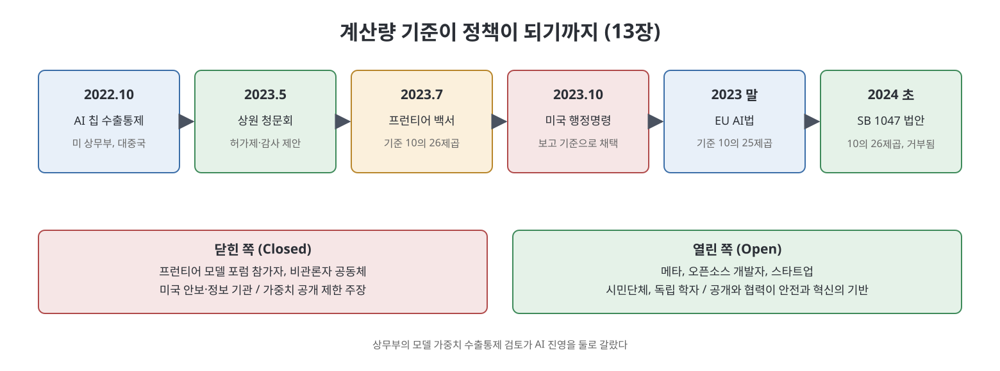

# 13장. 두 예언자 (The Two Prophets)

2023년 5월 샘 올트먼은 미국 의회 청문회에서 큰 호평을 받는다. 같은 시기에 OpenAI가 내세운 "미래의 위험을 막자"는 논리는 규제 문서와 행정명령, 외국 법안에까지 번진다. 이 장은 그 정책 영향력의 과정을 따라간 뒤 눈을 회사 안으로 돌린다. 안에서는 서두르자는 쪽과 조심하자는 쪽이 더 크게 갈라지고, 이사회는 올트먼에 대한 불신을 쌓아 간다. 저자는 이 장 마지막에서 일리야 수츠케버가 이사 헬렌 토너에게 연락했다는 사실로 14장의 사건을 예고한다.

> **이 장을 한 문장으로**
> 밖에서는 "위험을 걱정하는 책임 있는 회사"라는 얼굴로 워싱턴을 설득하는 동안, 안에서는 속도파와 안전파가 극단으로 갈라지고 이사회가 올트먼을 믿지 못하게 된다.

> **쉽게 말하면**
> 운동장 밖에서는 심판에게 "우리가 규칙을 같이 정하자"고 말하던 팀이, 라커룸에서는 감독과 코치가 서로를 믿지 못해 싸우고 있었다.

저자는 장 제목 "두 예언자"를 본문에서 직접 풀이하지 않는다. 이 노트는 문맥에 맞춰 AI가 세상을 구하리라 보는 낙관(Boomer)과 세상을 멸망시키리라 보는 비관(Doomer)이 한 회사 안에서 함께 커지는 모습으로 읽었다. 이는 노트 작성자의 해석이다.

---

## 이 장의 흐름

1. 2023년 5월 상원 청문회와 올트먼의 워싱턴 로비
2. "중국은 어쩌고?" 논리와 수출통제, 오픈소스 논쟁
3. 프런티어 모델 백서와 10의 26제곱 기준선
4. 닫힌 쪽 대 열린 쪽, 그리고 행정명령과 확산
5. 월드투어와 OpenAI 내부의 혼선
6. 속도파와 안전파의 극단화, 초정렬 팀과 벙커 이야기
7. 줄어드는 이사회와 올트먼에 대한 불신

---

## 1. 상원 청문회: 칭찬받은 증언

올트먼은 AGI(사람 수준의 범용 인공지능)가 기후변화와 암을 해결하리라는 약속을 되풀이하고, 새 일자리가 생기리라고 주장한다. 저작권과 학습 데이터 공개 질문은 피해 간다. 대신 규제를 요청하는데, 저자는 이를 OpenAI가 받아들일 만한 규제라고 평가한다. 그가 낸 세 가지 제안은 다음과 같다.

- 일정 수준 이상 능력의 모델을 위한 **허가제**를 운영할 기관을 만든다.
- "위험한 능력"을 측정하는 안전 기준을 만든다.
- 그 기준을 지키는지 **독립 감사**로 확인한다.

저자는 이 제안이 노동, 환경, 지식재산권 같은 기존 쟁점에서 대화를 돌려 아직 없는 미래 시스템의 극단적 위험으로 옮겼다고 본다. 책은 상원의원이 규제 기관장을 맡을 사람을 묻자 올트먼이 "저는 지금 일이 마음에 듭니다"라고 답해 웃음이 터졌다고 전한다. 또 이 청문회가 OpenAI 정책팀(안나 마카누 중심)이 수개월간 정치인, 직원, 외교관 등을 만나 온 캠페인의 결과였다고 설명한다. 뉴욕 타임스에 따르면 올트먼은 6월 초까지 미국 의원 100명 이상을 직접 만났다.

같은 날 워싱턴에는 할리우드 콘셉트 아티스트들도 와 있었다. 자비로 비행기표를 사서 AI 때문에 사라지는 일자리를 알리려던 이들이다. 일정이 밀린 그들은 와인과 치킨으로 직원들을 모으려 했고, 같은 시각 올트먼은 하원의원 60명과의 만찬에 있었다. 저자는 이를 누가 영향력을 쥐었는지 보여 주는 씁쓸한 장면으로 쓴다.

## 2. "중국은 어쩌고?"와 오픈소스 논쟁

**수출통제**란 국가 안보를 이유로 특정 기술의 해외 판매를 막는 제도다. 미국 상무부는 2022년 10월 엔비디아 등의 최첨단 AI 칩을 중국에 팔지 못하게 했다. 저자에 따르면 그 효과는 기대에 못 미쳤다. 엔비디아는 규칙에 맞춘 새 칩을 설계해 판매를 이어 갔고, 규제는 중국 자체 칩 산업에 자금과 관심을 모아 주었다.

더 큰 변수는 **오픈소스** 흐름이었다. 메타는 자사 모델 라마(Llama)의 **가중치**(학습된 결과값, 모델의 핵심 파일)를 무료로 공개했다. 책은 라마가 엄밀한 오픈소스 정의(가중치와 학습 데이터 모두 공개)에는 못 미치지만 중국 AI 산업의 중요한 부품이 되었다고 말한다. 메타 입장에서는 모델을 팔 필요 없이 자사 서비스에 넣어 인재를 끌어오는 영리한 전략이기도 했다.

## 3. 프런티어 모델 백서와 10의 26제곱

2023년 7월, OpenAI 안전팀과 마이크로소프트, 구글 딥마인드, 여러 싱크탱크 연구자들이 51쪽 백서를 낸다. 이 백서는 아직 존재하지 않지만 갑자기 나타날 수 있는 위험한 모델에 **"프런티어(frontier) 모델"** 이라는 이름을 붙이고, 학습에 쓰인 **계산량이 일정 선을 넘으면** 허가와 보고 대상으로 삼자고 제안한다. 그 선이 **10의 26제곱 부동소수점 연산(FLOP)**, 즉 1 뒤에 0이 26개 붙는 계산 횟수다. 직후 OpenAI, 마이크로소프트, 구글, 앤스로픽이 **프런티어 모델 포럼**을 만든다. 책은 이 문제에서 비관론자, 낙관론자, 기업의 이해가 드물게 맞아떨어졌다고 설명한다. 비관론자에게는 신념의 문제였고, 다른 쪽에는 기존 모델의 문제에서 시선을 돌리게 해 주는 편리한 주제였다.

그러나 공저자였던 사라 후커(코히어)와 데버라 라지 등은 이 접근에 반대한다. 후커의 말을 책은 이렇게 요약한다. 규모가 커지면 능력이 높아질 수는 있지만 **높은 능력이 반드시 큰 규모를 요구하지는 않는다**. 생물학 데이터만으로 학습한 작은 모델이 위험한 정보를 만들 수도 있고, 증류(큰 모델을 작은 모델로 압축하는 기법)로 작아진 모델도 비슷한 능력을 낸다. 모델의 행동은 계산량보다 **학습 데이터**가 정한다는 것이다. 후커가 짐작하기에 그 숫자는 GPT-4 학습량보다 약간 높게 잡은 값이었고, 저자들 사이에 합의도 없어 각주와 부록에 근거 없이 실렸다. 그런데도 이 숫자는 순식간에 인기 있는 정책 제안이 되었다. 마커스와 IBM의 크리스티나 몽고메리가 청문회에서 거듭 요구한 **학습 데이터 공개 의무**는 같은 관심을 받지 못했다. 저작권, 개인정보, 능력 검증에 실질적 책임을 물을 수 있는데도 그렇다고 책은 지적한다.

## 4. 닫힌 쪽 대 열린 쪽, 행정명령과 확산

미 상무부는 모델 가중치 공개 자체를 막는 수출통제를 검토한다(2024년 초 의견 수렴 공고 예정). 이를 두고 AI 진영이 둘로 갈린다. **닫힌 쪽(Closed)** 은 프런티어 모델 포럼 참가자, 비관론자 공동체, 미국 안보·정보 기관이었다. **열린 쪽(Open)** 은 메타, 오픈소스 개발자, 스타트업, 시민단체, 독립 학자였다. 열린 쪽은 생물무기 제조의 병목은 레시피가 아니라 재료와 장비이고, 가중치 공개를 막으면 소규모 개발자만 불리해지며 거대 기업의 지배가 굳어진다고 반박한다. 또 외부 연구자가 모델을 들여다볼 길이 막히고, 미국과 중국이 오랫동안 서로의 최대 협력 상대였다는 점도 짚는다. ResNet이 베이징의 마이크로소프트 연구소에서 나온 사례가 대표적이다.

그럼에도 2023년 10월 바이든 행정명령은 닫힌 쪽의 생각을 크게 받아들인다. 책에 따르면 이 명령은 서로 다른 두 문서를 이어 붙인 것이었다. 하나는 시민사회와 오래 논의한 "AI 권리장전 청사진"이고, 다른 하나는 올트먼의 제안과 백서를 거의 그대로 옮긴 부분이었다. 10의 26제곱이라는 기준도 정부 보고 기준으로 들어갔다. 이후 유럽연합은 10의 25제곱으로 더 엄격하게 잡았고, 2024년 초 캘리포니아 SB 1047 법안은 10의 26제곱으로 돌아갔다. 이 법안은 뉴섬 주지사가 거부했는데, 업계가 다른 책임 조항에 반대해 로비한 결과이기도 했고, 후커와 라지는 과학적 합의에 근거하라는 뜻에서 환영했다. 저자는 이 전체가 독립적 AI 전문성이 얼마나 쇠퇴했는지 보여 준다고 평가한다. 라지는 슈머 상원의원의 AI 인사이트 포럼에서 업계와 관계없는 유일한 학자로 증언하며, 다른 증인들의 근거 없는 주장을 청중이 그대로 믿는 데 충격을 받았다.

## 5. 월드투어와 OpenAI의 혼선

올트먼은 사용자를 만나겠다며 시작한 여행이 G20 정상들과의 사진 촬영을 곁들인 "월드투어"가 되도록 두었다. 책에 따르면 여기에는 통신·정책팀의 큰 전략이 없었고, 올트먼이 정한 방문지를 트위터에 올리자 관심이 눈덩이처럼 불어 팀이 뒤늦게 투입되었다. GPT-4 발표도 한 사례다. 회사는 100명이 넘는 직원의 공동 성과로 발표했지만, 올트먼은 따로 야쿠브 파초키 한 사람의 공을 트윗했다. 저자는 공식 임원과 올트먼이 실제로 귀 기울이는 사람이 다르고, 공식 절차와 그의 관계·기분 가운데 무엇이 전략을 이끄는지 불분명했다고 쓴다.

그 결과가 엇갈린 대외 메시지였다. 법무팀은 뉴욕 타임스 저작권 소송에 "모델을 일부러 조작했다"며 강하게 반박했는데, 같은 주 정책팀은 영국 상원에 저작권 자료 없이는 학습이 "불가능하다"고 제출했다가 논란이 되자 표현에서 물러섰다. 한 직원은 전략처럼 보이는 것이 사실은 우연의 결과일 때가 많다는 취지로 말한다.

## 6. 속도파와 안전파의 극단화

회사 안은 둘로 더 벌어진다. 응용(Applied) 부서와 연구 쪽 다수는 빠른 배포가 사명 달성의 길이라 믿었다. OpenAI는 이를 **반복 배포(iterative deployment)**, 즉 모델을 사용자에게 일찍 자주 내놓고 피드백으로 고쳐 간다는 논리로 정당화했다. 반면 수는 적지만 안전파(Safety clan)는 정책 연구팀(마일스 브런디지)과 정렬팀(얀 라이케)을 중심으로 위험 경고의 수위를 높였다. 능력이 커지면서 안전파로 합류하는 연구자도 생겼다.

수츠케버는 양쪽에 걸쳐 있었다. GPT-4 이후 시간을 반반 나눠 안전에 쏟았고, 책은 그가 AGI에 대해 누구보다 기대하고 두려워한다고 묘사한다. 그는 새 연구자들에게 AGI 공개 전에 "벙커"를 지을 것이고 들어갈지는 선택이라고 말했고, 한 연구자는 이를 "휴거(rapture)"를 믿는 사람들이라는 식으로 표현했다. 수츠케버와 올트먼은 사람보다 똑똑한 시스템을 다룰 새 정렬 방법을 찾는 팀을 구상했고, 올트먼이 이를 **"정렬판 맨해튼 프로젝트"** 라 불렀다. 결국 회사 안에 **초정렬(Superalignment)** 팀이 생겼고 확보한 컴퓨팅의 20%를 약속했다. 수츠케버는 이 팀을 소개하며 "정렬이 타오르는 불이라면 초정렬은 활활 타는 불길"이라는 취지로 말했다. 회사가 커지자 연구 부서 대부분은 옛 파이오니어 빌딩으로 돌아갔고, 응용과 안전이 물리적으로도 갈라졌다.

**맨해튼 프로젝트 비유**(2023년 7월 영화 〈오펜하이머〉 단체 관람이 있었다)도 해석이 갈렸다. 다수는 영웅적 성취로 받아들이고, 안전파는 인류 멸망의 무게로 받아들인다. 책에 따르면 올트먼은 원폭의 버섯구름 이미지가 과학에 대한 세상의 반감을 불렀다는 PR의 교훈으로 이해했다. 극단적 비관론자는 "왜 아폴로 프로그램이 아니라 맨해튼인가"라고 불편해했다.

한편 연구 부서는 언어 모델의 성장이 둔해지자 행동하는 **AI 에이전트** 쪽으로 옮겨 갔다. 가장 야심 찬 프로젝트인 "AI 과학자"는 실험을 해서 스스로 지식을 만들려는 시도였고, 파초키와 시모 시도르가 이끌었다. 성공하면 AGI가 더 빨리 온다는 뜻이어서 믿는 사람들은 흥분과 불안을 함께 느꼈고, 사막의 로스앨러모스 같은 곳에 연구진이 모여 산다는 상상까지 나왔다. 보안팀이 적은 위협 모델에는 외국 정부, 경쟁사, 이념적 동기를 가진 사람들 세 범주가 있었고, 이념 범주에는 엘리에제르 유드코프스키(극단적 비관론자)의 공습 발언 기고문이 예로 들어갔다. 이에 항의가 있어 네 번째 범주인 "정렬되지 않은 AGI"가 추가되었다.

## 7. 줄어드는 이사회와 불신

2023년 들어 독립 이사 세 명이 잇달아 떠난다. 리드 호프먼(인플렉션 창업, 이해 충돌), 시본 질리스(머스크 쪽 인사, xAI 설립 등으로 이해 충돌), 윌 허드(대선 출마)다. 남은 독립 이사는 쿼라의 애덤 디안젤로, 로봇 공학자 타샤 맥콜리, 헬렌 토너 세 명이었다. 올트먼과 브록먼, 수츠케버가 이사회의 나머지였다.

책은 독립 이사들이 쌓아 온 의심을 몇 가지로 제시한다.

- 후임 이사를 정하려 했으나 몇 달째 교착이었다. 후보들에 브록먼과 수츠케버가 이의를 달았고, 올트먼은 반대하지도 진행하지도 않으면서 자기 인맥의 후보를 제안했다.
- 이사회와 직원 사이의 소통 창구가 흐지부지해져 이사들은 개인 인맥과 올트먼에게 정보를 의존했다. 그런데 올트먼의 장밋빛 설명이 다른 경로의 보고와 자주 달랐다.
- 마이크로소프트가 **배포안전위원회(DSB)** 승인 없이 인도에서 GPT-4를 제한적으로 먼저 내놓았는데, 올트먼은 하루 종일 이사회와 있었으면서도 알리지 않았다.
- 올트먼이 디안젤로 사퇴를 제안했으나(쿼라의 챗봇 포가 이해 충돌이라는 이유) 다른 이사가 반박해 무산되었다. 이사들은 그가 자기에게 불편한 질문을 하는 이사를 몰아내려 한다고 느꼈다.
- 오픈AI 스타트업 펀드를 올트먼 본인이 법적으로 소유하고 있었다는 점이 서류에서 드러났다.

이사들은 이 사례들이 모여 한 그림이 된다고 판단한다. 올트먼이 이사회가 자신을 견제하지 못하도록 조금씩 시야를 흐린다는 것이다. 그는 이사회가 자신을 해임할 수 있다는 점을 대외 신뢰의 근거로 내세워 왔다. 이 모든 것은 서술된 사건에 대한 저자의 정리이며, 올트먼 측 반론은 이 장에 나오지 않는다. 가을이 되어 이사들의 사기가 바닥일 때 토너는 수츠케버의 예상 밖 이메일을 받는다.

---

## 표 1. 이 장의 주요 인물과 조직

| 인물·조직 | 쉬운 설명 | 이 장에서의 역할 |
|-----------|-----------|------------------|
| 샘 올트먼 | OpenAI CEO | 청문회 증언, 월드투어, 이사회와의 불신 |
| 안나 마카누 | OpenAI 정책팀 책임자 | 워싱턴 설득 캠페인 실행 |
| 사라 후커, 데버라 라지 | AI 연구자 | 계산량 기준 접근에 반대 |
| 개리 마커스 | AI 비평가 | 데이터 공개 요구, 나중에 "속았다" 취지로 번복 |
| 일리야 수츠케버 | OpenAI 수석 과학자 | 안전 쪽으로 방향 전환, 초정렬 팀 공동 주도 |
| 얀 라이케, 마일스 브런디지 | 정렬팀, 정책 연구팀 책임자 | 안전파의 중심 |
| 야쿠브 파초키, 시모 시도르 | 연구자 | AI 과학자 프로젝트 주도 |
| 디안젤로, 맥콜리, 토너 | 남은 독립 이사 3인 | 올트먼에 대한 불신 축적 |
| 프런티어 모델 포럼 | OpenAI, MS, 구글, 앤스로픽의 연합 | 정책 의제 영향력 확대 |

## 표 2. 이 장에 나온 정책 기준 비교

| 시기 | 문서 | 계산량 기준 | 결과 |
|------|------|-------------|------|
| 2023년 7월 | 프런티어 모델 백서 | 10의 26제곱 FLOP | 근거 없이 각주·부록에 실림 |
| 2023년 10월 | 미국 행정명령 | 10의 26제곱 FLOP | 정부 보고 기준이 됨 |
| 2023년 말 | EU AI법 | 10의 25제곱 FLOP | 더 엄격하게 설정 |
| 2024년 초 | 캘리포니아 SB 1047 | 10의 26제곱 FLOP | 주지사 거부 |

---

## 핵심 정리

- **위험의 초점이 미래로 옮겨졌다.** 올트먼의 청문회 제안은 노동, 환경, 저작권 같은 현재의 쟁점에서 대화를 아직 없는 "프런티어 모델"로 돌렸다는 것이 저자의 평가다.
- **계산량 기준은 근거가 약한데도 정책이 되었다.** 10의 26제곱은 각주에 실린 임의의 숫자였지만, 중국에 대한 두려움과 맞물려 행정명령, EU 법안, 캘리포니아 법안까지 번졌다. 학습 데이터 공개는 외면받았다.
- **같은 서사가 대외 정책과 내부 정당화에 쓰였다.** "중국은 어쩌고?"와 위험 경고가 규제를 피하고 공개를 줄이는 논리로 이어졌다는 것이 저자의 시각이다.
- **회사 안에서는 속도파와 안전파가 극단으로 갈렸다.** 반복 배포를 믿는 응용 부서와, 수츠케버를 포함해 초정렬과 벙커를 말하는 안전 쪽이 물리적으로도 멀어졌다.
- **이사회의 불신이 임계점을 향했다.** 독립 이사들은 DSB 위반 미보고, 이사 교체 시도, 펀드 소유 문제를 하나의 패턴으로 보았고, 이것이 14장의 전환점을 준비한다.

---

[이전: 12장 약탈당한 지구](12%EC%9E%A5%20%EC%95%BD%ED%83%88%EB%8B%B9%ED%95%9C%20%EC%A7%80%EA%B5%AC.md) | [다음: 14장 구원](14%EC%9E%A5%20%EA%B5%AC%EC%9B%90.md) | [3부 Readme](Readme.md)
