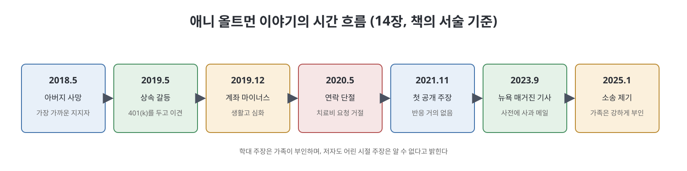

# 14장. 구원 (Deliverance)

이 장은 OpenAI의 기술이나 경영이 아니라 샘 올트먼의 여동생 애니 올트먼의 이야기를 다룬다. 2023년 9월 뉴욕 매거진 인물 기사가 애니의 존재를 주류 언론에 처음 알렸고, 저자는 그 뒤 애니와 가족, OpenAI 쪽을 취재해 그의 삶과 주장을 정리한다. 저자는 이 이야기를 OpenAI가 "이 회사를 이끄는 사람의 반영이자 연장"이라는 이해를 굳혀 준 사례로 쓴다. 이 장은 같은 이야기를 AI가 풍요를 가져온다는 서사와, 노동자와 활동가들이 겪는 현실에 겹쳐 본다.

> **읽기 전에**
> 이 장에는 가족 간 금전 갈등, 정신건강, 성매매, 아동 성학대 주장이 나온다. 모두 한 개인의 주장이고 가족은 학대 주장을 강하게 부인한다. 저자도 어린 시절의 학대 주장에 대해서는 "알 수 없다"고 분명히 밝힌다. 이 노트는 사실 여부를 판단하지 않고 책이 서술한 범위만 정리하며, 자극적인 세부는 줄였다.

---

## 이 장의 흐름

1. 2023년 9월 뉴욕 매거진 기사와 올트먼의 사과 메일
2. 저자의 취재와 각 측의 반응, 그리고 한계
3. 애니의 성장과 건강, 아버지의 죽음
4. 상속과 생활비를 둘러싼 갈등, 연락 단절
5. 책이 보는 "두 얼굴의 샘"과 AI의 풍요 서사
6. 학대 주장과 공개 폭로의 경과
7. 올트먼과 홍보 책임자의 대응, 저자가 본 권력 격차

---

## 1. 기사와 사과 메일

수츠케버가 토너에게 연락하기 몇 주 전, 올트먼은 홍보 위기를 맞고 있었다. 2023년 9월 25일 엘리자베스 와일이 뉴욕 매거진에 올트먼 인물 기사를 냈고, 여기에서 처음으로 주류 언론이 애니를 언급했다. 기사는 애니가 건강 문제와 주거 불안 속에 사는 모습을 올트먼의 고가 주택과 고급차 생활과 대비했다. 한 줄 요약으로 책은 애니가 샘의 공적 삶에서 "클럽에 들 사람이 아니었다"는 대목을 인용한다.

OpenAI는 사전에 논평 기회를 받았다. 이 과정에서 홍보 담당 부사장 해나 웡은 잡지와 올트먼 가족 사이의 연락 창구가 되었다. 기사가 나오기 전날 올트먼은 애니에게 메일을 보냈다. 속죄일을 앞두고 용서를 구한다는 말로 시작해, 자신이 어머니와 가족의 입장 사이에서 갈등하다가 지원을 이어 가지 않은 것은 잘못된 판단이었다고 사과했다. 기사가 나온 뒤 애니가 예전에 올렸던, 올트먼이 여러 방식으로 학대했다는 트윗이 다시 퍼졌다. 올트먼에게는 이것이 가족사의 아픈 일이 공개되는 고통이었고, 애니에게는 여러 해 허공에 외치다가 처음 들린다는 해방감이었다고 책은 쓴다.

## 2. 저자의 취재와 한계

저자는 2024년에 애니, 어머니 코니 깁스틴, 형제 맥스와 잭, 그리고 OpenAI 홍보팀을 통해 올트먼에게 연락했다. 반응은 다음과 같았다.

- **애니**: 적극 협조했다. 가족과 주고받은 메시지, 어린 시절부터의 신체·정신 건강 기록 등 방대한 자료를 건넸다.
- **어머니**: 가족이 애니를 사랑하고 걱정한다는 짧은 성명을 내고 애니의 주장을 "사실이 아니다"라고 했으나, 자세한 질의와 자료 요청에는 응하지 않았다.
- **형제**: 응답하지 않았다. OpenAI는 세부 사항에 논평하지 않았다.
- 2025년 1월 애니가 올트먼을 상대로 소송을 내자 올트먼, 어머니, 형제는 공동 성명으로 애니를 정신적으로 불안정하고 돈을 무리하게 요구한다고 묘사하고 주장이 시간이 갈수록 크게 변했다고 반박했다.

저자는 가족의 판단 이유를 전부 알지 못한다고 인정한다. 특히 어린 시절 올트먼에게 학대를 당했다는 애니의 주장은 알 수 없다고 밝힌다. 그럼에도 이 이야기가 OpenAI라는 이야기의 여러 주제를 압축한 작은 모형이라고 본다. 애니에 관한 보도는 올트먼의 신경을 유독 건드렸고 홍보 책임자까지 끌어들였다.

## 3. 성장, 건강, 아버지의 죽음

책은 애니를 오빠와 닮은 사람으로 그린다. 잘 들어 주고, 사소한 것을 기억하고, 엉뚱하고 관대하며, 사람의 신뢰를 빨리 얻는다는 것이다. 학업도 뛰어나 터프츠 대학에서 생물심리학을 전공하고 무용을 부전공했으며, 졸업 후 의대 진학 준비와 함께 샌프란시스코에서 신경과학 연구실 일을 했다. 그러나 대학 시절인 2014년 아킬레스건염으로 시작된 신체 문제가 이어져 만성 통증과 이동 제한이 생겼고, 여러 해에 걸쳐 건염 재발, 난소 낭종과 다낭성 난소 증후군 진단 등을 겪었다.

2018년 5월 25일, 가족 중 가장 가까웠던 아버지가 갑자기 심장마비로 세상을 떠났다. 책은 올트먼도 아버지의 죽음을 인생에서 가장 힘든 순간으로 말해 왔고, 그 일이 머스크가 공동 의장에서 물러난 지 몇 달 뒤였다고 짚는다. 애니는 아버지가 자신의 유일한 확고한 지지자였다고 말하며, 그 뒤 가족과 멀어졌지만 인정과 지원은 간절히 바랐다고 한다. 의대 대신 예술을 택한 일과 항불안제를 끊고 자연적 대처를 택한 일로 이미 어머니와 갈등이 있었다.

## 4. 상속과 생활비, 연락 단절

애니는 아버지의 생명보험으로 약 10만 달러를 받았다고 말한다. 이를 공연, 팟캐스트 같은 예술 활동과 월세, 의료비에 쓰다 2019년 중반 돈이 줄었다. 그해 5월 아버지가 자신에게 401(k)(미국의 퇴직연금 계좌)를 남겼다는 것을 알았으나, 생존 배우자로서 관리 권한이 있던 어머니가 세금 전략을 이유로 그 돈을 애니에게 주지 않겠다고 통보했다. 이메일은 재정적 독립이 최선이며 앞으로 상속분이 떨어지면 지원하지 않겠다는 내용이었고 "엄마, 샘, 맥스, 잭" 이름으로 서명되어 있었다.

2019년 12월 계좌가 마이너스가 되자 애니는 화상 통화로 돈을 버는 서비스에 처음 접속했다. 같은 해 올트먼은 마이크로소프트의 첫 10억 달러 투자를 끌어낸 상태였다. 이후 애니는 가족에게 도움을 요청했고 가족 상담 두 번 뒤 일정 기간 비용을 대 주기로 했다. 책은 가족이 돈이 해로운 행동을 부추길까 걱정했고 전문가 조언에 따라 독립을 격려하려 했다는 점을 함께 적는다.

2020년 5월 치료비를 더 요청했으나 거절당했다. 하와이로 옮겨 농장 일을 하던 때, 올트먼은 아버지의 유골과 형제들의 머리카락으로 만든 기념 다이아몬드를 보내겠다며 주소를 물었다. 애니에게 이 연락은 생존이 급한 자신의 처지를 모르거나 외면하는 것처럼 느껴졌고, 그는 가족과 연락을 끊었다.

이후 3년 동안 애니의 생활은 바닥을 쳤다. 2021년 봄여름 올트먼이 다시 연락해 집을 사 주겠다고 제안했는데, 애니는 소유가 아니라 거주만 허용하는 방식이라 이해해 건강과 진로에 가족이 간섭할 통로가 될까 우려했고, 가족은 신탁을 통한 주택 소유 제안이었다고 설명한다. 책은 이 부분에서 양측이 다르게 말한다고 적는다. 결국 올트먼이 1년간 집세를 집주인에게 직접 내기로 합의했고, 2022년 여름 애니가 다시 연락하지 않자 지급이 멈췄다.

## 5. 두 얼굴의 샘, 그리고 AI의 풍요 서사

저자는 여기서 해석의 층을 하나 더한다. 올트먼은 관대하면서 자기중심적이고, 상냥하면서 위협적이며, 많은 이에게 은인이면서 어떤 이에게는 큰 고통의 근원이라는 상반된 초상이 있다는 것이다. 공적으로는 진정성과 이타심을 보이지만 사적으로는 더 복잡한 계산이 보이고, 판 전체를 오직 자신만 보는 체스에서 왕의 권력을 지키는 것이 목적처럼 비친다고 쓴다.

이 이야기는 AI가 풍요의 세상을 연다는 거대 서사와도 부딪힌다. 올트먼은 AI가 빈곤을 끝내리라 기대하고, 브록먼은 의료가 크게 좋아지리라 말하고, 수츠케버는 값싸고 효과적인 심리 치료를 말했다. 저자는 케냐의 노동자, 칠레의 활동가, 올트먼의 여동생이 겪은 현실 앞에서 이런 꿈이 공허하게 들린다고 쓴다. AI의 발전은 애니의 절박함을 조금도 덜어 주지 못했고 오히려 더 얽맸을지도 모른다고 한다. 애니는 처음에 디지털 수단으로 예술을 수익화하려 했지만, 노출이 거의 없었고 팟캐스트 후기가 사라지는 일이 있었다. 전직 페이스북 데이터 과학자와 전문가들은 플랫폼이 성노동 관련 계정을 자동화된 시스템으로 추적해 제한하므로 첫 계정이 다른 활동의 노출까지 줄였을 **가능성이 있다**고 말한다. 가능성에 그치며 확정은 아니다.

책이 인용한 애니의 지인 네일리 메서슈미트의 말은 이렇다. "샘이 AI를 세상에 끌고 온 방식이 어린 여동생을 대한 방식과 같았다"는 취지이며, 오빠는 잘나가고 여동생은 틈새로 떨어진다는 것이다. 이는 한 지인의 평가로 읽어야 한다.

## 6. 학대 주장과 공개 폭로

저자는 애니가 가족과 단절한 뒤 2020년 말~2021년 초부터 어린 시절 성학대의 플래시백(갑작스러운 기억)을 겪었다고 전한다. 마우이의 트라우마 치료사 기록에는 불안, 외상 후 스트레스, 아동기 성학대 이력이 진단 소견으로 적혀 있으나, 기록에 특정 가해자는 없다. 책은 애니가 지인 메서슈미트에게 올트먼이 가해자였다고 말했다고 쓴다. 여기에 대해 저자는 수십 년 뒤 아동 학대를 입증하기는 흔히 어렵고, 심리학에서 기억이 방아쇠를 만나 갑자기 되살아나는 경우가 알려져 있다는 상담 전문가의 말을 덧붙이면서도, 이 서술의 목적은 무슨 일이 있었는지 확정하는 것이 아니라 애니가 어른으로서 경험하고 믿은 바를 재구성해 그가 목소리를 내게 된 동기를 보여 주는 것이라고 밝힌다.

애니는 2021년 11월 트위터에 처음으로 자신이 형제에게 여러 형태의 학대를 당했다고 공개했고, 반응은 거의 없었으며 일부는 남매 관계 자체를 의심했다. 2022년 9월 다시 올렸고, 2023년 7월 뉴욕 매거진의 연락을 받았다. 기사가 나온 뒤 3개월 만에 애니의 온라인 수입은 열 배 넘게 늘었고 성노동은 온라인 활동만 남겼다. 가족은 지원을 해 왔다고 주장하며 가정 상담 뒤의 지원 계획과 집세 지급을 예로 든다. 2023년 7월 올트먼은 조건 없이 돈을 주겠다는 메일을 보냈다. 지속적 관계는 원치 않는다면서도, 이메일의 많은 주장에 동의하지 않는다고 덧붙였다. 애니는 이제 그의 돈이 아니라 아버지가 남긴 몫을 원했고 답하지 않았다.

2024년 초 애니는 변호사를 선임했고 아버지의 신탁이 2023년에 새로 채워진 사실을 알게 되었다. 가족 측은 변호사를 통해 신탁에서 조건 없는 월 지급을 논의했고, 가족은 공개 성명에서 평생 지원을 예상한다고 밝혔다. 애니는 4년 만에 안정된 집을 얻었고, 2025년 1월 8일 이전에 올트먼을 상대로 아동 성학대 소송을 낼 준비를 했다. 소송은 가족이 강하게 부인하는 내용을 주장한다. 애니는 2024년 10월 오랜 건강 문제의 원인으로 과운동성 엘러스-단로스 증후군을 진단받았는데, 책은 브록먼의 아내와 같은 병이라고 덧붙인다.

## 7. 올트먼과 홍보 책임자의 대응, 권력 격차

책은 기사 직전 올트먼이 주변에 여동생이 경계성 성격장애가 있다고 말했고, 한 사람이 이를 "기사가 나오기도 전에 애니의 말을 무력화했다"고 평했다고 쓴다. 저자가 본 애니의 치료·의료 기록에는 그런 진단이 없고, 치료사가 한 번 평가한 흔적만 있었으며 최종 소견에는 없었다. 저자가 상담한 전문가들은 이 장애가 대체로 호전되며 예후가 좋다고 말했다고 쓴다(이 전문가들은 애니의 사례를 직접 검토하지 않았다).

OpenAI는 처음 사무실 방문과 경영진 인터뷰를 주선하겠다고 했다가, 저자가 샌프란시스코 출장을 앞둔 시점에 방문을 취소하고 이 책에 더는 참여하지 않겠다고 통보했다. 출장 중 저자가 애니와 이야기하고 있다는 소문이 퍼지자 해나 웡이 만나자고 했고, 그 자리에서 웡은 애니에게 정신건강 문제가 있다는 점과 가족이 보호와 방임 방지 사이에서 균형을 잡으려 한다는 점을 거듭 강조했다. 저자는 이것이 웡이 전하러 온 핵심 메시지였다고 보며, 회사와 올트먼의 개인사가 얼마나 가깝게 연결되어 있는지 보여 준다고 평가한다. 이 부분은 저자 본인의 경험과 해석이며 웡 측 입장은 이 장에 실려 있지 않다.

저자는 애니의 경험을 AI 제국에 밀려난 다른 사람들, 곧 데이터 노동자나 데이터센터 반대 활동가들과 잇는다. 자료를 모아 가며 누구든 들어 주기를 바라야 하는 권력 격차, 아주 적은 것을 걸고 맞서다 수십억 달러와 인프라와 몇 마디 부드러운 말로 항의를 가라앉히는 상대를 보는 분노와 무력감이 닮았다는 것이다. 기사 이후 애니는 더 이상 허공에 외치지 않게 되었다. 장의 마지막은 그의 글이 수츠케버의 눈에 들어갔다는 서술로 끝나며, 수츠케버가 올트먼에게서 본다는 "학대의 패턴"에 대한 고민과 이어진다는 암시로 마무리된다. 원문이 이 시점을 2022년 10월로 적은 것은 앞 맥락과 어긋나 보여 이 노트에서는 날짜를 옮기지 않았다.

---

## 표. 애니 올트먼 이야기 연표 (책의 서술 기준)

| 시기 | 사건 | 비고 |
|------|------|------|
| 2014년 | 아킬레스건염 진단 | 신체 문제의 시작 |
| 2018년 5월 | 아버지 사망 | 애니의 가장 가까운 지지자 |
| 2019년 5월 | 401(k) 상속 건 통보 | 어머니가 관리, 독립 강조 이메일 |
| 2019년 12월 | 계좌 마이너스, 첫 온라인 성노동 | 올트먼은 MS 첫 투자 확보 직후 |
| 2020년 5~6월 | 치료비 요청 거절, 연락 단절 | 하와이로 이동 |
| 2021년 봄~2022년 여름 | 올트먼의 연락 재개와 집세 1년 지급 | 집 제안은 양측 설명이 다름 |
| 2021년 11월 | 애니의 첫 공개 주장 | 반응 거의 없음 |
| 2023년 9월 25일 | 뉴욕 매거진 기사 | 사전에 올트먼 사과 메일 |
| 2025년 1월 | 애니가 소송 제기 | 가족은 강하게 부인 |

---

## 핵심 정리

- **이 장은 올트먼이라는 사람을 보는 렌즈다.** 저자는 애니 이야기를 OpenAI가 올트먼의 반영이자 연장이라는 이해를 굳혀 준 사례로 쓴다.
- **사실과 주장이 구분되어 있다.** 가족 성명과 애니의 기록이 엇갈리는 지점(집 제안 등)은 양쪽을 병기하고, 아동기 학대 주장은 저자 스스로 "알 수 없다"고 밝힌다.
- **AI의 풍요 서사와 현실이 대비된다.** 빈곤 해소, 의료와 치료 개선 약속이 케냐 노동자, 칠레 활동가, 애니의 현실 앞에서 공허하다는 것이 저자의 평가다.
- **회사와 개인사의 경계가 흐릿했다.** 홍보 책임자가 올트먼 가족 이슈에 직접 관여한 모습이 책에 묘사된다.
- **이 이야기는 이사회 위기로 이어진다.** 애니의 글이 수츠케버의 눈에 들어왔고, 그가 올트먼의 행동에서 본다는 "학대의 패턴"에 대한 고민과 겹친다는 서술로 이사회 위기 이야기가 이어진다.

---

[이전: 13장 두 예언자](13%EC%9E%A5%20%EB%91%90%20%EC%98%88%EC%96%B8%EC%9E%90.md) | [3부 Readme](Readme.md) | [3부 핵심 정리](%ED%95%B5%EC%8B%AC%20%EC%A0%95%EB%A6%AC.md)
