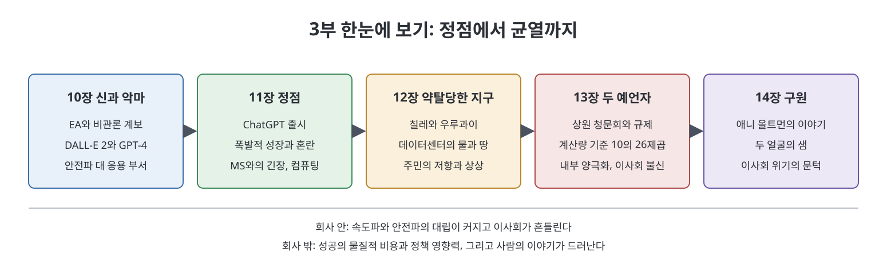

# 3부 (10장~14장)

3부는 OpenAI가 가장 높은 곳에 오른 시기를 다룬다. GPT-4와 ChatGPT가 성공을 가져오고, 그 성공이 회사 안팎에서 무엇을 바꿨는지가 이야기의 중심이다. 저자는 이 시기를 세 방향에서 본다. 회사 안에서는 속도를 내려는 쪽과 조심하려는 쪽의 대립이 커진다. 회사 밖에서는 AI를 돌리는 데이터센터가 땅과 물에 미치는 비용과 워싱턴에서의 정책 영향력이 드러난다. 그리고 마지막에는 샘 올트먼이라는 사람 자체를 비추는 이야기로 이사회 위기의 문턱에 이른다.

> **3부를 한 문장으로**
> 가장 크게 성공한 순간에 OpenAI 안에서는 균열이 깊어지고, 그 성공의 비용은 칠레의 사막과 워싱턴의 회의장과 올트먼의 가족사로 퍼져 나간다.

3부 제목은 이 노트가 참고한 원문 쪽(3부 표지)에 따로 적혀 있지 않다. 이 노트에서는 "3부"라고만 부른다.

---

## 0. 먼저 알아 둘 것: 3부의 큰 그림

3부의 다섯 장은 시간 순서를 따르면서도 장마다 시선이 다르다.

- 10~11장은 **회사 안**에서 일어난 일이다. 제품을 내놓을 때마다 안전파와 응용 부서가 부딪히고, ChatGPT가 터지면서 회사가 통제하기 어려울 만큼 빠르게 커진다.
- 12장은 **회사 밖의 물질적 비용**이다. AI를 훈련하고 돌리는 데이터센터가 필요로 하는 땅, 전기, 물을 칠레와 우루과이 사례로 보여 준다.
- 13장은 **워싱턴과 이사회**다. 올트먼의 정책 로비, 그와 맞물린 규제 논의, 그리고 이사회 안의 불신을 그린다.
- 14장은 **한 사람의 이야기**다. 올트먼의 여동생 애니의 사연을 통해 이 회사가 이끄는 사람을 어떻게 닮았는지 따져 본다.

이 모든 이야기는 저자의 서술과 해석이라는 점을 염두에 두고 읽는 것이 좋다. 노트는 "저자에 따르면" 같은 표현으로 출처를 구분했다.

### 3부에 자주 나오는 말

| 용어 | 쉬운 설명 |
|------|-----------|
| AGI | 사람 수준으로 폭넓은 일을 해내는 인공지능. OpenAI가 목표로 내세운 개념이다. |
| Boomer, Doomer | 이 책이 쓰는 구분. AI가 세상을 구하리라 보며 빨리 가자는 쪽이 Boomer, 인류에 큰 위험이 되리라 보며 조심하자는 쪽이 Doomer다. |
| 안전파(Safety clan) | OpenAI 안에서 AI의 위험 대응을 우선시하는 사람들의 모임. |
| 응용 부서(Applied) | 연구 결과를 제품으로 만들어 내놓는 쪽. |
| 효과적 이타주의(EA) | 같은 자원으로 가장 큰 선을 만들자는 사회 운동. AI 안전 연구 지원과 가까웠다. |
| RLHF | 사람의 평가를 반영해 모델의 답을 다듬는 방법. |
| 배포안전위원회(DSB) | 마이크로소프트와 OpenAI가 새 모델을 내보낼지 심사하려고 만든 위원회. |
| 반복 배포 | 모델을 일찍, 자주 내놓고 피드백으로 고쳐 가는 OpenAI의 방식. |
| 프런티어 모델 | 아직 없지만 위험할 수 있다고 가정한 최첨단 모델. 규제 논의의 핵심 용어였다. |
| 데이터센터 | AI를 훈련하고 서비스하는 컴퓨터들이 모인 시설. 전기와 냉각용 물을 많이 쓴다. |
| 초정렬(Superalignment) | 사람보다 똑똑한 AI를 인간 뜻에 맞추려는 OpenAI의 팀 이름. |

### 3부 주요 인물과 조직

| 이름 | 쉬운 설명 | 주로 나오는 장 |
|------|-----------|----------------|
| 샘 올트먼 | OpenAI CEO | 전체 |
| 그렉 브록먼 | OpenAI 공동 창업자, 제품과 모델 개발을 이끎 | 10~11, 13장 |
| 일리야 수츠케버 | OpenAI 수석 과학자, 안전 쪽으로 기움 | 10, 13, 14장 |
| 미라 무라티 | OpenAI 경영진 | 10~11장 |
| 이사회 독립 이사 | 디안젤로, 맥콜리, 토너 | 13장 |
| 마이크로소프트 | OpenAI의 최대 투자자이자 컴퓨팅 제공자 | 10~13장 |
| 칠레·우루과이의 활동가들 | 데이터센터에 맞선 주민들 | 12장 |
| 애니 올트먼 | 샘 올트먼의 여동생 | 14장 |

---

## 1. 문서 목록

처음 읽는다면 아래 순서가 자연스럽다. 앞 장의 사건을 뒤 장이 이어받는다.

| 순서 | 문서 | 이런 질문에 답한다 |
|:---:|------|------------------|
| 1 | [10장 신과 악마](10%EC%9E%A5%20%EC%8B%A0%EA%B3%BC%20%EC%95%85%EB%A7%88.md) | 안전파와 응용 부서는 왜 제품마다 부딪혔나? |
| 2 | [11장 정점](11%EC%9E%A5%20%EC%A0%95%EC%A0%90.md) | ChatGPT 출시는 회사를 어떻게 바꿨나? |
| 3 | [12장 약탈당한 지구](12%EC%9E%A5%20%EC%95%BD%ED%83%88%EB%8B%B9%ED%95%9C%20%EC%A7%80%EA%B5%AC.md) | AI의 성장은 땅과 물에 어떤 비용을 남기나? |
| 4 | [13장 두 예언자](13%EC%9E%A5%20%EB%91%90%20%EC%98%88%EC%96%B8%EC%9E%90.md) | 워싱턴에서는 어떻게 규제 논의가 짜였고 이사회는 왜 흔들렸나? |
| 5 | [14장 구원](14%EC%9E%A5%20%EA%B5%AC%EC%9B%90.md) | 올트먼 가족사는 이 회사 이야기와 어떻게 이어지나? |
| 6 | [핵심 정리](%ED%95%B5%EC%8B%AC%20%EC%A0%95%EB%A6%AC.md) | 3부 전체를 빠르게 복습하려면? |

- **10장 신과 악마**: EA와 안전 사상, DALL-E 2와 GPT-4, 안전 대 응용의 충돌
- **11장 정점**: ChatGPT 출시, 폭발적 성장과 조직의 혼란, 마이크로소프트와의 긴장, 컴퓨팅 확보 경쟁
- **12장 약탈당한 지구**: 칠레와 우루과이의 데이터센터 사례, 물과 땅, 주민의 저항과 대안 상상
- **13장 두 예언자**: 상원 청문회, 계산량 기준 정책, 내부 양극화, 이사회의 불신
- **14장 구원**: 애니 올트먼의 이야기, 저자의 취재와 한계, 권력 격차

---

## 2. 읽을 때 유의할 점

- 이 노트는 번역이 아니라 **내용을 풀어 쓴 학습 노트**이며, 책이 서술한 범위 안에서만 정리했다.
- 14장에는 실존 인물에 대한 민감한 주장이 나온다. 노트는 책의 서술을 "주장"과 "반박"으로 구분했고 사실 여부를 판단하지 않는다.
- 사람과 조직의 행동·평가는 대부분 **저자의 시각**이다. 당사자의 반론이 책에 실려 있지 않은 경우가 있다.

 
