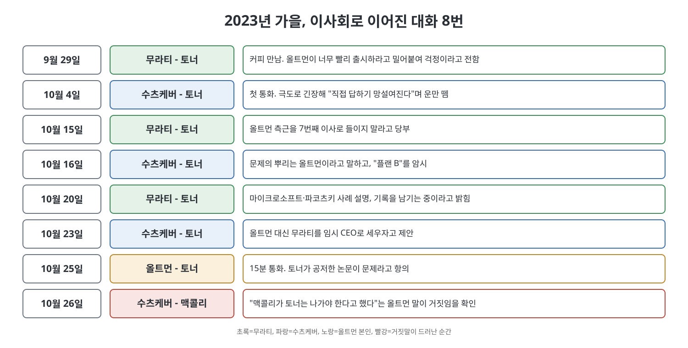
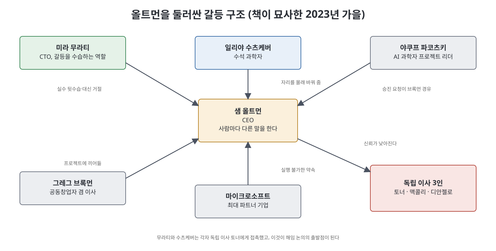

# 15장 도박수 (The Gambit)

2023년 가을, OpenAI의 경영진 두 사람이 서로 모르게 같은 이사에게 다가간다. CTO 미라 무라티와 수석 과학자 일리야 수츠케버다. 이 장은 두 사람이 왜 독립 이사 헬렌 토너에게 마음을 열었는지, 그 대화가 어떻게 "CEO를 바꿔야 하나"라는 질문으로 번졌는지를 따라간다. 저자 카렌 하오는 이 과정을 무라티의 성장 배경 소개로 시작해, 가을 한 달 동안 오간 통화와 만남을 날짜순으로 보여 준다. 마지막은 올트먼이 토너의 논문을 문제 삼다가 거짓말이 드러나는 장면이다. 이 장의 내용은 모두 책이 서술한 범위이며, 책은 인물의 속마음을 당사자와 주변인의 증언에 기대어 전한다.

> **이 장을 한 문장으로**
> 해임은 하루아침의 쿠데타가 아니라, 가을 내내 쌓인 불신이 두 경영진의 입을 통해 이사회로 흘러 들어간 결과였다고 책은 그린다.

---

## 이 장의 흐름

1. 무라티는 어떤 사람이고, 올트먼 곁에서 어떤 역할을 했나
2. 무라티가 본 올트먼: 사람마다 다른 말, 빨라지는 출시, 반복되는 뒷수습
3. 수츠케버의 불안: 팀 갈등, 신뢰 상실, 여동생 애니의 주장
4. 토너와의 대화들: 10월 한 달 동안의 통화 일지
5. 올트먼의 반격처럼 보이는 논문 사건과 맥콜리 확인 통화

---

## 1. 무라티는 어떤 사람인가

책은 무라티를 알바니아에서 자란 사람으로 소개한다. 어린 시절 공산 체제에서 시장경제로 급변하는 혼란을 겪었고, 폭동과 폭력의 흔적을 피해 등교했다는 이야기다. 그녀는 수학과 과학에서 안정을 찾았고, 열여섯 살에 캐나다 사립학교 장학생으로 유학한 뒤 다트머스에서 기계공학을 전공했다. 항공우주 회사를 거쳐 테슬라에서 모델 X 제품 담당으로 일하며 "복잡한 제품을 압박 속에서 만드는 법"을 익혔고, 그곳에서 AI에 끌렸다고 한다. 이후 AR/VR 회사 립모션을 거쳐 2018년 OpenAI에 합류했다.

OpenAI가 비영리에서 상업 조직으로 바뀌는 동안 그녀는 응용 부문과 제휴를 맡아 마이크로소프트와의 핵심 관계를 관리했다. 2022년 5월에는 공식 CTO가 됐다. 책에 따르면 그녀는 자기 과시가 적고 잘 들어 주며, 어려운 결정을 내리는 데 능한 사람으로 평가받았다. 한편 초기 연구 문화를 그리워하는 일부 연구자는 그녀를 "과학자가 아니라 엔지니어"로 보고 OpenAI의 상업화 상징처럼 여기기도 했다.

**쉽게 말하면**: 무라티는 사장과 직원 사이의 통역사이자 소방수 같은 자리에 있었다. 올트먼의 결정을 실행하는 사람이면서, 팀이 반대할 때는 그 팀의 대변인이기도 했다.

## 2. 무라티가 본 올트먼

책이 전하는 무라티의 불만은 몇 가지로 정리된다.

- **양쪽에 다 맞장구**: 두 팀이 의견이 갈리면 올트먼은 각자에게 개별적으로 동의해 혼란과 불신을 키웠다는 것이다.
- **브록먼의 개입**: 무라티는 공동창업자 그레그 브록먼을 "나쁜 두 번째 CEO"처럼 느꼈다. 프로젝트에 마구 뛰어들어 사람들을 번아웃으로 몰았다는 설명이다. GPT-4 개발기에는 핵심 사전학습 팀원들이 그만둘 뻔했다고 한다.
- **마이크로소프트와의 약속**: 무라티가 현실적인 약속안을 만들어 두면 올트먼이 마이크로소프트 임원 앞에서 로드맵에 없는 요구를 받아들였다. 사티아 나델라가 사실상 "세 번째 CEO"처럼 보일 만큼 올트먼이 마이크로소프트에 순종적이었다고 책은 쓴다.
- **절차 건너뛰기**: 올트먼은 법무팀이 GPT-4 터보를 DSB(배포 전 안전 심사) 면제로 판단했다고 무라티에게 말했지만, 법무를 총괄하는 제이슨 권은 그런 판단을 한 적이 없었다고 했다.
- **불편한 피드백 뒤의 침묵**: 무라티가 여름에 상세한 피드백을 주자 올트먼은 그녀를 따돌렸고, 관계를 회복하는 데 몇 주가 걸렸다. 올트먼은 그녀가 이사회에 말했을까 가장 신경 썼지만, 실제로는 하지 않았다.

특히 최근에는 수츠케버가 "뜨거운 의자"에 앉았다. 수츠케버 밑의 연구자 야쿠프 파코츠키가 인정받지 못한다고 불만을 품자, 올트먼이 브록먼을 거쳐 그에게 더 높은 연구 직책을 주었는데 수츠케버에게는 알리지 않았다는 것이다. 두 사람은 같은 연구를 각자 다른 방향으로 이끌게 됐고, 몇 달간 연구 부문이 흔들렸다.

## 3. 수츠케버의 불안

수츠케버의 걱정은 두 갈래였다. 하나는 AGI(인간 수준의 범용 AI)가 곧 올 것이라는 확신에서 오는 책임감이다. 다른 하나는 올트먼 아래서 OpenAI가 과연 AGI에 도달하거나 그 책임을 질 수 있느냐는 회의였다. 챗GPT 이후 OpenAI에서 승진하는 일이 실리콘밸리 최고의 사회적 자산이 되면서 내부 정치가 심해졌고, 올트먼이 "각자가 듣고 싶은 말"을 해 주며 작은 거짓말과 큰 거짓말을 섞는 일이 거의 매일이 됐다고 그는 봤다.

여기에 올트먼의 여동생 애니의 SNS 글이 다시 퍼졌다. 수츠케버는 사실 여부는 모른다고 하면서도, 오래된 문제적 행동의 증거일 수 있다고 느꼈다. 그가 보기에 "학대(abuse)"라는 말이 올트먼에 대한 자신의 관찰과 맞아떨어졌다. 앞서 다리오 아모데이가 OpenAI를 떠나며 남긴 경고, "심리적 학대"라는 표현의 뜻도 이제야 이해가 됐다는 것이다.

### 쉽게 이해하는 핵심 용어

| 용어 | 쉬운 설명 |
|------|-----------|
| 독립 이사 | 회사 경영진이나 주주가 아닌 입장에서 CEO를 감시하는 이사. OpenAI 비영리 이사회에서는 토너, 맥콜리, 디안젤로가 이 역할이었다. |
| DSB | 신제품을 내놓기 전에 안전을 점검하는 심사 기구. 올트먼이 이를 건너뛰려 했다는 대목이 나온다. |
| 아웃터/이너 얼라인먼트 | 수츠케버의 비유. 이사회(바깥 통제)와 경영진(안쪽 운영)이 모두 제대로 정렬되어야 한다는 말이다. 토너는 이사회를, 그는 경영진을 고쳐야 한다고 봤다. |
| 임시 CEO | 새 CEO를 찾기 전까지 맡는 대행. 수츠케버는 무라티를 제안했다. |

## 4. 토너와의 대화 일지

토너가 무라티를 처음 만난 것은 9월 29일 커피 자리였다. 평범한 업무 보고처럼 시작했지만 무라티는 올트먼이 출시를 너무 서두른다는 걱정을 내비쳤다. 며칠 뒤 수츠케버가 2년 만에 처음으로 단독 면담을 요청했고, 10월 4일 그는 말을 잇지 못할 만큼 긴장해 있었다. 그는 구체적인 사실은 밝히지 않고 OpenAI가 "겉보다 훨씬 까다로운 환경"이라고만 말했다.

흐름은 이렇게 이어진다.

- **10월 15일, 무라티**: 올트먼이 자기 자리가 위협받는다고 느끼고 있다고 전했다. 이사회가 그를 쫓아낼 생각은 전혀 없었기에 토너는 놀랐다. 무라티는 7번째 이사 자리에 올트먼 측근을 앉히지 말고 마이크로소프트의 배포와 DSB를 살피라고 당부했다.
- **10월 16일, 수츠케버**: 파코츠키 사례를 들어 올트먼의 패턴을 설명하고, 아모데이와 애니 이야기도 꺼냈다. 이사 증원보다 경영진 문제가 핵심이며, 결정적 증거가 없으니 이사회가 결국 "손쓸 수 없다"고 결론 내릴 가능성이 크다는 걱정도 했다. 브록먼이 이사에서 물러나는 방안에는 "플랜 B로 비슷한 방향을 생각해 왔다"고만 답했다.
- **10월 20일, 무라티**: 마이크로소프트 회의와 파코츠키 건을 이야기했다. 그녀는 메모를 쓰고 있으며, "정보가 올트먼에게서만 오지 않게 하라"고 충고했다.
- **10월 23일, 수츠케버**: 무라티와 토너가 이야기했다는 사실을 알고 더 솔직해졌다. 그는 "AGI의 버튼에 손가락을 올려 둘 사람이 샘은 아니라고 생각한다"고 했고, 무라티를 임시 CEO로 세우자고 말했다. 이후 세 독립 이사가 의견을 나눠 보니 무라티도 "샘이 AGI로 이끄는 것이 불편하다"고 말했다는 사실이 확인됐다. 이사들은 이를 매우 무겁게 받아들였다.

같은 시기 토너, 맥콜리, 디안젤로는 비영리 이사회가 독립된 법률 자문이 없다는 약점도 확인했다. 모든 법률 지원이 영리 법인의 변호사를 거쳤기 때문이다. 이들은 새 비영리 변호사를 두기로 했다.

## 5. 논문 사건과 맥콜리 확인

10월 25일 올트먼이 토너에게 전화해 그녀가 CSET(토너의 본업 직장인 연구 기관)에서 공저한 논문이 문제라고 했다. 65쪽짜리 논문에서 OpenAI가 언급된 것은 28~30쪽에 불과했다. 내용은 OpenAI와 앤트로픽이 모델을 내놓는 전략의 장단점을 비교한 것으로, GPT-4 안전 평가를 투명하게 공개한 점은 칭찬했다. 그런데 OpenAI 슬랙에는 OpenAI를 비판하고 앤트로픽을 칭찬한 세 문단만 올라와 "꽤 매운 비교"라는 반응이 오갔다고 책은 쓴다.

올트먼은 FTC 조사 등으로 규제 압박을 받는 때에 이사가 회사를 비판하는 모습이 좋지 않다고 했고, 토너는 논문을 변화한 환경에서 다시 검토하지 못한 점을 인정했다. 그녀는 이사회에 사과 이메일을 보내 마무리했다고 믿었다. 하지만 올트먼은 사내 일부에 "비판이 이사회에서 나오면 무게가 다르다"는 취지의 메일을 보냈고, 수츠케버에게는 토너가 이사에서 물러나야 하며 맥콜리도 동의했다고 말했다.

수츠케버가 10월 26일 맥콜리에게 직접 물었다. 맥콜리는 그런 말을 한 적이 없다고 답했다. 올트먼이 10월 24일 늦게 전화해 논문 이야기를 하기는 했지만, 맥콜리는 논문을 읽지도 않았고 토너와 직접 대화하라고 권했다는 것이다. 저자는 이 장면을 "특정한 거짓말"이 눈앞에서 실시간으로 일어난 사례로 강조한다. 통화 직후 수츠케버와 토너는 세 독립 이사가 모여야 할 때가 왔다고 결론을 내린다.

## 한눈에 보는 연표

| 날짜(2023) | 사건 |
|-----------|------|
| 9월 29일 | 무라티와 토너의 커피 만남 |
| 10월 4일 | 수츠케버가 토너에게 첫 단독 면담 |
| 10월 15~16일 | 무라티와 수츠케버가 각각 토너와 통화 |
| 10월 20일 | 무라티가 토너에게 마이크로소프트 문제 등을 전함 |
| 10월 23일 | 수츠케버가 올트먼 교체와 무라티 임시 CEO안을 제안 |
| 10월 24일 | 토너, 맥콜리, 디안젤로가 독립 법률 지원 필요성에 합의 |
| 10월 25일 | 올트먼이 토너에게 논문 문제를 제기 |
| 10월 26일 | 수츠케버가 맥콜리에게 확인, 올트먼의 말이 사실이 아님이 드러남 |

## 핵심 정리

- 무라티는 올트먼과 연구진 사이의 통역사였지만, 올트먼이 사람마다 다른 말을 하고 약속을 번복하는 바람에 뒷수습에 시달렸다고 책은 전한다.
- 수츠케버는 출시 속도 경쟁과 내부 정치가 연구 속도와 AI 안전 판단을 모두 갉아먹는다고 보았고, 올트먼이 "AGI의 버튼"을 쥐어서는 안 된다고 결론 냈다.
- 두 경영진 모두 결정적 물증은 없고 "쌓인 패턴"이 문제라고 했다는 점이 이 장의 핵심 난점이다. 결정적 증거가 없는 상태에서 이사회는 판단해야 했다.
- 올트먼이 토너의 논문을 빌미로 이사진을 갈라놓으려 했다는 이야기는, 맥콜리 확인 통화로 불신을 결정적으로 키운다.

---

이전: [4부 개요](Readme.md) | 다음: [16장 첩보전](16%EC%9E%A5%20%EC%B2%A9%EB%B3%B4%EC%A0%84.md)
