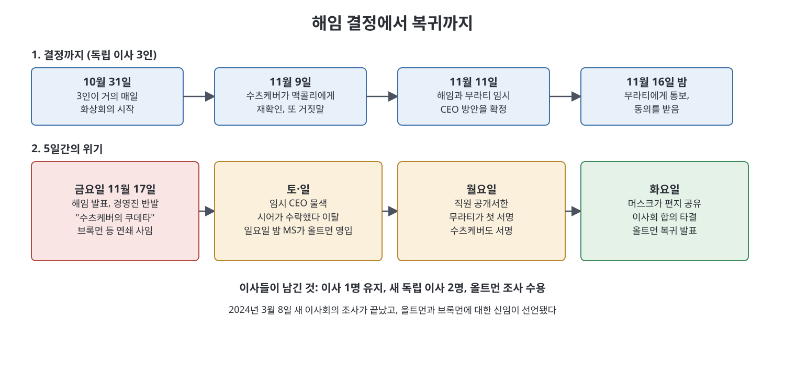

# 16장 첩보전 (Cloak-and-Dagger)

15장이 불신이 이사회로 흘러든 과정이었다면, 16장은 그 이사회가 실제로 올트먼을 해임하고, 5일 만에 모든 것이 뒤집히는 과정이다. 제목의 "첩보전(Cloak-and-Dagger)"은 비밀 회의, 사라지는 이메일, 익명 계정 같은 장치가 줄줄이 등장하는 데서 나온 말로 읽힌다. 장의 후반부에는 저자 본인이 머스크가 공유한 익명 편지의 비밀 받은편지함을 우연히 들여다보게 된 취재담이 나오고, 마지막에는 위기 이후의 사내 분위기와 새 이사회의 조사 결과가 이어진다.

> **이 장을 한 문장으로**
> 이사회는 "신뢰가 무너졌다"는 이유로 CEO를 해임했지만, 그 판단을 직원·투자자·마이크로소프트에게 설득하지 못해 5일 만에 되돌려졌다고 책은 그린다.

---

## 이 장의 흐름

1. 독립 이사 3인의 숙의: 무엇을 근거로, 무엇을 배제했나
2. 비밀 유지와 결정: 11월 11일 결정, 16일 밤 무라티에게 통보
3. 해임 발표(11월 17일) 이후 5일: 수츠케버와 무라티의 이탈, 올트먼 복귀
4. 머스크의 편지와 저자의 취재: 익명 받은편지함의 정체
5. 위기 뒤: Q*, 소란 후의 일상, 조사 결과와 새 이사회

---

## 1. 독립 이사 3인의 숙의

10월 31일부터 토너, 맥콜리, 디안젤로는 거의 매일 화상 회의를 했다. 수츠케버는 이미 해임으로 마음을 굳혔지만 일부러 논의 자리에서 빠졌다. 이사들이 스스로 결론을 내려야 했고, 그가 회사 지분을 가지고 있다는 점도 영향을 줄 수 있었기 때문이다. 이사들은 나중에 세 번째 이유도 말해 준다. 그들은 올트먼에 대한 신뢰가 워낙 낮아서, 올트먼이 이사들의 충성을 시험하려고 수츠케버를 보낸 것은 아닌가 하는 의심까지 했다고 한다.

이사들이 정리한 근거는 다음과 같다. 올트먼과 한두 단계 거리에 있는 최소 일곱 명(수츠케버, 무라티, 아모데이 포함)에게서 비슷한 피드백을 들었고, 몇몇은 그의 행동을 학대와 조작이라 했다. 이사들이 직접 발견한 문제도 있었다. 비영리의 무력화, 오픈AI 스타트업 펀드의 법적 소유 사실 미공개, 마이크로소프트의 DSB 위반을 알리지 않은 일, 디안젤로(그리고 이제는 토너)를 이사에서 밀어내려 한 시도다. 이들은 애니의 주장은 아예 다루지 않기로 했다. 판단 대상은 CEO로서의 직무 역량이었다.

이들은 두 가지 사고 실험도 했다. 하나는 OpenAI가 세상에서 가장 영향력 있는 AI 회사인데, 최고 경영진이 CEO의 정보를 믿지 못하는 상황이 괜찮은가였다. 다른 하나는 "만약 인스타카트 같은 평범한 회사라면 이 행동이 해임 사유인가"였다. 결과는 경우에 따라 다르지만, 어느 쪽이든 올트먼이 성숙해 가는 회사를 이끌 최적의 사람인지는 불확실하다고 봤다. 일상 운영은 이미 무라티가 하고 있다는 판단도 있었다.

수츠케버는 무라티와 함께 모은 문서와 스크린샷을 "사라지는 이메일"로 보냈다. 책은 결정적 증거라기보다 올트먼이 사람마다 다른 말을 했다는 사례의 누적이었다고 설명한다. 또한 올트먼이 글로 남기기를 피하고 구두로 소통하며, 나중에 상대가 "잘못 기억하는 것"이라고 말해 빠져나간다는 점도 문제로 지적됐다.

이사들은 마이크로소프트에 알릴지, 추가 조사를 할지, 제3의 임원에게 접촉할지 따져 봤지만 모두 하지 않기로 했다. 새 사람이 알 때마다, 결정이 늦어질 때마다 올트먼이 눈치채고 판을 뒤집을 가능성이 높아진다고 봤기 때문이다.

## 2. 마지막 확인과 통보

11월 9일 수츠케버가 맥콜리와 다시 통화했다. 올트먼이 "타샤가 계속 헬렌의 이사직 사퇴를 지지한다"고 말했다는 것이다. 맥콜리는 그 뒤 올트먼과 대화한 적이 없었다. 책은 이것이 첫 번째보다 더 노골적인 거짓말이었다고 쓴다. 이사들은 위기 둘째 날 중재 자리에서 이 거짓말을 직접 따졌고, 올트먼은 잠시 당황해 "그렇게 말할 수 있었다고 생각했다"고 중얼거렸다. 저자는 토너 논문의 비중이 언론에서 과장된 데에는 올트먼 측이 기자에게 흘렸을 가능성도 있다고 이사들이 믿는다고 전한다.

11월 11일 토요일, 이사들은 올트먼을 해임하고 무라티를 임시 CEO로 세우기로 결정했다. 16일 밤 네 사람이 무라티에게 화상 통화로 알렸고, 그녀는 놀라면서도 수용적이었다. "그는 지금 너무 편집증적이에요"라고 했고, 결정에 "완전히" 편안하다고 답했다. 이사들은 이 순간 자신들이 얼마나 큰 오판을 했는지 몰랐다고 책은 쓴다.

## 3. 발표 이후 5일

11월 17일 금요일 공개 발표 직후 상황이 급격히 나빠진다. 올트먼과 브록먼이 이번 해임을 "수츠케버가 벌인 쿠데타"라고 주변에 말하고 다녔고, 수츠케버의 전사 회의 설명도 서툴렀다. 제이슨 권과 안나 마칸주는 이사들이 쓴 "일관되게 솔직하지 않았다"는 표현을 격렬히 부정하며 증거를 요구했다. 이사들은 무라티를 밝히지 않고는 증거를 낼 수 없다고 느꼈다. 이사들이 받은 자료상 올트먼에게 비슷한 우려를 가졌던 임원들도 그 자리에서는 침묵했다.

**수츠케버**는 첫날 밤부터 흔들렸다. 책은 그가 올트먼에 대해 한 말은 굳게 지키되, 의도는 OpenAI를 강하게 하려는 것이었지 해체가 아니었다고 쓴다. 그는 주말 내내 이사들에게 재고를 호소했다.

**무라티**는 이사들의 기대와 달랐다. 겉으로는 의견을 나눴지만 이사회 결정을 공개적으로 지지하지는 못했다. 금요일에 브록먼이 항의 사임했고 파코츠키, 시몬 시도르, 알렉산더 마드리도 뒤따랐다. 그녀는 이사들이 먼저 결정을 정당화해야 한다고 느꼈다고 한다.

이사들은 새 임시 CEO를 찾았다. 다리오 아모데이에게도 제안했지만 관심이 없었고, 주말 내내 들뜬 모습이었다고 책은 전한다. 일요일에는 트위치 공동창업자 에밋 시어가 수락했지만, 책은 월스트리트저널 보도를 인용해 시어가 올트먼과 같은 YC 동기이고 에어비앤비의 브라이언 체스키의 친구이기도 했다고 한다. 체스키와 리드 호프먼이 전화를 돌려 투자자를 달래는 사이 시어도 올트먼 편으로 기울었다. 일요일 밤에는 마이크로소프트의 나델라가 올트먼과 브록먼이 새 AI 연구 조직을 이끈다고 발표했다. 다른 AI 연구소들이 인재를 노리고 있었다.

월요일 새벽 직원 공개서한이 만들어졌다. 이사회 결정에 항의하고 마이크로소프트로 옮기겠다고 경고하는 내용이다. 무라티가 첫 번째로 서명했고, 곧 서명이 눈덩이처럼 불었다. 많은 직원이 올트먼보다 무라티를 더 신뢰했고, 직원들의 지분 매각(텐더 오퍼)을 지킬 모금 능력이나 실리콘밸리의 영향력 때문에 올트먼을 택한 사람도 있었다. 수츠케버도 새벽에 서명했다. 한 연구자의 말처럼, 무라티가 없었다면 올트먼이 해낼 수 없었을 것이라는 시각이 소개된다. 이사들에게는 그녀의 망설임이 "자기실현적 예언"처럼 느껴졌다. 무라티는 나중에 직원들에게 이사회에 먼저 피드백을 준 적은 없고, 이사들이 연락했을 때 올트먼이 이미 아는 피드백만 줬다고 해명했다.

월요일 아침 이사들은 졌다는 것을 알았다. 그래서 목표를 바꿨다. 이사 한 명 유지, 올트먼에 맞설 수 있는 독립 이사 두 명 확보, 올트먼의 조사 수용을 얻어 내는 것이다.

### 주요 인물과 위기 속 역할

| 인물 | 위기 속 역할 |
|------|-------------|
| 헬렌 토너, 타샤 맥콜리, 애덤 디안젤로 | 해임을 결정한 독립 이사 3인 |
| 일리야 수츠케버 | 해임을 이끌었지만 첫날 밤부터 흔들려 서한에 서명 |
| 미라 무라티 | 임시 CEO로 지명됐으나 반발이 커지자 올트먼 복귀 쪽으로 기움 |
| 에밋 시어 | 일요일에 임시 CEO를 수락했다가 올트먼 편으로 이동 |
| 브라이언 체스키, 리드 호프먼 | 투자자와 마이크로소프트 메시지를 조율해 이사회를 압박 |
| 사티아 나델라 | 일요일 밤 올트먼·브록먼 영입 발표 |
| 일론 머스크 | 이사회에 보낸 익명 편지를 트윗으로 공유 |

## 4. 머스크의 편지와 저자의 취재

위기 내내 X에는 온갖 음모론이 돌았다. 머스크는 일요일에 "일리야는 도덕적 나침반이 좋고 권력을 추구하지 않는다"며 걱정을 썼고, 새벽에는 영화 <대부>의 세례 장면 영상을 올렸다. 화요일 오후에는 "OpenAI 관련 이 편지가 방금 내게 왔다"며 링크를 공유했다. 옛 직원들을 자칭하는 이 편지는 올트먼의 기만과 조작을 주장하고, 임시 CEO 시어에게 비영리 이탈 과정까지 조사 범위를 넓히라고 요구했다. 편지 하단의 "일반 독자를 위한 추가 자료" 세 줄 중 두 개가 저자의 기사였다.

저자는 편지에 적힌 Tor(익명 통신) 이메일로 연락했고, 곧 Signal 알림이 왔다. 응답한 사람은 편지 작성자가 아니라 편지를 받은 또 다른 전직 직원이었다. 그는 capped_profit이라는 계정 정보를 받아 받은편지함에 들어가 보니 발송함에 편지 원문이 있었다고 한다. 그는 스크린샷을 모두 저자에게 보냈다.

스크린샷에 따르면 편지가 너무 일찍 올라가 버렸다는 취지의 답장, 그리고 작성자가 13명이었다는 답장이 있었다. 초안 폴더에는 보낼 의도가 없던 메일 "미디어 접촉 중단"도 있었다. 머스크가 개입하면서 이 일이 음모론자의 인신공격으로 변질됐다는 판단이었다. 저자는 문체로 보아 안전 진영 출신 옛 직원이 썼을 것이라 짐작하는 사람이 많았다고 하면서도, 작성자는 끝내 알지 못했다고 쓴다.

**쉽게 말하면**: 이사회가 올트먼을 내보내려던 바로 그 주에, 신원을 숨긴 채 이사들에게 호소하려는 별도의 움직임도 있었다. 다만 초안 메일에 적힌 대로, 작성자들은 머스크가 끼어든 뒤 이 일이 음모론적 인신공격으로 변했다고 판단했다.

## 5. 위기 이후

**Q\* 소동**: 12월 6일 전사 회의 때 올트먼은 평소와 달리 의기소침했고 수츠케버는 불참했다. 위기 중 로이터가 보도한 "Q\*"는 이사회 결정과는 관련이 없었다고 책은 쓴다. 이는 수츠케버가 2021년부터 개발한 아이디어로, 학습 때 쓰는 데이터를 늘리는 대신 **답을 만들 때(추론) 컴퓨터 계산을 더 쓰면** 성능이 좋아진다는 접근이다. 기존 스케일링 법칙(데이터, 파라미터, 컴퓨팅이 성능을 정한다)을 깨는 방법이었다. 유출 뒤 회사는 연구를 슬랙까지 분리하고 프로젝트명을 "스트로베리"로 바꿨다. 저자는 비밀리에 하는 연구에서 "돌파구"라는 이름표가 회사 자신의 의견일 뿐이라는 점도 지적한다.

**일상 복귀**: 2024년 1월 올트먼은 다시 평소 모습이었다. GPT-5로 키우려는 프로젝트의 코드명은 오리온이었고, 소라(영상 생성 모델)도 공개됐다. 직원들은 위기를 "블립(The Blip)"이라 불렀다.

**조사 결과**: 2024년 3월 8일, 서머스와 테일러가 이끈 새 이사회의 조사가 끝났다. 로펌 윌머헤일이 3만 건이 넘는 문서를 검토하고 수십 건의 인터뷰를 했지만 보고서는 공개되지 않았다. 서머스는 사적으로 올트먼이 사람마다 다른 말을 한 사례가 많았으나 CEO를 계속할 만한 수준이라고 판단했다고 전했다. 테일러는 "샘과 그레그가 OpenAI의 올바른 리더"라는 성명을 냈고, 올트먼은 이사회로 복귀했으며 새 독립 이사 세 명이 추가됐다. 토너와 맥콜리는 "속임, 조작, 철저한 감독에 대한 저항은 용납될 수 없어야 한다"는 입장을 냈다. 장은 "그리고 갑자기, 끝나지 않았다"는 문장으로 끝난다.

## 핵심 정리

- 독립 이사 3인은 학대, 조작, 거짓말이라는 여러 사람의 증언과 자체 발견 사항을 근거로 해임을 결정했지만, 애니의 주장은 판단에서 제외했다.
- 그들은 확산을 막으려 마이크로소프트와 직원에게 알리지 않았고, 이 비밀주의가 발표 후 설득 실패의 원인이 됐다는 것이 책의 흐름이다.
- 수츠케버와 무라티는 직원 반발과 회사 붕괴 위험 앞에서 입장을 바꿨고, 직원 서한과 마이크로소프트의 영입 발표가 결정적이었다.
- 새 이사회의 조사는 올트먼을 유임시켰지만 보고서는 비공개였고, 책은 이것이 위기의 끝이 아니라고 암시한다.

---

이전: [15장 도박수](15%EC%9E%A5%20%EB%8F%84%EB%B0%95%EC%88%98.md) | 다음: [17장 청산](17%EC%9E%A5%20%EC%B2%AD%EC%82%B0.md)
