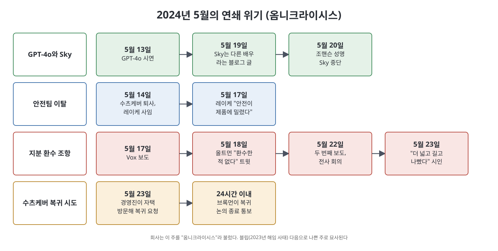

# 17장 청산 (Reckoning)

블립(2023년 해임 사태)이 끝난 뒤에도 OpenAI의 불안은 가라앉지 않았다. 이 장은 2024년 봄에서 5월 말까지, 안전 진영의 약화, GPT-4o 출시, 수츠케버와 레이케의 퇴사, 퇴직자 지분 환수 조항, 스칼릿 조핸슨 목소리 논란이 한꺼번에 터진 시기를 다룬다. 직원들은 이 시기를 "옴니크라이시스(Omnicrisis)"라고 불렀다. 저자는 이 사건들을 개별 사고가 아니라, 힘을 한곳에 모은 구조가 만드는 불안정의 연장으로 해석한다.

> **이 장을 한 문장으로**
> 책은 블립과 옴니크라이시스가 서로 다른 사건이 아니라, 소수에게 힘이 집중된 구조가 만드는 같은 진동이라고 해석한다.

---

## 이 장의 흐름

1. 블립 이후: 약해진 안전 진영, 올트먼의 AI 칩 구상
2. GPT-4o(코드명 스칼리언)와 무리한 출시 일정
3. 올트먼의 달라진 모습과 사방에서 오는 압력
4. 5월 중순의 연쇄 위기: 수츠케버·레이케 퇴사, 지분 환수 조항, 조핸슨
5. 전사 회의들과 수츠케버 복귀 시도의 무산

---

## 1. 약해진 안전 진영과 칩 구상

블립 후 수츠케버는 사무실로 돌아오지 않았다. 안전 진영(Safety clan)은 경영진과 이사회에서 대변자를 잃어 힘이 약해졌고, 새 이사회의 조사가 끝난 뒤에는 특히 AI가 재앙이 될 확률("p(doom)")을 높게 보는 사람들이 환멸을 느끼며 떠났다. 회사가 정보 유출을 이유로 해고했다고 밝힌 두 명도 있었다.

결정타 중 하나는 올트먼의 AI 칩 회사 구상이었다. 올트먼은 블립 직전부터 이 회사를 위해 자금을 모으고 있었고, 2024년 2월 최대 7조 달러를 모으려 한다는 보도가 나오자 "fk it why not 8"이라 트윗했다. 나중에 그는 7조 달러가 오보였다고 했다. 극단적 둠머(AI 위험을 매우 크게 보는 쪽)는 이를 비도덕적이라 봤다. 세계의 칩 공급을 늘리면 AI 개발이 더 빨라져 파국 위험이 커지기 때문이다. 이전에 올트먼은 업계의 가속이 "하드웨어 과잉"을 소진해서 자연스럽게 잦아든다고 말해 왔다. 사무실 면담 시간에 몇 명이 항의하자 올트먼은 "암 치료를 얼마나 미루고 위험을 피할 건가"라고 되물었다가, 곧 "절멸 위험이라면 무한정"이라고 말을 바꿨다고 한다. 이후 몇 명이 회사를 떠났다.

## 2. GPT-4o: 영화 Her를 향해

남은 조직은 영화 *Her*(AI 비서와의 사랑을 다룬 영화)가 보여 준 AI 비서라는 비전을 밀어붙였다. 소규모 모델로 기획됐던 스칼리언(Scallion)은 훈련 중 기대 이상의 성능을 보여, 더 오래 훈련해 GPT-4를 넘기기로 했다. 특징은 언어, 시각, 그리고 새로 더해진 **음성**을 하나의 모델로 다루는 것이다. 기존 음성 모드는 말을 글로 바꿔 모델에 넣고, 답을 다시 음성으로 바꾸는 방식이었다. 스칼리언은 목소리 자체를 바로 처리해 웃음, 외침, 머뭇거림 같은 단서를 읽고 음성으로 직접 답했다. 음성 연구를 이끈 알렉시스 코노는 모델이 10~15분간 스탠드업 코미디를 하고, 갑자기 웃거나 기침한 뒤 사과하는 등 "오디오 지능의 출현"을 봤다고 말했다.

올트먼과 브록먼은 5월 9일 출시라는 목표를 정했다. 구글 I/O(5월 14일), 3월에 나온 앤트로픽의 클로드 3, 개발 지연 중이던 오리온 때문이었다. 두 사람은 이를 "반복 배포(iterative deployment)", 즉 이른 시기에 자주 내놓고 사용자 피드백을 받는 전략으로 정당화했다. 응용 부문은 고되지만 신났지만, 약해진 안전 진영은 또 하나의 안전 후순위화로 봤다. 스칼리언은 작년 말 공개한 **대비 프레임워크(Preparedness Framework)** 아래 처음 나오는 출시였다. 한 안전 연구원은 메모에서 대비팀(알렉산더 마드리 이끎)이 평가에 쓸 시간이 열흘뿐이라 경고했다. 올트먼은 "5월 9일에 스칼리언을 출시한다"며 일정을 고수했다고 한다. 메모의 필자는 곧 회사를 떠났다.

출시는 지연됐고, 일부 기능은 몇 달 뒤에 나왔다. 그래도 5월 13일, 구글 I/O 하루 전에 시연회가 열렸다. 공식 이름은 GPT-4o(o는 omni, 여러 모달리티를 뜻함)다. 시스템 프롬프트(모델이 어떻게 말할지 정하는 지시문)는 "재치 있고 장난기 넘치는 동반자", "사람처럼 행동하라"는 내용이었고, 책은 비판적 표현을 피하도록 훈련된 점과 합쳐져 4o가 "플러팅 기계"가 됐다는 데일리 쇼의 풍자를 소개한다. 올트먼은 시연 직후 "her"라고 트윗했고, 전사 회의에서는 "챗GPT 이후 최고의 출시"라 했다. 그는 GPT-3, 4, 5 식 이름 대신 플래그십 모델을 "o1"로 부르겠다고도 했다. 영화 속 AI의 이름이 OS1이라는 것을 책은 짚는다. 곧 조핸슨의 에이전트가 전화를 걸어 무슨 생각이냐고 따졌다.

## 3. 달라진 올트먼, 사방의 압력

조사가 끝난 뒤 일부 직원은 올트먼이 흔들린다고 느꼈다. 그는 머스크와 대조되는 신중한 이미지를 관리해 왔고, 홍보 담당 부사장이었던 스티브 다울링은 "겸손하게, 덜 약속하고 더 해내라"는 기조를 강조했다. 그런데 올트먼은 3월 렉스 프리드먼 팟캐스트에서 "AGI로 가는 길은 거대한 권력 투쟁이어야 한다. 아니, 그럴 거라 예상한다"고 했고, 4월에는 AI 스타트업들에 "우리는 당신들을 짓밟을 것"이라 했으며, 5월에는 지능이 "물질의 창발 속성"이라며 들뜬 말을 했다. 4o와 구글 행사 사진을 나란히 놓고 "미학 차이"를 쓴 트윗도 직원들에게는 이례적이었다. 책은 이 모든 것을 "올트먼의 불안이 드러난 것"으로 읽고, 허세가 늘수록 사정이 나쁘다는 신호가 되어 갔다고 쓴다.

압력은 사방에서 왔다. 규제 당국의 조사(월스트리트저널에 따르면 SEC의 투자자 오도 여부 조사 포함), 뉴욕타임스의 저작권 소송과 작가·예술가·개발자들의 소송, 머스크의 새 소송이 겹쳤다. 마이크로소프트는 인플렉션 AI를 사실상 인수채용하며 포트폴리오를 분산했다. 책은 직원들이 "세상이 우리에게 등을 돌린다"고 느끼며 회사 로고를 가방 안쪽으로 숨기게 됐고, 회사는 비판에 귀를 닫는 쪽으로 움직였다고 묘사한다. 한 전직 직원은 "잘못은 대중에게 있다는 합리화가 시작됐다"고 말했다.

## 4. 5월 중순의 연쇄 위기

**수츠케버와 레이케의 퇴사(5월 14일)**: OpenAI는 수츠케버가 떠나고 파코츠키가 새 수석 과학자가 된다고 발표했다. 수츠케버는 올트먼 아래, 특히 브록먼과 함께는 안전한 AGI를 만들 환경이 아니라는 결론에 이르렀고, 회사는 거액으로 붙잡으려 했지만 거절했다. 같은 날 슈퍼얼라인먼트(AI가 인간 가치에서 벗어나지 않게 하는 연구) 공동 책임자 얀 레이케도 떠났고, 팀은 해체돼 존 슐먼 밑으로 흡수됐다. 5월 17일 레이케는 트윗으로 "안전 문화와 절차가 번쩍이는 제품에 밀렸다", 팀이 컴퓨팅 확보에도 어려움을 겪었다고 폭로했다. 15일 전사 회의에서는 무라티가 슈퍼얼라인먼트의 컴퓨팅 약속(전체의 20%)이 유지된다고 했고, 올트먼은 레이케가 그 점은 걱정하지 않았다고 이해한다고 말했다. 이후 레이케는 앤트로픽에 합류했다. 책은 이 싸움이 이제 회사 밖에서 이어진다고 쓴다.

**지분 환수 조항**: 17일 Vox의 켈시 파이퍼가 퇴사 시 평생 비방 금지 합의서에 서명하지 않으면 이미 확정된(vested) 지분을 잃는다는 사실을 보도했다. 정책 연구팀을 4월에 떠난 다니엘 코코타일로는 서명을 거부해 약 170만 달러, 가족 순자산의 약 85%에 해당하는 지분을 포기했다고 한다. 지분 환수는 실리콘밸리에서 건드리면 안 되는 선이라는 것이 책의 설명이다. 사내 슬랙에서 인사 책임자 줄리아 빌라그라는 지분을 취소한 적이 없다고 했고, 올트먼은 18일 "확정된 지분은 확정된 지분, 끝"이라며 "나는 몰랐고, 알았어야 했다"고 사과 겸 변명을 했다.

**조핸슨 목소리**: 5월 19일 OpenAI는 시연 목소리 "Sky"가 2023년 초 캐스팅한 다른 배우의 것이라는 글을 올렸다. 다음 날 조핸슨은 성명을 냈다. 올트먼이 2023년 9월에 직접 목소리 참여를 부탁했고, 그녀는 개인 사정으로 거절했으며, 올트먼이 시연 며칠 전 다시 연락했다는 것이다. 시연 목소리가 자신과 너무 닮아 충격을 받았고 변호사를 선임해 법적 서한을 두 번 보냈다고 했다. OpenAI는 Sky를 내리고 "소통을 잘못해 죄송하다"는 올트먼의 사과를 추가했다. 이 스캔들은 이사회가 말한 "일관되게 솔직하지 않다"는 의심을 다시 키웠고, AI 비평가 게리 마커스는 정책 결정에 영향을 줄 수 있다고 말했다.

### 연쇄 위기 한눈에 보기

| 구분 | 내용 | 회사의 대응 |
|------|------|------------|
| 안전 진영 이탈 | 수츠케버 퇴사, 레이케 사임 및 폭로 | 컴퓨팅 약속 유지 강조, AGI 대비 그룹 신설 |
| 지분 환수 | 퇴직 합의서의 비방 금지·지분 취소 조항 | 서류 수정, 사과, 이후 조항 폐지 |
| 목소리 논란 | Sky가 조핸슨 목소리와 닮았다는 지적 | Sky 중단, 사과문 |

## 5. 전사 회의와 수츠케버 복귀 시도

**5월 22일 전사 회의**: 제이슨 권은 지분 문제는 "용납할 수 없고" 수정 중이며, 조핸슨 건은 "아쉬운" 오해라고 했다. 무라티는 목소리 선정이 "완전한 우연"이었고 자신은 영화를 보지 않았다고 했다. 직원들은 분노했고, 일부는 변호사를 구해 서류를 직접 검토했다. 경영진에게 사전 인지 여부를 일일이 물었을 때 권은 안다고 했고, 무라티와 COO는 모른다고 했으며, 올트먼은 "특정 사례는 알았지만 모두에게 필수인 줄은 몰랐다, 내 눈을 벗어났다"고 했다. 그 사이 파이퍼의 두 번째 기사가 나와 인사팀이 서명을 압박하려 지분 취소 가능성을 명시했다고 보도했다. 코코타일로가 모은 자료를 근거로 한 것이다. 또 올트먼이 법인 설립 서류에 한 해 전(2023년 4월 10일) 서명한 사실이 기사에 나와 그의 해명이 의심받았다.

**5월 23일**: 올트먼은 "상황은 우리가 생각한 것보다 더 넓고 길고 나쁘다", "서류에 우리 이름이 있다", "지금까지 가장 크게 잘못한 일"이라 인정했다. 그러나 "수츠케버도 비방 금지 의무가 있느냐"는 질문에는 "없다, 맞을 거다"라고 답했다가 권이 "확인하고 100% 정확하게 알려 드리겠다"고 수습했다. 브록먼도 모호하게 답했다. 책은 많은 직원이 이때 처음으로 올트먼의 행동이 자신들을 해친다고 느꼈고, 이사회가 옳았을지 의심하기 시작했다고 쓴다.

같은 날 무라티, 브록먼, 파코츠키가 수츠케버의 집을 찾아 직원들의 카드와 선물을 주며 복귀를 눈물로 청했다. 올트먼도 늦게 혼자 찾아왔다. 수츠케버는 진지하게 고민했고(머스크의 xAI 제안은 이미 거절했다), 갈등을 정직하게 해결한다는 보장을 요구했다. 그러나 마드리가 반대했다고 책은 쓴다. 수츠케버의 영향력이 커져 자신과 친구 파코츠키의 영향력이 줄어든다는 이유다. 올트먼은 평소처럼 결정에서 빠졌고, 24시간 안에 브록먼이 복귀 논의는 끝났다고 통보했다.

저자는 여기서 해석을 덧붙인다. 옴니크라이시스는 회사가 신뢰 상실의 원인을 성찰할 기회였지만, 회사는 오히려 비판에 맞서 방어를 굳혔다. 블립과 옴니크라이시스는 많은 이에게서 빼앗아 소수에게 모은 "제국"이 만드는 불안정의 같은 경련이라는 것이다.

## 핵심 정리

- 블립 이후 안전 진영은 약해졌고, 올트먼의 칩 구상과 무리한 GPT-4o 출시 일정이 이탈을 가속했다고 책은 쓴다.
- 5월 중순에는 수츠케버·레이케 퇴사, 퇴직자 지분 환수 조항, 조핸슨 목소리 논란이 한 주 안에 겹쳐 "옴니크라이시스"가 됐다.
- 지분 환수 사건에서 경영진의 "몰랐다"는 해명이 문서로 흔들리며, 많은 직원이 처음으로 올트먼의 정직성에 의문을 품었다.
- 수츠케버 복귀 시도는 경영진 내부의 권력 다툼으로 무산됐고, 저자는 이를 제국 구조가 낳는 반복된 혼란으로 해석한다.

---

이전: [16장 첩보전](16%EC%9E%A5%20%EC%B2%A9%EB%B3%B4%EC%A0%84.md) | 다음: [18장 제국의 공식](18%EC%9E%A5%20%EC%A0%9C%EA%B5%AD%EC%9D%98%20%EA%B3%B5%EC%8B%9D.md)
