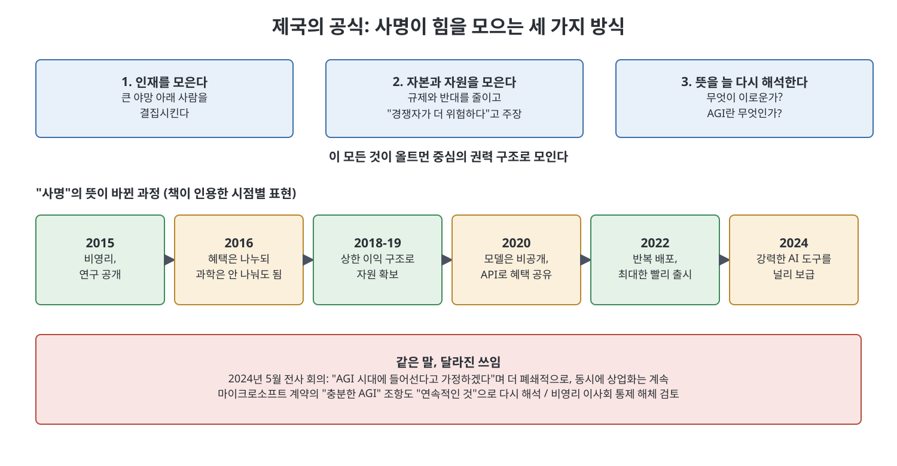

# 18장 제국의 공식 (A Formula for Empire)

4부의 마지막 장은 사건 서술에서 한 발 물러나 저자의 핵심 주장을 정리한다. 올트먼이 나폴레옹의 책을 좋아한다고 말한 일화에서 출발해, OpenAI의 "AGI가 인류 전체에 이롭도록 하겠다"는 사명이 어떻게 인재, 자본, 권력을 모으는 공식이 됐는지 세 가지 재료로 설명한다. 이어서 2024년 하반기에 벌어진 경영진 이탈, 대형 투자 유치, 영리 구조로의 전환 발표를 훑는다. 이 장의 해석은 저자의 주장이며, 책은 이를 "나는 확신하게 됐다"는 식으로 밝힌다.

> **이 장을 한 문장으로**
> 저자는 OpenAI의 사명이 진심에서 출발했을지 몰라도 지금은 힘을 한곳에 모으는 도구가 됐다고 주장한다.

---

## 이 장의 흐름

1. 올트먼과 나폴레옹: 슬로건을 권력에 쓰는 법
2. 세 가지 재료: 인재, 자본, 모호한 정의
3. 사명의 뜻이 바뀐 과정(2015년에서 2024년까지)
4. 구조를 바꾸려는 움직임: 비영리 통제의 해체
5. 2024년 하반기: 경영진 이탈, 대형 투자, 전환 발표

---

## 1. 나폴레옹의 일화

올트먼은 2018년 가장 인상 깊게 읽은 책으로 『나폴레옹의 정신(The Mind of Napoleon)』을 꼽았다. 나폴레옹의 말을 모은 책이다. 그는 "분명 심각한 결함이 있는 인물이지만 인상적"이라고 하면서, 나폴레옹이 인간 심리를 깊게 이해했다고 말했다. 가장 와닿은 대목은 프랑스 혁명의 구호 "자유, 평등, 박애"를 나폴레옹이 자기 권력 강화에 재해석한 부분이었다. 책에 따르면 실제로 그는 자유를 제한하고, 박애를 외면했으며, 평등은 프랑스 남성에게만 인정했고, 식민지 노예제를 다시 도입했다. 올트먼은 "통제하는 시스템을 만드는 법"을 말한 것으로 이해했고 "그가 미국을 이끌지 않아 다행"이라고 농담처럼 말했다.

**쉽게 말하면**: 같은 구호도 누가 어떻게 풀이하느냐에 따라 전혀 다른 일을 정당화할 수 있다. 저자는 이 일화를 OpenAI의 사명에 겹쳐 읽는다.

## 2. 제국의 공식 세 가지 재료

저자는 6년 전 OpenAI의 이타성을 의심했고, 이제는 이 사명이 처음에는 진심 어린 이상주의였을 수 있어도 지금은 "제국 같은 권력 구조"를 만드는 강력한 공식이 됐다고 확신한다고 쓴다.

| 재료 | 설명 | 책이 드는 근거 |
|------|------|---------------|
| 인재 집중 | 큰 야망으로 사람을 모은다. 존 매카시가 "인공지능"이라는 말을 지은 방식과 같다. | 올트먼의 2013년 블로그: 최고의 창업가는 회사가 아니라 "종교에 가까운 것"을 만들려 한다 |
| 자본·자원 집중, 장애물 제거 | 혁신과 진보를 위해서라면 어떤 대가도 치르겠다는 논리로 규제와 반대를 줄인다. 무서운 경쟁자가 있다는 주장이 힘을 더한다. | 올트먼의 2024년 7월 워싱턴포스트 기고: 미국과 동맹국 주도 AI인가, 권위주의 국가 주도 AI인가 |
| 모호한 정의 | 무엇이 이로운가, AGI가 무엇인가가 불분명해 중앙화하는 쪽이 마음대로 재해석한다. | 올트먼이 뉴욕타임스에 한 말: AGI는 "터무니없고 무의미한 용어"라 계속 써서 미안하다 |

세 번째가 가장 중대하다고 저자는 본다. 이 재료 덕분에 사명은 상황에 맞게 늘어난다.

## 3. 사명의 뜻은 어떻게 바뀌었나

책이 인용하는 시점별 표현을 따라가면 다음과 같다.

| 시점 | 사명의 뜻(책이 인용한 표현) |
|------|--------------------------|
| 2015 | 수익 창출 부담이 없는 비영리, 연구 공개 |
| 2016 | 모두가 AI의 혜택을 누려야 하지만 과학을 공유하지 않아도 된다(수츠케버가 올트먼, 브록먼, 머스크에게 쓴 말) |
| 2018~2019 | 상한 이익 구조로 막대한 자원을 모으되, 안전 대책 없는 경쟁을 피한다(헌장) |
| 2020 | 모델은 가두고, API를 "개방과 혜택 공유의 전략"으로 삼는다(올트먼) |
| 2022 | "반복 배포"와 챗GPT를 최대한 빨리 내놓는 것 |
| 2024 | 매우 유능한 AI 도구를 무료 또는 저렴하게 사람들 손에 쥐여 주는 것(GPT-4o 출시 후 블로그) |

2024년 5월 15일 전사 회의에서 올트먼은 "이제 우리는 AGI 시대에 들어서고 있다고 가정할 것"이라며, 사명을 위해 더 폐쇄적이어야 하고 로비와 대외 메시지에 더 힘써야 한다고 말했다. 동시에 제품 출시, 연구, 제휴는 늦추지 않는다고 했다. 마이크로소프트와의 계약에 있던 "충분한 AGI 조항"(OpenAI가 AGI에 도달하면 기술 공유를 멈추는 조건)도 이제는 명확한 시점이 없고 "계속되는 과정"으로 본다고 했다. 5월 말에는 애플 제품에 OpenAI 모델을 넣는 계약이 보도됐다. 저자는 이 일관성 없어 보이는 전략이 단 하나의 해석에서만 말이 된다고 평한다. OpenAI는 지배력을 굳히려고 필요한 모든 일을 하고, 그에 맞춰 사명을 다시 해석한다는 것이다.

## 4. 구조를 바꾸려는 움직임

저자는 블립이 비영리가 영리 법인을 통제하는 구조 때문에 올트먼의 해임이 사실상 필연이었음을 보여 줬다고 본다. 이사회가 올트먼이 사명에 부합하는지를 자기 해석으로 판단해 해임할 수 있었고, 같은 갈등이 다시 일어날 수 있었다. 올트먼은 이 구조를 바꾸는 준비에 들어갔다.

- 5월 28일 직원이 슬랙에서 최신 주주 계약에 비영리 해체를 허용하는 대목이 있다며 "비영리는 얼마나 단단한가"를 물었다.
- 이튿날 The Information이 올트먼의 올해 최우선 과제에 영리 회사에 가까운 구조 재편이 있다고 보도했다. 이후 일반 영리 법인 전환이나 앤트로픽, xAI 같은 영리 공익법인(PBC)으로의 전환이 거론됐고, 두 경우 모두 비영리는 남되 이사회의 사업 통제는 사라진다. 투자자들은 올트먼이 지분을 갖기를 압박했다.
- 한편 둠머 쪽 압력은 커졌다. 6월 4일 뉴욕타임스가 코코타일로와 그가 주도한 투명성·내부 고발자 보호 캠페인을 소개했고, 코코타일로 외 서명자 12명 중 10명이 안전 진영 출신이었다. 7월에는 SEC에 퇴직 합의서가 내부 고발자 보호를 어긴다는 진정이 접수됐고, 상원의원 5명이 질의 서한을 보냈다.

## 5. 2024년 하반기

내부 개편과 이탈이 이어졌다. 브록먼은 무라티가 아니라 올트먼에게 보고하게 됐고, 마드리는 대비팀에서 작은 연구직으로 옮겨졌다. 새 CFO 새라 프라이어(전 넥스트도어 CEO)와 새 최고제품책임자 케빈 웨일(전 페이스북·인스타그램·트위터)이 합류했다. 8월 5일 존 슐먼은 앤트로픽으로 떠났고, 같은 날 브록먼은 연말까지 안식휴가를 발표했다. 9월 25일에는 이사회에 우려를 전했던 무라티가 갑자기 떠난다고 알렸고, 몇 시간 안에 최고연구책임자 밥 맥그루와 배럿 조프도 뒤를 이었다. 올트먼은 "서로 독립적이고 원만한 결정"이라고 설명했다. 마크 첸이 연구 부문 선임 부사장, 조슈아 아키암이 사명 정렬(mission alignment) 책임자로 올랐고, CTO 후임은 당분간 뽑지 않는다고 했다.

책은 이때가 사실 최악의 시기였다고 쓴다. 머스크는 xAI의 컴퓨팅 증설을 서둘렀고, 앤트로픽의 클로드는 고객을 가져갔으며, 수츠케버는 새 회사 세이프 슈퍼인텔리전스를 세워 10억 달러를 확보했다. 오리온은 1년 넘게 기대 성능에 못 미쳤다. 책은 "스케일링이라는 검증된 공식만으로는 부족해 보이고 새 연구 아이디어가 필요한 상황"이었지만, OpenAI는 기존 연구를 활용하는 쪽에 조직을 맞춰 왔다고 평가한다. 9월 23일 올트먼은 "지능의 시대" 글에서 딥러닝이 통했고, 규모에 따라 예측 가능하게 좋아졌으며, 우리가 더 많은 자원을 쏟았다고 썼다.

10월 초 OpenAI는 66억 달러를 유치했다. 사상 최대 규모의 벤처 투자였고 기업가치는 1570억 달러였지만, 2년 안에 영리로 전환하지 못하면 투자자가 돈을 돌려받을 수 있다는 조건이 붙었다. 이후에도 루크 메츠, 마일스 브런디지, 릴리언 웡, 알렉 래드퍼드 등이 떠났다. 앤트로픽은 샌프란시스코 광고판에 "드라마 없는 쪽"이라는 문구를 내걸었다. 애니는 올트먼에게 소송 의사를 알리는 법률 서한을 보냈다. 머스크는 트럼프와 가까워진 채 소송을 키우며 영리 전환에 반대했고 더 많은 초기 이메일을 공개했으며, 메타도 캘리포니아 법무장관에게 전환 저지를 요청했다. 연말에 OpenAI는 영리 공익법인으로 전환하고 비영리는 그 지분을 가진 별도 조직으로 남는 구조를 공식 발표했다. 2025년 1월 6일 올트먼은 "우리가 전통적으로 이해한 AGI를 만드는 방법을 안다고 확신한다"며 초지능을 언급했다.

### 이 장의 주요 인물

| 인물 | 이 장에서의 모습 |
|------|---------------|
| 샘 올트먼 | 나폴레옹을 읽고, 사명을 재해석하며 구조 전환을 추진 |
| 미라 무라티, 밥 맥그루, 배럿 조프 | 2024년 9월 한꺼번에 퇴사 |
| 존 슐먼 | 8월 앤트로픽으로 이직 |
| 일리야 수츠케버 | 세이프 슈퍼인텔리전스 설립 |
| 일론 머스크 | 영리 전환에 반대해 소송을 키움 |

## 핵심 정리

- 저자의 주장: 사명은 인재 집중, 자본·자원 집중, 모호한 정의라는 세 재료로 힘을 한곳에 모으는 공식이다.
- 사명의 뜻은 2015년부터 2024년까지 시점마다 달라졌고, 매번 그 시점의 전략을 정당화하는 쪽으로 해석됐다.
- 블립으로 비영리 통제의 위험을 확인한 올트먼은 구조 재편을 준비했고, 연말에 영리 공익법인 전환을 발표했다.
- 2024년 하반기 무라티, 슐먼 등 핵심 인물이 떠났지만, 저자의 표현으로 OpenAI는 여전히 "올트먼의 AI 제국"이다.

---

이전: [17장 청산](17%EC%9E%A5%20%EC%B2%AD%EC%82%B0.md) | 다음: [에필로그](../05.%20%EC%97%90%ED%95%84%EB%A1%9C%EA%B7%B8/Readme.md)
