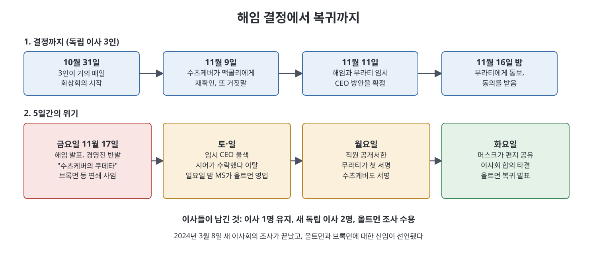

# 4부 개요 (15~18장)

4부는 챗GPT 이후 OpenAI 내부에서 터진 두 번의 큰 위기, 2023년 11월의 올트먼 해임과 복귀(블립), 2024년 5월의 연쇄 위기(옴니크라이시스)를 다룬다. 15장은 해임으로 가는 가을, 16장은 해임 결정과 5일간의 반전, 17장은 이듬해 봄의 후폭풍, 18장은 저자가 이 모든 것을 "제국의 공식"으로 정리하는 대목이다.

> **이 부를 한 문장으로**
> 올트먼을 둘러싼 불신은 이사회의 해임으로 터졌고, 해임은 실패했으며, 그 뒤 OpenAI는 더 올트먼 중심의 구조로 나아갔다고 책은 그린다.

---

## 0. 먼저 알아 둘 것: 4부의 배경

3부까지 OpenAI는 비영리 연구소에서 출발해 영리 자회사를 두고, 챗GPT로 세계적 기업이 됐다. 이 과정에서 두 진영의 갈등이 커졌다. 책은 AI의 혜택을 크게 보고 빠른 배포를 원하는 쪽을 "부머(Boomer)", 파국 위험을 크게 보고 속도를 늦추려는 쪽을 "둠머(Doomer)"라고 부른다. 4부는 이 갈등과 CEO 올트먼에 대한 신뢰 문제가 한꺼번에 터지는 시기다.

## 1. 핵심 요점

- **불신은 경영진에서 이사회로 흘렀다**: 무라티와 수츠케버가 독립 이사 토너에게 올트먼이 사람마다 다른 말을 한다고 전했다.
- **이사회는 해임했지만 설득에 실패했다**: 직원 서한, 마이크로소프트의 영입 발표, 무라티와 수츠케버의 입장 변화로 5일 만에 올트먼이 복귀했다.
- **블립 뒤 안전 진영이 약해졌다**: 수츠케버, 레이케가 떠나고, 지분 환수 조항과 조핸슨 목소리 논란이 겹쳤다.
- **저자의 결론**: 사명이 인재, 자본, 모호한 정의를 한곳에 모으는 공식이고, 구조는 영리 공익법인으로 옮겨 간다.

---

## 2. 문서 목록

| 순서 | 문서 | 이런 질문에 답한다 |
|:---:|------|------------------|
| 1 | [15장 도박수](15%EC%9E%A5%20%EB%8F%84%EB%B0%95%EC%88%98.md) | 무라티와 수츠케버는 왜 토너에게 갔나? |
| 2 | [16장 첩보전](16%EC%9E%A5%20%EC%B2%A9%EB%B3%B4%EC%A0%84.md) | 이사회는 어떻게 해임했고, 왜 5일 만에 뒤집혔나? |
| 3 | [17장 청산](17%EC%9E%A5%20%EC%B2%AD%EC%82%B0.md) | 블립 이후 5월에 무슨 일이 한꺼번에 일어났나? |
| 4 | [18장 제국의 공식](18%EC%9E%A5%20%EC%A0%9C%EA%B5%AD%EC%9D%98%20%EA%B3%B5%EC%8B%9D.md) | 저자는 OpenAI의 사명을 어떻게 해석하나? |
| 5 | [핵심 정리](%ED%95%B5%EC%8B%AC%20%EC%A0%95%EB%A6%AC.md) | 4부 전체를 빠르게 복습하려면? |

- **15장 도박수**: 무라티, 수츠케버, 토너의 10월 통화 일지와 논문 사건
- **16장 첩보전**: 독립 이사 3인의 결정, 5일 위기, 머스크의 편지와 저자의 취재, 조사 결과
- **17장 청산**: GPT-4o, 수츠케버·레이케 퇴사, 지분 환수 조항, 조핸슨 논란
- **18장 제국의 공식**: 제국의 세 재료, 사명의 변천, 영리 전환 발표

## 3. 연표

| 시점 | 사건 |
|------|------|
| 2023년 9~10월 | 무라티와 수츠케버가 토너와 접촉 |
| 2023년 10월 31일 | 독립 이사 3인이 거의 매일 논의 시작 |
| 2023년 11월 17일 | 올트먼 해임 발표 |
| 2023년 11월, 위기 닷새째(화요일) | 올트먼 복귀 발표(책은 화요일 오후 직후라고 서술) |
| 2024년 3월 8일 | 새 이사회의 조사 종료, 올트먼과 브록먼 신임 |
| 2024년 5월 13일 | GPT-4o 시연 |
| 2024년 5월 14~23일 | 수츠케버·레이케 퇴사, 지분 환수 논란, 조핸슨 성명 |
| 2024년 8~9월 | 슐먼, 무라티, 맥그루, 조프 이탈 |
| 2024년 10월 | 66억 달러 투자 유치(기업가치 1570억 달러) |
| 2024년 말 | 영리 공익법인 전환 계획 발표 |

## 4. 인물 표

| 인물 | 처음 풀이 |
|------|-----------|
| 샘 올트먼 | OpenAI CEO. 해임되었다가 복귀한다. |
| 미라 무라티 | CTO. 올트먼 뒷수습을 하며 이사회에 우려를 전했고 2024년 9월 퇴사했다. |
| 일리야 수츠케버 | 공동창업자이자 수석 과학자. 해임을 주도했다가 서한에 서명했고 2024년 5월 떠났다. |
| 그레그 브록먼 | 공동창업자 겸 이사. 해임 직후 항의 사임했다가 복귀했다. |
| 헬렌 토너, 타샤 맥콜리, 애덤 디안젤로 | 비영리 이사회의 독립 이사 3인. |
| 야쿠프 파코츠키 | 연구 리더. 수츠케버 후임 수석 과학자가 된다. |
| 얀 레이케 | 슈퍼얼라인먼트 공동 책임자. 5월에 사임하며 안전 문화 문제를 공개했다. |
| 다니엘 코코타일로 | 정책 연구팀 출신. 퇴직 합의서 서명을 거부해 지분 포기를 택했다. |
| 켈시 파이퍼 | Vox 기자. 지분 환수 조항을 보도했다. |
| 스칼릿 조핸슨 | 영화 *Her*의 목소리 배우. GPT-4o 목소리 논란의 당사자. |
| 래리 서머스, 브렛 테일러 | 위기 후 새 이사회를 이끌고 올트먼 조사를 감독했다. |

## 5. 용어 표

| 용어 | 쉬운 설명 |
|------|-----------|
| 블립(The Blip) | 2023년 11월의 해임과 복귀 소동을 직원들이 부른 이름 |
| 옴니크라이시스 | 2024년 5월의 연쇄 위기를 직원들이 부른 이름 |
| 독립 이사 | 경영진이 아닌 위치에서 CEO를 감독하는 이사 |
| DSB | 신모델 배포 전 안전 심사 기구 |
| Q* / 스트로베리 | 답을 만들 때 계산을 더 써서 추론력을 높이려는 연구 |
| 대비 프레임워크 | 모델의 위험한 능력을 출시 전 평가하는 절차 |
| 지분 환수(clawback) 조항 | 퇴직 시 확정 지분을 되찾을 수 있다는 조건 |
| 영리 공익법인(PBC) | 이익과 공익 목적을 함께 내세우는 영리 회사 형태 |

 
